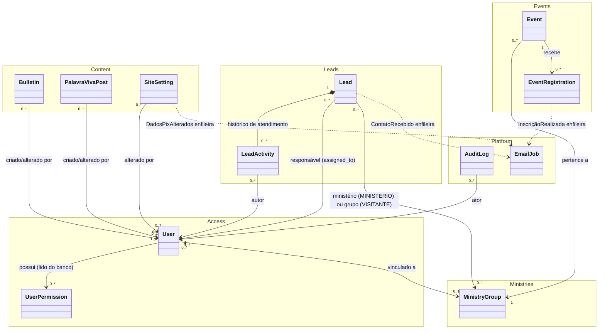
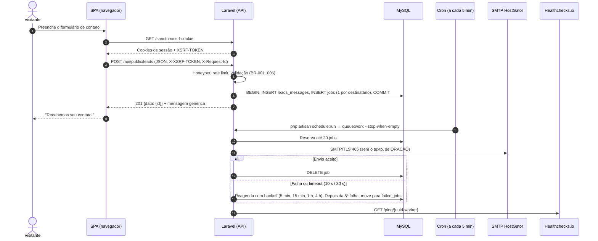
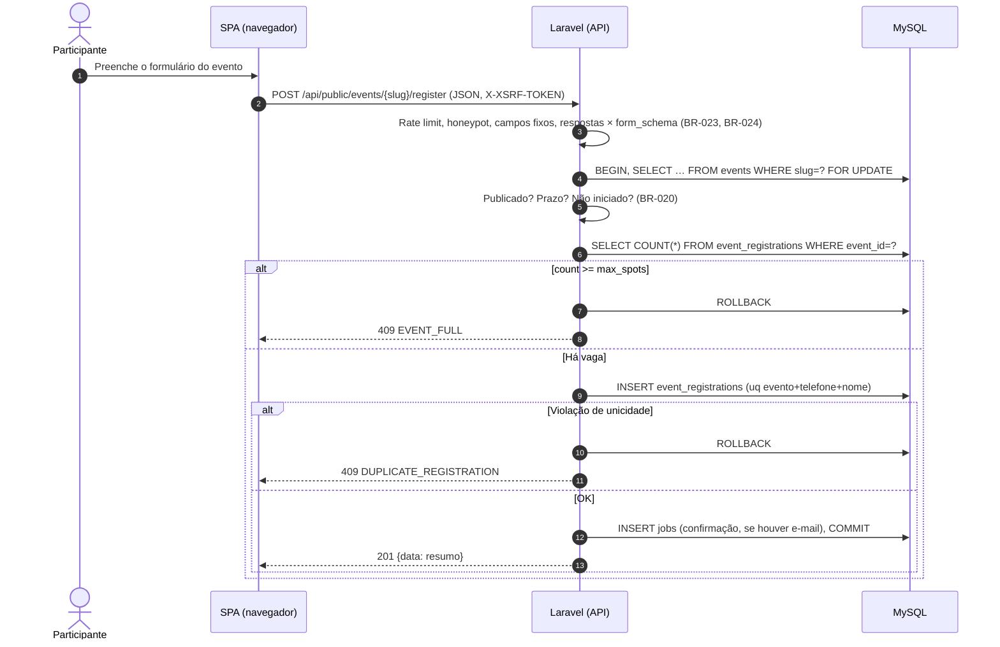
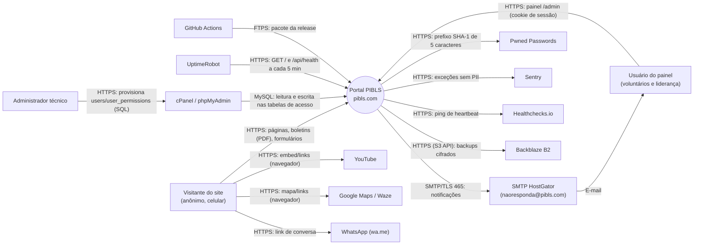
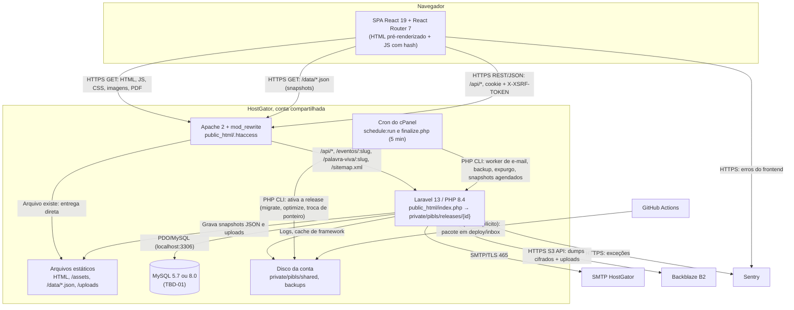
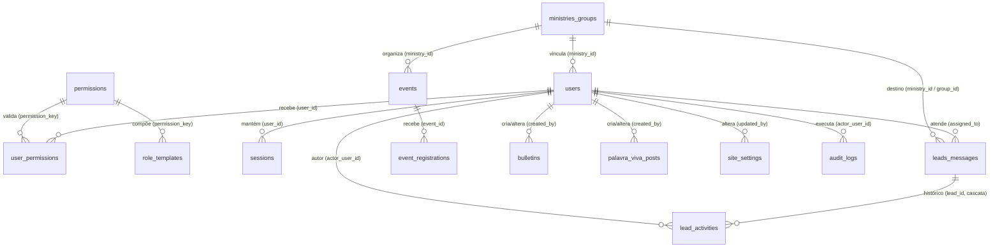
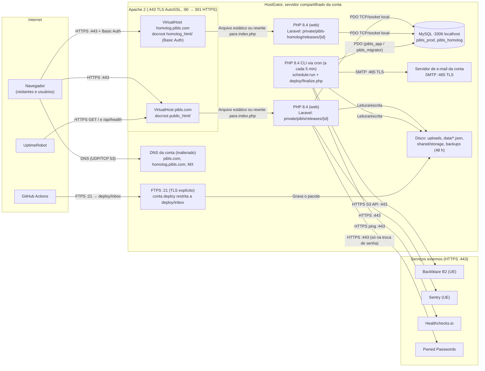
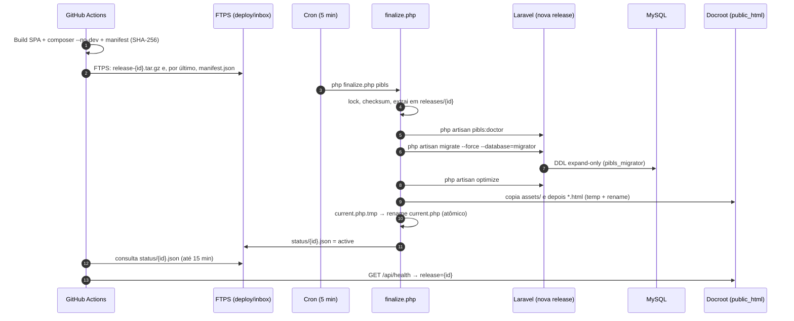

# Architecture — Novo Portal PIBLS (pibls.com)

> Documento-fonte único da arquitetura do Novo Portal PIBLS. Auto-contido: reúne as decisões com rationale e a especificação prescritiva necessária para implementar o sistema.
>
> **Entradas**: `prd.md` (v0.1, 2026-10-19) e *Especificação de Produto e Arquitetura — Novo Portal PIBLS* (PDF, Parte 2).
> **Modo do processo**: Context dump nas Etapas 1–4, cada uma confirmada pelo responsável. Nas Etapas 5–23, **Best guess sem confirmação por etapa**, por instrução explícita do responsável em 2026-10-19 ("faça toda arquitetura seguindo o padrão recomendado por você e no final me passe as dúvidas"). As decisões dessas etapas são recomendações do arquiteto. As que mudam algo já confirmado nas Etapas 1–4, ou que dependem de terceiros, estão listadas em **Final Recommendations → Dúvidas para o responsável** e/ou em `to-be-determined.md`. · Profundidade Full (23 etapas).
>
> **Revisão de 2026-10-19 (após a entrega)**: o responsável tornou obrigatório o uso de **Tailwind CSS e shadcn/ui** em toda a interface (restrição C-01, ADR-018). A compatibilidade com a HostGator foi verificada: os dois atuam só no build, e o servidor recebe apenas arquivos estáticos.

## Progresso do processo

| Etapa | Nome | Status |
|---|---|---|
| 1 | Contexto do Produto | Concluída |
| 2 | Contexto de Time e Operação | Concluída |
| 3 | Requisitos Funcionais | Concluída |
| 4 | Requisitos Não Funcionais | Concluída |
| 5 | Modelagem de Domínio | Concluída (Best guess) |
| 6 | Estado Atual e Migração | Concluída (Best guess) |
| 7 | Integrações Externas | Concluída (Best guess) |
| 8 | Arquitetura | Concluída (Best guess) |
| 9 | Banco de Dados | Concluída (Best guess) |
| 10 | APIs | Concluída (Best guess) |
| 11 | Segurança | Concluída (Best guess) |
| 12 | Infraestrutura | Concluída (Best guess) |
| 13 | DevOps | Concluída (Best guess) |
| 14 | Observabilidade | Concluída (Best guess) |
| 15 | Performance | Concluída (Best guess) |
| 16 | Escalabilidade | Concluída (Best guess) |
| 17 | Testes | Concluída (Best guess) |
| 18 | Internacionalização e Localização | Concluída (Best guess) |
| 19 | Documentação e Developer Experience | Concluída (Best guess) |
| 20 | Riscos | Concluída (Best guess) |
| 21 | Análise de Custo | Concluída (Best guess) |
| 22 | Revisão da Arquitetura | Concluída (Best guess) |
| 23 | Aprovação Final | **Aguardando sign-off do responsável** e o resultado da PoC (TBD-05, bloqueante) |

---

# Product Overview

## Propósito do sistema

O Novo Portal PIBLS é a aplicação web **pública** da Primeira Igreja Batista em Lagoa Santa (pibls.com). Ela substitui o site WordPress atual, na mesma conta HostGator, e cumpre dois papéis: **portfólio institucional** para visitantes (história, crenças, horários, ministérios, grupos, localização) e **hub digital** para membros e os ministérios (boletins em PDF, mensagens Palavra Viva, eventos com inscrição online, contribuição via PIX, formulários de contato).

O sistema inclui um **Painel Administrativo restrito** (`/admin`) em que a equipe da igreja publica conteúdo, gerencia eventos e inscrições, atende os contatos recebidos e atualiza dados institucionais sem alterar código. É uma aplicação de **organização única** (*single-tenant*), não comercializada como SaaS.

## Perfis de usuário

| Perfil | Autenticado | O que faz no sistema |
|---|---|---|
| **Público anônimo** (visitante e membro) | Não | Lê conteúdo institucional, boletins e mensagens; envia formulários de contato; se inscreve em eventos; copia a chave PIX. O sistema **não distingue** visitante de membro. |
| **Operador do painel** (Comunicação, Secretaria, Tesouraria, líderes de ministério, liderança pastoral) | Sim | Acessa apenas os módulos permitidos pelas permissões provisionadas no banco (`role_code` + `permission_key`). |
| **Administrador técnico** | Fora da aplicação | Cria, altera e desativa usuários e permissões diretamente no MySQL via cPanel/phpMyAdmin. Não existe papel de superadministrador na interface. |

## Stakeholders

| Stakeholder | Papel no projeto | Decide |
|---|---|---|
| **Responsável pelo projeto** (claude@rumosolucoes.com) | Dono técnico e de produto | Aprova a arquitetura (sign-off da Etapa 23) e decide escopo e prioridades de produto |
| **Liderança pastoral** (Pastor titular) | Patrocinador institucional | Conteúdo pastoral e decisões de exposição pública (ex.: endereço das Células de CL) |
| **Comunicação, Secretaria, Tesouraria** | Operadores e donos de conteúdo | Conteúdo editorial, dados de contato, dados PIX |
| **Administrador técnico** | Operação da hospedagem | Provisionamento de usuários, acesso ao cPanel, backups |

## Escopo

- **Dentro**: todos os épicos E1 a E8 do PRD (`prd.md`, seções 5 e 7). Banco, API e modelo de permissões cobrem **R1 e R2** (eventos) desde já; a entrega pode ser fatiada, mas o modelo não.
- **Fora**: itens da seção 8 do PRD. Entre eles: criação de usuários pela interface, área logada de membros, ChMS, gateway de pagamento, streaming próprio, app nativo, automação de WhatsApp, infraestrutura paga e mudança de DNS/e-mail.

## Links úteis

| Recurso | Local |
|---|---|
| PRD de origem | `prd.md` (v0.1, 2026-10-19) |
| Especificação de Produto e Arquitetura (documento-base) | `Especificação de Produto e Arquitetura - Novo Portal PIBLS.pdf` |
| Guia Institucional (conteúdo oficial) | `Guia Institucional - (PIBLS).pdf` |
| Compatibilidades da HostGator (referência obrigatória de versões) | https://suporte.hostgator.com.br/hc/pt-br/articles/30811116692115-Quais-s%C3%A3o-as-compatibilidades-da-HostGator |
| Repositório de código | Monorepo **privado no GitHub**, a ser criado na tarefa F0-01 (DevOps). Hoje a pasta do projeto não é um repositório Git. |

# Business Goals

## Objetivos que a arquitetura precisa sustentar

| ID | Objetivo | Restrição técnica imposta |
|---|---|---|
| BG-1 | **Custo adicional zero** | Execução exclusiva na hospedagem compartilhada HostGator já contratada (Apache + PHP + MySQL). Sem runtime Node.js no servidor, sem processos residentes, sem serviços pagos. |
| BG-2 | **Preservação do e-mail institucional** | Nenhuma alteração de nameservers ou registros MX/SPF/DKIM. Deploy na mesma conta cPanel do WordPress atual. |
| BG-3 | **Autonomia editorial** | Todo conteúdo mutável (horários, líderes, Células de CL, PIX, links) vem do banco via API, nunca de constantes no código. Alterações não exigem build nem deploy. |
| BG-4 | **Governança de acesso** | Usuários e permissões são criados só no MySQL; a aplicação apenas lê esses registros para autenticar e autorizar. |
| BG-5 | **Alcance de visitantes pela busca orgânica** | As páginas públicas precisam ser indexáveis e ter pré-visualização correta no WhatsApp (Open Graph). Daí a decisão de SPA com pré-renderização. |
| BG-6 | **Conformidade com a LGPD** | Pedidos de oração e fichas de visitante revelam convicção religiosa (dado sensível, LGPD art. 5º, II, e art. 11). Exige acesso restrito, consentimento e política de retenção. |

## Restrições confirmadas

| ID | Restrição | Origem |
|---|---|---|
| C-01 | **Stack obrigatória**: frontend React + Vite + TypeScript, com **Tailwind CSS** para estilo e **shadcn/ui** para componentes (ADR-018); backend PHP 8.x **com framework**; MySQL; hospedagem compartilhada HostGator. | Documento-base, confirmado pelo responsável. Tailwind CSS e shadcn/ui acrescentados pelo responsável em 2026-10-19 |
| C-02 | **SPA com pré-renderização** das páginas públicas no build, em vez de SPA renderizada só no cliente. | Responsável pelo projeto |
| C-03 | **Framework PHP**: escolhido na Etapa 8 entre opções que funcionam em hospedagem compartilhada (sem processo residente; dependências do Composer enviadas prontas, se não houver Composer/SSH no servidor). | Responsável pelo projeto |
| C-04 | **Modelagem completa R1 + R2**: schema, API e permissões cobrem eventos e inscrições desde a primeira versão. | Responsável pelo projeto |

## Horizonte de vida

- **Mais de 5 anos** em produção. Prioridade para manutenibilidade, poucas dependências, versões de linguagem e framework com suporte de longo prazo e documentação que permita a troca de mantenedores ao longo do tempo.
- **Sem data-alvo de go-live**. Qualidade e segurança têm prioridade sobre velocidade de entrega.
- Implicação levada à Etapa 8: com horizonte de mais de 5 anos, a versão mínima de PHP deve ter suporte de segurança garantido pelo maior prazo possível. Pelo calendário oficial (php.net/supported-versions), o PHP 8.2 sai de suporte de segurança em 31/12/2026; as versões 8.4 e 8.5 vão até 2028 e 2029.

## Compatibilidades da hospedagem compartilhada (HostGator)

> **Regra do projeto**: em qualquer dúvida de versão ou compatibilidade, a referência é a página oficial de compatibilidades da HostGator (ver Links úteis). A página não tem data de atualização (rodapé "© 2025"); consultada em 2026-10-19. Valores abaixo valem para os planos compartilhados (Start, P, M, Turbo, Plus e Revenda).

| Recurso | Compartilhada | Impacto na arquitetura |
|---|---|---|
| PHP 8.2 a 8.5 | ✓ (8.0, 8.1 e 7.4 ✗) | Faixa de versões do C-01 confirmada. Versão escolhida na Etapa 8. |
| Módulos PHP/PECL; `pdo_mysql`, MySQLi, cURL, GD2, ImageMagick, mbstring, zlib, iconv, tokenizer, `shell_exec` | ✓ | PDO disponível; GD/ImageMagick permitem tratar banners e imagens. |
| **Cache de opcode (OPcache/APC/XCache)** | **✗** | Sem cache de bytecode, todo request recompila os arquivos PHP. Frameworks com boot pesado ficam mais lentos. **Critério obrigatório na escolha do framework (Etapa 8).** |
| Laravel 10 e 11 | ✓ (citados nominalmente) | As duas versões estão fora do suporte de segurança em 2026-10. Versões mais novas não estão listadas, mas dependem só da versão de PHP e das extensões. Avaliar na Etapa 8. |
| Node.js | ✗ | Confirma o build local; só os artefatos estáticos (`dist/`) vão para o servidor. A pré-renderização (C-02) acontece no build. Tailwind CSS e shadcn/ui também atuam só no build: o servidor recebe CSS e JS prontos (ADR-018). |
| **SSH** | **✗** | Sem `composer install` nem comandos no servidor: `vendor/` vai pronto e o deploy é por FTP/SFTP do cPanel, Gerenciador de Arquivos ou cliente Git do cPanel. Detalhado na Etapa 13. |
| Cliente Git | ✓ (servidor Git ✗) | Possível usar o "Git Version Control" do cPanel para puxar de um repositório remoto. Avaliar na Etapa 13. |
| Tarefas cron | ✓ | Permite jobs agendados (ex.: reenvio de e-mails que falharam, expurgo por retenção LGPD). |
| Apache 2 com `mod_rewrite` e `mod_security` | ✓ (nginx ✗) | `.htaccess` para reescrita da SPA e da API. O `mod_security` pode bloquear requisições legítimas; validar nos testes. |
| **MySQL** | **5.7** em servidores `br00`/`sh-pro00` (CentOS) ou **8.0** em servidores `sh0000`/`rs000`/`sh-pro00000` (AlmaLinux); MariaDB ✗ | A versão depende do servidor da conta. O schema precisa ser compatível com a versão real. ⚠️ Pendente — ver to-be-determined.md (TBD-01) |
| SSL wildcard/multidomínio | ✓ | HTTPS no domínio. Detalhado na Etapa 12. |
| Docker, xdebug, nginx | ✗ | Sem contêiner em produção. Ambiente local pode usar contêiner, mas deve reproduzir Apache + PHP sem OPcache. |
| Limites da conta (memória PHP, `upload_max_filesize`, `max_execution_time`, e-mails/hora, inodes) | **Não informados na página** | Afetam upload de boletins, exportação de PDF e envio de e-mails. ⚠️ Pendente — ver to-be-determined.md (TBD-02) |

# Team & Operations Profile

## Tamanho do time

- **Hoje**: 1 desenvolvedor (o responsável pelo projeto) trabalhando com um agente de código (Claude Code).
- **Projeção em 12 meses**: sem expansão prevista. A mesma pessoa desenvolve e opera.

## Experiência com a stack

| Tecnologia | Nível |
|---|---|
| React + TypeScript | Sólida |
| PHP com Laravel | Sólida |
| MySQL | Sólida |

## Responsável por camada

| Camada | Responsável |
|---|---|
| Frontend | Responsável pelo projeto |
| Backend | Responsável pelo projeto |
| Banco de dados | Responsável pelo projeto |
| Infraestrutura (cPanel, DNS, SSL, backups) | Responsável pelo projeto |
| Segurança | Responsável pelo projeto |
| Provisionamento de usuários e permissões (administrador técnico) | Responsável pelo projeto |
| Conteúdo (boletins, eventos, contatos, dados institucionais) | Voluntários da Comunicação, Secretaria e Tesouraria, pelo painel |

## Modelo de operação

- **Quem opera em produção**: o responsável pelo projeto (deploys, correções, incidentes, backups).
- **DevOps/SRE dedicado**: não há.
- **Plantão formal**: não há escala; uma única pessoa responde aos incidentes.
- **Expectativa de recuperação**: o site **precisa voltar em poucas horas**, inclusive fora do horário comercial e aos domingos (pico de uso nos horários de culto). O valor exato de RTO/RPO é definido na Etapa 4.
- **Partes terceirizadas**: nenhuma. A HostGator é fornecedora da hospedagem, não parte do time.

## Impacto na arquitetura

**Opções descartadas por este perfil** (somadas às já descartadas pela hospedagem compartilhada, ver Business Goals):

| Opção | Motivo do descarte |
|---|---|
| Microsserviços, SOA | Uma pessoa não sustenta várias unidades de deploy, contratos entre serviços e observabilidade distribuída |
| Arquitetura orientada a eventos com broker, CQRS, Saga | Complexidade operacional sem ganho para o volume de uma igreja local; também não há broker disponível |
| Orquestração de contêineres, multi-região, alta disponibilidade ativa-ativa | Exige maturidade operacional e infraestrutura fora do RNF-01 (custo zero) |
| Ferramentas de observabilidade pagas ou auto-hospedadas (stack ELK, Prometheus/Grafana próprios) | Sem servidor para hospedá-las e sem orçamento |
| Tecnologias fora do domínio do time | Com uma pessoa só, cada tecnologia nova é um ponto único de falha de conhecimento |

**Direcionamentos para as próximas etapas:**

1. **Laravel é a opção natural de framework** pela experiência sólida do responsável. A ausência de OPcache e a lista desatualizada de versões na página da HostGator precisam ser avaliadas antes da decisão final (Etapa 8, ADR).
2. **Tudo que for operacional precisa ser automatizado ou estar num runbook**, porque não há segunda pessoa para conferir: deploy reproduzível, rollback documentado, backup automático e restauração testada.
3. **Detecção de queda sem depender de alguém olhando o site**: é preciso monitoramento externo gratuito com alerta no celular, para que "voltar em poucas horas" seja possível (Etapa 14).
4. **Fator ônibus = 1.** Desenvolvimento, operação, administração técnica e aprovação estão com a mesma pessoa. Credenciais (cPanel, banco, SMTP, domínio) e runbooks precisam de uma **cópia de contingência sob custódia da liderança da igreja**, para o sistema sobreviver à ausência do responsável (Etapas 11, 19 e 20).

### Contradição sinalizada

> **"Voltar em poucas horas, inclusive aos domingos" × 1 pessoa sem plantão.** A meta só se sustenta se: (a) a queda for detectada automaticamente e avisar o responsável no celular; (b) o rollback e a restauração levarem minutos e estiverem documentados; e (c) o responsável aceitar estar alcançável nos horários de culto. Fora disso, o RTO real é "quando o responsável vir o problema". A disponibilidade da própria HostGator também está fora do controle do time. Tratado nas Etapas 4 (valores de RTO/RPO), 14 (alertas) e 20 (risco).

# Requisitos Funcionais

> As histórias de usuário e os critérios de aceite estão no PRD (`prd.md`, seção 7: US-01 a US-25). Esta seção registra só o que a implementação precisa e o PRD não cobre: fluxos, exceções, campos, validações e permissões. Limites numéricos de segurança (rate limit, sessão, política de senha) ficam na Etapa 11; códigos HTTP e formato de erro, na Etapa 10.

## Decisões confirmadas na Etapa 3

| ID | Decisão |
|---|---|
| RF-D01 | **Escopo por ministério nos eventos**: um evento pertence a um ministério (`ministry_id`). Permissões com sufixo `.own` limitam o operador aos eventos do seu ministério; a API aplica a regra. |
| RF-D02 | **Conteúdo fixo × editável**: história, linha do tempo, ex-pastores, biografia pastoral, texto sobre a CBB e Política de Privacidade ficam **no código** (mudam com deploy e são pré-renderizados). Todo o resto vem **do banco** e é editável pelo painel. |
| RF-D03 | **Pedido de oração anônimo**: nome e contato são opcionais; só o texto do pedido é obrigatório. |
| RF-D04 | **Células de CL**: a API pública expõe só bairro, dia/horário e contato. O endereço residencial fica no banco e só aparece no painel. |
| RF-D05 | **Eventos**: prazo de inscrição, bloqueio de inscrição duplicada no mesmo evento e indicador "evento com menores" (exige responsável e consentimento). Pagamento e lista de espera ficam **fora** do escopo. *Ajuste da Etapa 5 (BR-022)*: a duplicidade passa a ser medida por **telefone + nome normalizado**, porque irmãos inscritos pelo responsável e casais costumam usar o mesmo telefone. *Acréscimo (BR-034)*: o painel pode cancelar uma inscrição, o que libera a vaga. Ver Final Recommendations → Dúvidas. |
| RF-D06 | **"Esqueci minha senha"** por autoatendimento: link por e-mail com token de uso único válido por 60 minutos. Não fere a governança (não cria usuário nem permissão). |
| RF-D07 | **Destinatários de notificação por tipo de contato**, editáveis no painel (`settings.write`). Exceção: os destinatários do aviso de alteração de PIX ficam na configuração do servidor (ver CAP-18). |
| RF-D08 | **Publicação agendada** de boletins e mensagens via `published_at`. Data futura = agendado; a consulta pública filtra `published_at <= agora`, sem cron. |
| RF-D09 | **Atribuição de contatos**: um contato em atendimento tem um responsável (`assigned_to`). |

## Convenções de validação (valem para todas as capacidades)

| Tipo lógico | Regra | Normalização / armazenamento |
|---|---|---|
| **Nome de pessoa** | 2 a 120 caracteres após `trim`; pelo menos uma letra | `trim`, espaços múltiplos colapsados |
| **Telefone / WhatsApp** | Celular ou fixo brasileiro: 10 ou 11 dígitos após remover a máscara; DDD entre 11 e 99 | Só dígitos, no formato E.164 com `+55` (ex.: `+5531999998888`) |
| **E-mail** | Formato RFC 5322, até 254 caracteres | Minúsculas, `trim` |
| **Texto livre curto** | Até 200 caracteres | `trim`; armazenado como texto puro |
| **Texto livre longo** | Limite por campo (ver tabelas) | `trim`; texto puro, escapado na exibição |
| **Texto formatado** | Formatação básica: parágrafo, negrito, itálico, listas, links, citação, títulos h2/h3 | HTML **sanitizado no servidor** por lista de permissão antes de gravar |
| **Consentimento LGPD** | Obrigatório e igual a `true` em todo formulário público | Gravado com data/hora (`consent_at`) e versão da Política de Privacidade (`consent_version`) |
| **Honeypot** | Campo oculto `website` precisa chegar vazio | Não é gravado |
| **Slug** | `^[a-z0-9]+(-[a-z0-9]+)*$`, até 160 caracteres, único na entidade | Gerado do título; editável |
| **Datas e horas** | ISO 8601 na API | Exibição em `America/Sao_Paulo` (detalhe na Etapa 18) |

## Capacidades públicas (sem autenticação)

### CAP-01 a CAP-04 — Consultar conteúdo público

- **Propósito**: entregar o conteúdo institucional, boletins, mensagens Palavra Viva e dados PIX às páginas públicas.
- **Ator**: público anônimo. **Permissão**: nenhuma.
- **PRD**: US-01 a US-09.

| Capacidade | Dados expostos | Regras de exposição |
|---|---|---|
| CAP-01 Conteúdo institucional | Quadro de horários, avisos (campanha, Ceia), links (YouTube, WhatsApp, redes), endereço e mapas, ministérios ativos (nome, atribuições, líderes), grupos e Células de CL | Só itens ativos. Células: **sem endereço residencial** (RF-D04). Configurações: só as chaves de uma **lista de permissão pública**; destinatários de e-mail e qualquer dado interno nunca saem pela API pública. |
| CAP-02 Boletins | Edição, data de referência, título, resumo, URL do PDF | `published_at <= agora`; ordenação por `reference_date` decrescente; filtro por ano e mês; paginação de 12 itens |
| CAP-03 Mensagens Palavra Viva | Título, slug, texto formatado, autor exibido, link do YouTube, data | `published_at <= agora`; ordenação por `published_at` decrescente; paginação de 10 itens |
| CAP-04 PIX | Favorecido, chave, imagem do QR Code, código "Copia e Cola" (se cadastrado) | Sempre o valor vigente |

- **Fluxos de exceção**: recurso inexistente ou não publicado → "não encontrado" (página 404 amigável no frontend). Falha da API → o frontend mostra o conteúdo pré-renderizado do build (quando houver) e um aviso discreto de que há dados temporariamente indisponíveis.
- **Dependências**: banco; armazenamento de arquivos (PDF e imagens).

### CAP-05 — Enviar contato

- **Propósito**: registrar contatos do site e notificar a equipe responsável.
- **Ator**: público anônimo. **Permissão**: nenhuma.
- **PRD**: US-11, US-12, US-13; contato com ministério em US-04.

**Fluxo principal**

1. A pessoa preenche o formulário do tipo correspondente; o frontend valida no navegador.
2. O frontend envia o contato com o token CSRF da sessão.
3. A API verifica o honeypot, o limite de envios por IP e o token CSRF.
4. A API valida os campos conforme o tipo (tabela abaixo).
5. Numa única transação, a API grava o contato com status `NOVO` e os dados de consentimento, e grava na fila de e-mails uma notificação para cada destinatário do tipo (RF-D07).
6. A API responde sucesso com mensagem genérica ("Recebemos seu contato! Em breve alguém da nossa equipe vai falar com você.").
7. A fila de e-mails é processada (CAP-19).

**Fluxos de exceção**

| Situação | Comportamento |
|---|---|
| Campo inválido | Rejeita com a lista de erros por campo; nada é gravado |
| Honeypot preenchido | Responde como sucesso, mas **descarta** o envio (não alerta o robô) |
| Limite de envios por IP excedido | Rejeita: "Muitas tentativas. Tente novamente em alguns minutos." |
| Token CSRF inválido ou expirado | Rejeita; o frontend renova o token e reenvia uma única vez |
| Falha no envio de e-mail | O contato **continua gravado**; a notificação fica na fila para reenvio |
| Falha de banco | Erro genérico; o frontend mostra "Não foi possível enviar agora. Tente novamente ou fale conosco pelo WhatsApp", com o link |
| `MINISTERIO` com ministério inexistente ou inativo | Rejeita: "Ministério inválido." |

**Campos e validações por tipo**

| Campo | Tipo | `VISITANTE` | `MEMBRO` | `ORACAO` | `CONTATO` | `MINISTERIO` | Regras |
|---|---|:-:|:-:|:-:|:-:|:-:|---|
| `name` | Nome de pessoa | Obrig. | Obrig. | Opcional | Obrig. | Obrig. | — |
| `phone` | Telefone | Obrig. | Obrig. | Opcional | Cond. | Cond. | Em `CONTATO` e `MINISTERIO`: `phone` **ou** `email` obrigatório |
| `email` | E-mail | — | Opcional | Opcional | Cond. | Cond. | Idem |
| `neighborhood` | Texto curto | Obrig. (2–80) | — | — | — | — | Bairro |
| `wants_visit` | Booleano | Obrig. | — | — | — | — | "Deseja receber uma visita?" |
| `wants_cell_group` | Booleano | Obrig. | — | — | — | — | "Deseja conhecer uma Célula de CL?" |
| `group_id` | Referência | Opcional | — | — | — | — | Grupo/célula ativos, pré-selecionado por "Quero participar" |
| `from_other_baptist_church` | Booleano | — | Obrig. | — | — | — | "É membro de outra igreja batista?" |
| `ministry_id` | Referência | — | — | — | — | Obrig. | Ministério ativo |
| `message` | Texto longo | Opcional (≤ 2.000) | Opcional (≤ 2.000) | **Obrig.** (5–4.000) | Obrig. (5–2.000) | Obrig. (5–2.000) | Texto puro |
| `consent` | Consentimento | Obrig. | Obrig. | Obrig. | Obrig. | Obrig. | — |
| `website` | Honeypot | Vazio | Vazio | Vazio | Vazio | Vazio | — |

**Roteamento da notificação**

| Tipo | Destinatários |
|---|---|
| `VISITANTE`, `MEMBRO`, `ORACAO`, `CONTATO` | Lista configurada para o tipo (`settings.write`) |
| `MINISTERIO` | E-mail de contato interno do ministério escolhido; se vazio, a lista configurada para `MINISTERIO` |
| Lista vazia | O contato é gravado e aparece no painel; o sistema registra um aviso de "tipo sem destinatário" |

- **Conteúdo do e-mail**: tipo, data e link para o contato no painel. Para `ORACAO`, o e-mail **não inclui o texto do pedido** (dado sensível); traz só o aviso e o link.
- **Dependências**: banco; fila de e-mails (CAP-19); SMTP (Etapa 7).

### CAP-06 — Ver evento e se inscrever

- **Propósito**: divulgar eventos e receber inscrições com controle de vagas.
- **Ator**: público anônimo. **Permissão**: nenhuma.
- **PRD**: US-16.

**Fluxo principal**

1. O frontend carrega o evento publicado pelo slug, com o formulário dinâmico (`form_schema`).
2. A pessoa preenche os campos fixos e os personalizados.
3. A API valida CSRF, limite por IP, honeypot, campos fixos e respostas contra o `form_schema` vigente.
4. Numa transação com **bloqueio da linha do evento**, a API confere: evento publicado; prazo de inscrição não vencido; evento não iniciado; vagas disponíveis; a mesma pessoa (telefone + nome normalizado) ainda não inscrita no evento (BR-022).
5. A API grava a inscrição e, se houver e-mail, coloca a confirmação na fila (CAP-19).
6. A API responde sucesso com o resumo da inscrição.

**Fluxos de exceção**

| Situação | Mensagem ao usuário |
|---|---|
| Evento inexistente, não publicado ou excluído | Página "Evento não encontrado" |
| Prazo de inscrição vencido ou evento já iniciado | "As inscrições para este evento estão encerradas." |
| Vagas esgotadas (inclusive em envios simultâneos) | "Vagas esgotadas para este evento." |
| Mesma pessoa (telefone + nome) já inscrita no evento | "Esta pessoa já está inscrita neste evento com este telefone." |
| Resposta inválida para um campo personalizado | Erro no campo, com a regra violada |
| Falha no e-mail de confirmação | A inscrição fica gravada; a confirmação fica na fila |

**Campos fixos**

| Campo | Tipo | Obrigatório | Regras |
|---|---|---|---|
| `participant_name` | Nome de pessoa | Sim | — |
| `phone` | Telefone | Sim | Único por evento junto com o nome normalizado (BR-022) |
| `email` | E-mail | Não | Se informado, recebe confirmação |
| `guardian_name` | Nome de pessoa | Se `has_minors` | Responsável legal |
| `guardian_phone` | Telefone | Se `has_minors` | — |
| `guardian_consent` | Booleano | Se `has_minors` | Igual a `true`: "Sou o responsável legal e autorizo a inscrição" |
| `answers` | Objeto | Conforme schema | Chave = `key` do campo no schema |
| `consent` | Consentimento | Sim | — |
| `health_consent` | Booleano | Se algum campo do schema for `sensitive` | Igual a `true`: "Autorizo o uso destas informações de saúde para a organização do evento" (BR-083). Sem campo sensível, o formulário não mostra o checkbox e o valor é ignorado |
| `website` | Honeypot | — | Vazio |

**Formulário dinâmico (`form_schema`)**: lista ordenada de até **30 campos**. Cada campo tem:

| Atributo | Tipo | Obrigatório | Regras |
|---|---|---|---|
| `key` | Texto | Sim | `^[a-z][a-z0-9_]{0,39}$`; único no schema; nunca reutilizado com outro significado |
| `label` | Texto | Sim | 1 a 120 caracteres |
| `type` | Enum | Sim | `TEXT` (≤ 200), `TEXTAREA` (≤ 2.000), `NUMBER`, `DATE`, `SELECT` (uma opção), `MULTISELECT` (várias), `BOOLEAN` |
| `required` | Booleano | Sim | — |
| `options` | Lista de textos | Para `SELECT`/`MULTISELECT` | 2 a 30 opções, cada uma com 1 a 100 caracteres, sem repetição |
| `min` / `max` | Número | Não | `NUMBER`: limites de valor. `DATE`: limites de data |
| `help_text` | Texto | Não | Até 200 caracteres |
| `sensitive` | Booleano | Não (padrão `false`) | Marca um campo que pede dado de saúde (alergia, medicamento, restrição alimentar por motivo médico…). Com algum campo marcado, o formulário público mostra o segundo checkbox, de consentimento específico (BR-083). O construtor mostra a dica "Marque se a resposta for informação de saúde" e o aviso de que o formulário passa a exigir o consentimento (ADR-020) |

- **Dependências**: banco (com transação e bloqueio de linha); fila de e-mails; CAP-14.

## Capacidades do painel (autenticadas)

### CAP-07 — Entrar, sair e redefinir senha

- **Ator**: operador. **Permissão**: usuário existente e ativo (`is_active = 1`).
- **PRD**: US-18, US-21.

**Fluxo principal: login**

1. O operador informa e-mail e senha.
2. A API busca o usuário ativo pelo e-mail (sem diferenciar maiúsculas) e verifica a senha contra o hash armazenado.
3. A API regenera o identificador de sessão e grava o cookie de sessão (`HttpOnly`, `Secure`, `SameSite=Strict`).
4. A API devolve os dados do usuário e suas permissões (igual ao CAP-08).

**Fluxo principal: redefinir senha (RF-D06)**

1. O operador informa o e-mail em "Esqueci minha senha".
2. A API responde **sempre** "Se o e-mail estiver cadastrado, você receberá um link para criar uma nova senha.", sem revelar se o e-mail existe.
3. Se o usuário existe e está ativo, a API gera um token de uso único (armazenado como hash, válido por **60 minutos**) e coloca na fila o e-mail com o link `https://pibls.com/admin/redefinir-senha`.
4. O operador abre o link e informa a nova senha duas vezes.
5. A API valida o token e a política de senha (Etapa 11), grava o novo hash, **invalida todas as sessões do usuário** e o token.

**Fluxos de exceção**

| Situação | Comportamento |
|---|---|
| E-mail ou senha incorretos, ou usuário inativo | "E-mail ou senha inválidos." (mensagem idêntica nos três casos) |
| Excesso de tentativas de login | Bloqueio temporário: "Muitas tentativas. Aguarde alguns minutos e tente novamente." (parâmetros na Etapa 11) |
| Sessão expirada ou usuário desativado durante a sessão | A próxima requisição é recusada; o painel volta para o login com "Sua sessão expirou. Entre novamente." |
| Token de redefinição inválido, expirado ou já usado | "Link inválido ou expirado. Solicite um novo." |
| Nova senha fora da política | Erro no campo, com a regra violada |
| Excesso de pedidos de redefinição | Limite por e-mail e por IP (Etapa 11); a resposta continua genérica |

| Campo | Tipo | Obrigatório | Regras |
|---|---|---|---|
| `email` | E-mail | Sim | — |
| `password` | Texto | Sim | Política na Etapa 11 |
| `password_confirmation` | Texto | Na redefinição | Igual a `password` |
| `token` | Texto | Na redefinição | Recebido pelo link |

- **Logout**: invalida a sessão no servidor e apaga o cookie.

### CAP-08 — Consultar o próprio perfil e permissões

- **Ator**: operador autenticado.
- **Fluxo**: devolve id, nome, e-mail, ministério vinculado, papéis e a lista de permissões. O frontend monta o menu do painel a partir dela (PRD US-19). **Toda rota administrativa revalida a permissão no servidor**, independentemente do menu.

### CAP-09 — Diretório de usuários

- **Ator**: operador. **Permissão**: `users.read`. **PRD**: US-20.
- **Fluxo**: lista todos os usuários com nome, e-mail, ministério, status (ativo/inativo), papéis e permissões. Ordenação por nome; filtro por status e por ministério.
- **Somente leitura**: não há criação, edição, desativação nem troca de senha de terceiros pela interface (BG-4).

### CAP-10 e CAP-11 — Caixas de entrada de contatos

- **Ator**: operador.
- **Permissões**: CAP-10 (tipos `VISITANTE`, `MEMBRO`, `CONTATO`, `MINISTERIO`) exige `leads.read` para ler e `leads.manage` para alterar. CAP-11 (tipo `ORACAO`) exige `leads.oracao.read` e `leads.oracao.manage`. **Um pedido de oração nunca aparece na caixa do CAP-10**, nem para quem tem `leads.read`.
- **PRD**: US-14.

**Fluxo principal**

1. O operador abre a caixa e vê a lista: tipo, nome (ou "Anônimo"), data, status, responsável e destaque para contatos em `NOVO` há mais de 3 dias.
2. Filtros: tipo, status, responsável, período, busca por nome ou telefone. Ordenação por data decrescente; paginação de 25 itens.
3. Ao abrir um contato, o operador vê todos os campos e o histórico de status, com um botão "Responder no WhatsApp" (`https://wa.me/<telefone sem +>`) quando houver telefone.
4. O operador altera o status. Ao mover para `EM_ATENDIMENTO`, o responsável passa a ser o próprio operador, ou outro operador com a mesma permissão de gestão (RF-D09).
5. A mudança grava o histórico: status anterior e novo, responsável, autor e data/hora.

**Transições de status permitidas**

| De → Para | Permitida |
|---|---|
| `NOVO` → `EM_ATENDIMENTO` | Sim (define responsável) |
| `NOVO` → `CONCLUIDO` | Sim |
| `EM_ATENDIMENTO` → `CONCLUIDO` | Sim |
| `EM_ATENDIMENTO` → `NOVO` | Sim (devolver à fila; remove responsável) |
| `CONCLUIDO` → `EM_ATENDIMENTO` | Sim (reabrir) |
| Demais | Não: "Mudança de status não permitida." |

| Campo | Tipo | Obrigatório | Regras |
|---|---|---|---|
| `status` | Enum | Sim | Transição válida (tabela acima) |
| `assigned_to` | Referência a usuário | Se `EM_ATENDIMENTO` | Usuário ativo com a permissão de gestão do tipo do contato |
| `note` | Texto longo | Não | Até 1.000 caracteres; anotação interna do atendimento |

### CAP-12 — Gerenciar boletins

- **Ator**: operador. **Permissão**: `boletins.write`. **PRD**: US-06, US-07.
- **Fluxo principal**: criar (metadados + PDF) → o boletim aparece no site a partir de `published_at`. Editar metadados e substituir o PDF (o arquivo anterior é removido). Excluir.

| Campo | Tipo | Obrigatório | Regras |
|---|---|---|---|
| `edition_number` | Inteiro | Sim | > 0; único: "Já existe um boletim com a edição N." |
| `reference_date` | Data | Sim | — |
| `title` | Texto | Sim | 3 a 150 caracteres |
| `summary_text` | Texto longo | Não | Até 5.000 caracteres, texto puro |
| `pdf` | Arquivo | Sim na criação | MIME **real** `application/pdf`; até **10 MB** ⚠️ Pendente — ver to-be-determined.md (TBD-02, o limite de upload da conta precisa comportar o valor); renomeado com nome aleatório antes de gravar |
| `published_at` | Data/hora | Sim | Padrão: agora. Data futura = agendado (RF-D08) |

- **Exceções**: arquivo que não é PDF → "O arquivo precisa ser um PDF."; arquivo grande demais → "O PDF pode ter no máximo 10 MB.".

### CAP-13 — Gerenciar mensagens Palavra Viva

- **Ator**: operador. **Permissão**: `mensagens.write`. **PRD**: US-08.

| Campo | Tipo | Obrigatório | Regras |
|---|---|---|---|
| `title` | Texto | Sim | 3 a 150 caracteres |
| `slug` | Slug | Sim | Único |
| `body` | Texto formatado | Sim | Até 50.000 caracteres após sanitização |
| `author_display` | Texto curto | Não | Ex.: "Pr. Joselito F. Sena" |
| `youtube_url` | URL | Não | Domínios `youtube.com` ou `youtu.be` |
| `published_at` | Data/hora | Sim | Padrão: agora (RF-D08) |

### CAP-14 — Gerenciar eventos

- **Ator**: operador.
- **Permissões**: `eventos.write` (todos os ministérios) ou `eventos.write.own` (só eventos do ministério do operador, RF-D01). **PRD**: US-15.
- **Fluxo principal**: criar em rascunho → montar o formulário de inscrição → publicar → acompanhar inscrições (CAP-15) → despublicar ou encerrar.

| Campo | Tipo | Obrigatório | Regras |
|---|---|---|---|
| `title` | Texto | Sim | 3 a 150 caracteres |
| `slug` | Slug | Sim | Único |
| `ministry_id` | Referência | Sim | Ministério ativo. Com `.own`, obrigatoriamente o ministério do operador |
| `description` | Texto formatado | Sim | Até 20.000 caracteres após sanitização |
| `starts_at` | Data/hora | Sim | — |
| `ends_at` | Data/hora | Não | ≥ `starts_at` |
| `location` | Texto curto | Sim | Até 200 caracteres |
| `banner` | Imagem | Não | JPEG, PNG ou WebP (MIME real); até 3 MB; redimensionado no servidor |
| `max_spots` | Inteiro | Não | ≥ 1; vazio = ilimitado |
| `registration_deadline` | Data/hora | Não | ≤ `starts_at` |
| `has_minors` | Booleano | Sim | Padrão: falso |
| `is_published` | Booleano | Sim | Padrão: falso (rascunho) |
| `form_schema` | Lista de campos | Sim | Ver CAP-06; pode ser vazia (só campos fixos) |

**Regras de alteração**

| Situação | Comportamento |
|---|---|
| Reduzir `max_spots` abaixo do número de inscritos | Rejeita: "Já existem N inscritos; o número de vagas não pode ser menor." |
| Alterar o `form_schema` com inscrições existentes | Permitido adicionar campos e mudar textos. Remover um campo ou trocar seu `type` exige confirmação explícita; as respostas já gravadas são preservadas com o `label` da época. |
| Excluir evento com inscrições | Rejeita: "Este evento tem inscrições e não pode ser excluído. Despublique-o." |
| Operador com `.own` acessa evento de outro ministério | Recusado como "não encontrado" (não revela a existência) |

### CAP-15 — Ver e exportar inscritos

- **Ator**: operador.
- **Permissões**: `eventos.inscricoes.read` (todos) ou `eventos.inscricoes.read.own` (eventos do próprio ministério). **PRD**: US-17.
- **Fluxo**: tabela de inscritos do evento (campos fixos + respostas, na ordem do schema), contador "X de Y vagas preenchidas" e exportação.

| Formato | Especificação |
|---|---|
| **CSV** | UTF-8 **com BOM**; separador `;` (padrão do Excel em pt-BR); primeira linha com os rótulos; colunas: data da inscrição, nome, telefone, e-mail, campos personalizados na ordem do schema e, se `has_minors`, responsável e telefone do responsável |
| **PDF** | A4 paisagem; cabeçalho com título, data e local do evento e data de geração; mesmas colunas do CSV. *Ajuste da Etapa 15*: gerado **no navegador** (pdfmake carregado sob demanda) a partir do mesmo JSON da listagem, para não depender do `memory_limit` e do tempo de execução da hospedagem compartilhada (TBD-02). Ver Final Recommendations → Dúvidas. |

- **Exceção**: evento sem inscrições → exportação gera o arquivo só com o cabeçalho.

### CAP-16 — Gerenciar ministérios, grupos e Células de CL

- **Ator**: operador. **Permissão**: `ministerios.write`. **PRD**: US-22.

| Campo | Tipo | Obrigatório | Regras |
|---|---|---|---|
| `category` | Enum | Sim | `MINISTERIO`, `GRUPO` (Homens, Mulheres, Salt, Mini PIB…), `CELULA` |
| `name` | Texto | Sim | 2 a 120 caracteres |
| `description` | Texto formatado | Não | Atribuições; até 5.000 caracteres |
| `leaders_text` | Texto | Não | Até 500 caracteres (ex.: "Coordenador: …") |
| `schedule_text` | Texto curto | Para `GRUPO` e `CELULA` | Ex.: "Terças, 20h"; "Último sábado do mês, 20h" |
| `neighborhood` | Texto curto | Para `CELULA` | 2 a 80 caracteres; **público** |
| `private_address` | Texto | Não | Endereço residencial; **nunca exposto na API pública** (RF-D04) |
| `contact_phone` | Telefone | Não | Público |
| `contact_email` | E-mail | Não | **Interno**: destino das notificações de contato do ministério (CAP-05) |
| `display_order` | Inteiro | Sim | ≥ 0 |
| `is_active` | Booleano | Sim | Inativo some do site e dos formulários |

### CAP-17 — Gerenciar configurações

- **Ator**: operador. **Permissão**: `settings.write`. **PRD**: US-01, US-02, US-22.

| Configuração | Pública | Regras |
|---|:-:|---|
| Quadro de horários | Sim | Lista de itens {dia/recorrência, atividade, horário `HH:MM`, modalidade}; até 20 itens |
| Aviso da campanha "Estamos Construindo" | Sim | Título (≤ 80) e texto (≤ 500); ativo/inativo |
| Aviso da Ceia do Senhor | Sim | Texto (≤ 300); ativo/inativo |
| Endereço | Sim | Logradouro, número, complemento, bairro, cidade, UF, CEP (8 dígitos) |
| Links de mapas | Sim | URLs de Google Maps e Waze |
| WhatsApp de atendimento | Sim | Telefone |
| Links do YouTube (canal e ao vivo) e redes sociais | Sim | URLs `https` |
| Destinatários de notificação por tipo de contato | **Não** | Lista de até 10 e-mails por tipo (RF-D07) |

### CAP-18 — Gerenciar dados PIX

- **Ator**: operador. **Permissão**: `pix.write`. **PRD**: US-09, US-10.

**Fluxo principal**

1. O operador abre os dados PIX e edita os campos.
2. A API exige **reconfirmação de senha** antes de gravar.
3. A API grava os novos valores e um registro de auditoria com valor anterior, valor novo, autor e data/hora.
4. A API coloca na fila um e-mail de alerta para os destinatários de **alteração de PIX**, definidos na **configuração do servidor** (não editáveis pelo painel: um invasor com acesso ao painel não consegue silenciar o alerta).

| Campo | Tipo | Obrigatório | Regras |
|---|---|---|---|
| `pix_key` | CNPJ | Sim | 14 dígitos com dígitos verificadores válidos |
| `beneficiary_name` | Texto | Sim | Até 120 caracteres |
| `qr_image` | Imagem | Sim | PNG ou JPEG (MIME real); até 1 MB |
| `copy_paste_code` | Texto | Não | Código EMV "Pix Copia e Cola"; até 512 caracteres; CRC16 válido |

## Capacidades do sistema (agendadas)

### CAP-19 — Fila de e-mails com reenvio

- **Ator**: sistema, disparado por cron.
- **Fluxo**: toda notificação (CAP-05, CAP-06, CAP-07, CAP-18) é gravada numa fila no banco, na mesma transação da operação. *Ajuste da Etapa 8 (ADR-003)*: **o envio é feito só pelo worker agendado** (a cada 5 minutos), e não mais "logo após gravar". Assim, o tempo de resposta não depende do SMTP e a requisição não fica presa a um servidor de e-mail lento. Após o limite de tentativas, a mensagem vai para `failed_jobs` (falha definitiva) e entra no resumo diário. Os parâmetros estão em External Integrations Map → SMTP. Ver Final Recommendations → Dúvidas.

### CAP-20 — Expurgo por retenção (LGPD)

- **Ator**: sistema, cron diário.
- **Fluxo**: remove ou anonimiza contatos, inscrições e pedidos de oração que passaram do prazo de retenção, e registra a quantidade expurgada.
- **Prazos de retenção**: ⚠️ Pendente — ver to-be-determined.md (TBD-03).

## Matriz de permissões

### Catálogo de `permission_key`

| Permissão | Concede |
|---|---|
| `boletins.write` | Criar, editar e excluir boletins (CAP-12) |
| `mensagens.write` | Criar, editar e excluir mensagens Palavra Viva (CAP-13) |
| `eventos.write` | Gerenciar eventos de **qualquer** ministério (CAP-14) |
| `eventos.write.own` | Gerenciar eventos **do próprio ministério** (CAP-14) |
| `eventos.inscricoes.read` | Ver e exportar inscritos de **qualquer** evento (CAP-15) |
| `eventos.inscricoes.read.own` | Ver e exportar inscritos dos eventos **do próprio ministério** (CAP-15) |
| `leads.read` | Ver contatos `VISITANTE`, `MEMBRO`, `CONTATO`, `MINISTERIO` (CAP-10) |
| `leads.manage` | Alterar status, responsável e anotações desses contatos (CAP-10) |
| `leads.oracao.read` | Ver pedidos de oração (CAP-11) |
| `leads.oracao.manage` | Alterar status, responsável e anotações de pedidos de oração (CAP-11) |
| `ministerios.write` | Gerenciar ministérios, grupos e Células de CL (CAP-16) |
| `settings.write` | Gerenciar configurações gerais (CAP-17) |
| `pix.write` | Gerenciar dados PIX (CAP-18) |
| `users.read` | Ver o diretório de usuários (CAP-09) |

**Regras gerais**

- Permissões são **aditivas**: um usuário pode ter vários papéis e recebe a união das permissões.
- O `role_code` é um rótulo que agrupa permissões no provisionamento; a autorização na API é feita **sempre pela `permission_key`**.
- Permissões `.own` exigem que o usuário tenha ministério vinculado. Sem ministério, a permissão `.own` não concede acesso.
- CAP-07 e CAP-08 exigem apenas usuário ativo.

### Papéis de referência (papel × permissão)

| Permissão | COMUNICACAO | SECRETARIA | TESOURARIA | ORACAO | PASTORAL | LIDER_MINISTERIO | ADMIN_TECNICO |
|---|:-:|:-:|:-:|:-:|:-:|:-:|:-:|
| `boletins.write` | ✓ | | | | | | |
| `mensagens.write` | ✓ | | | | ✓ | | |
| `eventos.write` | ✓ | | | | | | |
| `eventos.write.own` | | | | | | ✓ | |
| `eventos.inscricoes.read` | ✓ | ✓ | | | | | |
| `eventos.inscricoes.read.own` | | | | | | ✓ | |
| `leads.read` | | ✓ | | | ✓ | | |
| `leads.manage` | | ✓ | | | | | |
| `leads.oracao.read` | | | | ✓ | ✓ | | |
| `leads.oracao.manage` | | | | ✓ | | | |
| `ministerios.write` | ✓ | ✓ | | | | | |
| `settings.write` | ✓ | ✓ | | | | | |
| `pix.write` | | | ✓ | | | | |
| `users.read` | | | | | ✓ | | ✓ |

> **ADMIN_TECNICO** tem só `users.read` na aplicação, por menor privilégio. O acesso amplo desse papel acontece pelo cPanel/phpMyAdmin, fora da aplicação.

## Fora da aplicação: provisionamento de usuários

Sem SSH na hospedagem (ver Business Goals), o provisionamento segue este caminho:

1. O administrador técnico gera o hash da senha inicial **na própria máquina**, com um comando de console do projeto rodado localmente.
2. No phpMyAdmin, insere o usuário (nome, e-mail, hash, ministério, ativo) e as linhas de permissão conforme o papel de referência.
3. O usuário entra e troca a senha pelo fluxo de redefinição (CAP-07).
4. Para desligar alguém, basta marcar o usuário como inativo: as sessões abertas deixam de valer na próxima requisição.

O runbook detalhado fica na Etapa 19.

# Non Functional Requirements

> **Origem**: RNF-01 a RNF-13 do PRD (`prd.md`, seção 7) e Etapa 4, com valores confirmados pelo responsável pelo projeto em 2026-10-19. Esta seção dá números e critérios; **como** cada requisito é atendido fica nas Etapas 8 a 16.

## Envelope de carga (limite de projeto)

Não há dados medidos de acesso do site atual (PRD Q-20). Por isso o projeto adota um **limite de projeto**: o volume que a arquitetura precisa suportar e que os testes de carga (Etapa 17) vão verificar. Não é uma previsão.

| Item | Valor | Origem |
|---|---|---|
| Porte da igreja | Médio-grande, **mais de 200 membros**, além de visitantes | Responsável pelo projeto |
| **Pico de usuários simultâneos** | **100** (domingo ou abertura de inscrições) | Limite de projeto, aceito pelo responsável |
| **Pico de escrita** | **300 inscrições na primeira hora** de um evento grande | Limite de projeto, aceito pelo responsável |
| Média fora dos picos | Desconhecida; espera-se bem abaixo do pico | — |
| Revisão do envelope | Depois de 3 meses de dados reais de acesso, ou se o monitoramento (Etapa 14) mostrar picos próximos do limite | — |

**Janelas de pico previstas** (a partir da agenda do Apêndice A do PRD):

| Janela | Motivo |
|---|---|
| Domingo, 8h às 12h | Boletim publicado até as 8h, EBD às 9h, Culto Matinal às 10h10 |
| Domingo, 19h às 21h30 | Culto Noturno às 19h30 (presencial e YouTube) |
| Quinta-feira, 19h30 às 21h30 | Culto de Oração às 20h (presencial e online) |
| Abertura de inscrições de evento grande | A data é escolhida pelo operador e o sistema não tem como prever |

## Concorrência e throughput

- **Leitura**: até 100 usuários simultâneos navegando em páginas públicas. Throughput derivado para a API: **cerca de 10 requisições/s sustentadas**, supondo cerca de 1 requisição à API a cada 10 s por usuário ativo. A premissa é refinada no perfil de carga da Etapa 17. A carga que de fato chega ao PHP depende de como a pré-renderização (C-02) entrega os dados dinâmicos, o que é decidido na Etapa 8.
- **Escrita**: 300 inscrições/hora dão cerca de 5 por minuto em média, mas os primeiros minutos depois da divulgação concentram mais envios. A contagem de vagas e o bloqueio de duplicidade precisam continuar corretos com envios simultâneos (CAP-06, transação com bloqueio da linha do evento).
- **Painel administrativo**: poucos operadores ao mesmo tempo (voluntários). Não há requisito de concorrência próprio além do já previsto para o público.

## Performance

| Operação | Meta | Medição | Origem |
|---|---|---|---|
| Carregamento das páginas públicas | **LCP ≤ 2,5 s** (p75, celular em 4G) | Chrome UX Report / Lighthouse em perfil móvel | PRD RNF-05 |
| Leitura pública na API (listas e detalhes) | **p95 ≤ 800 ms** | Tempo de resposta medido no servidor | Etapa 4 |
| Escrita na API (contato, inscrição, ações do painel) | **p95 ≤ 1,5 s** | Tempo de resposta medido no servidor, sem contar o envio de e-mail (que vai para a fila, CAP-19) | Etapa 4 |
| Exportação de inscritos em PDF | **≤ 10 s** para até **500 inscritos** | Tempo entre o clique e o download. A geração passou para o navegador na Etapa 15 (CAP-15); meta medida num computador de referência (notebook de entrada com 4 GB de RAM e navegador atual; spec 001 SC-014) | Etapa 4 |
| Exportação de inscritos em CSV | Coberta pela meta de leitura (p95 ≤ 800 ms) até 500 inscritos | Tempo de resposta medido no servidor | Etapa 4 |
| p99 | Sem meta; acompanhado no monitoramento | — | — |

- As metas da API são **conservadoras de propósito**, porque a hospedagem não tem cache de opcode (OPcache). **A meta de 800 ms precisa ser validada por uma prova de conceito do framework na própria conta HostGator antes da decisão da Etapa 8.**
- O tempo de upload de arquivos (boletins até 10 MB) depende da rede do operador e não tem meta.
- O orçamento de performance por operação é detalhado na Etapa 15.

## Disponibilidade / SLA

| Item | Valor |
|---|---|
| SLA contratual com usuários | **Não há.** Sistema institucional, sem penalidade contratual. |
| Meta percentual de disponibilidade | **Não definida.** A disponibilidade está limitada pela da hospedagem compartilhada, que o time não controla. O compromisso do time é o RTO (ver Backup e Recovery). |
| SLA da HostGator para o plano | Desconhecido; a página de compatibilidades não informa. ⚠️ Pendente — ver to-be-determined.md (TBD-04) |
| Janela de operação | Site público **24×7**. O período mais crítico são as janelas de pico acima. |
| **Janela de manutenção (deploys planejados)** | **De segunda a quarta, das 9h às 18h.** |
| **Congelamento** | **Nenhum deploy planejado de quinta 19h a domingo 22h** (Culto de Oração, Culto Salt, grupos de sábado e cultos de domingo). |
| Exceção ao congelamento | Correção de incidente que já deixou o site fora do ar ou com dados em risco pode ser feita a qualquer momento, pelo runbook de rollback (Etapa 13). |

## Regiões geográficas

- **Só Brasil.** Público local (Lagoa Santa/MG e região), em fuso **`America/Sao_Paulo`**.
- Uma única hospedagem, sem multirregião (já descartado na Etapa 2).
- Latência aceitável: coberta pelas metas de LCP e de tempo de resposta acima.
- Localização do datacenter da conta HostGator: desconhecida. Afeta a latência e a análise de transferência internacional de dados (LGPD, art. 33). ⚠️ Pendente — ver to-be-determined.md (TBD-04)

## Armazenamento

| Conteúdo | Retenção | Volume estimado | Observação |
|---|---|---|---|
| **Boletins** (PDF) | **Para sempre**, como acervo histórico, até um operador remover | 52 por ano. Com 1 a 3 MB por PDF (premissa, sem medição), cerca de **50 a 150 MB/ano**. Com o teto de 10 MB por PDF, no máximo **520 MB/ano**. | A remoção apaga o arquivo do disco (CAP-12) |
| **Mensagens Palavra Viva** | **Para sempre**, até um operador remover | Texto de até 50.000 caracteres por mensagem; desprezível em disco | O vídeo fica no YouTube; o sistema guarda só a URL |
| Banners de eventos | Enquanto o evento existir | Até 3 MB por evento; o total depende do número de eventos por ano (desconhecido) | — |
| QR Code do PIX | Só o arquivo vigente | Até 1 MB | — |
| Contatos, inscrições, histórico de status, fila de e-mails | Prazos ainda não definidos | Registros pequenos no banco; volume desprezível frente aos PDFs | ⚠️ Pendente — ver to-be-determined.md (TBD-03) |
| Cópias de backup na própria conta | Definida na Etapa 12 | Dumps horários ocupam disco e inodes da conta | Depende do espaço em disco e dos inodes. ⚠️ Pendente — ver to-be-determined.md (TBD-02) |

## Backup e Recovery

| Item | Valor | Racional |
|---|---|---|
| **RTO** | **≤ 4 h, inclusive aos domingos** | É o "voltar em poucas horas" da Etapa 2 em número |
| **RPO do banco** | **≤ 1 h** | Perder um dia de contatos e inscrições prejudica a métrica principal do PRD (contatos de acolhimento concluídos em até 7 dias) |
| Frequência | **Dump do banco por cron a cada hora**, na própria conta | Banco pequeno; o dump é barato |
| Cópia fora da hospedagem | **Diária**, do banco **e** da pasta de uploads, automática (sem depender de ação manual) | Protege contra a perda da conta ou do servidor inteiro |
| Restauração | Testada periodicamente e documentada em runbook | Uma pessoa só não pode descobrir no dia do incidente que o backup não restaura (Etapa 2) |
| Detalhes | Mecanismo de cópia externa sem custo, retenção das cópias, criptografia e frequência do teste de restauração: Etapas 12 e 13 | — |

**Alcance do RPO de 1 h**: vale para falhas **dentro** da conta, como dado corrompido, migração com defeito ou exclusão acidental. Se a conta ou o servidor da HostGator for perdido por inteiro, as cópias horárias se perdem junto e o RPO efetivo passa a ser **≤ 24 h** (a última cópia diária externa). Arquivos enviados (PDFs, banners) seguem esse mesmo RPO de 24 h. Se for preciso reduzir esse valor, a frequência da cópia externa pode ser revista na Etapa 12.

**Condições para o RTO de 4 h** (ver a contradição sinalizada em Team & Operations Profile):

1. A queda é **detectada automaticamente** e o alerta chega ao celular do responsável (Etapa 14).
2. Rollback e restauração levam minutos e estão num runbook (Etapa 13).
3. O responsável está alcançável nas janelas de pico.
4. **Fora do alcance do time**: se a indisponibilidade for da própria HostGator, o RTO depende dela. Esse risco vai para o Risk Register (Etapa 20).

## Escalabilidade

- O crescimento esperado cabe no envelope de carga acima. Não há meta de crescimento além do porte da igreja.
- Escala só **vertical** (troca de plano na HostGator), e qualquer troca exige rever o BG-1 (custo zero). Sem escala horizontal. Estratégia detalhada na Etapa 16.

## Compatibilidade

- **Navegadores**: as duas últimas versões estáveis de Chrome, Safari (iOS), Edge, Firefox e Samsung Internet (PRD RNF-12). Vale para o site público e para o painel.
- **Piso técnico** (imposto pelo Tailwind CSS 4, ADR-018): **Safari/iOS 16.4+, Chrome e Edge 111+, Firefox 128+** e Samsung Internet baseado no Chromium 111+. Abaixo disso, o CSS do Tailwind 4 não funciona (depende de `@property` e `color-mix()`). Na prática ficam de fora os iPhones que não atualizam além do iOS 15 (iPhone 6s, 7 e SE de 1ª geração). Para eles, o HTML pré-renderizado mostra um aviso "Seu navegador está desatualizado" (Frontend Architecture → Padrão de UI). Ver RK-22 e Dúvidas (D-17).
- **Dispositivos**: **mobile-first**, com layout funcional a partir de **360 px** de largura (PRD RNF-06). O painel também precisa ser utilizável no celular.
- Sem suporte a Internet Explorer nem a navegadores fora da lista.

## Acessibilidade

- **WCAG 2.1 nível AA** no site público e no painel (PRD RNF-07): contraste, texto redimensionável, navegação por teclado, foco visível, textos alternativos e rótulos de formulário.
- **Natureza**: **requisito de qualidade**, não obrigação legal ou contratual. A Lei Brasileira de Inclusão (Lei 13.146/2015, art. 63) exige acessibilidade em sites de empresas com sede no país e de órgãos de governo; uma organização religiosa não se enquadra claramente. Motivo de produto: o público inclui idosos (PRD, persona Célia; risco R-10).

## Regulatório / Compliance

| Norma | Aplicação no projeto |
|---|---|
| **LGPD** (Lei 13.709/2018) | Política de privacidade publicada; consentimento explícito nos formulários, gravado com `consent_at` e `consent_version`; **dado sensível** (convicção religiosa: art. 5º, II, e art. 11) com acesso restrito por permissão; dados de **menores** com consentimento do responsável (art. 14); prazos de retenção e expurgo automático (CAP-20); canal para o titular pedir exclusão (PRD RNF-08). Prazos: ⚠️ Pendente — ver to-be-determined.md (TBD-03) |
| Marco Civil da Internet (Lei 12.965/2014, art. 15) | A guarda obrigatória de registros de acesso por 6 meses vale para provedores com fins econômicos. Não se aplica claramente a uma igreja; **não adotado como requisito**. A retenção de logs é definida na Etapa 14. |
| PCI DSS | **Não se aplica**: o sistema não processa pagamento; o PIX é só exibido e copiado. |

## Internacionalização

- **Idioma**: só **português (pt-BR)**, no site público, no painel, nas mensagens de erro e nos e-mails.
- **Moeda**: não há multimoeda; o sistema não exibe preços nem valores.
- **Fuso horário**: único, `America/Sao_Paulo`. A convenção de armazenamento de datas é definida na Etapa 9 e a de formatação na Etapa 18.

## Rastreabilidade dos RNFs do PRD

| RNF do PRD | Onde é tratado neste documento |
|---|---|
| RNF-01 Custo zero | BG-1; Etapas 8, 12, 21 |
| RNF-02 Preservação do e-mail | BG-2; Etapas 6 e 12 |
| RNF-03 Segurança de dados | Etapas 9, 10, 11 |
| RNF-04 Upload seguro e bloqueio de listagem | CAP-12, CAP-14, CAP-18; Etapas 11 e 12 |
| RNF-05 Desempenho | Performance (acima); Etapa 15 |
| RNF-06 Mobile-first | Compatibilidade (acima); Etapa 8 (frontend) |
| RNF-07 Acessibilidade | Acessibilidade (acima); Etapa 17 (testes) |
| RNF-08 LGPD | Regulatório (acima); Etapa 11 (Data Privacy Strategy) |
| RNF-09 SEO e compartilhamento | C-02; Etapa 8 |
| RNF-10 Backup | Backup e Recovery (acima); Etapas 12 e 13 |
| RNF-11 Auditoria | Etapas 9, 11, 14 |
| RNF-12 Compatibilidade de navegadores | Compatibilidade (acima); Etapa 17 |
| RNF-13 Manutenibilidade por voluntários | Etapas 13 e 19 |

## Verificação de consistência com o perfil do time (Etapa 2)

| Requisito | Situação | Encaminhamento |
|---|---|---|
| RTO ≤ 4 h com 1 pessoa, sem plantão | **Viável só com condições** (ver acima) | Etapas 13, 14, 20 |
| RPO ≤ 1 h | Viável dentro da conta; vira ≤ 24 h se a conta inteira for perdida | Etapa 12 |
| API p95 ≤ 800 ms sem OPcache | **Não comprovado** | Prova de conceito do framework na conta antes do ADR da Etapa 8 |
| Congelamento de quinta 19h a domingo 22h | Compatível: reduz o risco de deploy fora do horário em que o responsável está disponível | Etapa 13 |
| WCAG 2.1 AA com 1 desenvolvedor | Viável com verificação automatizada mais revisão manual pontual | Etapa 17 |

# Glossário / Linguagem Ubíqua

**Convenção de idioma** (decisão da Etapa 5):

- A **interface** (site, painel, e-mails, mensagens de erro) é toda em pt-BR.
- **Identificadores de código** (tabelas, colunas, classes, rotas da API) ficam em inglês, usando a coluna "Identificador no código" abaixo. Os nomes de tabela da especificação de origem são mantidos.
- **Valores de enum** e **chaves de permissão** ficam em português, como já definido na Etapa 3 (`VISITANTE`, `boletins.write`).
- "Palavra Viva" é nome próprio e não é traduzido (`palavra_viva_posts`).

| Termo (UI) | Definição | Identificador no código | Sinônimos proibidos |
|---|---|---|---|
| **Visitante do site** | Qualquer pessoa que acessa o site sem login. O sistema não distingue membro de não membro. | — (público anônimo) | "usuário", "cliente", "lead" |
| **Usuário** (do painel) | Pessoa com cadastro ativo que entra no `/admin`. Neste documento, o papel é chamado de *operador*. | `User` / `users` | "admin" (não existe superadmin), "membro", "conta" |
| **Administrador técnico** | Pessoa que provisiona usuários e permissões no phpMyAdmin. Não é um perfil da aplicação. | — | "admin do sistema", "root" |
| **Papel** | Rótulo que agrupa permissões no provisionamento (ex.: `COMUNICACAO`). Não autoriza nada sozinho. | `role_code` | "perfil", "grupo" |
| **Permissão** | Direito atômico verificado pela API (ex.: `leads.read`). | `permission_key` / `permissions` | "acesso", "role" |
| **Escopo do próprio ministério** | Permissão com sufixo `.own`: vale só para registros do ministério vinculado ao usuário. | sufixo `.own` | "meus eventos" (na API) |
| **Contato** | Mensagem recebida por um formulário público, com tipo e status. | `Lead` / `leads_messages` | "lead" (na UI), "ticket", "chamado" |
| **Tipo de contato** | `VISITANTE` (Ficha de Visitante), `MEMBRO` ("Quero ser membro"), `ORACAO` (pedido de oração), `CONTATO` (Fale conosco), `MINISTERIO` (contato com um ministério). | `LeadType` | "categoria do lead" |
| **Pedido de oração** | Contato do tipo `ORACAO`. Pode ser anônimo e é **dado sensível**. | `LeadType::ORACAO` | "prayer", "oração" (sozinho, como substantivo do registro) |
| **Status do contato** | `NOVO`, `EM_ATENDIMENTO`, `CONCLUIDO`. | `LeadStatus` | "aberto", "fechado", "pendente" |
| **Responsável** (pelo contato) | Usuário que está atendendo o contato. | `assigned_to` | "dono", "atendente" |
| **Registro de atendimento** | Entrada no histórico do contato: mudança de status, troca de responsável e/ou anotação interna. | `LeadActivity` / `lead_activities` | "log", "comentário" |
| **Boletim** | Publicação semanal em PDF, identificada pela **edição**. | `Bulletin` / `bulletins` | "informativo", "jornal", "newsletter" |
| **Edição** | Número sequencial do boletim. | `edition_number` | "número", "volume" |
| **Mensagem Palavra Viva** | Texto pastoral publicado, com link opcional para o vídeo do quadro Palavra Viva no YouTube. | `PalavraVivaPost` / `palavra_viva_posts` | "post", "artigo", "sermão", "devocional" |
| **Evento** | Atividade com data, local e, opcionalmente, inscrição online. | `Event` / `events` | "atividade", "programação" |
| **Inscrição** | Registro de uma pessoa (participante) em um evento. | `EventRegistration` / `event_registrations` | "cadastro", "registro", "reserva" |
| **Participante** | Pessoa inscrita no evento. | `participant_name` | "inscrito" (aceito só na UI de listagem: "Inscritos") |
| **Responsável legal** | Adulto que autoriza a inscrição de menor (evento com menores). | `guardian_*` | "pai", "tutor" |
| **Evento com menores** | Evento que exige responsável legal e autorização. | `has_minors` | "evento infantil" |
| **Formulário de inscrição** | Lista ordenada de campos personalizados do evento. | `form_schema` | "ficha", "questionário" |
| **Campo personalizado** | Item do formulário de inscrição (`key`, `label`, `type`…). | `FormField` | "pergunta" (no código) |
| **Vagas** | Número máximo de inscrições; vazio = ilimitado. | `max_spots` | "capacidade", "lotação" |
| **Prazo de inscrição** | Data/hora a partir da qual não se aceitam inscrições. | `registration_deadline` | "data limite" (no código) |
| **Ministério / Grupo / Célula de CL** | Item do catálogo institucional, distinguido pela categoria `MINISTERIO`, `GRUPO` ou `CELULA`. "Célula de CL" é o culto no lar, organizado por bairro. | `MinistryGroup` / `ministries_groups` | "PG", "pequeno grupo", "departamento" |
| **Configurações do site** | Dados institucionais editáveis: horários, avisos, endereço, links, destinatários. | `SiteSetting` / `site_settings` | "parâmetros", "options" |
| **Dados PIX** | Favorecido, chave (CNPJ), QR Code e código Copia e Cola. | `site_settings.key = 'pix'` | "conta bancária", "dados de doação" |
| **Publicado / Agendado** | Boletim ou mensagem com `published_at` ≤ agora (publicado) ou no futuro (agendado). | derivado de `published_at` | "ativo", "online" |
| **Rascunho** | Evento com `is_published = false`. | `is_published` | "inativo" |
| **Notificação** | E-mail gerado pelo sistema e colocado na fila de envio. | job de fila (`jobs`) | "alerta" (exceto o alerta de PIX) |
| **Consentimento** | Aceite da Política de Privacidade, gravado com data e versão. | `consent_at`, `consent_version` | "aceite dos termos" |
| **Expurgo** | Exclusão automática de dados pessoais vencidos (CAP-20). | `RetentionPurge` | "limpeza", "arquivamento" |
| **Registro de auditoria** | Registro imutável de uma ação relevante (quem, o quê, quando, de onde). | `AuditLog` / `audit_logs` | "histórico" (reservado ao registro de atendimento) |
| **Release** | Versão implantada do backend e do frontend, identificada por um id. | `release_id` | "build", "versão do site" |

**Siglas padronizadas**: PIBLS (Primeira Igreja Batista em Lagoa Santa); EBD (Escola Bíblica Dominical); CBB (Convenção Batista Brasileira); MCM e UMHBB (grupos de mulheres e de homens, conforme o Guia Institucional); Salt (juventude); Mini PIB (crianças); LGPD; RTO/RPO; PoC (prova de conceito). "CL" em "Célula de CL" é nome próprio usado pela igreja; não expandir.

# Domain Model

## Decisões

**Bounded contexts como módulos de um único monolito** (ver ADR-001). Cada contexto vira um módulo do backend (`app/Modules/<Nome>`) e uma pasta de *feature* no frontend.

| Contexto (módulo) | Responsabilidade | Depende de |
|---|---|---|
| **Access** (Acesso) | Usuários, permissões (só leitura), sessão, redefinição de senha | Ministries (vínculo do usuário), Platform |
| **Ministries** (Ministérios) | Catálogo de ministérios, grupos e Células de CL | Platform |
| **Content** (Conteúdo) | Boletins, mensagens Palavra Viva, configurações do site, dados PIX | Access, Platform |
| **Leads** (Atendimento) | Contatos, histórico de atendimento, roteamento de notificações | Access, Ministries, Content (destinatários), Platform |
| **Events** (Eventos) | Eventos, formulário de inscrição, inscrições, exportação | Access, Ministries, Platform |
| **Platform** (Plataforma, transversal) | Fila de e-mails, auditoria, expurgo LGPD, arquivos, snapshots públicos, saúde, backup, release | — (não depende de módulos de negócio) |

**Agregados e raízes**

| Agregado (raiz) | Contém | Rationale |
|---|---|---|
| `User` | `UserPermission` (somente leitura na aplicação) | As permissões só fazem sentido junto do usuário. A aplicação nunca as grava (BG-4). |
| `MinistryGroup` | — | Entidade simples, referenciada por id pelos outros contextos. |
| `Bulletin` | Arquivo PDF | Ciclo de vida próprio. |
| `PalavraVivaPost` | — | Ciclo de vida próprio. |
| `SiteSetting` (uma raiz por chave) | Valor JSON validado por chave | Cada chave tem schema, permissão e visibilidade próprios. `pix` é a chave com regras extras (CAP-18). |
| `Lead` | `LeadActivity` (histórico) | Status, responsável e histórico mudam juntos e precisam ser consistentes. |
| `Event` | `form_schema` (value object) | Define as regras de inscrição: prazo, vagas, menores e schema. |
| `EventRegistration` | Respostas (value object) | **Agregado separado** do `Event`: carregar até 500 inscrições a cada nova inscrição seria caro. As invariantes que cruzam os dois (vagas e duplicidade) são garantidas por **bloqueio da linha do evento** (`SELECT … FOR UPDATE`) mais uma **constraint única** no banco (BR-021, BR-022). |
| `AuditLog` | — | Só inclusão (*append-only*). |

**Consistência entre contextos**

- **Transacional** dentro de uma requisição, porque há um único banco. Uma ação que afeta mais de um contexto (ex.: gravar o contato e enfileirar as notificações) roda numa só transação.
- **E-mail é eventual**: o job de envio é gravado na tabela `jobs` **na mesma transação** da operação de negócio (efeito de *transactional outbox*) e enviado depois pelo worker agendado (ADR-003).
- **Eventos de domínio** são despachados em processo, de forma síncrona (eventos e listeners do Laravel), sem broker.

## Especificação

### Diagrama do modelo de domínio



### Entidades principais

> Os atributos completos (tipo SQL, tamanho, nulidade e default) estão em **Database Strategy → Especificação — Schema Detalhado**. Aqui ficam responsabilidades, relacionamentos, integridade, ciclo de vida e auditoria.

| Entidade | Relacionamentos | Integridade | Ciclo de vida | Auditoria |
|---|---|---|---|---|
| `User` | N:1 `MinistryGroup` (opcional); 1:N `UserPermission` | E-mail único (minúsculas) | Criado, alterado e desativado **só no phpMyAdmin**. A aplicação grava apenas a senha (redefinição), `password_changed_at` e `last_login_at`. Nunca é excluído: desativação via `is_active = 0`. | Login (sucesso e falha), logout, redefinição de senha → `audit_logs` |
| `UserPermission` | N:1 `User`; N:1 `permissions` (catálogo) | Único (`user_id`, `role_code`, `permission_key`); FK para o catálogo impede chave digitada errada | Só phpMyAdmin | — (fora da aplicação) |
| `MinistryGroup` | Referenciado por `User`, `Lead`, `Event` | Campos obrigatórios por categoria (BR-049) | Criado e editado no painel. **Exclusão definitiva só quando não há referências**; caso contrário, apenas desativação (BR-047). | Criação, alteração e exclusão → `audit_logs` |
| `Bulletin` | N:1 `User` (criado/alterado por) | Edição única entre os não excluídos | Criado, editado e substituído no painel. **Exclusão lógica** (`deleted_at`), recuperável pelo administrador técnico (ADR-009). | Criação, alteração, substituição do PDF e exclusão → `audit_logs` |
| `PalavraVivaPost` | N:1 `User` | Slug único entre os não excluídos | Igual ao boletim (exclusão lógica) | Igual ao boletim |
| `SiteSetting` | N:1 `User` (alterado por) | Uma linha por chave; valor validado pelo schema da chave | Só atualização; as chaves nascem por migration | Toda alteração → `audit_logs` (o PIX guarda valor anterior e novo) |
| `Lead` | N:1 `User` (responsável); N:1 `MinistryGroup`; 1:N `LeadActivity` | Campos por tipo (CAP-05); transições válidas (BR-008) | Criado pelo público. Status e responsável mudam no painel. **Exclusão definitiva** pelo expurgo (CAP-20) ou a pedido do titular (BR-081). | O histórico é o próprio `LeadActivity`. A exclusão gera `audit_logs` **sem dados pessoais**. |
| `LeadActivity` | N:1 `Lead` (cascata); N:1 `User` (autor) | — | Só inclusão; excluído junto com o contato | É o histórico |
| `Event` | N:1 `MinistryGroup`; 1:N `EventRegistration` | Slug único; datas coerentes (BR-025, BR-026) | Rascunho → publicado → (inscrições encerradas, derivado) → realizado (derivado). **Exclusão definitiva só sem inscrições** (BR-028); com inscrições, apenas despublicar. | Criação, alteração, publicação e exclusão → `audit_logs` |
| `EventRegistration` | N:1 `Event` | Única por (evento, telefone, nome normalizado) (BR-022) | Criada pelo público. **Cancelamento pelo painel = exclusão definitiva**, que libera a vaga (BR-034). Expurgo por retenção. | Cancelamento e exportação → `audit_logs` (sem dados pessoais) |
| `AuditLog` | N:1 `User` (ator, opcional) | — | Só inclusão; retenção na Etapa 14 | — |

**Estados derivados (não gravados)**

| Entidade | Estado | Regra |
|---|---|---|
| `Bulletin`, `PalavraVivaPost` | `AGENDADO` | `published_at > agora` |
| | `PUBLICADO` | `published_at <= agora` e `deleted_at` nulo |
| `Event` | `RASCUNHO` | `is_published = false` |
| | `INSCRICOES_ABERTAS` | Publicado, `agora < starts_at`, `registration_deadline` vazio ou futuro, e há vagas |
| | `INSCRICOES_ENCERRADAS` | Publicado e (prazo vencido, ou evento já começou, ou vagas esgotadas) |
| | `REALIZADO` | `agora > coalesce(ends_at, starts_at)` |
| `Lead` | "Aguardando há N dias" | `status = NOVO` e `created_at` há mais de 3 dias (BR-010) |

"Encerrar inscrições" no painel grava `registration_deadline = agora`; não existe estado gravado à parte.

### Value Objects

| Value Object | Validação | Representação |
|---|---|---|
| `PhoneNumber` | 10 ou 11 dígitos após remover a máscara; DDD entre 11 e 99 | E.164 `+55…`; exibição `(31) 99999-8888` |
| `EmailAddress` | RFC 5322, até 254 caracteres | Minúsculas, `trim` |
| `PersonName` | 2 a 120 caracteres, pelo menos uma letra | `trim`, espaços colapsados. Forma normalizada (minúsculas, sem acentos) para comparação |
| `Slug` | `^[a-z0-9]+(-[a-z0-9]+)*$`, até 160 caracteres | — |
| `Cnpj` | 14 dígitos com dígitos verificadores válidos | Só dígitos; exibição `00.000.000/0000-00` |
| `PixCopyPasteCode` | Payload EMV com CRC16 válido, até 512 caracteres | Texto |
| `Consent` | `accepted = true` | `consent_at` (UTC) + `consent_version` (versão vigente da política) |
| `SanitizedHtml` | Lista de permissão: `p`, `br`, `strong`, `em`, `ul`, `ol`, `li`, `a[href]` (http/https/mailto, com `rel="noopener noreferrer"` forçado), `blockquote`, `h2`, `h3` | HTML sanitizado no servidor antes de gravar |
| `FormField` / `FormSchema` | Regras do CAP-06 (até 30 campos, `key` única etc.) | JSON |
| `RegistrationAnswers` | Validadas contra o `FormSchema` vigente | JSON autodescritivo: `[{key, label, type, value}]` (guarda o rótulo da época) |
| `EventPeriod` | `ends_at >= starts_at` | Par de datas/horas UTC |
| `ScheduleItem` | Dia/recorrência, atividade, `HH:MM`, modalidade | JSON em `site_settings.schedule` |
| `PostalAddress` | Logradouro, número, complemento, bairro, cidade, UF, CEP com 8 dígitos | JSON em `site_settings.address` |
| `YoutubeUrl` | Host `youtube.com`, `www.youtube.com`, `m.youtube.com` ou `youtu.be` | URL + `video_id` extraído |

### Enums / Constantes

| Enum | Valores |
|---|---|
| `LeadType` | `VISITANTE` (Ficha de Visitante), `MEMBRO` (pré-cadastro "Quero ser membro"), `ORACAO` (pedido de oração), `CONTATO` (Fale conosco), `MINISTERIO` (contato com um ministério) |
| `LeadStatus` | `NOVO` (recebido, sem atendimento), `EM_ATENDIMENTO` (com responsável), `CONCLUIDO` (atendimento encerrado) |
| `MinistryCategory` | `MINISTERIO` (catálogo de ministérios), `GRUPO` (Homens, Mulheres, Salt, Mini PIB…), `CELULA` (Célula de CL) |
| `FormFieldType` | `TEXT`, `TEXTAREA`, `NUMBER`, `DATE`, `SELECT`, `MULTISELECT`, `BOOLEAN` |
| `SettingKey` | `schedule`, `campaign_notice`, `lords_supper_notice`, `address`, `map_links`, `whatsapp`, `youtube_links`, `social_links`, `notification_recipients` (privada), `pix` |
| `RoleCode` (referência) | `COMUNICACAO`, `SECRETARIA`, `TESOURARIA`, `ORACAO`, `PASTORAL`, `LIDER_MINISTERIO`, `ADMIN_TECNICO` |
| `PermissionKey` | As 14 chaves do catálogo (Requisitos Funcionais → Matriz de permissões) |
| `AuditAction` | Lista em Security → Audit logs |

### Eventos de domínio

Todos são despachados em processo, dentro da transação da operação.

| Evento | Emitido por | Consumidores |
|---|---|---|
| `LeadReceived` | Leads (CAP-05) | Leads → enfileira uma notificação por destinatário do tipo (sem o texto, se `ORACAO`) |
| `LeadStatusChanged` | Leads (CAP-10/11) | Leads → grava `LeadActivity` |
| `LeadErased` | Leads (pedido do titular) | Platform → `audit_logs` sem dados pessoais |
| `RegistrationCreated` | Events (CAP-06) | Events → enfileira a confirmação, se houver e-mail |
| `RegistrationCancelled` | Events (painel) | Platform → `audit_logs` |
| `PasswordResetRequested` | Access (CAP-07) | Access → enfileira o e-mail com o link |
| `PasswordChanged` | Access (CAP-07) | Access → invalida todas as sessões do usuário e enfileira o aviso "Sua senha foi alterada"; Platform → `audit_logs` |
| `PixSettingsChanged` | Content (CAP-18) | Platform → `audit_logs` (valor anterior e novo); Content → enfileira o alerta para os destinatários definidos no `.env` |
| `PublicContentChanged` | Content, Ministries, Events (criação, alteração ou exclusão de dado público) | Platform → regenera os snapshots JSON públicos (ADR-014) |
| `RetentionPurgeCompleted` | Platform (CAP-20) | Platform → log e `audit_logs` com as contagens |

# Business Rules

Severidade: **ERROR** bloqueia a operação. **WARNING** permite a operação e registra ou avisa.

| ID | Regra | Escopo | Severidade | Mensagem ao usuário (pt-BR) |
|---|---|---|---|---|
| BR-001 | Todo formulário público exige consentimento igual a `true`. A aplicação grava `consent_at` e `consent_version`. | `Lead`, `EventRegistration` | ERROR | "Para enviar, você precisa concordar com a Política de Privacidade." |
| BR-002 | Envio com o honeypot `website` preenchido é descartado sem aviso. | `Lead`, `EventRegistration` | WARNING (registra contagem no log) | Mensagem de sucesso genérica |
| BR-003 | Limite de envios por IP e por telefone (parâmetros em Security). | Formulários públicos | ERROR | "Muitas tentativas. Tente novamente em alguns minutos." |
| BR-004 | Campos obrigatórios e formatos conforme o tipo de contato (CAP-05). | `Lead` | ERROR | Por campo, ex.: "Informe seu nome.", "Informe um telefone válido com DDD.", "Informe um e-mail válido.", "Escreva sua mensagem (mínimo de 5 caracteres)." |
| BR-005 | `CONTATO` e `MINISTERIO` exigem telefone **ou** e-mail. | `Lead` | ERROR | "Informe um telefone ou um e-mail para retorno." |
| BR-006 | `MINISTERIO` exige ministério existente e ativo. `group_id`, quando informado, exige grupo ou célula ativos. | `Lead` | ERROR | "Ministério inválido." / "Grupo inválido." |
| BR-007 | Pedido de oração só é visível com `leads.oracao.read` e nunca aparece na caixa geral. O e-mail de notificação não leva o texto do pedido. | `Lead` | ERROR (404 para quem não tem permissão) | "Contato não encontrado." |
| BR-008 | Só são permitidas as transições de status da tabela do CAP-10. | `Lead` | ERROR | "Mudança de status não permitida." |
| BR-009 | `EM_ATENDIMENTO` exige responsável ativo com a permissão de gestão do tipo do contato. Voltar para `NOVO` remove o responsável. | `Lead` | ERROR | "Escolha um responsável com acesso a este tipo de contato." |
| BR-010 | Contato em `NOVO` há mais de 3 dias aparece em destaque na caixa e no resumo diário. | `Lead` | WARNING | "Aguardando atendimento há N dias" |
| BR-011 | Tipo de contato sem destinatário configurado: o contato é gravado e aparece no painel; o sistema registra o aviso. | `Lead`, `SiteSetting` | WARNING | No painel de configurações: "O tipo X não tem destinatário de e-mail. Os contatos chegam só pelo painel." |
| BR-012 | Contato atribuído a usuário desativado continua atribuído; o painel mostra "(inativo)" e permite reatribuir. | `Lead` | WARNING | "Responsável inativo. Reatribua este contato." |
| BR-013 | Anotação interna: até 1.000 caracteres, com ou sem mudança de status. | `LeadActivity` | ERROR | "A anotação pode ter no máximo 1.000 caracteres." |
| BR-020 | Inscrição só em evento publicado, antes do início e dentro do prazo. | `EventRegistration` | ERROR | "As inscrições para este evento estão encerradas." |
| BR-021 | Inscrições ativas < `max_spots` (quando definido), verificado sob bloqueio da linha do evento. | `Event` + `EventRegistration` | ERROR | "Vagas esgotadas para este evento." |
| BR-022 | Não pode haver duas inscrições com o mesmo telefone **e o mesmo nome normalizado** no mesmo evento. Isso permite irmãos ou cônjuges com o mesmo telefone. | `EventRegistration` | ERROR | "Esta pessoa já está inscrita neste evento com este telefone." |
| BR-023 | Evento com menores exige nome e telefone do responsável legal e a autorização marcada. | `EventRegistration` | ERROR | "Informe os dados do responsável legal e marque a autorização." |
| BR-024 | Respostas validadas contra o `form_schema` vigente: obrigatoriedade, tipo, limites e opções. | `EventRegistration` | ERROR | Por campo, ex.: "Este campo é obrigatório.", "Escolha uma das opções.", "Informe um número entre {min} e {max}.", "Use no máximo {max} caracteres.", "Use pelo menos {min} caracteres.", "Informe uma data válida.", "Informe uma resposta válida.", "Informe um número a partir de {min}.", "Informe um número de até {max}." |
| BR-025 | `ends_at`, quando informado, ≥ `starts_at`. | `Event` | ERROR | "O término precisa ser depois do início." |
| BR-026 | `registration_deadline`, quando informado, ≤ `starts_at`. | `Event` | ERROR | "O prazo de inscrição precisa terminar antes do início do evento." |
| BR-027 | `max_spots` não pode ficar abaixo do número de inscrições existentes. | `Event` | ERROR | "Já existem N inscritos; o número de vagas não pode ser menor." |
| BR-028 | Evento com inscrições não pode ser excluído. | `Event` | ERROR | "Este evento tem inscrições e não pode ser excluído. Despublique-o." |
| BR-029 | Remover campo ou trocar o `type` de um campo com inscrições existentes exige confirmação explícita (`confirm_schema_change = true`). | `Event` | WARNING (bloqueia sem a confirmação) | "Este campo já tem respostas. As respostas existentes serão mantidas com o rótulo atual. Confirmar?" |
| BR-030 | Com permissão `.own`, o usuário só vê e altera eventos e inscrições do próprio ministério. Os demais aparecem como inexistentes. | `Event`, `EventRegistration` | ERROR (404) | "Evento não encontrado." |
| BR-031 | `form_schema`: até 30 campos; `key` única no padrão `^[a-z][a-z0-9_]{0,39}$`; `SELECT`/`MULTISELECT` com 2 a 30 opções sem repetição; `sensitive` opcional, booleano, padrão `false` (BR-083). | `Event` | ERROR | "O formulário pode ter no máximo 30 campos." / "Já existe um campo com a chave X." / "Informe de 2 a 30 opções diferentes." |
| BR-032 | Slug único por entidade (eventos; mensagens não excluídas). | `Event`, `PalavraVivaPost` | ERROR | "Já existe um item com este endereço. Escolha outro." |
| BR-033 | Publicar um evento com inscrições exige `registration_deadline` vazio ou futuro **ou** confirmação. | `Event` | WARNING | "O prazo de inscrição já passou; o evento será publicado com inscrições encerradas." |
| BR-034 | Cancelar uma inscrição pelo painel exclui o registro definitivamente e libera a vaga. Exige `eventos.write` (ou `.own` no próprio ministério). | `EventRegistration` | WARNING (confirmação) | "A inscrição de {nome} será excluída definitivamente e a vaga liberada. Confirmar?" |
| BR-040 | Edição de boletim única entre os não excluídos. | `Bulletin` | ERROR | "Já existe um boletim com a edição N." |
| BR-041 | PDF com MIME real `application/pdf`, assinatura `%PDF-` e até 10 MB. | `Bulletin` | ERROR | "O arquivo precisa ser um PDF." / "O PDF pode ter no máximo 10 MB." |
| BR-042 | Conteúdo agendado (`published_at` futuro) não aparece na API pública nem nos snapshots. | `Bulletin`, `PalavraVivaPost` | — (invariante) | — |
| BR-044 | `youtube_url` precisa ser do YouTube. | `PalavraVivaPost` | ERROR | "Informe um link do YouTube." |
| BR-045 | Imagens (banner, QR) com MIME real permitido e tamanho máximo (banner: JPEG/PNG/WebP até 3 MB; QR: PNG/JPEG até 1 MB). | `Event`, `SiteSetting(pix)` | ERROR | "A imagem precisa ser JPEG, PNG ou WebP, com até 3 MB." / "O QR Code precisa ser PNG ou JPEG, com até 1 MB." |
| BR-046 | Texto formatado é sanitizado; marcação fora da lista de permissão é removida. | `SanitizedHtml` | WARNING | "Parte da formatação não é permitida e foi removida." (aviso no editor) |
| BR-047 | Ministério, grupo ou célula referenciado por usuário, evento ou contato não pode ser excluído; só desativado. | `MinistryGroup` | ERROR | "Este item está vinculado a eventos, contatos ou usuários. Desative-o em vez de excluir." |
| BR-048 | O endereço residencial da Célula de CL nunca sai pela API pública nem pelos snapshots. | `MinistryGroup` | — (invariante; teste obrigatório) | — |
| BR-049 | `GRUPO` e `CELULA` exigem `schedule_text`; `CELULA` exige `neighborhood`. | `MinistryGroup` | ERROR | "Informe dia e horário." / "Informe o bairro." |
| BR-050 | A API pública e os snapshots expõem só as chaves de configuração marcadas como públicas. | `SiteSetting` | — (invariante; teste obrigatório) | — |
| BR-051 | Destinatários de notificação: até 10 e-mails válidos por tipo. | `SiteSetting` | ERROR | "Informe até 10 e-mails válidos." |
| BR-060 | Alterar dados PIX exige reconfirmar a senha do usuário. | `SiteSetting(pix)` | ERROR | "Senha incorreta. Os dados PIX não foram alterados." |
| BR-061 | Chave PIX = CNPJ válido. | `SiteSetting(pix)` | ERROR | "Informe um CNPJ válido." |
| BR-062 | Código Copia e Cola, quando informado, com CRC16 válido. | `SiteSetting(pix)` | ERROR | "O código Pix Copia e Cola é inválido. Copie-o novamente do aplicativo do banco." |
| BR-063 | Alteração de PIX só é aceita se houver destinatários de alerta configurados no servidor (`PIX_ALERT_RECIPIENTS`). | `SiteSetting(pix)` | ERROR | "Alteração bloqueada: os destinatários do alerta de PIX não estão configurados no servidor. Fale com o administrador técnico." |
| BR-070 | Login com e-mail inexistente, senha errada ou usuário inativo responde com a mesma mensagem. | `User` | ERROR | "E-mail ou senha inválidos." |
| BR-071 | Bloqueio temporário após excesso de tentativas de login (parâmetros em Security). | `User` | ERROR | "Muitas tentativas. Aguarde alguns minutos e tente novamente." |
| BR-072 | Token de redefinição é de uso único e vale 60 minutos. | `User` | ERROR | "Link inválido ou expirado. Solicite um novo." |
| BR-073 | Política de senha: mínimo de 12 caracteres, no máximo 72 bytes, e fora da base de senhas vazadas (Security). | `User` | ERROR | "A senha precisa ter pelo menos 12 caracteres." / "A senha é longa demais." / "Esta senha apareceu em vazamentos de dados. Escolha outra." |
| BR-074 | Usuário desativado perde o acesso na requisição seguinte. | `User` | ERROR (401) | "Sua sessão expirou. Entre novamente." |
| BR-075 | Permissão `.own` sem ministério vinculado não concede acesso. | `User` | ERROR (403) | "Você não tem permissão para esta ação." |
| BR-076 | Toda rota administrativa revalida a permissão no servidor. | Todos | ERROR (403) | "Você não tem permissão para esta ação." |
| BR-077 | A aplicação nunca grava em `user_permissions`, `permissions` ou `role_templates`. | Access | — (invariante; teste de arquitetura) | — |
| BR-080 | Dados pessoais vencidos são excluídos pelo expurgo diário, conforme os prazos de retenção aprovados (Data Privacy Strategy → Retenção e exclusão; TBD-03). | `Lead`, `EventRegistration`, fila | — (rotina) | — |
| BR-081 | Exclusão a pedido do titular: definitiva, feita no painel por quem tem a permissão de gestão do tipo (contatos) ou `eventos.write`/`.own` (inscrições). A auditoria registra a ação sem dados pessoais. | `Lead`, `EventRegistration` | WARNING (confirmação) | "Esta exclusão é definitiva e não pode ser desfeita. Confirmar?" |
| BR-082 | `consent_version` gravada é sempre a versão vigente da Política de Privacidade (`PRIVACY_POLICY_VERSION`). | `Consent` | — (invariante) | — |
| BR-083 | Se o `form_schema` do evento tiver algum campo `sensitive = true`, a inscrição exige `health_consent = true` e grava `health_consent_at` com `consent_version` vigente. Sem campo sensível, `health_consent` é ignorado e `health_consent_at` fica `NULL`. O consentimento é avaliado contra o schema vigente na hora da inscrição (ADR-020). | `EventRegistration` | ERROR | "Para continuar, autorize o uso das informações de saúde." |

# Current State & Migration Strategy

## Situação atual

- **Não é greenfield.** O pibls.com roda hoje um **WordPress** em `public_html/`, na mesma conta cPanel da HostGator. Ele usa o banco MySQL da conta, com plugins não inventariados.
- **E-mail institucional** na mesma conta. MX, SPF e DKIM ficam no DNS da conta e **não podem ser alterados** (BG-2).
- **Integrações do site atual**: desconhecidas. Possíveis formulários de contato, analytics e Search Console (PRD Q-20). O inventário é o passo 1 do plano abaixo.
- **Conteúdo legado candidato a migração**: boletins em PDF e, possivelmente, mensagens Palavra Viva na biblioteca de mídia e nos posts do WordPress. O escopo está pendente (PRD Q-10). ⚠️ Pendente — ver to-be-determined.md (TBD-08)
- Não há contratos nem SLAs ligados ao site atual.

## Padrão de migração escolhido: Big Bang com validação prévia em homologação

| Padrão | Risco | Custo | Indisponibilidade | Rollback | Veredito |
|---|---|---|---|---|---|
| **Strangler Fig** (o `.htaccess` manda parte das URLs ao novo portal e o resto ao WordPress) | Médio: dois sistemas e dois cabeçalhos/menus convivendo | Alto para 1 pessoa: manter o WordPress atualizado e seguro durante a transição | Nenhuma | Simples por rota | Descartado: o site é pequeno, e o custo de conviver com os dois supera o ganho |
| **Parallel Run** (os dois sistemas recebendo os mesmos dados) | Baixo | Alto: formulários duplicados, dados divergentes | Nenhuma | Simples | Descartado: não há dado transacional legado que justifique |
| **Branch by Abstraction** | — | — | — | — | Não se aplica: não há código legado a substituir por dentro |
| **Big Bang com homologação prévia** | Médio, mitigado pela homologação no mesmo servidor e por rollback em minutos | Baixo | Minutos, dentro da janela de manutenção | Recolocar o WordPress no lugar (≤ 15 min) | **Escolhido** |

**Rationale**: o conteúdo institucional é reescrito (não migrado), os formulários são novos e não há integração legada. O risco principal (e-mail e SEO) independe do padrão e é tratado nos passos abaixo. O perfil do time (1 pessoa, Etapa 2) favorece o caminho com menos sistemas em paralelo.

## Estratégia de migração de dados

| Dado | Estratégia |
|---|---|
| Conteúdo institucional (história, crenças, biografia) | Reescrito no código (RF-D02), a partir do Guia Institucional |
| Horários, endereço, links, PIX, ministérios e grupos | **Migration de dados** com os valores do Guia (Apêndice A do PRD), revisados pela Secretaria em homologação |
| Boletins antigos | Recadastro pelo painel em homologação, depois exportação e importação do banco e dos arquivos para a produção no cutover, preservando `reference_date` e `published_at` originais. Se forem muitos, um comando local de importação em lote (lê uma planilha com edição, data, título e caminho do PDF) gera os registros. Escopo: TBD-08. |
| Mensagens Palavra Viva antigas | Mesma estratégia dos boletins, se o escopo incluir |
| **Contatos e formulários do WordPress** | **Não migrar.** Não há registro de consentimento compatível com a nova política (LGPD, minimização). Ficam só no backup arquivado do WordPress, que é destruído no fim do período de arquivo. |
| Usuários do WordPress | Não migrar. Os usuários do painel são provisionados do zero (BG-4). |

## Plano de cutover (runbook resumido; versão completa em `docs/runbooks/cutover.md`)

1. **Inventário** (≥ 30 dias antes): plugins, páginas, URLs mais acessadas (Search Console ou o `sitemap.xml` atual), arquivos de mídia relevantes, registros DNS atuais (MX, SPF, DKIM, DMARC; exportar a zona do cPanel e guardar).
2. **Homologação**: o novo portal roda em `homolog.pibls.com` (ver Infrastructure) com dados reais de conteúdo. Secretaria e Comunicação validam. Testes de e-mail, formulários, permissões e `mod_security`.
3. **Mapa de redirecionamentos 301** das URLs antigas relevantes para as novas, no `.htaccess` (US-24).
4. **Backup completo do WordPress** (arquivos + banco) pelo cPanel, guardado fora da hospedagem e com restauração conferida.
5. **Janela de cutover**: segunda a quarta, das 9h às 18h.
6. Mover o WordPress de `public_html/` para `/home/USUARIO/wp_legacy/` (fora da raiz web), **preservando** `public_html/.well-known/` (validação do SSL) e `public_html/cgi-bin/`. O banco do WordPress fica intacto.
7. Publicar a release de produção (pipeline de deploy) e aplicar o conteúdo validado em homologação.
8. Smoke test: páginas principais, `GET /api/health`, envio de cada tipo de contato, login no painel, **envio e recebimento de e-mail institucional** e conferência dos registros DNS contra o inventário.
9. Enviar o novo `sitemap.xml` ao Search Console e monitorar erros 404 por 7 dias.

## Operação em paralelo e desligamento do legado

- Sem operação em paralelo. O WordPress fica **inativo, fora da raiz web**, por **30 dias** como caminho de rollback.
- **Desligamento**: depois de 30 dias estáveis, o banco e os arquivos do WordPress são arquivados (backup cifrado fora da hospedagem) e removidos da conta. O arquivo é destruído após **90 dias** do go-live (minimização LGPD). Os dois prazos são recomendações (ver Dúvidas).

## Plano de rollback

- **Gatilho**: site fora do ar, ou formulários e e-mail falhando sem correção possível em até **2 h** após o cutover.
- **Procedimento** (≤ 15 min, pelo Gerenciador de Arquivos do cPanel, sem SSH): renomear `public_html/` para `public_html_novo/` e recolocar o WordPress de `wp_legacy/` em `public_html/`, preservando `.well-known/`. Como o DNS não muda, o efeito é imediato.
- Contatos recebidos pelo novo portal durante a tentativa continuam no banco novo e são repassados manualmente à Secretaria.

# External Integrations Map

> **Regra geral**: nenhuma integração externa fica no caminho síncrono de uma requisição do público. A única exceção é a consulta de senha vazada, que roda só no painel, com *fail-open*. Toda falha externa tem comportamento definido abaixo. Nenhum provedor recebe dado pessoal do público, exceto o SMTP (destinatários internos e a pessoa que pediu confirmação) e o armazenamento de backup (cifrado antes de sair).

## Resumo

| # | Provedor | Tipo | Síncrona? | Uso | Criticidade |
|---|---|---|---|---|---|
| I-01 | **SMTP da própria conta HostGator** | SMTP com TLS | Assíncrona (worker) | Todas as notificações | Alta |
| I-02 | **YouTube** | Links e `iframe` | No navegador | Ao vivo, vídeos da Palavra Viva | Baixa |
| I-03 | **Google Maps / Waze** | Links e `iframe` de mapa | No navegador | Como chegar | Baixa |
| I-04 | **WhatsApp** (`wa.me`) | Links | No navegador | Atendimento, "Responder no WhatsApp" | Baixa |
| I-05 | **Have I Been Pwned — Pwned Passwords** | REST (k-anonimato) | Síncrona, só no painel | Política de senha (BR-073) | Baixa |
| I-06 | **Sentry** | HTTPS (SDK) | Assíncrona para o usuário | Rastreamento de erros (backend e frontend) | Média |
| I-07 | **UptimeRobot** | Sonda HTTPS externa | Externa | Detecção de queda | Alta (RTO) |
| I-08 | **Healthchecks.io** | HTTPS (ping) | Fim de cada job agendado | Heartbeat do cron | Alta (RPO) |
| I-09 | **Backblaze B2** | API S3 compatível (HTTPS) | Job diário | Cópia de backup fora da hospedagem | Alta (RPO) |
| I-10 | **GitHub** (repositório + Actions) | Git, FTPS | CI/CD | Build, testes, deploy | Média |
| I-11 | **Google Search Console** | Verificação por arquivo ou meta tag | — | SEO, sitemap | Baixa |

Os planos gratuitos de I-06 a I-10 e as condições de uso precisam ser confirmados na adesão. ⚠️ Pendente — ver to-be-determined.md (TBD-07)

## I-01 — SMTP (e-mail transacional)

| Item | Especificação |
|---|---|
| Provedor | Servidor de e-mail da própria conta HostGator. Caixa dedicada **`naoresponda@pibls.com`**, criada no cPanel, sem mudança de DNS |
| Tipo | SMTP com TLS implícito (porta **465**), host informado no cPanel ("Configurar cliente de e-mail"). Alternativa: 587 com STARTTLS |
| Autenticação | Usuário e senha da caixa, no `.env` do servidor (`MAIL_USERNAME`, `MAIL_PASSWORD`) |
| SLA | Não documentado; o mesmo da hospedagem (TBD-04). **Limite de envios por hora: desconhecido** ⚠️ Pendente — ver to-be-determined.md (TBD-02) |
| Dono do contrato | Igreja (plano HostGator) |
| Resiliência | **Fila no banco** (`jobs`) processada pelo worker a cada 5 min (`queue:work --stop-when-empty --max-time=240`). Timeout de conexão **10 s** e de envio **30 s**. **Tentativas: 5**, com backoff de **5 min, 15 min, 1 h e 4 h**. Depois disso, vai para `failed_jobs` (*dead letter*). **Teto por execução: 20 e-mails** (`MAIL_MAX_PER_RUN`), ou seja, até 240 por hora. Ajustar abaixo do limite real da conta quando o TBD-02 for resolvido. |
| Comportamento em falha | O dado de negócio (contato, inscrição) **já está gravado**. A notificação espera a próxima tentativa. `failed_jobs` aparece no resumo diário, e mais de 10 falhas em 1 hora geram alerta pelo Healthchecks (o alerta não pode depender do próprio SMTP). |
| Contrato | Mailables do Laravel, HTML simples com versão em texto. Remetente `PIBLS <naoresponda@pibls.com>`; `Reply-To` conforme o tipo (ex.: e-mail da Secretaria) |
| Idempotência | Entrega *at-least-once*: uma falha depois do aceite do SMTP pode gerar um e-mail duplicado (risco aceito) |
| Entregabilidade | Conferir no cPanel ("Entregabilidade de e-mail") se SPF e DKIM estão válidos para o domínio. **Só conferir, sem alterar.** Se houver problema, registrar e decidir com o responsável, porque a correção mexe em DNS (BG-2). |
| Ambiente de teste | Local: **Mailpit**. Homologação: só envia a endereços de uma lista (`MAIL_ALLOWLIST`); os demais são trocados pelo log. |

## I-02 a I-04 — YouTube, mapas e WhatsApp (só no navegador)

| Item | Especificação |
|---|---|
| YouTube | Embed por `https://www.youtube-nocookie.com/embed/{video_id}`, carregado **só depois do clique** (fachada com miniatura `https://i.ytimg.com/vi/{id}/hqdefault.jpg`). Assim não há cookies de terceiros antes da interação e o LCP é preservado. Os links "Ao vivo" e "Canal" vêm de `site_settings.youtube_links`. Sem API e sem chave. |
| Mapas | `iframe` de incorporação do Google Maps (URL de incorporação guardada em `site_settings.map_links`), carregado depois do clique, mais os links "Abrir no Google Maps" e "Abrir no Waze". Sem chave de API. |
| WhatsApp | Links `https://wa.me/<E.164 sem +>`, com texto pré-preenchido opcional (`?text=`). Sem API. |
| Falha | Se o conteúdo externo não carregar, o link direto continua visível. Nenhum dado é enviado pelo servidor. |
| Versionamento | Os formatos de URL desses serviços são estáveis. Se mudarem, a correção é só no frontend e na configuração. |

## I-05 — Pwned Passwords (Have I Been Pwned)

| Item | Especificação |
|---|---|
| Uso | Só ao definir uma senha (redefinição). Regra `Password::uncompromised()` do Laravel, que envia apenas os **5 primeiros caracteres do hash SHA-1** (k-anonimato); a senha nunca sai do servidor |
| Autenticação | Nenhuma (API pública de faixas de hash) |
| Resiliência | Timeout **3 s**, sem retry. **Fail-open**: se a API não responder, a senha é aceita, desde que cumpra as demais regras, e o evento vai para o log como `warning` |
| SLA | Não documentado (serviço gratuito) |

## I-06 — Sentry (rastreamento de erros)

| Item | Especificação |
|---|---|
| Uso | Exceções do backend (`sentry/sentry-laravel`) e do frontend (`@sentry/react`), com a release e o ambiente |
| Autenticação | DSN no `.env` (backend) e na variável de build (frontend; o DSN é público por design) |
| Dados enviados | **Sem dado pessoal**: `send_default_pii = false`; `before_send` remove corpo de requisição, cookies, cabeçalhos de autenticação e query strings. Usuário identificado só pelo `id` numérico. Região de dados **UE** (projeto criado na região europeia) |
| Resiliência | Envio assíncrono no fim da requisição. Timeout HTTP **2 s**, conexão **1 s**. Falha = evento descartado, sem impacto para o usuário |
| Plano | Gratuito (Developer); limites a confirmar (TBD-07) |

## I-07 — UptimeRobot (detecção de queda)

| Item | Especificação |
|---|---|
| Monitores | (1) `https://pibls.com/` com verificação de palavra-chave (texto fixo do rodapé); (2) `https://pibls.com/api/health`, esperando HTTP 200 e `"status":"ok"`; (3) validade do certificado SSL |
| Intervalo | 5 minutos (plano gratuito) |
| Alertas | Aplicativo no celular (push) e e-mail do responsável. Contato secundário: um membro da liderança, só para ciência |
| Plano | Gratuito, de uso **não comercial**; confirmar que se aplica a uma igreja (TBD-07). Alternativa equivalente: Better Stack (plano gratuito) |

## I-08 — Healthchecks.io (heartbeat do cron)

| Item | Especificação |
|---|---|
| Uso | Cada tarefa agendada faz `GET https://hc-ping.com/<uuid>` ao terminar com sucesso, ou `…/<uuid>/fail` em caso de erro. Se o ping não chega dentro do período + tolerância, o serviço alerta |
| Checks | Worker de e-mail (5 min, tolerância 15 min); dump do banco (1 h, tolerância 30 min); cópia externa (diária, tolerância 2 h); expurgo (diário, tolerância 2 h); finalizador de deploy (5 min, tolerância 15 min); alerta de falhas de e-mail (ping `/fail` quando há mais de 10 falhas em 1 h) |
| Resiliência | Timeout **5 s**, 1 retry. Falha no ping não interrompe a tarefa |
| Plano | Gratuito ("Hobbyist", 20 checks); o provedor informa um plano Business gratuito para organizações sem fins lucrativos (TBD-07) |

## I-09 — Backblaze B2 (cópia de backup fora da hospedagem)

| Item | Especificação |
|---|---|
| Tipo | API compatível com S3 (HTTPS 443), pelo driver S3 do Laravel (`league/flysystem-aws-s3-v3`) |
| Autenticação | *Application key* restrita ao bucket, **sem permissão de exclusão** (só gravar e listar). Um invasor que obtenha a chave não consegue apagar os backups. Fica no `.env` |
| Região | UE (Amsterdã), por ser jurisdição com lei de proteção de dados equivalente; os arquivos já saem cifrados (ver Security) |
| Conteúdo | Dump diário cifrado do banco (`db/daily/AAAA-MM-DD.sql.gz.enc`), cópia mensal (`db/monthly/AAAA-MM.sql.gz.enc`) e **sincronização incremental** de `uploads/`: os arquivos têm nome único e imutável, então só os novos são enviados |
| Retenção | Regras de ciclo de vida do bucket: `db/daily/` 35 dias; `db/monthly/` 12 meses; `uploads/` sem expiração |
| Resiliência | Timeout **60 s** por requisição; **3 tentativas** com backoff de 1, 5 e 15 min na mesma execução. Falha final → ping `/fail` no Healthchecks |
| Plano | 10 GB gratuitos segundo o provedor. Volume estimado bem abaixo disso (Etapa 4). Exigência de cartão na adesão não confirmada (TBD-07) |
| Teste | Restauração trimestral (DevOps) |

## I-10 — GitHub (repositório e CI/CD)

| Item | Especificação |
|---|---|
| Uso | Repositório **privado**; GitHub Actions para CI e para o deploy por **FTPS** (FTP com TLS explícito, porta 21) |
| Autenticação | Conta FTP **dedicada ao deploy**, criada no cPanel e restrita ao diretório `/home/USUARIO/private/deploy/inbox/`. Credenciais nos *secrets* do GitHub Environment (`homolog`, `production`) |
| Resiliência | Upload com até 3 tentativas. A ativação da release é feita no servidor e é atômica (DevOps); um upload interrompido nunca vira release ativa |
| Plano | GitHub Free; minutos de Actions para repositório privado a confirmar (TBD-07) |

## Fluxos críticos

**Envio de contato e notificação**



**Inscrição com controle de vagas**



# Architecture

## Decisões

| Categoria | Escolha | ADR |
|---|---|---|
| Estilo de decomposição | **Monolito modular**: um backend Laravel (módulos Access, Ministries, Content, Leads, Events, Platform) + uma SPA React | ADR-001 |
| Organização interna (backend) | **Camadas por módulo, no estilo Laravel**: Controller fino → Form Request (validação) → **Action** (caso de uso) → Model Eloquent / Policy. Sem portas e adaptadores formais. | ADR-002 |
| Modelo de comunicação | **REST/JSON síncrono** na mesma origem (`pibls.com/api`). Assíncrono só para e-mail, via **fila no MySQL + cron** (outbox). Eventos de domínio em processo. Sem CQRS, sem Saga, sem broker. | ADR-003 |
| Renderização | **React Router 7 em *framework mode*, com `ssr: false` + `prerender`**: páginas públicas pré-renderizadas no build; dados dinâmicos buscados em tempo de execução; páginas de detalhe (eventos, Palavra Viva) com **meta tags injetadas pelo PHP**. | ADR-004 |
| Framework PHP | **Laravel 13 em PHP 8.4**, condicionado à PoC de desempenho sem OPcache | ADR-005 (Proposta) |
| Topologia na hospedagem | Front controller do Laravel em `public_html/index.php`; código em `/home/USUARIO/private/`; a API continua em `/api/*` como prefixo de URL | ADR-006 |
| Leituras públicas quentes | **Snapshots JSON estáticos** gerados pelo backend (`/data/*.json`), servidos pelo Apache sem PHP | ADR-014 |
| Multi-client / BFF | **Não se aplica**: um único cliente (a SPA), na mesma origem e com deploy conjunto | — |

**Avaliação das alternativas de decomposição** (detalhe no ADR-001)

| Opção | Prós | Contras | Custo | Complexidade | Manutenção | Escala | Fit com o time (Etapa 2) |
|---|---|---|---|---|---|---|---|
| Monolito simples | Mais rápido de começar | Fronteiras se perdem em 5+ anos | Zero | Baixa | Piora com o tempo | Vertical | Bom no curto prazo |
| **Monolito modular** | Uma unidade de deploy, com fronteiras explícitas e testadas | Disciplina de módulos | Zero | Baixa–média | Boa no longo prazo | Vertical | **Ótimo** |
| Microsserviços | Deploy independente | Várias unidades de deploy, rede, observabilidade distribuída | Inviável na hospedagem compartilhada | Alta | Alta | Horizontal | **Descartado** (1 pessoa, sem processo residente) |
| Serverless | Sem servidor | Custo e fornecedor novos; viola BG-1 | > 0 | Média | Média | Automática | **Descartado** (BG-1) |
| SOA | — | Mesmo problema dos microsserviços | — | Alta | Alta | — | **Descartado** |

## Especificação

### Diagrama de contexto



### Diagrama de containers



### Estrutura de pastas (monorepo)

```
pibls/
├── frontend/                          # React Router 7 (framework mode, ssr:false) + Vite + TypeScript
│   ├── app/
│   │   ├── app.css                    # entrada única do Tailwind 4: @import "tailwindcss", tokens (:root + @theme inline), base
│   │   ├── root.tsx                   # layout raiz, <Meta/>, <Links/>, providers (QueryClient, Auth)
│   │   ├── routes.ts                  # tabela de rotas (Frontend Architecture)
│   │   ├── routes/
│   │   │   ├── public/                # páginas públicas (pré-renderizadas)
│   │   │   └── admin/                 # painel (lazy, não pré-renderizado)
│   │   ├── features/                  # um diretório por bounded context
│   │   │   ├── access/  ministries/  content/  leads/  events/
│   │   │   │   └── (api.ts, queries.ts, schemas.ts [zod], components/, hooks/)
│   │   ├── shared/
│   │   │   ├── ui/                    # componentes do shadcn/ui (gerados pelo CLI, versionados) + compostos do projeto
│   │   │   ├── lib/utils.ts           # cn() = clsx + tailwind-merge (alias "utils" do components.json)
│   │   │   ├── http/                  # cliente fetch, CSRF, X-Request-Id, mapeamento de erros
│   │   │   ├── format/                # datas, telefone, CNPJ (pt-BR, America/Sao_Paulo)
│   │   │   └── api-types.ts           # gerado do OpenAPI (openapi-typescript)
│   │   └── content/                   # conteúdo fixo em código (RF-D02): história, crenças, política
│   ├── public/                        # favicon, robots.txt, imagens estáticas
│   ├── components.json                # configuração do CLI do shadcn (ADR-018)
│   ├── vite.config.ts                 # plugins: @tailwindcss/vite + reactRouter()
│   └── react-router.config.ts         # ssr:false, prerender:[...]
├── backend/                           # Laravel 13
│   ├── app/
│   │   ├── Modules/
│   │   │   ├── Access/   Ministries/   Content/   Leads/   Events/   Platform/
│   │   │   │   ├── Http/Controllers/  Http/Requests/  Http/Resources/
│   │   │   │   ├── Actions/           # um caso de uso por classe (ex.: SubmitLead, RegisterForEvent)
│   │   │   │   ├── Models/            Policies/   DomainEvents/   Listeners/   Mail/
│   │   │   │   ├── Enums/             ValueObjects/
│   │   │   │   └── routes.php         # rotas do módulo, carregadas por routes/api.php
│   │   └── Shared/                    # Http (envelope de erro, X-Request-Id), Sanitizer, ValueObjects comuns
│   ├── bootstrap/  config/  lang/pt_BR/  resources/views/ (e-mails, shell de meta)  routes/
│   ├── database/migrations/           # schema + dados obrigatórios (seed de produção)
│   ├── database/factories/  database/seeders/   # só dados falsos para dev/teste
│   └── tests/ (Unit/, Feature/, Arch/)
├── deploy/
│   ├── finalize.php                   # ativador de release (PHP puro, roda no cron)
│   ├── htaccess/public_html.htaccess  htaccess/uploads.htaccess
│   └── templates/ (current.php, env.example, cron.txt)
├── e2e/                               # Playwright
├── load/                              # k6
├── docs/ (adr/, runbooks/, manual-do-painel/)
├── .github/workflows/ (ci.yml, deploy.yml, rollback.yml, zap.yml)
├── docker-compose.yml                 # ambiente local (Apache + PHP 8.4 sem OPcache, MySQL, Mailpit)
├── CLAUDE.md                          # instruções para o agente de código
└── architecture.md  to-be-determined.md  prd.md
```

### Regras de dependência

| Regra | Onde é verificada |
|---|---|
| Controllers não contêm regra de negócio: validam com Form Request e chamam uma Action | Revisão + teste de arquitetura (`Controllers` não usam `DB::` nem `Model::query()` diretamente) |
| Módulos de negócio não dependem entre si, exceto pela tabela de dependências do Domain Model (ex.: `Leads` pode usar `Ministries\Models\MinistryGroup` para validar; `Content` não usa `Leads`) | Pest `arch()`: `expect('App\Modules\Content')->not->toUse('App\Modules\Leads')` etc. |
| `Platform` não depende de nenhum módulo de negócio | Pest `arch()` |
| Nenhum código escreve em `user_permissions`, `permissions` ou `role_templates` (BR-077) | Pest `arch()` + teste que procura `UserPermission::create/update/delete` |
| SQL cru só com *bindings* | Larastan + regra do Semgrep |
| Frontend: `features/X` não importa de `features/Y`; `routes/public` não importa de `routes/admin`; `shared/` não importa de `features/` | ESLint `import/no-restricted-paths` |
| Frontend: componentes de interface vêm só de `~/shared/ui` (shadcn/ui). Fora de `shared/ui`, é proibido importar a biblioteca-base do shadcn (Base UI) diretamente e qualquer outra biblioteca de componentes ou de CSS-in-JS (ADR-018) | ESLint `no-restricted-imports` |
| O código do painel só entra no bundle por `lazy()` | Orçamento de bundle no CI (Performance) |

**Contribuições de um módulo ao que é de outro (US9, T177).** `Content` é dono de `home.json`, do `sitemap.xml` e da página de detalhe da Palavra Viva, mas não pode depender de `Events`. Por isso a `Platform` oferece pontos de extensão neutros, e o módulo que tem o dado se registra neles no seu *service provider*: `Platform\Snapshots\SnapshotSection` (+ `SnapshotSections`) acrescenta uma chave ao `data` de um snapshot (os `upcoming_events` da `home`, com a regeneração agendada quando um evento começa, termina ou vence o prazo) e `Platform\Web\SitemapSource` (+ `SitemapSources`) acrescenta páginas ao sitemap. As duas contribuições de eventos conferem a flag `features.events` na hora de responder, então valem sem recarregar nada. Para o `Events` poder montar a própria página com meta injetada e o resumo, três classes saíram do `Content` para lugares neutros: `MetaShell` → `Platform\Web`, `PostExcerpt` e `PublicationInstant` → `Shared\Support`. No frontend, a mesma regra vale para as telas que cruzam features: a rota (`routes/admin/eventos.tsx`) busca os ministérios do snapshot e entrega ao `features/events`, e o `slugify` mora em `~/shared/lib/slug`.

# Architecture Decisions (ADR)

> **Decisores** de todas as ADRs abaixo: arquiteto (recomendação em modo Best guess) e **responsável pelo projeto** (aprovação no sign-off da Etapa 23). Data: 2026-10-19. A partir da implementação, as ADRs continuam em `docs/adr/NNNN-titulo.md`, com a mesma numeração (Documentation Strategy).

### ADR-001 — Adoção de monolito modular

- **Status:** Aceita
- **Data:** 2026-10-19

**Contexto**

Uma pessoa desenvolve e opera, sem SRE nem plantão (Etapa 2). A hospedagem compartilhada não tem processos residentes, Docker nem SSH (Business Goals). O horizonte é de mais de 5 anos, com possível troca de mantenedor. O domínio tem cinco contextos pequenos e um banco só.

**Decisão**

Adotamos um monolito modular: um único backend Laravel, organizado em módulos por bounded context com fronteiras verificadas por teste de arquitetura, e uma única SPA.

**Alternativas consideradas**

- **Microsserviços** — descartados: exigem várias unidades de deploy e observabilidade distribuída, que uma pessoa não sustenta, e a hospedagem não roda processos residentes.
- **Serverless** — descartado: traz custo e fornecedor novos, violando o BG-1.
- **Monolito sem módulos** — descartado: em 5+ anos de manutenção as fronteiras se diluem e a troca de mantenedor fica mais cara.

**Consequências**

- *Positivas:* um deploy, um banco, transações locais; o agente de código e um novo mantenedor encontram cada contexto numa pasta só.
- *Negativas:* a disciplina de módulos depende de testes de arquitetura mantidos; um defeito pode derrubar o sistema inteiro (sem isolamento de falha).
- *A observar:* se um módulo precisar escalar de forma independente (improvável no envelope da Etapa 4), reavaliar.

### ADR-002 — Camadas por módulo com Actions

- **Status:** Aceita
- **Data:** 2026-10-19

**Contexto**

O responsável tem experiência sólida com Laravel (Etapa 2). Clean, Hexagonal ou Onion completos exigem portas, adaptadores e mapeamento entre modelos de domínio e ORM, o que dobra o código num sistema CRUD com poucas regras ricas.

**Decisão**

Organizamos cada módulo em camadas no estilo Laravel: Controller fino → Form Request → Action (um caso de uso por classe) → Model Eloquent e Policy. As regras de negócio (BR-*) ficam nas Actions, nos Value Objects e nas Policies.

**Alternativas consideradas**

- **Clean/Hexagonal** — descartadas: o isolamento do ORM não se paga sem troca de banco nem de framework prevista; aumentaria o custo de manutenção para uma pessoa.
- **Vertical Slice puro** — descartado: duplicaria validações e acesso a dados entre slices do mesmo contexto.
- **Lógica nos Controllers/Models (Laravel "padrão")** — descartada: espalha as BR e dificulta os testes unitários.

**Consequências**

- *Positivas:* idiomático para Laravel; Actions testáveis de forma isolada; mapeamento direto BR → Action → teste.
- *Negativas:* o domínio fica acoplado ao Eloquent; trocar de ORM seria caro.
- *A observar:* Actions com mais de ~150 linhas ou Models com regras de negócio são sinal de revisão.

### ADR-003 — E-mail por fila no MySQL processada pelo cron

- **Status:** Aceita
- **Data:** 2026-10-19

**Contexto**

Não há processo residente para um worker contínuo nem broker (Business Goals). O SMTP da conta tem limite horário desconhecido (TBD-02). A meta de escrita p95 ≤ 1,5 s exclui o envio de e-mail (Etapa 4). O CAP-19 previa uma tentativa imediata depois de gravar, mas, sem `fastcgi_finish_request` garantido no handler PHP da HostGator, essa tentativa ficaria dentro do tempo da requisição.

**Decisão**

Gravamos toda notificação como job na fila `database` do Laravel, na mesma transação da operação, e enviamos só pelo worker agendado a cada 5 minutos, com teto por execução e tentativas com backoff.

**Alternativas consideradas**

- **Envio síncrono na requisição** — descartado: um SMTP lento pioraria o tempo de resposta e poderia exceder o `max_execution_time`.
- **Tentativa imediata após a resposta (`dispatchAfterResponse`)** — descartada: depende do handler PHP; no pior caso, cai no envio síncrono.
- **Serviço de e-mail transacional externo** — descartado: os planos gratuitos são limitados e haveria mudança de DNS para autenticar o domínio (BG-2).

**Consequências**

- *Positivas:* o contato nunca se perde por falha de e-mail (outbox transacional); o teto por execução protege o limite horário.
- *Negativas:* **latência de até ~5 minutos** para notificações e para o link de redefinição de senha.
- *A observar:* se a HostGator limitar o cron a intervalos maiores (TBD-02), a latência cresce na mesma proporção.

### ADR-004 — React Router 7 com pré-renderização e meta tags injetadas pelo PHP

- **Status:** Aceita
- **Data:** 2026-10-19

**Contexto**

O C-02 exige SPA com pré-renderização. O BG-3 exige que mudanças de conteúdo apareçam **sem build nem deploy**. Não há Node.js no servidor. O WhatsApp e os buscadores não executam JavaScript para ler Open Graph em páginas de detalhe que nascem depois do build (eventos, Palavra Viva).

**Decisão**

Usamos React Router 7 em *framework mode* com `ssr: false` e `prerender` para as rotas públicas de conteúdo fixo ou de lista. Os dados mutáveis são buscados em tempo de execução (snapshots JSON e API). Para `/eventos/:slug` e `/palavra-viva/:slug`, o Laravel devolve o HTML de fallback da SPA com `<title>`, `description`, Open Graph e JSON-LD injetados do banco. O `sitemap.xml` é gerado dinamicamente pelo Laravel.

**Alternativas consideradas**

- **SPA sem pré-renderização** — descartada: contraria o C-02 e prejudica SEO e pré-visualização.
- **Pré-renderizar também os dados dinâmicos no build** — descartado: cada mudança de conteúdo exigiria build e deploy (viola o BG-3).
- **SSR em tempo real** — descartado: exige Node.js no servidor (indisponível).
- **Plugins de pré-renderização baseados em navegador headless** (ex.: `vite-plugin-prerender`) — descartados: são menos mantidos que o pré-render nativo do React Router e mais frágeis no CI.

**Consequências**

- *Positivas:* HTML indexável e rápido para as páginas principais; pré-visualização correta no WhatsApp para eventos e mensagens; conteúdo sempre atual.
- *Negativas:* o HTML pré-renderizado mostra o conteúdo mutável só depois da hidratação (com *skeleton*), salvo o snapshot gravado no build como fallback; existem dois caminhos de entrega do HTML (estático e injetado pelo PHP).
- *A observar:* se o React Router mudar o formato do fallback (`__spa-fallback.html`), ajustar o injetor de meta.

### ADR-005 — Laravel 13 sobre PHP 8.4, condicionado à PoC sem OPcache

- **Status:** Proposta (vira Aceita quando a PoC passar; ver TBD-05)
- **Data:** 2026-10-19

**Contexto**

C-01 exige PHP com framework. O responsável domina Laravel (Etapa 2). A HostGator oferece PHP 8.2–8.5 e **não tem OPcache** (Business Goals). Pela política oficial do Laravel, a versão 13 (lançada no 1º trimestre de 2026, PHP 8.3–8.5) recebe correções de segurança até o 1º trimestre de 2028; a 12 vai até 24/02/2027; a 10 e a 11, citadas pela HostGator, já estão sem suporte. O PHP 8.4 tem suporte de segurança até 31/12/2028. O horizonte é de mais de 5 anos.

**Decisão**

Adotamos Laravel 13 sobre PHP 8.4, desde que uma PoC na própria conta HostGator (endpoint de leitura com consulta real, sem OPcache, com `config:cache`, `route:cache` e autoload em classmap autoritativo) mostre **p95 ≤ 500 ms** sob 10 requisições concorrentes. O valor deixa folga para a meta de 800 ms da Etapa 4.

**Alternativas consideradas**

- **Laravel 12** — descartado: o suporte de segurança termina em 02/2027, logo depois do início do projeto.
- **Slim 4 + Eloquent (ou PDO)** — descartado como primeira opção: o boot é bem mais leve, mas exige montar autenticação, CSRF, filas, e-mail, validação e migrations à mão, numa stack que o time conhece menos. **É o plano B se a PoC falhar.**
- **PHP puro sem framework** — descartado: viola C-01.
- **PHP 8.5** — adiado: suporte até 2029, mas mais recente na hospedagem e no ecossistema. Migração prevista para a janela anual de atualização de 2027.

**Consequências**

- *Positivas:* produtividade máxima do responsável e do agente; Sanctum, filas, e-mail, validação e migrations prontos.
- *Negativas:* boot pesado sem OPcache; **atualização de versão major todo ano** (o Laravel lança uma major por ano, com 2 anos de segurança).
- *A observar:* p95 real em produção (resumo diário); se passar de 800 ms por 2 semanas, ampliar os snapshots (ADR-014) ou acionar o plano B.

### ADR-006 — Front controller do Laravel em `public_html/index.php`

- **Status:** Aceita
- **Data:** 2026-10-19

**Contexto**

A especificação de origem coloca a API em `public_html/api/`. Mas o Laravel também precisa atender `/eventos/:slug`, `/palavra-viva/:slug` e `/sitemap.xml` (ADR-004). Com o front controller dentro de `public_html/api/`, o Laravel calcularia caminhos diferentes para `/api/*` e para as demais URLs, o que gera roteamento confuso.

**Decisão**

Colocamos o front controller em `public_html/index.php`, com `public_path` apontando para `public_html`. O `.htaccess` entrega primeiro os arquivos estáticos existentes, depois manda `/api/*` e as rotas de meta ao Laravel e, por fim, entrega o fallback da SPA. A URL `/api/...` da especificação é preservada como prefixo de rota. Todo o código e os segredos ficam em `/home/USUARIO/private/`.

**Alternativas consideradas**

- **Front controller em `public_html/api/index.php`** (como na especificação) — descartado pela inconsistência de caminhos descrita acima.
- **Script PHP separado, sem Laravel, para as meta tags** — descartado: duplicaria acesso a dados e configuração.

**Consequências**

- *Positivas:* um roteador só; URLs da especificação mantidas.
- *Negativas:* a raiz pública mistura o build da SPA com o `index.php`; o deploy precisa preservar `uploads/`, `.well-known/` e `cgi-bin/`.
- *A observar:* `DirectoryIndex index.html` precisa continuar valendo para `/` (página inicial estática).

### ADR-007 — Schema compatível com MySQL 5.7.8+ e 8.0

- **Status:** Aceita
- **Data:** 2026-10-19

**Contexto**

A versão do MySQL depende do servidor da conta (TBD-01). As duas versões possíveis já passaram do fim de vida oficial. Não pode haver MariaDB.

**Decisão**

Escrevemos o schema e as consultas compatíveis com MySQL 5.7.8+ e 8.0: InnoDB, `utf8mb4_unicode_ci`, colunas `JSON` sem `DEFAULT`, colunas geradas *stored* para unicidade condicional, e sem CTE, *window functions*, índices funcionais nem `CHECK` como única garantia. `CHECK` nomeados existem como reforço (o 8.0.16+ os aplica). O CI testa nas duas versões até o TBD-01 ser resolvido.

**Alternativas consideradas**

- **Só MySQL 8.0** — descartado enquanto a versão real não for conhecida.
- **SQLite** — descartado: o C-01 exige MySQL.

**Consequências**

- *Positivas:* a implementação começa sem esperar o TBD-01.
- *Negativas:* não usamos recursos do 8.0 (CTE, *window functions*); a matriz de CI fica mais lenta.
- *A observar:* se a HostGator migrar a conta para um servidor com MySQL mais novo, remover o 5.7 da matriz.

### ADR-008 — Autenticação por sessão com cookie (Sanctum SPA)

- **Status:** Aceita
- **Data:** 2026-10-19

**Contexto**

SPA e API estão na mesma origem. A especificação exige CSRF em todas as rotas de escrita (RNF-03). O painel lida com dados sensíveis. Não há cliente móvel nem parceiro.

**Decisão**

Usamos a autenticação SPA do Laravel Sanctum: sessão em cookie `HttpOnly`/`Secure`/`SameSite=Strict`, guardada na tabela `sessions`, com proteção CSRF por `XSRF-TOKEN`. Nenhum token de API é emitido.

**Alternativas consideradas**

- **JWT no `localStorage`** — descartado: fica exposto a XSS e a revogação imediata (desativação, troca de senha) é difícil.
- **Tokens pessoais do Sanctum** — descartados: não há cliente que precise deles.

**Consequências**

- *Positivas:* revogação imediata (as sessões são linhas no banco); CSRF nativo; nenhum segredo acessível ao JavaScript.
- *Negativas:* toda requisição autenticada faz leitura e escrita da sessão no MySQL.
- *A observar:* o volume da tabela `sessions` (a limpeza roda pelo agendador).

### ADR-009 — Exclusão lógica para conteúdo editorial; exclusão definitiva para dados pessoais

- **Status:** Aceita
- **Data:** 2026-10-19

**Contexto**

Boletins e mensagens são acervo permanente, e voluntários podem excluir por engano. Restaurar um backup inteiro para recuperar um item é caro e perde dados posteriores. Já os dados pessoais (contatos, inscrições) estão sujeitos a minimização e ao direito de exclusão (LGPD).

**Decisão**

`bulletins` e `palavra_viva_posts` usam `deleted_at` (exclusão lógica, recuperável pelo administrador técnico no phpMyAdmin). Contatos, inscrições e histórico de atendimento são excluídos definitivamente. Eventos e ministérios só podem ser excluídos sem dependentes (exclusão definitiva); com dependentes, o caminho é despublicar ou desativar.

**Alternativas consideradas**

- **Exclusão definitiva em tudo** — descartada pelo custo de recuperar enganos.
- **Exclusão lógica em tudo** — descartada: mantém dado pessoal que deveria ser apagado.
- **Lixeira com restauração pelo painel** — adiada (Future Improvements).

**Consequências**

- *Positivas:* enganos editoriais se resolvem em minutos; o dado pessoal sai de fato do banco.
- *Negativas:* o PDF de um boletim excluído continua acessível a quem tiver a URL exata (nome aleatório de 32 caracteres hexadecimais); a remoção física do arquivo é manual.
- *A observar:* um pedido de remoção por conteúdo indevido no PDF exige apagar o arquivo à mão (runbook).

### ADR-010 — Deploy por releases imutáveis com ativação no servidor via cron

- **Status:** Aceita
- **Data:** 2026-10-19

**Contexto**

Sem SSH, não é possível rodar `composer install`, `artisan migrate` nem trocar *symlinks* por linha de comando (Business Goals). Upload por FTP arquivo a arquivo deixa o site inconsistente durante a cópia. O RTO é de 4 h e o rollback precisa levar minutos (Etapa 4). O cron e o PHP CLI estão disponíveis.

**Decisão**

O CI monta um pacote completo (backend com `vendor/` + build da SPA) e o envia por FTPS para `private/deploy/inbox/`. Um script PHP puro (`finalize.php`), executado pelo cron a cada 5 minutos, valida o pacote, roda `migrate` e `optimize` com o PHP CLI, copia os arquivos públicos e troca de forma atômica o ponteiro `current.php`, que diz qual release está ativa. O rollback troca o ponteiro de volta.

**Alternativas consideradas**

- **Upload FTP direto sobre a release ativa** — descartado: não é atômico e não roda migrations.
- **Git Version Control do cPanel com `.cpanel.yml`** — descartado como caminho principal: depende de suporte a tarefas de deploy que não está confirmado na HostGator e exige `vendor/` versionado no Git.
- **Endpoint HTTP protegido para migrations** — descartado: amplia a superfície de ataque.

**Consequências**

- *Positivas:* deploy e rollback atômicos, sem SSH; a credencial do CI só alcança a caixa de entrada.
- *Negativas:* latência de até 5 min entre o upload e a ativação; script de ativação próprio para manter; migrations precisam ser compatíveis com a release anterior (*expand/contract*).
- *A observar:* falha do cron trava deploys; o heartbeat do `finalize.php` no Healthchecks detecta isso.

### ADR-011 — Backup externo no Backblaze B2 com cifragem por chave pública

- **Status:** Aceita
- **Data:** 2026-10-19

**Contexto**

O RPO exige cópia diária fora da HostGator, automática e sem custo (Etapa 4, BG-1). Se a conta for comprometida, o invasor terá acesso a tudo que está nela.

**Decisão**

O dump do banco é cifrado no servidor com uma **chave pública** (libsodium), e a chave privada **nunca fica no servidor**. O resultado vai diariamente para um bucket do Backblaze B2 na UE, com uma chave de aplicação sem permissão de exclusão e retenção por regras de ciclo de vida. Os uploads públicos são sincronizados de forma incremental.

**Alternativas consideradas**

- **Google Drive** — descartado: contas de serviço não têm cota própria e o OAuth com *refresh token* de app não verificado expira.
- **Download manual pelo responsável** — descartado como caminho principal: depende de ação humana (Etapa 2); fica como contingência mensal.
- **Repositório Git privado com backups** — descartado: o histórico cresce sem limite.

**Consequências**

- *Positivas:* uma conta HostGator comprometida não consegue ler nem apagar os backups.
- *Negativas:* perder a chave privada torna os backups inúteis, por isso ela integra o kit de contingência; dependência de um plano gratuito de terceiro (TBD-07).
- *A observar:* volume no bucket × limite gratuito; mudanças nas condições do plano.

### ADR-012 — Observabilidade com serviços gratuitos e resumo diário por e-mail

- **Status:** Aceita
- **Data:** 2026-10-19

**Contexto**

Não há servidor para Prometheus/Grafana/ELK nem orçamento (Etapa 2). Uma pessoa precisa saber da queda sem ficar olhando o site.

**Decisão**

Combinamos logs JSON em arquivo, Sentry (erros), UptimeRobot (disponibilidade), Healthchecks.io (heartbeat do cron) e um resumo diário por e-mail gerado pelo próprio sistema (p95 por rota, erros, fila, disco, backups, contatos parados).

**Alternativas consideradas**

- **APM pago (New Relic, Datadog)** — descartado (BG-1).
- **Só os logs** — descartado: ninguém seria avisado de uma queda.

**Consequências**

- *Positivas:* custo zero; alerta no celular para queda e para falhas silenciosas do cron.
- *Negativas:* métricas aproximadas (calculadas dos logs, uma vez por dia); vários fornecedores gratuitos com termos que podem mudar.
- *A observar:* se as cotas gratuitas forem excedidas ou mudarem, trocar pelas alternativas listadas no Risk Register.

### ADR-013 — Uma única SPA para o site público e o painel

- **Status:** Aceita
- **Data:** 2026-10-19

**Contexto**

O painel e o site compartilham a marca, os componentes e os tipos da API. São uma pessoa e um pipeline (Etapa 2).

**Decisão**

Mantemos um único app React. As rotas `/admin/*` são carregadas sob demanda (`lazy`), não são pré-renderizadas e levam `noindex`.

**Alternativas consideradas**

- **Dois apps (site e painel)** — descartado: duplicaria build, dependências e componentes.

**Consequências**

- *Positivas:* um build, um deploy, tipos compartilhados.
- *Negativas:* é preciso vigiar o tamanho do bundle público, para que o código do painel não entre nele.
- *A observar:* o orçamento de bundle no CI falha se isso acontecer.

### ADR-014 — Snapshots JSON estáticos para leituras públicas frequentes

- **Status:** Aceita
- **Data:** 2026-10-19

**Contexto**

O pico de domingo (100 usuários simultâneos) concentra leituras dos mesmos dados (horários, avisos, ministérios, destaques da página inicial). Cada requisição ao Laravel sem OPcache é cara, e contas compartilhadas costumam limitar os processos PHP simultâneos (TBD-02).

**Decisão**

Toda alteração de dado público dispara a regeneração de arquivos `public_html/data/*.json` (gravação em arquivo temporário seguida de `rename`, que é atômico). Um job agendado a cada 5 minutos regenera os arquivos quando algum conteúdo agendado passa a valer. A SPA lê esses arquivos (servidos pelo Apache, sem PHP) e só recorre à API quando o arquivo falta ou para listas paginadas e filtradas.

**Alternativas consideradas**

- **Cache de aplicação (store `database` ou `file`)** — descartado como solução principal: ainda exige o boot do Laravel a cada requisição.
- **CDN** — descartado: exigiria mudança de nameservers (BG-2).

**Consequências**

- *Positivas:* o pico de leitura fica sem PHP; o site continua mostrando dados mesmo se o PHP estiver lento.
- *Negativas:* dois caminhos de leitura (snapshot e API) com o mesmo serializador; o conteúdo agendado aparece com até 5 min de atraso.
- *A observar:* um teste de contrato garante que snapshot e API devolvem o mesmo formato.

### ADR-015 — Exportação de inscritos em PDF gerada no navegador

- **Status:** Aceita
- **Data:** 2026-10-19

**Contexto**

O CAP-15 pedia o PDF gerado no servidor. Bibliotecas PHP de HTML→PDF (dompdf) são lentas e consomem muita memória em tabelas de centenas de linhas; `memory_limit` e `max_execution_time` da conta são desconhecidos (TBD-02).

**Decisão**

Geramos o PDF no navegador com `pdfmake`, carregado sob demanda só na tela de inscritos, a partir do mesmo JSON da listagem. O CSV continua no servidor (*streaming*, barato).

**Alternativas consideradas**

- **dompdf no servidor** — descartado pelo risco de estourar memória ou tempo na hospedagem compartilhada.
- **Imprimir a página pelo navegador** — descartado: layout menos controlado e A4 paisagem não garantido.

**Consequências**

- *Positivas:* custo zero de servidor e nenhum risco de `memory_limit`.
- *Negativas:* ~1 MB extra de JavaScript (só no painel, sob demanda); desempenho depende do computador do usuário.
- *A observar:* geração acima de 10 s com 500 inscritos num computador comum.

### ADR-016 — Criptografia de campos sensíveis com o cast `encrypted` do Laravel

- **Status:** Aceita
- **Data:** 2026-10-19

**Contexto**

Pedidos de oração, mensagens de contato, anotações de atendimento, endereços de Células de CL e respostas de inscrição (que podem incluir dados de saúde em acampamentos) são sensíveis (BG-6). O phpMyAdmin dá ao administrador técnico acesso direto às tabelas, e os backups da HostGator ficam fora do nosso controle.

**Decisão**

Gravamos esses campos com o cast `encrypted` do Laravel (AES-256-CBC + HMAC, chave `APP_KEY`), e a rotação de chave usa `APP_PREVIOUS_KEYS`.

**Alternativas consideradas**

- **Criptografia de disco/banco** — indisponível na hospedagem compartilhada.
- **Sem criptografia de campo** — descartado: qualquer dump ou acesso ao phpMyAdmin exporia dado sensível em texto claro.

**Consequências**

- *Positivas:* dumps e o phpMyAdmin mostram texto cifrado nesses campos.
- *Negativas:* esses campos não podem ser pesquisados nem ordenados no banco; **perder a `APP_KEY` significa perder esses dados**, por isso a chave integra o kit de contingência.
- *A observar:* a busca na caixa de contatos fica limitada a nome e telefone (não cifrados).

### ADR-017 — Homologação no mesmo servidor, por subdomínio

- **Status:** Aceita
- **Data:** 2026-10-19

**Contexto**

O `mod_security`, os limites e as versões só podem ser validados no ambiente real. Não há orçamento para outra hospedagem.

**Decisão**

Criamos `homolog.pibls.com` como subdomínio no cPanel, com raiz em `/home/USUARIO/homolog_html/` e banco, `.env`, uploads e diretório de releases próprios. O ambiente fica protegido por senha (HTTP Basic) e com `noindex`.

**Alternativas consideradas**

- **Só ambiente local** — descartado: não reproduz `mod_security`, limites nem o handler PHP.
- **Outra conta ou hospedagem** — descartado (BG-1).

**Consequências**

- *Positivas:* testes no mesmo servidor de produção, a custo zero.
- *Negativas:* homologação e produção dividem CPU, memória e inodes; testes de carga em homologação afetam a produção (são feitos na janela de manutenção); criar o subdomínio acrescenta um registro A na zona DNS (não toca MX/SPF/DKIM; ver Dúvidas).
- *A observar:* consumo de inodes e disco da conta (TBD-02).

### ADR-018 — Tailwind CSS 4 e shadcn/ui como padrão obrigatório de interface

- **Status:** Aceita
- **Data:** 2026-10-19

**Contexto**

O responsável tornou obrigatório o uso de Tailwind CSS e shadcn/ui (C-01). A interface precisa ser acessível (WCAG 2.1 AA), mobile-first e caber no orçamento de bundle (JS inicial ≤ 160 KB gzip, ADR-023; CSS ≤ 40 KB gzip). A hospedagem não tem Node.js, e a CSP só aceita recursos do próprio domínio. Desde julho de 2026, o shadcn/ui usa o **Base UI** como biblioteca-base padrão e o recomenda para projetos novos. O Radix continua suportado, sem migração obrigatória.

**Decisão**

- **Tailwind CSS 4.x**, integrado pelo plugin `@tailwindcss/vite`. A configuração fica em CSS, num arquivo único (`app/app.css`); não há `tailwind.config.js`.
- **shadcn/ui** inicializado pelo CLI com `npx shadcn@latest init -b base` (Base UI). Os componentes são **copiados para o repositório** (`app/shared/ui`), versionados e editáveis. Não há pacote "shadcn" em tempo de execução.
- A interface inteira (site público e painel) usa só Tailwind e os componentes do shadcn/ui, ou composições deles. As regras de uso estão em Frontend Architecture → Padrão de UI.

**Compatibilidade com a HostGator**

Os dois atuam **só no build**, que roda no GitHub Actions (`react-router build`). O resultado é CSS e JS estáticos, com hash no nome, em `assets/`. O deploy envia esses arquivos por FTPS, e o Apache os serve com cache de 1 ano. Por isso:

- não há Node.js, PostCSS nem CDN em produção;
- não há impacto no PHP sem OPcache nem no `mod_security`;
- são poucos arquivos, então o impacto nos inodes é desprezível;
- o CSS é servido do próprio domínio (`style-src 'self'`). Os estilos *inline* que o Base UI aplica no posicionamento de popovers e menus já estão cobertos pela CSP atual (`style-src 'unsafe-inline'`). Não há fontes externas.

**Alternativas consideradas**

- **Radix UI como base do shadcn** — viável e maduro (era a base original). Descartado por recomendação do próprio shadcn para projetos novos e pelo horizonte de mais de 5 anos. A troca é um parâmetro do `init` (`-b radix`). Ver Dúvidas (D-16).
- **Tailwind CSS 3.4** — funciona em navegadores mais antigos. Descartado porque o shadcn/ui atual gera componentes para o Tailwind 4 e a linha 3 não recebe evolução. Fica como plano B se os dados de acesso mostrarem uma parcela relevante de navegadores abaixo do piso (RK-22).
- **MUI, Chakra, Mantine ou Ant Design** — descartados: mais peso no bundle, CSS-in-JS em tempo de execução e conflito com C-01.
- **Bootstrap ou CSS próprio** — descartados: os componentes interativos acessíveis (diálogo, menu, select) teriam de ser escritos e mantidos pelo time.

**Consequências**

- *Positivas:*
  - componentes acessíveis prontos (teclado, foco, ARIA);
  - CSS gerado só com as classes usadas;
  - a identidade visual (TBD-10) muda só nas variáveis de `app/app.css`;
  - o código dos componentes é do projeto, sem dependência de um fornecedor de UI em tempo de execução.
- *Negativas:*
  - **piso de navegadores**: Safari/iOS 16.4+, Chrome 111+, Firefox 128+ (Non Functional Requirements → Compatibilidade). Abaixo disso, a página perde o layout (RK-22);
  - atualizações dos componentes não são automáticas: é preciso reaplicar `npx shadcn@latest add` e revisar a diferença no PR;
  - os nomes de classe precisam ser literais no código, porque o Tailwind não detecta classes montadas por concatenação.
- *A observar:*
  - tamanho do CSS no orçamento do CI;
  - parcela de navegadores antigos nos dados de acesso (TBD-09).

### ADR-019 — O painel é uma única rota do React Router; as telas dele são rotas internas, carregadas sob demanda

- **Status:** Aceita
- **Data:** 2026-10-21

**Contexto**

O site público é pré-renderizado e tem o JS inicial limitado a 160 KB gzip por rota (RNF-05; 150 KB até a ADR-023). No modo SPA (`ssr: false`, sem servidor Node), o React Router injeta no JS inicial o *manifest* com **todas** as rotas declaradas em `app/routes.ts`, inclusive as do painel, que o visitante do site nunca abre (a descoberta preguiçosa de rotas pede um servidor que a hospedagem compartilhada não tem). A fase 4 fechou em 149,7 KB na pior rota. Medido na fase 5, declarar as 7 rotas do painel em `routes.ts` custou **2,3 a 2,8 KB** ao JS público (manifest e divisão de módulos compartilhados), e o painel terá umas 25 rotas até o fim do projeto. Com o painel como uma só rota o custo cai para cerca de **1,4 KB** e deixa de crescer com as telas.

**Decisão**

- Em `app/routes.ts` o painel é **uma só rota**: `route("admin/*", "routes/admin/app.tsx")`.
- `routes/admin/app.tsx` declara as telas do painel com `<Routes>` do React Router (rotas descendentes), cada tela como `React.lazy`: o painel continua sendo um chunk à parte e cada tela, um chunk próprio (Frontend Architecture → Lazy loading).
- A estrutura interna é `shell` (autenticação, toast, `noindex`) → telas de entrada (sem menu) ou `panel` (exige sessão, traz o menu) → cada tela. Cada história de painel acrescenta as suas rotas dentro do `panel`, antes do `*`.
- O painel não usa `loader` nem `action` do React Router (a SPA busca dados pelo TanStack Query), então a mudança não retira nenhum recurso. O título de cada tela sai de `<title>` no componente (React 19), e não de `meta()`.
- Regra complementar do mesmo orçamento: o que o site público usa de um componente com Base UI (`buttonClassName`, `badgeVariants`) mora em módulo próprio sem Base UI (`button-variants.ts`, `badge-variants.ts`); quem precisa do componente importa dele. Textos de uma tela só ficam fora de `~/shared/messages`.

**Alternativas consideradas**

- *Declarar cada tela do painel em `routes.ts`* (a tabela de rotas original): estoura o orçamento e piora a cada história de painel.
- *Subir o orçamento de 150 KB:* adiado na época; feito na ADR-023 (160 KB). Antes: é uma decisão do responsável sobre RNF-05, e há folga estrutural a recuperar antes disso.
- *Um segundo build para o painel:* dobraria o pipeline sem ganho (o painel já é lazy).

**Consequências**

- *Positivas:* o custo do painel no JS público fica constante, não importa quantas telas ele ganhe.
- *Negativas:* as telas do painel não são "route modules" do framework (sem `meta`, `loader`, `+types`); a tabela de rotas do painel vive em `routes/admin/app.tsx`, e não em `routes.ts`.
- *A observar (resolvido pela ADR-023):* **mesmo assim, o painel deixou `/grupos` em 151,5 KB (limite de 150)**; a decisão sobre como recuperar ~1,5 KB (cortes no JS compartilhado ou revisão do RNF-05 pelo responsável) fica pendente e bloqueia o CI até ser tomada. Qualquer rota pública nova precisa de medição.

### ADR-020 — Consentimento específico para dados de saúde nas inscrições (`FormField.sensitive`)

- **Status:** Aceita pelo responsável; confirmação da liderança pastoral pendente (TBD-12)
- **Data:** 2026-10-23 (decisão do responsável em 2026-10-20)
- Texto completo em `docs/adr/0020-consentimento-dados-de-saude.md`.

**Decisão**: o `FormField` ganha `sensitive` (booleano, padrão `false`). Se o `form_schema` do evento tiver algum campo sensível, o formulário público mostra um segundo checkbox, destacado, com o texto "Autorizo o uso destas informações de saúde para a organização do evento", e a API exige `health_consent = true` (BR-083). O momento fica em `event_registrations.health_consent_at`. Dado de saúde é sensível (LGPD art. 5º, II, e art. 11, I), e o construtor da R2 permitia pedi-lo sem consentimento específico.

### ADR-021 — Operação enxuta: só o que protege os dados e avisa quando o site cai

- **Status:** Aceita
- **Data:** 2026-10-23
- Texto completo em `docs/adr/0021-operacao-enxuta.md`.

**Decisão**: o código da operação (backup, expurgo, resumo diário, alertas, limpeza de releases) fica como está, e cada rotina só age quando a sua variável do `.env` está preenchida. Na implantação, ficam **obrigatórios** o backup no B2 com a chave privada guardada, **1 monitor** do UptimeRobot e **2 checks** do Healthchecks (cópia externa e worker de e-mail). **Opcionais**: Sentry, resumo diário e os outros três checks. A restauração é testada **uma vez** depois da primeira cópia e **uma vez por ano** (e depois de mudança no backup ou na chave); o kit de contingência é um cofre de 6 itens com uma cópia com uma pessoa de confiança da liderança. A meta realista passa a ser **voltar em um dia útil, perdendo até 24 h**; as metas de RTO ≤ 4 h e RPO ≤ 1 h valem para quem seguir o roteiro completo.

### ADR-022 — Medição de uso do site com GoatCounter

- **Status:** Aceita
- **Data:** 2026-10-23
- Texto completo em `docs/adr/0022-medicao-de-uso-goatcounter.md`.

**Decisão**: a medição de uso (FR-076, TBD-09) usa o GoatCounter, sem cookies nem `localStorage` e sem banner. Um único `count.js`, configurado no build por `VITE_ANALYTICS_SRC` e `VITE_ANALYTICS_ENDPOINT` (vazias = nenhum script), carregado só nas páginas públicas (nunca em `/admin*`), contando só o caminho, sem query string. A CSP libera `script-src https://gc.zgo.at` e `connect-src https://*.goatcounter.com`. A Política de Privacidade passa a citar a medição agregada.

### ADR-023 — Orçamento de JS do site público sobe de 150 KB para 160 KB

- **Status:** Aceita
- **Data:** 2026-10-23
- Texto completo em `docs/adr/0023-orcamento-de-bundle-160-kb.md`.

**Decisão**: o limite de JS inicial por rota pública passa a **160 KB gzip** (CSS segue em 40 KB), porque o piso de framework (~125 KB) e as histórias públicas levaram a pior rota a 155,7 KB e as medidas estruturais da ADR-019 já foram tomadas. O `bundle:check` continua bloqueante; o critério que vale é o LCP ≤ 2,5 s do RNF-05, e a folga não se estica de novo sem outra ADR.

### ADR-024 — Publicação manual do pacote de release enquanto o deploy pelo GitHub Actions não está disponível

- **Status:** Aceita
- **Data:** 2026-10-25
- Texto completo em `docs/adr/0024-publicacao-manual-do-pacote.md`.

**Decisão**: sem o repositório no GitHub (ou no GitHub Free privado, que não tem *environments*), a release é montada na máquina do responsável por `deploy/empacotar-local.sh`, com os mesmos passos e conferências do job de build do `deploy.yml`, e enviada à `inbox/` pelo Gerenciador de Arquivos do cPanel. O ativador e o restante da ADR-010 não mudam. Os testes do CI rodam à mão antes do empacotamento.

# Technology Stack

> **Regra de versões**: a tabela traz a **linha de versão** escolhida. A versão exata (patch) é fixada no início da implementação (tarefa F0-01) com a última estável disponível, e passa a ser a fonte de verdade em `composer.lock` e `package-lock.json`, ambos versionados. `engines` (package.json) e `config.platform.php` (composer.json) travam os runtimes. A compatibilidade com a hospedagem segue a página da HostGator (Links úteis).

## Backend

| Componente | Escolha | Versão | Rationale |
|---|---|---|---|
| Linguagem | PHP | **8.4.x** (`config.platform.php = 8.4`) | Suporte de segurança até 31/12/2028; disponível na HostGator; ADR-005 |
| Framework | Laravel | **13.x** | Domínio do responsável; segurança até o 1º tri/2028; ADR-005 |
| Autenticação SPA | laravel/sanctum | 4.x | ADR-008 |
| Sanitização de HTML | ezyang/htmlpurifier | 4.x | Lista de permissão madura (`SanitizedHtml`) |
| Imagens | intervention/image (driver GD) | 3.x | Redimensionar e reencodar banners e QR, removendo metadados EXIF |
| Armazenamento S3 (backup) | league/flysystem-aws-s3-v3 | 3.x | Cliente do Backblaze B2 (ADR-011) |
| Dump do banco | druidfi/mysqldump-php | 2.x | Dump em PHP puro, sem depender do binário `mysqldump` nem do caminho dele na conta |
| Erros | sentry/sentry-laravel | 4.x | ADR-012 |
| Documentação da API | dedoc/scramble | 0.x (ativo só em local e homologação) | OpenAPI 3.1 gerado do código |
| Extensões PHP exigidas | `pdo_mysql`, `mbstring`, `openssl`, `sodium`, `gd` (com WebP), `fileinfo`, `curl`, `zip`, `intl`, `bcmath` | — | Conferidas pelo comando `pibls:doctor` (DevOps) |

## Frontend

| Componente | Escolha | Versão | Rationale |
|---|---|---|---|
| Linguagem | TypeScript (`strict`) | 5.9.x ou a estável seguinte suportada pelo React Router | C-01 |
| UI | React | **19.x** | C-01 |
| Roteamento e pré-renderização | React Router (*framework mode*) | **7.x** | ADR-004 |
| Build | Vite | a versão exigida pelo `@react-router/dev` 7.x | C-01 |
| Dados do servidor | @tanstack/react-query | 5.x | Cache, revalidação e estados de carregamento |
| Formulários e validação | react-hook-form 7.x + zod 4.x + @hookform/resolvers | — | Validação no cliente espelhando as BR |
| Estilo | Tailwind CSS + `@tailwindcss/vite` | **4.x** | **Obrigatório (C-01)**; mobile-first; CSS só com as classes usadas; ADR-018 |
| Componentes | shadcn/ui (CLI `shadcn`, estilo `base-nova`, base **Base UI**) | CLI 4.x; componentes copiados para `app/shared/ui` | **Obrigatório (C-01)**; primitivos acessíveis (WCAG 2.1 AA); ADR-018 |
| Utilitários do shadcn | `class-variance-authority`, `clsx`, `tailwind-merge`, `tw-animate-css` | instalados pelo CLI do shadcn | Variantes de componente, `cn()` e animações em CSS |
| Ícones | lucide-react | instalado pelo CLI do shadcn | Biblioteca padrão do shadcn; importação por ícone (*tree-shaking*) |
| Texto formatado (leitura) | @tailwindcss/typography | 0.5.x | Classe `prose` para o HTML sanitizado de mensagens e avisos |
| Editor de texto formatado | @tiptap/react + StarterKit (restrito) | 3.x | Só os formatos permitidos pelo `SanitizedHtml` |
| PDF no navegador | pdfmake | 0.2.x | ADR-015 (carregado sob demanda) |
| Notificações visuais | sonner (via shadcn/ui) | — | Toasts |
| Erros | @sentry/react | versão compatível com o React 19 | ADR-012 |
| Tipos da API | openapi-typescript | 7.x | Gera `shared/api-types.ts` a partir do OpenAPI |

## Banco de dados

| Componente | Escolha | Versão |
|---|---|---|
| SGBD | MySQL (InnoDB) | **5.7.8+ ou 8.0**, conforme o servidor (TBD-01); ADR-007 |
| ORM | Eloquent (Laravel) | junto com o Laravel 13 |
| Migrations | Migrations do Laravel | — |

## Infraestrutura

| Componente | Escolha |
|---|---|
| Hospedagem | HostGator compartilhada (plano atual), Apache 2 + `mod_rewrite` + `mod_security` |
| Contêiner/orquestração | Nenhum em produção. Local: Docker Compose (`php:8.4-apache` **sem OPcache**, `mysql:8.0` e `mysql:5.7`, `axllent/mailpit`) |
| Runtime de build | Node.js **24 LTS**, só local e no CI (não existe no servidor) |
| Composer | 2.x, só local e no CI |

## Ferramentas de qualidade e CI/CD

| Ferramenta | Uso |
|---|---|
| Laravel Pint 1.x | Formatação PHP (preset `laravel`) |
| Larastan 3.x (PHPStan) | Análise estática, nível 6 |
| Pest 3.x ou 4.x (com o plugin de arquitetura) | Testes unitários, de feature e de arquitetura |
| ESLint 9 (flat config) + typescript-eslint + eslint-plugin-import + eslint-plugin-jsx-a11y | Lint do frontend |
| Prettier 3.x | Formatação do frontend |
| Vitest 3.x + Testing Library + MSW 2.x | Testes do frontend |
| Playwright 1.x + @axe-core/playwright | E2E e acessibilidade |
| Lighthouse CI | Orçamentos de desempenho e acessibilidade |
| k6 | Testes de carga |
| Semgrep CE | SAST |
| OWASP ZAP (baseline) | DAST semanal em homologação |
| `composer audit` / `npm audit` + Dependabot | Vulnerabilidades em dependências |
| GitHub Actions + `lftp` | CI, deploy por FTPS |

**Rationale geral (perfil do time)**: todas as escolhas estão no ecossistema que o responsável já domina (React + TS, Laravel, MySQL). As únicas peças novas são de baixo risco (React Router *framework mode*, pdfmake, TipTap), e nenhuma exige servidor ou serviço pago.

# Database Strategy

## Decisões

| Tema | Decisão | Rationale |
|---|---|---|
| SQL × NoSQL | **SQL (MySQL)**, um único banco por ambiente | Exigido por C-01; dados relacionais e transações (vagas) |
| Múltiplos bancos | Não. Um banco para produção e outro para homologação | Simplicidade (Etapa 2) |
| Multi-tenancy | Não se aplica (organização única) | — |
| Particionamento / sharding | Não | Volume pequeno (Etapa 4) |
| Compatibilidade | MySQL 5.7.8+ e 8.0; `utf8mb4` / `utf8mb4_unicode_ci`; InnoDB | ADR-007 |
| Fuso | **Tudo gravado em UTC** (`APP_TIMEZONE=UTC`, conexão com `timezone = '+00:00'`). Exibição em `America/Sao_Paulo` | Evita ambiguidade; detalhe em i18n / L10n Strategy |
| Soft × hard delete | Exclusão lógica (`deleted_at`) só em `bulletins` e `palavra_viva_posts`; o resto é exclusão definitiva, com regras de dependência | ADR-009 |
| Unicidade com exclusão lógica | Coluna gerada *stored* que vale `NULL` quando `deleted_at` não é nulo, mais índice único sobre ela | MySQL não tem índice parcial |
| Campos sensíveis | Cifrados na aplicação (cast `encrypted`) | ADR-016 |
| Replicação | Não (indisponível na hospedagem compartilhada) | — |
| Usuários do banco | **`pibls_app`**: só DML (SELECT, INSERT, UPDATE, DELETE), usado pela web e pelo agendador. **`pibls_migrator`**: DDL + DML, usado só pelo `finalize.php` para rodar migrations | Menor privilégio; atribuição feita no "Bancos de dados MySQL" do cPanel |
| Backup | Dump **por hora** na conta (retenção de **48 h**); cópia **diária** cifrada no B2 (**35 dias**) + **mensal** (**12 meses**) | Etapa 4 (RPO); ADR-011 |
| Arquivamento | Nenhum; o expurgo LGPD substitui o arquivamento de dados pessoais | Volume pequeno |
| Auditoria | `created_by`/`updated_by` nas tabelas editoriais + tabela `audit_logs` (só inclusão) | RNF-11 |

## Especificação — Schema Detalhado

Convenções:

- PK `id BIGINT UNSIGNED AUTO_INCREMENT`, salvo indicação.
- Datas em `DATETIME` UTC; `created_at`/`updated_at` são `DATETIME NULL`, gerenciados pelo Eloquent.
- Booleanos em `TINYINT(1)`.
- Nomes de constraint: `pk_`, `uq_`, `fk_`, `ck_`, `idx_`.
- `CHECK` vale só no MySQL ≥ 8.0.16; a garantia principal fica na aplicação.
- 🔒 = coluna cifrada pela aplicação (ADR-016), do tipo `TEXT`.

### `users`

| Coluna | Tipo | Nulo | Default | Descrição |
|---|---|---|---|---|
| `id` | BIGINT UNSIGNED | Não | AI | PK |
| `name` | VARCHAR(120) | Não | — | Nome exibido |
| `email` | VARCHAR(254) | Não | — | Login; gravado em minúsculas |
| `password` | VARCHAR(255) | Não | — | Hash bcrypt (custo 12) |
| `ministry_id` | BIGINT UNSIGNED | Sim | NULL | Ministério vinculado (permissões `.own`) |
| `is_active` | TINYINT(1) | Não | 1 | 0 = desativado |
| `remember_token` | VARCHAR(100) | Sim | NULL | Não usado ("lembrar-me" não existe); mantido por compatibilidade com o Laravel |
| `password_changed_at` | DATETIME | Sim | NULL | — |
| `last_login_at` | DATETIME | Sim | NULL | — |
| `created_at`, `updated_at` | DATETIME | Sim | NULL | — |

Constraints e índices: `uq_users_email (email)`; `fk_users_ministry (ministry_id → ministries_groups.id) ON DELETE RESTRICT`; `idx_users_ministry (ministry_id)`.

### `permissions` (catálogo; dados por migration)

| Coluna | Tipo | Nulo | Default | Descrição |
|---|---|---|---|---|
| `key` | VARCHAR(60) | Não | — | PK (`pk_permissions`), ex.: `leads.read` |
| `description` | VARCHAR(200) | Não | — | Texto do catálogo |
| `is_own_scope` | TINYINT(1) | Não | 0 | 1 para chaves `.own` |

### `role_templates` (papéis de referência; dados por migration)

| Coluna | Tipo | Nulo | Default | Descrição |
|---|---|---|---|---|
| `role_code` | VARCHAR(40) | Não | — | Ex.: `COMUNICACAO` |
| `permission_key` | VARCHAR(60) | Não | — | FK `fk_role_templates_permission → permissions.key` |

PK `pk_role_templates (role_code, permission_key)`. Conteúdo = matriz "Papéis de referência" dos Requisitos Funcionais.

### `user_permissions` (escrita só pelo phpMyAdmin)

| Coluna | Tipo | Nulo | Default | Descrição |
|---|---|---|---|---|
| `id` | BIGINT UNSIGNED | Não | AI | PK |
| `user_id` | BIGINT UNSIGNED | Não | — | FK `fk_user_permissions_user → users.id ON DELETE CASCADE` |
| `role_code` | VARCHAR(40) | Não | — | Papel de origem (rótulo) |
| `permission_key` | VARCHAR(60) | Não | — | FK `fk_user_permissions_permission → permissions.key ON DELETE RESTRICT` (impede chave digitada errada) |
| `created_at` | DATETIME | Sim | `CURRENT_TIMESTAMP` | — |

Constraints e índices: `uq_user_permissions (user_id, role_code, permission_key)`; `idx_user_permissions_user (user_id)`.

**Provisionamento por papel** (SQL do runbook, uma instrução por papel):

```sql
INSERT INTO user_permissions (user_id, role_code, permission_key)
SELECT :user_id, role_code, permission_key FROM role_templates WHERE role_code = 'COMUNICACAO';
```

### `sessions` (Laravel, driver `database`)

`id VARCHAR(255) PK`; `user_id BIGINT UNSIGNED NULL` (`idx_sessions_user`); `ip_address VARCHAR(45) NULL`; `user_agent TEXT NULL`; `payload LONGTEXT`; `last_activity INT` (`idx_sessions_last_activity`). Invalidar todas as sessões de um usuário = `DELETE FROM sessions WHERE user_id = ?`.

### `password_reset_tokens` (Laravel)

`email VARCHAR(254) PK`; `token VARCHAR(255)` (hash); `created_at DATETIME NULL`. Expiração de 60 min e intervalo mínimo de 60 s entre pedidos (`config/auth.php`).

### `ministries_groups`

| Coluna | Tipo | Nulo | Default | Descrição |
|---|---|---|---|---|
| `id` | BIGINT UNSIGNED | Não | AI | PK |
| `category` | VARCHAR(20) | Não | — | `MINISTERIO`, `GRUPO`, `CELULA`; `ck_ministries_groups_category` |
| `name` | VARCHAR(120) | Não | — | — |
| `description` | MEDIUMTEXT | Sim | NULL | HTML sanitizado (até 5.000 caracteres) |
| `leaders_text` | VARCHAR(500) | Sim | NULL | Público |
| `schedule_text` | VARCHAR(120) | Sim | NULL | Obrigatório para `GRUPO`/`CELULA` (BR-049) |
| `neighborhood` | VARCHAR(80) | Sim | NULL | Obrigatório para `CELULA`; público |
| `private_address` 🔒 | TEXT | Sim | NULL | **Nunca público** (BR-048) |
| `contact_phone` | VARCHAR(16) | Sim | NULL | E.164; público |
| `contact_email` | VARCHAR(254) | Sim | NULL | **Interno** (destino das notificações) |
| `display_order` | INT UNSIGNED | Não | 0 | — |
| `is_active` | TINYINT(1) | Não | 1 | — |
| `created_by`, `updated_by` | BIGINT UNSIGNED | Sim | NULL | FK → `users.id` (`fk_ministries_groups_created_by`, `_updated_by`) |
| `created_at`, `updated_at` | DATETIME | Sim | NULL | — |

Índice: `idx_ministries_groups_listing (category, is_active, display_order)`.

### `bulletins`

| Coluna | Tipo | Nulo | Default | Descrição |
|---|---|---|---|---|
| `id` | BIGINT UNSIGNED | Não | AI | PK |
| `edition_number` | INT UNSIGNED | Não | — | `ck_bulletins_edition_positive (edition_number > 0)` |
| `edition_number_active` | INT UNSIGNED, gerada *stored*: `IF(deleted_at IS NULL, edition_number, NULL)` | Sim | — | Unicidade entre os não excluídos |
| `reference_date` | DATE | Não | — | — |
| `title` | VARCHAR(150) | Não | — | — |
| `summary_text` | TEXT | Sim | NULL | Texto puro (até 5.000) |
| `pdf_path` | VARCHAR(255) | Não | — | Caminho relativo, ex.: `boletins/2026/3f9c…e1.pdf` |
| `pdf_size_bytes` | INT UNSIGNED | Não | — | — |
| `published_at` | DATETIME | Não | — | UTC |
| `created_by`, `updated_by` | BIGINT UNSIGNED | Sim | NULL | FK → `users.id` |
| `created_at`, `updated_at`, `deleted_at` | DATETIME | Sim | NULL | — |

Índices: `uq_bulletins_edition_active (edition_number_active)`; `idx_bulletins_public (deleted_at, published_at)`; `idx_bulletins_reference_date (reference_date)`.

### `palavra_viva_posts`

| Coluna | Tipo | Nulo | Default | Descrição |
|---|---|---|---|---|
| `id` | BIGINT UNSIGNED | Não | AI | PK |
| `title` | VARCHAR(150) | Não | — | — |
| `slug` | VARCHAR(160) | Não | — | — |
| `slug_active` | VARCHAR(160), gerada *stored*: `IF(deleted_at IS NULL, slug, NULL)` | Sim | — | Unicidade entre os não excluídos |
| `body` | MEDIUMTEXT | Não | — | HTML sanitizado (até 50.000 caracteres) |
| `excerpt` | VARCHAR(300) | Não | — | Gerado do `body` (texto puro); usado no Open Graph |
| `author_display` | VARCHAR(120) | Sim | NULL | — |
| `youtube_url` | VARCHAR(255) | Sim | NULL | — |
| `youtube_video_id` | VARCHAR(20) | Sim | NULL | Extraído da URL |
| `published_at` | DATETIME | Não | — | UTC |
| `created_by`, `updated_by` | BIGINT UNSIGNED | Sim | NULL | FK → `users.id` |
| `created_at`, `updated_at`, `deleted_at` | DATETIME | Sim | NULL | — |

Índices: `uq_palavra_viva_slug_active (slug_active)`; `idx_palavra_viva_public (deleted_at, published_at)`.

### `site_settings`

| Coluna | Tipo | Nulo | Default | Descrição |
|---|---|---|---|---|
| `key` | VARCHAR(60) | Não | — | PK (`pk_site_settings`); valores do enum `SettingKey` |
| `value` | JSON | Não | — | Validado pelo schema da chave (tabela abaixo) |
| `is_public` | TINYINT(1) | Não | 0 | Lista de permissão pública (BR-050) |
| `updated_by` | BIGINT UNSIGNED | Sim | NULL | FK → `users.id` |
| `updated_at` | DATETIME | Sim | NULL | — |

| Chave | Pública | Formato de `value` | Permissão para editar |
|---|:-:|---|---|
| `schedule` | Sim | `[{ "day": "Domingo", "recurrence": "semanal", "activity": "Culto Matinal", "time": "10:10", "mode": "Presencial e YouTube" }]` (até 20) | `settings.write` |
| `campaign_notice` | Sim | `{ "active": true, "title": "…", "text": "…" }` | `settings.write` |
| `lords_supper_notice` | Sim | `{ "active": true, "text": "…" }` | `settings.write` |
| `address` | Sim | `{ "street", "number", "complement", "neighborhood", "city", "state", "zip" }` | `settings.write` |
| `map_links` | Sim | `{ "google_maps_url", "waze_url", "embed_url" }` | `settings.write` |
| `whatsapp` | Sim | `{ "phone": "+55…", "default_text": "…" }` | `settings.write` |
| `youtube_links` | Sim | `{ "channel_url", "live_url" }` | `settings.write` |
| `social_links` | Sim | `[{ "network": "instagram", "url": "https://…" }]` | `settings.write` |
| `notification_recipients` | **Não** | `{ "VISITANTE": ["…"], "MEMBRO": [], "ORACAO": [], "CONTATO": [], "MINISTERIO": [] }` | `settings.write` |
| `pix` | Sim | `{ "pix_key": "20969119000184", "beneficiary_name": "…", "qr_image_path": "pix/…png", "copy_paste_code": "…" }` | `pix.write` |

### `leads_messages`

| Coluna | Tipo | Nulo | Default | Descrição |
|---|---|---|---|---|
| `id` | BIGINT UNSIGNED | Não | AI | PK |
| `type` | VARCHAR(20) | Não | — | `LeadType`; `ck_leads_messages_type` |
| `status` | VARCHAR(20) | Não | `'NOVO'` | `LeadStatus`; `ck_leads_messages_status` |
| `name` | VARCHAR(120) | Sim | NULL | Opcional em `ORACAO` |
| `phone` | VARCHAR(16) | Sim | NULL | E.164 |
| `email` | VARCHAR(254) | Sim | NULL | — |
| `neighborhood` | VARCHAR(80) | Sim | NULL | `VISITANTE` |
| `wants_visit` | TINYINT(1) | Sim | NULL | `VISITANTE` |
| `wants_cell_group` | TINYINT(1) | Sim | NULL | `VISITANTE` |
| `group_id` | BIGINT UNSIGNED | Sim | NULL | FK `fk_leads_messages_group → ministries_groups.id ON DELETE RESTRICT` |
| `from_other_baptist_church` | TINYINT(1) | Sim | NULL | `MEMBRO` |
| `ministry_id` | BIGINT UNSIGNED | Sim | NULL | FK `fk_leads_messages_ministry → ministries_groups.id ON DELETE RESTRICT` |
| `message` 🔒 | TEXT | Sim | NULL | Texto do contato ou do pedido |
| `assigned_to` | BIGINT UNSIGNED | Sim | NULL | FK `fk_leads_messages_assigned_to → users.id ON DELETE RESTRICT` |
| `consent_at` | DATETIME | Não | — | — |
| `consent_version` | VARCHAR(20) | Não | — | — |
| `status_changed_at` | DATETIME | Não | — | Última mudança de status (base da retenção) |
| `created_at`, `updated_at` | DATETIME | Sim | NULL | — |

Índices: `idx_leads_inbox (type, status, created_at)`; `idx_leads_assigned (assigned_to, status)`; `idx_leads_phone (phone)`; `idx_leads_retention (status, status_changed_at)`.

### `lead_activities`

| Coluna | Tipo | Nulo | Default | Descrição |
|---|---|---|---|---|
| `id` | BIGINT UNSIGNED | Não | AI | PK |
| `lead_id` | BIGINT UNSIGNED | Não | — | FK `fk_lead_activities_lead → leads_messages.id ON DELETE CASCADE` |
| `actor_user_id` | BIGINT UNSIGNED | Não | — | FK `fk_lead_activities_actor → users.id ON DELETE RESTRICT` |
| `from_status`, `to_status` | VARCHAR(20) | Sim | NULL | Preenchidos se houve mudança de status |
| `assigned_to` | BIGINT UNSIGNED | Sim | NULL | Responsável depois da ação |
| `note` 🔒 | TEXT | Sim | NULL | Anotação interna (até 1.000 caracteres) |
| `created_at` | DATETIME | Não | — | — |

Índice: `idx_lead_activities_lead (lead_id, created_at)`.

### `events`

| Coluna | Tipo | Nulo | Default | Descrição |
|---|---|---|---|---|
| `id` | BIGINT UNSIGNED | Não | AI | PK |
| `title` | VARCHAR(150) | Não | — | — |
| `slug` | VARCHAR(160) | Não | — | `uq_events_slug` |
| `ministry_id` | BIGINT UNSIGNED | Não | — | FK `fk_events_ministry → ministries_groups.id ON DELETE RESTRICT` |
| `description` | MEDIUMTEXT | Não | — | HTML sanitizado (até 20.000) |
| `excerpt` | VARCHAR(300) | Não | — | Texto puro, para Open Graph e listagens |
| `starts_at` | DATETIME | Não | — | UTC |
| `ends_at` | DATETIME | Sim | NULL | — |
| `location` | VARCHAR(200) | Não | — | — |
| `banner_path` | VARCHAR(255) | Sim | NULL | Variante grande; a variante pequena tem o sufixo `-800` |
| `max_spots` | INT UNSIGNED | Sim | NULL | NULL = ilimitado |
| `registration_deadline` | DATETIME | Sim | NULL | — |
| `has_minors` | TINYINT(1) | Não | 0 | — |
| `is_published` | TINYINT(1) | Não | 0 | — |
| `form_schema` | JSON | Não | — | `[]` quando não há campos (a aplicação grava o valor) |
| `created_by`, `updated_by` | BIGINT UNSIGNED | Sim | NULL | FK → `users.id` |
| `created_at`, `updated_at` | DATETIME | Sim | NULL | — |

Índices: `uq_events_slug (slug)`; `idx_events_public (is_published, starts_at)`; `idx_events_ministry (ministry_id)`.

### `event_registrations`

| Coluna | Tipo | Nulo | Default | Descrição |
|---|---|---|---|---|
| `id` | BIGINT UNSIGNED | Não | AI | PK |
| `event_id` | BIGINT UNSIGNED | Não | — | FK `fk_event_registrations_event → events.id ON DELETE RESTRICT` |
| `participant_name` | VARCHAR(120) | Não | — | — |
| `participant_name_normalized` | VARCHAR(120) | Não | — | Minúsculas, sem acentos, espaços colapsados (BR-022) |
| `phone` | VARCHAR(16) | Não | — | E.164 |
| `email` | VARCHAR(254) | Sim | NULL | — |
| `guardian_name` | VARCHAR(120) | Sim | NULL | Se `has_minors` |
| `guardian_phone` | VARCHAR(16) | Sim | NULL | Se `has_minors` |
| `guardian_consent_at` | DATETIME | Sim | NULL | Se `has_minors` |
| `answers` 🔒 | TEXT | Não | — | JSON cifrado `[{key, label, type, value}]` |
| `consent_at` | DATETIME | Não | — | — |
| `consent_version` | VARCHAR(20) | Não | — | — |
| `health_consent_at` | DATETIME | Sim | NULL | Momento do consentimento específico para dados de saúde (BR-083). `NULL` quando o `form_schema` do evento não tinha campo `sensitive` na hora da inscrição. Migration *expand*: coluna nula, sem preencher o histórico |
| `created_at` | DATETIME | Não | — | — |

Índices: `uq_event_registrations_person (event_id, phone, participant_name_normalized)`; `idx_event_registrations_event (event_id, created_at)`.

### `audit_logs`

| Coluna | Tipo | Nulo | Default | Descrição |
|---|---|---|---|---|
| `id` | BIGINT UNSIGNED | Não | AI | PK |
| `occurred_at` | DATETIME(3) | Não | — | UTC |
| `actor_user_id` | BIGINT UNSIGNED | Sim | NULL | NULL = sistema ou anônimo. FK `fk_audit_logs_actor → users.id ON DELETE RESTRICT` |
| `action` | VARCHAR(60) | Não | — | `AuditAction` (Security) |
| `resource_type` | VARCHAR(40) | Sim | NULL | Ex.: `lead`, `bulletin`, `setting` |
| `resource_id` | VARCHAR(60) | Sim | NULL | Id numérico ou chave (`pix`) |
| `ip_address` | VARCHAR(45) | Sim | NULL | — |
| `user_agent` | VARCHAR(255) | Sim | NULL | Truncado |
| `correlation_id` | CHAR(26) | Sim | NULL | ULID da requisição |
| `changes` | JSON | Sim | NULL | `{before, after}` **só com dados não pessoais** (ex.: PIX, títulos, flags) |

Índices: `idx_audit_logs_resource (resource_type, resource_id)`; `idx_audit_logs_actor (actor_user_id, occurred_at)`; `idx_audit_logs_occurred (occurred_at)`.

### Tabelas de infraestrutura do Laravel

| Tabela | Uso | Observação |
|---|---|---|
| `jobs` | Fila de e-mails (driver `database`) | O payload contém e-mail e nome do destinatário; o job é apagado após o envio |
| `failed_jobs` | *Dead letter* | Limpeza automática após **30 dias** (`queue:prune-failed --hours=720`) |
| `cache`, `cache_locks` | Store `database`: rate limiter e *locks* do agendador (`withoutOverlapping`) | — |
| `migrations` | Controle de migrations | — |

### Diagrama ER



## Especificação — Migrations & Seed

| Tema | Regra |
|---|---|
| Ferramenta | Migrations do Laravel (`database/migrations`) |
| Nomenclatura | Padrão do Laravel `AAAA_MM_DD_HHMMSS_<verbo>_<objeto>.php` (ex.: `2026_11_03_120000_create_leads_messages_table.php`); dados obrigatórios: `…_seed_<objeto>.php` |
| Execução | Em produção e homologação, **só pelo `finalize.php`**, com o usuário `pibls_migrator` (`php artisan migrate --force --database=migrator`). Nunca pelo navegador. |
| Compatibilidade | **Expand/contract**: toda migration precisa funcionar com o código da release anterior (rollback de código sem rollback de schema). Remover ou renomear coluna leva duas releases: (1) parar de usar; (2) remover. |
| Reversibilidade | `down()` implementado para uso local e no CI. Em produção as migrations são **só para frente**; a correção é uma nova migration |
| Teste | O CI roda `migrate:fresh` + `migrate:rollback` + `migrate` no MySQL 5.7 e 8.0 |
| Dados obrigatórios (seed de produção, por migration idempotente com `upsert`) | (1) `permissions`: as 14 chaves; (2) `role_templates`: a matriz de papéis; (3) `site_settings`: todas as chaves, com os valores iniciais do Guia Institucional (PRD, Apêndice A: horários, PIX CNPJ 20969119000184, links). Endereço pendente (PRD Q-03); (4) `ministries_groups`: ministérios, grupos e Células de CL do Apêndice A, depois da revisão da lista canônica (PRD Q-04) |
| Fonte dos dados iniciais | `database/data/initial_content.php` (array revisado pela Secretaria em homologação), lido pela migration de seed |
| Dados falsos | `database/seeders` + factories com Faker `pt_BR`, **só em local e no CI**. Usuários de teste: um por papel de referência, senha definida no `.env` local |
| Usuários reais | Nunca por migration: só phpMyAdmin (BG-4) |

# API Standards

## Decisões — Convenções

| Tema | Decisão |
|---|---|
| Protocolo | **REST + JSON** sobre HTTPS, na **mesma origem** (`https://pibls.com/api/...`). Sem CORS. |
| Público × interno | A API serve só a SPA. Não há API para parceiros. `/api/public/*` não exige autenticação; `/api/admin/*` e `/api/auth/me` exigem sessão. |
| Versionamento | **Sem versão na URI**. SPA e API são publicadas juntas, mas um navegador pode estar com a SPA anterior em cache. Por isso **toda mudança precisa ser compatível com a release anterior** (só acrescentar campos; remover só depois de uma release). |
| Formato de data | ISO 8601 em UTC na resposta (`2026-11-08T13:10:00Z`). Na entrada, ISO 8601 com fuso (`2026-11-08T10:10:00-03:00`). Datas sem hora: `AAAA-MM-DD`. |
| Nomes | Campos em `snake_case`; paths em `kebab-case`; enums em MAIÚSCULAS, como no domínio. |
| Envelope | Recurso único: `{ "data": { … } }`. Lista: `{ "data": [ … ], "meta": { "page", "per_page", "total", "last_page" } }`. |
| Paginação | **Offset** (`page`, `per_page`). `per_page` fixo nas rotas públicas (12 boletins, 10 mensagens, 12 eventos); no painel, padrão de 25 e máximo de 100. |
| Filtro e ordenação | Parâmetros simples de query (`type=ORACAO&status=NOVO&q=maria&from=2026-01-01&to=2026-01-31`) e `sort=campo` / `sort=-campo` (decrescente). Cada rota tem lista de permissão de `sort`; um valor fora dela gera 422. |
| Autenticação | Sessão por cookie (Sanctum SPA, ADR-008). Antes de qualquer POST/PATCH/DELETE, a SPA chama `GET /sanctum/csrf-cookie` (uma vez por sessão) e envia o cabeçalho `X-XSRF-TOKEN`. |
| Cabeçalhos comuns | Requisição: `Accept: application/json`; `Content-Type: application/json` (ou `multipart/form-data` em upload); `X-XSRF-TOKEN` (escrita); `X-Request-Id` (ULID gerado pela SPA; opcional). Resposta: `X-Request-Id` (o mesmo ou um gerado), `Cache-Control`. |
| Rate limiting | Por IP, por telefone, por e-mail ou por usuário, conforme a rota (tabela abaixo). Resposta 429 com `Retry-After`, `X-RateLimit-Limit` e `X-RateLimit-Remaining`. |
| Idempotência | Sem `Idempotency-Key`. A duplicidade é evitada pelas regras de negócio (BR-022) e pelo botão de envio desabilitado durante a requisição. Contatos duplicados são aceitos. |
| Cache HTTP | `GET /api/public/*`: `Cache-Control: public, max-age=60`. `/api/admin/*` e `/api/auth/*`: `Cache-Control: no-store`. |
| Documentação | **OpenAPI 3.1 gerado pelo Scramble** (`/docs/api`, só em local e homologação). O frontend gera tipos com `openapi-typescript`, e o CI falha se os tipos gerados divergirem dos versionados. |
| Formato de erro | `{ "error": { "code", "message", "details", "traceId" } }` (abaixo). |

### Formato padrão de erro

```json
{
  "error": {
    "code": "VALIDATION_ERROR",
    "message": "Confira os campos destacados.",
    "details": [
      { "field": "phone", "code": "invalid_phone", "message": "Informe um telefone válido com DDD." }
    ],
    "traceId": "01JC8Z3K7Q2W9V5T4N6M8B1X0Y"
  }
}
```

### Status codes

| Código | Uso neste sistema | `error.code` |
|---|---|---|
| 200 | Leitura ou alteração bem-sucedida, com corpo | — |
| 201 | Criação (contato, inscrição, boletim etc.) | — |
| 204 | Exclusão ou logout, sem corpo | — |
| 401 | Sem sessão ou sessão expirada/invalidada | `UNAUTHENTICATED` |
| 403 | Autenticado, mas sem a permissão exigida | `FORBIDDEN` |
| 404 | Recurso inexistente, não publicado **ou fora do escopo do usuário** (não revela existência: BR-007, BR-030) | `NOT_FOUND` |
| 409 | Conflito com regra de negócio ou de estado (vagas, duplicidade, transição inválida, exclusão com dependentes) | Código específico (ex.: `EVENT_FULL`) |
| 413 | Arquivo ou corpo acima do limite | `PAYLOAD_TOO_LARGE` |
| 419 | Token CSRF ausente ou expirado (a SPA renova e repete **uma vez**) | `CSRF_TOKEN_MISMATCH` |
| 422 | Validação de campos | `VALIDATION_ERROR` |
| 429 | Limite de requisições | `TOO_MANY_REQUESTS` |
| 500 | Erro inesperado (detalhe só no log e no Sentry) | `INTERNAL_ERROR` |
| 503 | Banco indisponível ou manutenção | `SERVICE_UNAVAILABLE` |

**Códigos de regra de negócio (409)**: `REGISTRATION_CLOSED` (BR-020), `EVENT_FULL` (BR-021), `DUPLICATE_REGISTRATION` (BR-022), `INVALID_STATUS_TRANSITION` (BR-008), `SPOTS_BELOW_REGISTRATIONS` (BR-027), `EVENT_HAS_REGISTRATIONS` (BR-028), `SCHEMA_CHANGE_NEEDS_CONFIRMATION` (BR-029), `ITEM_IN_USE` (BR-047), `DUPLICATE_EDITION` (BR-040), `DUPLICATE_SLUG` (BR-032), `PIX_ALERT_NOT_CONFIGURED` (BR-063), `PASSWORD_CONFIRMATION_FAILED` (BR-060).

### Limites por rota (rate limiting)

| Nome | Rotas | Limite |
|---|---|---|
| `public-read` | `GET /api/public/*` | 300 req/min por IP. Generoso por causa do Wi-Fi da igreja, em que muitos visitantes compartilham um IP |
| `lead-submit` | `POST /api/public/leads` | 10 por 10 min por IP **e** 3 por 10 min por telefone/e-mail informado |
| `registration-submit` | `POST /api/public/events/{slug}/register` | 60 por 10 min por IP **e** 5 por 10 min por telefone. O valor por IP considera o anúncio de inscrições no culto, com o Wi-Fi da igreja |
| `login` | `POST /api/auth/login` | 5 falhas por 15 min por (e-mail + IP) → bloqueio de 15 min; 20 por 15 min por IP |
| `password-forgot` | `POST /api/auth/forgot-password` | 3 por hora por e-mail; 10 por hora por IP |
| `password-reset` | `POST /api/auth/reset-password` | 10 por hora por IP |
| `admin` | `/api/admin/*` | 120 req/min por usuário |
| `admin-export` | Exportações | 10 por 10 min por usuário |

## Especificação — Contratos por Endpoint

> Notação: **Auth** = exige sessão; **Perm** = `permission_key` exigida. Todos os endpoints aceitam e devolvem os cabeçalhos comuns. Exemplos com dados fictícios.

### Infraestrutura

#### `GET /sanctum/csrf-cookie`
- **Auth**: não. **Rate limit**: `public-read`.
- **Resposta 204**: grava os cookies de sessão e `XSRF-TOKEN`.

#### `GET /api/health`
- **Auth**: não. **Rate limit**: `public-read`.
- **200**: `{ "status": "ok", "release": "2026.11.3" }`, quando a aplicação sobe e `SELECT 1` no banco funciona.
- **503**: `{ "status": "degraded" }`. Nenhum detalhe interno é exposto.

### Público

#### `GET /api/public/settings`
- **Perm**: nenhuma. **Rate limit**: `public-read`.
- **200**: só as chaves com `is_public = 1` (BR-050).

```json
{
  "data": {
    "schedule": [{ "day": "Quinta-feira", "recurrence": "semanal", "activity": "Culto de Oração", "time": "20:00", "mode": "Presencial e online" }],
    "campaign_notice": { "active": true, "title": "Estamos Construindo", "text": "Ajude na reconstrução do templo." },
    "lords_supper_notice": { "active": true, "text": "A Ceia do Senhor acontece no 1º domingo do mês." },
    "address": { "street": "…", "number": "…", "complement": null, "neighborhood": "…", "city": "Lagoa Santa", "state": "MG", "zip": "33000000" },
    "map_links": { "google_maps_url": "https://…", "waze_url": "https://…", "embed_url": "https://…" },
    "whatsapp": { "phone": "+5531999998888", "default_text": "Olá! Vim pelo site." },
    "youtube_links": { "channel_url": "https://www.youtube.com/@…", "live_url": "https://www.youtube.com/@…/live" },
    "social_links": [{ "network": "instagram", "url": "https://www.instagram.com/…" }],
    "pix": { "pix_key": "20969119000184", "beneficiary_name": "Primeira Igreja Batista em Lagoa Santa", "qr_image_url": "/uploads/pix/9a1c….png", "copy_paste_code": "000201…6304ABCD" }
  }
}
```

#### `GET /api/public/ministries`
- **Query**: `category` (opcional; `MINISTERIO` | `GRUPO` | `CELULA`); `neighborhood` (opcional; texto, só para `CELULA`).
- **200**: lista **sem paginação** (até ~100 itens), só os ativos, ordenada por `display_order` e `name`. Nunca inclui `private_address` nem `contact_email` (BR-048).

```json
{ "data": [ { "id": 7, "category": "CELULA", "name": "Célula de CL Promissão", "description": null, "leaders_text": "Anfitriões: …", "schedule_text": "Terças, 20h", "neighborhood": "Promissão", "contact_phone": "+5531999990000" } ] }
```

- **422**: `category` inválida.

#### `GET /api/public/bulletins`
- **Query**: `page` (inteiro ≥ 1, padrão 1); `year` (4 dígitos, opcional); `month` (1–12, exige `year`).
- **200**: publicados e não excluídos, por `reference_date` decrescente, 12 por página.

```json
{
  "data": [ { "id": 120, "edition_number": 1234, "reference_date": "2026-11-08", "title": "Boletim de 8 de novembro", "summary_text": "…", "pdf_url": "/uploads/boletins/2026/3f9c…e1.pdf", "pdf_size_bytes": 1843200 } ],
  "meta": { "page": 1, "per_page": 12, "total": 87, "last_page": 8 }
}
```

- **422**: `year`/`month` inválidos.

#### `GET /api/public/palavra-viva` e `GET /api/public/palavra-viva/{slug}`
- **Query (lista)**: `page`. 10 por página, por `published_at` decrescente; a lista traz `excerpt` em vez de `body`.
- **Path**: `slug` no padrão `^[a-z0-9]+(-[a-z0-9]+)*$`.
- **200 (detalhe)**: `{ "data": { "id", "title", "slug", "body" (HTML sanitizado), "author_display", "youtube_video_id", "published_at" } }`.
- **404**: inexistente, agendado ou excluído.

#### `GET /api/public/events` e `GET /api/public/events/{slug}`
- **Query (lista)**: `page`; `include_past` (booleano, padrão `false`). Lista os publicados, por `starts_at` crescente (próximos) ou decrescente (passados), 12 por página.
- **200 (detalhe)**:

```json
{
  "data": {
    "id": 31, "slug": "acampamento-de-carnaval-2027", "title": "Acampamento de Carnaval 2027", "ministry": { "id": 4, "name": "Salt" },
    "description": "<p>…</p>", "starts_at": "2027-02-06T11:00:00Z", "ends_at": "2027-02-09T15:00:00Z", "location": "Sítio …",
    "banner_url": "/uploads/eventos/2026/b7…a2.webp", "banner_small_url": "/uploads/eventos/2026/b7…a2-800.webp",
    "has_minors": true, "registration": { "state": "INSCRICOES_ABERTAS", "deadline": "2027-01-30T02:59:00Z", "spots_total": 120, "spots_left": 37 },
    "form_schema": [ { "key": "tamanho_camiseta", "label": "Tamanho da camiseta", "type": "SELECT", "required": true, "options": ["P", "M", "G", "GG"], "help_text": null, "sensitive": false } ]
  }
}
```

- `spots_left` = `null` quando as vagas são ilimitadas. `registration.state` usa os estados derivados do Domain Model.
- Cada campo do `form_schema` traz `sensitive`. Se algum for `true`, a SPA mostra o checkbox de `health_consent` e o envia no `register`.
- **404**: inexistente ou não publicado.

#### `POST /api/public/events/{slug}/register`
- **Headers**: `X-XSRF-TOKEN`. **Rate limit**: `registration-submit`.
- **Body**:

```json
{
  "participant_name": "Ana Souza", "phone": "(31) 99999-8888", "email": "ana@example.com",
  "guardian_name": "Carla Souza", "guardian_phone": "(31) 98888-7777", "guardian_consent": true,
  "answers": { "tamanho_camiseta": "M" },
  "consent": true, "health_consent": null, "website": ""
}
```

`health_consent` só é obrigatório (`true`) quando o `form_schema` tem campo `sensitive` (BR-083); caso contrário pode vir `null` ou ausente.

- **201**: `{ "data": { "id": 845, "event_title": "Acampamento de Carnaval 2027", "participant_name": "Ana Souza", "starts_at": "2027-02-06T11:00:00Z", "confirmation_email_queued": true } }`.
- **404**: evento inexistente ou não publicado. **409**: `REGISTRATION_CLOSED`, `EVENT_FULL`, `DUPLICATE_REGISTRATION`. **422**: campos fixos ou respostas inválidos (BR-001, BR-023, BR-024, BR-083). **429**: limite.
- Honeypot preenchido → **201** com corpo genérico, sem gravar (BR-002).

#### `POST /api/public/leads`
- **Headers**: `X-XSRF-TOKEN`. **Rate limit**: `lead-submit`.
- **Body**: campos por tipo, conforme o CAP-05.

```json
{ "type": "VISITANTE", "name": "João Lima", "phone": "31999998888", "neighborhood": "Centro", "wants_visit": false, "wants_cell_group": true, "group_id": 7, "message": "Gostei do culto!", "consent": true, "website": "" }
```

- **201**: `{ "data": { "received": true } }`. Não devolve o id (evita enumeração).
- **422**: BR-004, BR-005, BR-006, BR-001. **429**: limite. Honeypot → 201 sem gravar.

### Autenticação

#### `POST /api/auth/login`
- **Body**: `{ "email": "rafael@pibls.com", "password": "…" }`. **Rate limit**: `login`.
- **200**: o mesmo corpo de `GET /api/auth/me`, com a sessão regenerada.
- **422**: `{ "error": { "code": "INVALID_CREDENTIALS", "message": "E-mail ou senha inválidos." } }` (BR-070). **429**: BR-071.

#### `POST /api/auth/logout`
- **Auth**. **204**. Invalida a sessão e o cookie.

#### `GET /api/auth/me`
- **Auth**. **200**:

```json
{ "data": { "id": 3, "name": "Rafael", "email": "rafael@pibls.com", "ministry": { "id": 2, "name": "Comunicação" }, "roles": ["COMUNICACAO"], "permissions": ["boletins.write", "mensagens.write", "eventos.write", "eventos.inscricoes.read", "ministerios.write", "settings.write"] } }
```

- **401**: sem sessão, sessão expirada ou usuário inativo (BR-074).

#### `POST /api/auth/forgot-password`
- **Body**: `{ "email": "…" }`. **Rate limit**: `password-forgot`.
- **200 sempre**: `{ "data": { "message": "Se o e-mail estiver cadastrado, você receberá um link para criar uma nova senha." } }`.

#### `POST /api/auth/reset-password`
- **Body**: `{ "email", "token", "password", "password_confirmation" }`. **Rate limit**: `password-reset`.
- **200**: senha trocada; todas as sessões do usuário invalidadas; aviso "Sua senha foi alterada" enfileirado.
- **422**: `INVALID_RESET_TOKEN` (BR-072) ou política de senha (BR-073).

### Painel — usuários

#### `GET /api/admin/users`
- **Perm**: `users.read`. **Query**: `is_active` (booleano), `ministry_id`, `page`, `per_page`, `sort` (`name` | `-name`, padrão `name`).
- **200**: `{ "data": [ { "id", "name", "email", "is_active", "ministry": {id, name} | null, "roles": [...], "permissions": [...] } ], "meta": {…} }`. Somente leitura (BG-4).

### Painel — contatos

#### `GET /api/admin/leads`
- **Perm**: `leads.read` (tipos gerais) ou `leads.oracao.read` (com `inbox=oracao`).
- **Query**: `inbox` (`geral` | `oracao`, obrigatório); `type` (só em `geral`; um dos 4 tipos gerais); `status`; `assigned_to` (id ou `me`); `from`/`to` (datas); `q` (nome ou telefone, ≥ 2 caracteres); `page`, `per_page`; `sort` (`created_at` | `-created_at`, padrão `-created_at`).
- **200**: lista com `{ "id", "type", "status", "name" (ou null → "Anônimo"), "phone", "created_at", "waiting_days", "assigned_to": {id, name, is_active} | null }`. Sem `message` na lista.
- **403**: sem a permissão da caixa pedida.

#### `GET /api/admin/leads/{id}`
- **Perm**: a de leitura do tipo do contato. **404** se o usuário não tem a permissão do tipo (BR-007).
- **200**: todos os campos (incluindo `message`, decifrado) + `activities: [{ "id", "actor": {id, name}, "from_status", "to_status", "assigned_to", "note", "created_at" }]` + `whatsapp_url`.

#### `GET /api/admin/leads/assignees?type={LeadType}`
- **Perm**: a de gestão do tipo. **200**: usuários ativos com essa permissão de gestão (`[{id, name}]`).

#### `PATCH /api/admin/leads/{id}`
- **Perm**: `leads.manage` ou `leads.oracao.manage`, conforme o tipo.
- **Body** (todos opcionais, pelo menos um): `{ "status": "EM_ATENDIMENTO", "assigned_to": 5, "note": "Liguei, retorno na quinta." }`.
- **200**: o contato atualizado (igual ao GET). Grava `LeadActivity`.
- **409**: `INVALID_STATUS_TRANSITION`. **422**: BR-009, BR-013.

#### `DELETE /api/admin/leads/{id}`
- **Perm**: a de gestão do tipo. **Body**: `{ "reason": "TITULAR_REQUEST" }`.
- **204**: exclusão definitiva (BR-081); auditoria sem dados pessoais.

### Painel — boletins

#### `GET /api/admin/bulletins`
- **Perm**: `boletins.write`. **Query**: `page`, `per_page`, `year`, `status` (`AGENDADO` | `PUBLICADO`), `sort` (`-reference_date` padrão | `-edition_number`).
- **200**: lista com os campos públicos + `published_at`, `status`, `updated_at`, `updated_by`.

#### `POST /api/admin/bulletins` (multipart)
- **Perm**: `boletins.write`. **Campos**: `edition_number`, `reference_date`, `title`, `summary_text?`, `published_at?` (padrão: agora), `pdf` (arquivo).
- **201**: o boletim. **409**: `DUPLICATE_EDITION`. **413/422**: BR-041.

#### `PATCH /api/admin/bulletins/{id}` (JSON) · `POST /api/admin/bulletins/{id}/pdf` (multipart) · `DELETE /api/admin/bulletins/{id}`
- **Perm**: `boletins.write`.
- PATCH altera os metadados (200). POST `/pdf` substitui o arquivo (200; o arquivo anterior é apagado do disco). DELETE faz a exclusão lógica (204).
- Toda alteração dispara a regeneração dos snapshots (ADR-014).

### Painel — Palavra Viva

#### `GET | POST /api/admin/palavra-viva` · `GET | PATCH | DELETE /api/admin/palavra-viva/{id}`
- **Perm**: `mensagens.write`.
- **Body (POST/PATCH)**: `{ "title", "slug", "body" (HTML), "author_display?", "youtube_url?", "published_at?" }`.
- **201/200**: o recurso, com o `body` já sanitizado. Se algo foi removido, a resposta traz `"sanitization_warning": true` (BR-046). **409**: `DUPLICATE_SLUG`. **422**: BR-044. **DELETE**: 204 (exclusão lógica).

### Painel — eventos e inscrições

#### `GET /api/admin/events`
- **Perm**: `eventos.write` (todos) ou `eventos.write.own` (filtra pelo ministério do usuário, BR-030). Também aceita quem só tem `eventos.inscricoes.read[.own]`, para navegar até os inscritos.
- **Query**: `page`, `per_page`, `state` (estado derivado), `ministry_id`, `sort` (`-starts_at` padrão | `starts_at`).
- **200**: lista com `registrations_count`.

#### `POST /api/admin/events` · `GET | PATCH | DELETE /api/admin/events/{id}`
- **Perm**: `eventos.write` ou `eventos.write.own` (com `.own`, `ministry_id` precisa ser o do usuário).
- **Body (POST/PATCH)**: campos do CAP-14 em JSON (`form_schema` como array) + `confirm_schema_change` (booleano, para BR-029).
- **201/200**: o evento. **409**: `SPOTS_BELOW_REGISTRATIONS`, `SCHEMA_CHANGE_NEEDS_CONFIRMATION`, `DUPLICATE_SLUG`, `EVENT_HAS_REGISTRATIONS` (DELETE). **404**: fora do escopo `.own`. **422**: BR-025, BR-026, BR-031.
- "Encerrar inscrições" = `PATCH { "registration_deadline": "<agora>" }`.

#### `POST /api/admin/events/{id}/banner` (multipart) · `DELETE /api/admin/events/{id}/banner`
- **Perm**: as mesmas do evento. **Campo**: `banner`. O servidor gera as variantes WebP de 1600 px e 800 px de largura.
- **200**: `{ "data": { "banner_url", "banner_small_url" } }`. **413/422**: BR-045.

#### `GET /api/admin/events/{id}/registrations`
- **Perm**: `eventos.inscricoes.read` ou `.own`. **Query**: `page`, `per_page` (até 500 para alimentar o PDF), `q` (nome ou telefone).
- **200**: `{ "data": [ { "id", "created_at", "participant_name", "phone", "email", "guardian_name", "guardian_phone", "answers": [{key, label, type, value}] } ], "meta": {…, "spots_total", "spots_filled"} }`.

#### `GET /api/admin/events/{id}/registrations/export.csv`
- **Perm**: igual à anterior. **Rate limit**: `admin-export`.
- **200**: `text/csv; charset=UTF-8`, com BOM, separador `;` e `Content-Disposition: attachment; filename="inscritos-<slug>-AAAAMMDD.csv"`. Gerado por *streaming*. Auditoria `registrations.exported`.

#### `DELETE /api/admin/events/{id}/registrations/{registrationId}`
- **Perm**: `eventos.write` ou `.own`. **Body**: `{ "reason": "CANCELLED" | "TITULAR_REQUEST" }`.
- **204**: exclusão definitiva, que libera a vaga (BR-034, BR-081).

### Painel — ministérios, grupos e células

#### `GET | POST /api/admin/ministries` · `PATCH | DELETE /api/admin/ministries/{id}`
- **Perm**: `ministerios.write`. **Query (GET)**: `category`, `is_active`, `q`.
- **Body**: campos do CAP-16. A resposta do painel **inclui** `private_address` e `contact_email`.
- **409**: `ITEM_IN_USE` no DELETE (BR-047). **422**: BR-049.

### Painel — configurações e PIX

#### `GET /api/admin/settings`
- **Perm**: `settings.write`. **200**: todas as chaves, exceto `pix`, incluindo `notification_recipients` e os avisos de tipo sem destinatário (BR-011).

#### `PATCH /api/admin/settings`
- **Perm**: `settings.write`. **Body**: `{ "<chave>": <valor completo da chave>, … }` (só as chaves enviadas são substituídas; `pix` é rejeitada nesta rota).
- **200**: as chaves atualizadas. **422**: validação por chave (BR-051 etc.).

#### `POST /api/admin/settings/pix` (multipart)
- **Perm**: `pix.write`. **Campos**: `pix_key`, `beneficiary_name`, `copy_paste_code?`, `qr_image?` (arquivo), `current_password`.
- **200**: os dados PIX novos. Auditoria com valor anterior e novo, e alerta enfileirado (CAP-18).
- **409**: `PIX_ALERT_NOT_CONFIGURED` (BR-063). **422**: `PASSWORD_CONFIRMATION_FAILED` (BR-060), BR-061, BR-062, BR-045.

### Rotas web do Laravel (não são API)

| Rota | Resposta |
|---|---|
| `GET /eventos/{slug}` | O `__spa-fallback.html` com `<title>`, `<meta name="description">`, Open Graph (`og:title`, `og:description`, `og:image` = banner, `og:url`, `og:type=website`) e JSON-LD `Event` injetados. 404 com a página 404 da SPA se o evento não existir ou não estiver publicado. `Cache-Control: public, max-age=300`. |
| `GET /palavra-viva/{slug}` | Idem, com JSON-LD `Article` e `og:image` = miniatura do YouTube ou imagem padrão |
| `GET /sitemap.xml` | Rotas fixas + eventos publicados + mensagens publicadas, com `lastmod`. `Cache-Control: public, max-age=3600` |

# Frontend Architecture

## Decisões

| Tema | Decisão | Rationale |
|---|---|---|
| Estado global | **Nenhuma biblioteca de store.** Estado do servidor no TanStack Query; sessão num `AuthContext`, alimentado por `GET /api/auth/me`; filtros na URL (`useSearchParams`); formulários no React Hook Form | Quase todo o estado vem do servidor; Redux/Zustand seriam peso sem ganho |
| Data fetching e cache | **TanStack Query 5** | Cache, revalidação, estados de carregamento e erro padronizados |
| Renderização | **Pré-renderização no build (SSG) das rotas públicas + SPA**, com meta tags injetadas pelo PHP nas páginas de detalhe | ADR-004 |
| Uma SPA para site e painel | Painel carregado sob demanda e não pré-renderizado | ADR-013 |
| UI | **Obrigatório: Tailwind CSS 4 para estilo e shadcn/ui (base Base UI) para componentes**, em toda a interface. Nenhuma outra biblioteca de componentes ou de CSS | C-01, ADR-018; WCAG 2.1 AA |

## Especificação

### Stores / contextos

| Contexto | Responsabilidade |
|---|---|
| `QueryClientProvider` | Cache de dados do servidor (regras abaixo) |
| `AuthContext` (só em `/admin`) | Usuário atual e `permissions`; `can(permissionKey)`; logout; redireciona ao login em 401 |
| Sem outros | Filtros na URL; formulários locais |

### Regras de cache (TanStack Query)

| Dado | Fonte | `staleTime` | Revalidação | Invalidação |
|---|---|---|---|---|
| Configurações, ministérios, destaques da página inicial | `/data/*.json` (snapshot); se falhar, a API | 60 s | Ao focar a janela | — (o snapshot é sempre o atual) |
| Listas públicas (boletins, mensagens, eventos) | API | 60 s | Ao focar a janela | — |
| Detalhe de evento (vagas) | API | 0 | Ao montar e a cada 30 s com a página visível | Depois de uma inscrição (409 `EVENT_FULL` força o refetch) |
| `auth/me` | API | 5 min | Ao focar a janela | Login e logout |
| Listas e detalhes do painel | API | 0 | Ao montar | `invalidateQueries` da lista e do detalhe depois de cada mutação |

Atualização otimista: **não usada** (simplicidade; todas as mutações aguardam o servidor).

### Tabela de rotas

| Path | Página | Guard | Pré-renderizada | Lazy |
|---|---|---|:-:|:-:|
| `/` | Início (boas-vindas, horários, campanha, Ceia, destaques, YouTube/WhatsApp) | — | ✓ | — |
| `/quem-somos` | História (linha do tempo), crenças e CBB, pastor titular, ex-pastores | — | ✓ | — |
| `/ministerios` | Catálogo de ministérios + "Falar com este ministério" | — | ✓ | — |
| `/grupos` | Células de CL (filtro por bairro), Homens, Mulheres, Salt, Mini PIB; lema 1Pe 4:10 | — | ✓ | — |
| `/boletins` | Lista com filtro por mês/ano e leitura/download do PDF | — | ✓ | — |
| `/palavra-viva` | Lista de mensagens | — | ✓ | — |
| `/palavra-viva/:slug` | Mensagem (meta injetada pelo PHP) | — | — | ✓ |
| `/eventos` | Próximos eventos (e "Eventos anteriores") | — | ✓ | — |
| `/eventos/:slug` | Evento + formulário de inscrição (meta injetada pelo PHP) | — | — | ✓ |
| `/contribua` | PIX: chave, copiar, QR Code, Copia e Cola | — | ✓ | — |
| `/como-chegar` | Endereço, mapa sob clique, Google Maps/Waze | — | ✓ | — |
| `/sou-visitante` | Ficha de Visitante (`VISITANTE`; aceita `?grupo=<id>`) | — | ✓ | — |
| `/quero-ser-membro` | Pré-cadastro (`MEMBRO`) | — | ✓ | — |
| `/pedido-de-oracao` | Pedido de oração (`ORACAO`) | — | ✓ | — |
| `/contato` | Fale conosco (`CONTATO`; `?ministerio=<id>` → `MINISTERIO`) | — | ✓ | — |
| `/privacidade` | Política de Privacidade (versão vigente) | — | ✓ | — |
| `*` | 404 amigável (links para Início, Horários, Contato) | — | fallback | — |
| `/admin/entrar` | Login | Visitante não autenticado | — | ✓ |
| `/admin/esqueci-senha` · `/admin/redefinir-senha` | Redefinição de senha | — | — | ✓ |
| `/admin` | Início do painel (atalhos conforme as permissões; contatos parados) | Autenticado | — | ✓ |
| `/admin/contatos` · `/admin/contatos/:id` | Caixa geral | `leads.read` | — | ✓ |
| `/admin/oracao` · `/admin/oracao/:id` | Pedidos de oração | `leads.oracao.read` | — | ✓ |
| `/admin/boletins` (+ `/novo`, `/:id`) | Boletins | `boletins.write` | — | ✓ |
| `/admin/palavra-viva` (+ `/novo`, `/:id`) | Mensagens | `mensagens.write` | — | ✓ |
| `/admin/eventos` (+ `/novo`, `/:id`) | Eventos e formulário de inscrição | `eventos.write` ou `.own` | — | ✓ |
| `/admin/eventos/:id/inscritos` | Inscritos, CSV e PDF | `eventos.inscricoes.read` ou `.own` | — | ✓ |
| `/admin/ministerios` (+ `/novo`, `/:id`) | Ministérios, grupos, células | `ministerios.write` | — | ✓ |
| `/admin/configuracoes` | Horários, avisos, endereço, links, destinatários | `settings.write` | — | ✓ |
| `/admin/pix` | Dados PIX | `pix.write` | — | ✓ |
| `/admin/usuarios` | Diretório (somente leitura) | `users.read` | — | ✓ |

### Route guards

- `RequireAuth`: sem sessão → `/admin/entrar?voltar=<rota>`. Depois do login, volta à rota pedida.
- `RequirePermission(key | key[])`: sem a permissão → página "Você não tem acesso a esta área" com link para `/admin`. **O guard é só de experiência**; a autorização real é do servidor (BR-076).
- Um 401 em qualquer chamada do painel limpa o `AuthContext` e redireciona com a mensagem "Sua sessão expirou. Entre novamente."
- O menu lateral mostra só os itens cujas permissões o usuário tem (US-19).

### Lazy loading

- Todo `/admin/*` fica num chunk separado (`lazy` por rota).
- `pdfmake` e as fontes dele: `import()` só no clique de "Exportar PDF".
- TipTap: só nas telas de edição.
- Players do YouTube e mapas: fachada; o `iframe` é carregado depois do clique.

### Padrão de UI (Tailwind CSS + shadcn/ui) — obrigatório

Vale para o site público e para o painel (C-01, ADR-018).

**Configuração**

| Item | Valor |
|---|---|
| Inicialização | `npx shadcn@latest init -b base` dentro de `frontend/`, na tarefa F0-08 |
| `components.json` | `style: "base-nova"`, `rsc: false`, `tsx: true`, `tailwind.config: ""` (Tailwind 4), `tailwind.css: "app/app.css"`, `baseColor: "neutral"`, `cssVariables: true`, `iconLibrary: "lucide"`; aliases `ui` → `~/shared/ui`, `utils` → `~/shared/lib/utils`, `lib` → `~/shared/lib`, `hooks` → `~/shared/hooks`, `components` → `~/shared` |
| `app/app.css` | `@import "tailwindcss"`, `@import "tw-animate-css"`, `@import "shadcn/tailwind.css"`, `@plugin "@tailwindcss/typography"`, tokens em `:root` + `@theme inline`, estilos base e o aviso de navegador desatualizado |
| `vite.config.ts` | plugin `@tailwindcss/vite` antes de `reactRouter()` |

**Regras de uso**

1. **Estilo só com classes do Tailwind no JSX.** São proibidos:
   - arquivos `.css` por componente;
   - CSS Modules;
   - CSS-in-JS;
   - `style={{…}}`, exceto para valores calculados em tempo de execução (ex.: a largura da barra de progresso).
2. **CSS global só em `app/app.css`.**
3. **Componente novo: procurar primeiro no shadcn/ui** (`npx shadcn@latest add <nome>`).
   - O arquivo gerado entra em `app/shared/ui` e é versionado.
   - Pode ser editado (textos em pt-BR, variantes), mantendo os atributos de acessibilidade.
   - Toda alteração local é registrada num comentário no topo do arquivo, para facilitar atualizações futuras.
4. **Só tokens semânticos** (`bg-primary`, `text-muted-foreground`, `border-input`), nunca cores fixas (`bg-blue-600`). A identidade visual (TBD-10) troca só as variáveis de `app/app.css`. Só tema claro: o bloco `.dark` e as variantes `dark:` não são usados.
5. **Nomes de classe sempre literais.**
   - Nunca concatenar (`` `bg-${cor}` ``), porque o Tailwind não detecta a classe e ela some do CSS.
   - Variantes ficam em `cva` ou em objetos com as classes completas.
   - Vale também para o formulário renderizado a partir do `form_schema`.
6. **Combinação de classes com `cn()`** (`~/shared/lib/utils`).
7. **Ícones só do `lucide-react`.** Ícone decorativo leva `aria-hidden`; ícone que é o único conteúdo de um botão leva rótulo acessível.
8. **Fontes**: fonte do sistema até TBD-10.
   - **Proibido carregar fontes de CDN** (Google Fonts etc.): a CSP bloqueia (`font-src 'self'`), e o pedido enviaria o IP do visitante a terceiros.
   - Se um preset do shadcn trouxer fonte externa, ela é removida.
9. **Animações** só do `tw-animate-css` e das transições do Tailwind. Uma regra global em `app/app.css` desliga animações e transições sob `prefers-reduced-motion: reduce`.
10. **Piso de navegadores** (Safari/iOS 16.4+, Chrome 111+, Firefox 128+): utilitários que o Tailwind marca como de suporte limitado (ex.: `field-sizing-content`, `@starting-style`) entram só como melhoria progressiva. A tela precisa funcionar sem eles.
11. **Acessibilidade**:
    - não remover `focus-visible:ring-*`, `aria-*` nem `sr-only` dos componentes gerados;
    - alvos de toque de no mínimo 44 × 44 px nos formulários públicos;
    - contraste conferido pelo axe no CI.
12. **HTML sanitizado** (mensagens da Palavra Viva, avisos) é renderizado dentro de `prose` (`@tailwindcss/typography`), com as cores ajustadas aos tokens.
13. **Aviso de navegador desatualizado**: o `root.tsx` inclui um `<div class="browser-outdated" role="alert">` com o texto "Seu navegador está desatualizado e esta página pode aparecer sem formatação. Atualize o aparelho ou use outro navegador." e um link para `/como-chegar`.
    - Fica oculto por uma regra **fora de `@layer`** em `app/app.css`, e só aparece sob `@supports not (color: color-mix(in srgb, red, blue))`.
    - É só CSS, sem JavaScript, e funciona no HTML pré-renderizado.

### Componentes reutilizáveis

Todos ficam em `shared/ui`.

**Do shadcn/ui** (adicionados pelo CLI):
- **Formulário**: Button, Input, Textarea, Label, Field, Select, Checkbox, RadioGroup.
- **Sobreposições**: Dialog, AlertDialog, Sheet (menu em gaveta do painel), DropdownMenu, Tooltip.
- **Dados e navegação**: Table, Pagination, Tabs, Card, Badge, Separator.
- **Estados e feedback**: Skeleton, Spinner, Progress, Alert (banners), Sonner (toasts), Empty.

**Compostos do projeto** (montados sobre os do shadcn):

| Componente | Base e comportamento |
|---|---|
| ConfirmDialog | AlertDialog |
| DatePicker | `Input` nativo `type=datetime-local`, convertido para ISO com fuso |
| FileDrop | Com `Progress` |
| DataTable | `Table` + `Pagination`; paginação no servidor |
| EmptyState | `Empty` |
| ErrorState | — |
| StatusBadge | `Badge` |
| PhoneInput | Máscara BR |
| ConsentCheckbox | Texto, link da política e versão |
| Honeypot | — |
| YouTubeFacade, MapFacade | — |
| PixCopy | Clipboard API, com o fallback "toque e segure para copiar" |
| RichTextEditor | TipTap restrito, estilizado com Tailwind |
| PermissionGate | — |
| BrowserOutdatedNotice | Regra 13 |

### Estados de tela

| Estado | Comportamento |
|---|---|
| Carregando | *Skeleton* do formato final (listas, cartões); nada de spinner de página inteira |
| Vazio | `EmptyState` com texto e ação (ex.: "Nenhum boletim publicado ainda.") |
| Erro | `ErrorState` com a mensagem amigável, o botão "Tentar novamente" e, nas páginas públicas, o link do WhatsApp. Nas públicas, se houver dado do snapshot de build, ele é mostrado com o aviso "Algumas informações podem estar desatualizadas." |
| Sucesso | Toast de 4 s nas mutações do painel; tela de confirmação nos formulários públicos |

### Formulários

- Validação no cliente com Zod, com as mesmas regras e mensagens das BR. A validação do servidor é a final: os erros 422 são mapeados para os campos via `details[].field`.
- Envio: o botão fica desabilitado com spinner enquanto a requisição está em andamento (evita duplicidade). Em 419, a SPA renova o CSRF e reenvia uma vez.
- Layout de uma coluna no celular; rótulos sempre visíveis (nunca só placeholder); erros associados por `aria-describedby`; foco vai para o primeiro campo com erro.
- Formulário de inscrição renderizado dinamicamente a partir do `form_schema`.
- **Rascunho local** (spec 001, FR-077): só nos formulários de conteúdo do painel (boletim sem o PDF, mensagem Palavra Viva, evento sem o banner).
  - Gravado no `localStorage` (chave `pibls:draft:<userId>:<formulário>:<id|novo>`, *debounce* de 1 s, validade de 7 dias) e oferecido de volta após novo login: "Encontramos um rascunho não salvo. Deseja restaurar?".
  - Apagado ao salvar com sucesso, ao descartar e no logout explícito.
  - **Proibido** em formulários com dados pessoais (atendimento, anotações, inscrições, PIX). Regra de ESLint: `shared/drafts` só pode ser importado por `features/content` e `features/events`.
  - Não conflita com o ADR-008, que rejeita tokens no `localStorage`, não rascunhos de conteúdo público.

### Responsividade

Mobile-first a partir de **360 px**. Breakpoints do Tailwind: `sm` 640, `md` 768, `lg` 1024, `xl` 1280. Painel: menu em gaveta abaixo de `lg`; tabelas viram cartões abaixo de `md`.

### Temas

Só tema claro. Cores, tipografia e logotipo oficiais da igreja: ⚠️ Pendente — ver to-be-determined.md (TBD-10). Até lá:
- tokens neutros do shadcn/ui (`baseColor: neutral`), com contraste AA garantido;
- fonte do sistema (`system-ui`), sem custo de download;
- tamanho base de 16 px (18 px em textos longos).

A troca da identidade visual mexe só nas variáveis de `app/app.css` (ADR-018).

### Notificações e feedback visual

| Tipo | Uso | Duração |
|---|---|---|
| Toast de sucesso | Mutações do painel | 4 s |
| Toast de erro | Falhas do painel | Até ser fechado |
| Banner | Avisos de página (ex.: "tipo sem destinatário", conteúdo desatualizado) | Fixo |
| Skeleton | Carregamento de listas e cartões | — |
| Spinner no botão | Envio de formulário | — |
| Barra de progresso | Upload de PDF e imagens | — |

# Security

## Decisões

### Autenticação

| Item | Decisão |
|---|---|
| Mecanismo | Sessão Laravel por cookie via Sanctum SPA (ADR-008), driver `database` |
| Cookie de sessão | `pibls_session`; `HttpOnly`, `Secure`, `SameSite=Strict`, `Path=/`, sem `Domain` (só pibls.com) |
| Tempo de sessão | **Inatividade: 60 min** (`SESSION_LIFETIME=60`). **Absoluto: 12 h**: middleware que guarda `login_at` na sessão e encerra depois de 12 h |
| Regeneração | Id de sessão regenerado no login; sessão invalidada no logout |
| Revogação | Troca ou redefinição de senha apaga todas as sessões do usuário. Desativação (`is_active = 0`) é conferida em toda requisição (BR-074) |
| Hash de senha | **bcrypt, custo 12**. Senha inicial gerada localmente com `php artisan pibls:hash-password` (sem SSH) |
| Política de senha | Mínimo **12 caracteres**; máximo **72 bytes** (limite do bcrypt); sem regras de composição; recusada se estiver na base Pwned Passwords (I-05, *fail-open*) |
| Força bruta | Rate limit `login` (API Standards) + mensagem única (BR-070) + auditoria de falhas |
| Reconfirmação | Alteração de PIX exige `current_password` na mesma requisição (BR-060) |
| 2FA na aplicação | Não nesta versão (Future Improvements). **2FA obrigatório no cPanel** (onde está o acesso mais amplo) |

### Autorização

- **Por permissão** (RBAC pela `permission_key`) + **regra de escopo** (ABAC simples: `.own` compara `ministry_id` do recurso com o do usuário).
- Implementação: um `Gate` por `permission_key`, carregado de `user_permissions` uma vez por requisição. Uma `Policy` por modelo com escopo (`Event`, `EventRegistration`) e por tipo de contato (`Lead`).
- O frontend recebe `permissions` só para montar a interface (BR-076).

**Matriz papel × recurso × ação** (derivada do catálogo de permissões; ✓ = permitido; "own" = só no próprio ministério)

| Recurso / ação | COMUNICACAO | SECRETARIA | TESOURARIA | ORACAO | PASTORAL | LIDER_MINISTERIO | ADMIN_TECNICO |
|---|:-:|:-:|:-:|:-:|:-:|:-:|:-:|
| Boletins: criar/editar/excluir | ✓ | | | | | | |
| Palavra Viva: criar/editar/excluir | ✓ | | | | ✓ | | |
| Eventos: criar/editar/publicar/excluir | ✓ | | | | | own | |
| Inscrições: ver/exportar | ✓ | ✓ | | | | own | |
| Inscrições: cancelar/excluir | ✓ | | | | | own | |
| Contatos gerais: ver | | ✓ | | | ✓ | | |
| Contatos gerais: atender/excluir | | ✓ | | | | | |
| Pedidos de oração: ver | | | | ✓ | ✓ | | |
| Pedidos de oração: atender/excluir | | | | ✓ | | | |
| Ministérios/grupos/células: gerenciar | ✓ | ✓ | | | | | |
| Configurações: editar | ✓ | ✓ | | | | | |
| PIX: editar | | | ✓ | | | | |
| Usuários: ver diretório | | | | | ✓ | | ✓ |
| Usuários e permissões: criar/alterar | — fora da aplicação (phpMyAdmin) — |||||||

### Gestão de segredos

| Segredo | Onde fica | Rotação |
|---|---|---|
| `APP_KEY` (+ `APP_PREVIOUS_KEYS`) | `.env` em `/home/USUARIO/private/pibls/shared/.env` (permissão 600) + kit de contingência | Anual ou em suspeita de vazamento, mantendo a anterior em `APP_PREVIOUS_KEYS` até recifrar os campos (comando `pibls:reencrypt`) |
| Credenciais MySQL (`pibls_app`, `pibls_migrator`) | `.env` | Anual, na troca de mantenedor ou em suspeita |
| SMTP (`naoresponda@`) | `.env` | Idem |
| Chave do B2 (só gravação) | `.env` | Anual |
| **Chave privada dos backups** | **Fora do servidor**: gerenciador de senhas do responsável + kit de contingência | Só se houver exposição (exige recifrar os backups seguintes) |
| DSN do Sentry, URLs do Healthchecks | `.env` / variável de build | Quando mudar |
| `PIX_ALERT_RECIPIENTS` | `.env` (não editável pelo painel) | Na troca da Tesouraria ou da liderança |
| FTP de deploy | Secrets do GitHub Environment | Anual |
| cPanel / domínio | Gerenciador de senhas do responsável + kit de contingência; 2FA ativo | Anual |

**Kit de contingência** (Etapa 2, fator ônibus): arquivo KeePassXC (gratuito) cifrado, com cPanel, domínio, `.env`, chave privada dos backups, GitHub e recuperação de 2FA. Fica num pendrive guardado pela liderança pastoral, com a senha mestra em envelope lacrado separado. Atualizado a cada rotação, com revisão semestral.

### Criptografia

| Onde | Como |
|---|---|
| Em trânsito, navegador ↔ site | TLS (AutoSSL da HostGator); **HSTS** `max-age=31536000` (sem `includeSubDomains` e sem `preload`, porque outros subdomínios da conta podem não ter HTTPS) |
| Em trânsito, servidor → SMTP / B2 / Sentry / Healthchecks / HIBP | TLS (465 / HTTPS) |
| Em trânsito, CI → servidor | FTPS (TLS explícito) |
| Em trânsito, aplicação → MySQL | `localhost` (sem trânsito por rede) |
| Em repouso, campos sensíveis (🔒) | Cast `encrypted` do Laravel: AES-256-CBC + HMAC-SHA-256 (ADR-016) |
| Em repouso, backups | Envelope com libsodium: uma chave simétrica aleatória por arquivo (`crypto_secretstream_xchacha20poly1305`), por sua vez selada com a **chave pública** dos backups (`crypto_box_seal`) |
| Senhas | bcrypt (custo 12) |
| Tokens de redefinição | Guardados como hash |

### Threat model (superfícies de ataque)

| Componente | Ameaça | Controle |
|---|---|---|
| Formulários públicos | Spam, flood, injeção de conteúdo | Honeypot, rate limit por IP e por telefone, validação estrita, texto puro escapado na exibição |
| Inscrição em eventos | *Overbooking* por concorrência; scraping de vagas | Bloqueio de linha + constraint única; rate limit |
| Painel (`/admin`) | Força bruta, roubo de sessão, CSRF, XSS | Rate limit + mensagem única; cookie `HttpOnly`/`Strict`; XSRF; CSP; sanitização |
| Autorização | IDOR (acessar contato ou evento de outro escopo) | Policy em toda rota; 404 fora do escopo; testes por papel |
| Uploads | Arquivo executável, *polyglot*, metadados (GPS) | MIME real (finfo) + assinatura; nome aleatório; extensão derivada do MIME; imagens reencodadas pelo GD (sem EXIF); `.htaccess` em `uploads/` que nega execução |
| Dados PIX | Troca da chave por invasor do painel | Permissão própria, reconfirmação de senha, alerta para destinatários fora do painel, auditoria |
| `.env` e código | Exposição pela web | Tudo fora de `public_html`; `.htaccess` nega `.env`, `.git` e `composer.*` por precaução |
| cPanel / phpMyAdmin | Comprometimento da conta (acesso total) | 2FA, senha forte, MySQL remoto desligado, campos sensíveis cifrados, backups externos imunes a exclusão |
| CI/CD | Credencial de deploy vazada | Conta FTP restrita à caixa de entrada; o ativador valida *manifest* e *checksum*; GitHub com 2FA; *branch protection* |
| Dependências | Pacote com CVE ou malicioso | Lockfiles, `composer audit`/`npm audit`, Dependabot, poucas dependências |
| E-mail | Vazamento de dado sensível por e-mail | `ORACAO` sem o texto do pedido; e-mails só com link para o painel |
| Backups | Leitura ou exclusão por invasor | Cifragem com chave pública + chave B2 sem exclusão |

## Especificação

### Controles para o OWASP Top 10 (2021)

| Categoria | Controle |
|---|---|
| A01 Broken Access Control | Policies e Gates em toda rota `/api/admin/*`; 404 fora do escopo; teste de feature por papel × rota (matriz acima); `users`/`user_permissions` sem escrita na aplicação (BR-077) |
| A02 Cryptographic Failures | TLS + HSTS; campos 🔒; bcrypt; backups cifrados; nenhum dado sensível em URL ou log |
| A03 Injection | Eloquent/Query Builder com *bindings*; Semgrep bloqueia `DB::raw` com interpolação; HTML sanitizado (HTMLPurifier); saída escapada pelo React |
| A04 Insecure Design | BRs de negócio explícitas e testadas; limites de concorrência (vagas); reconfirmação no PIX |
| A05 Security Misconfiguration | `APP_DEBUG=false` em produção e homologação; `Options -Indexes`; cabeçalhos de segurança; `pibls:doctor` confere a configuração |
| A06 Vulnerable Components | Auditoria no CI + Dependabot; política de CVE abaixo |
| A07 Identification & Auth Failures | Rate limit, política de senha + HIBP, sessão com tempo absoluto, revogação na troca de senha |
| A08 Software & Data Integrity | Lockfiles; *manifest* com SHA-256 do pacote de release conferido pelo ativador; GitHub Actions com versões fixadas por SHA |
| A09 Logging & Monitoring Failures | `audit_logs`, logs JSON, Sentry, alertas (Observability) |
| A10 SSRF | O servidor **nunca** busca URLs fornecidas por usuários. Chamadas externas só para hosts fixos na configuração (SMTP, B2, Sentry, Healthchecks, HIBP) |

### CSRF, XSS, SQL Injection, SSRF

- **CSRF**: middleware Sanctum stateful + `VerifyCsrfToken` em todo POST/PUT/PATCH/DELETE, inclusive os públicos (RNF-03); `SameSite=Strict`.
- **XSS**: React escapa por padrão. `dangerouslySetInnerHTML` é permitido **só** nos campos `SanitizedHtml` (`body`, `description`) e passa pela lista de permissão no servidor. Regra de ESLint proíbe outros usos.
- **Content-Security-Policy** (no `.htaccess`):
  `default-src 'self'; script-src 'self' 'unsafe-inline' https://gc.zgo.at; style-src 'self' 'unsafe-inline'; img-src 'self' data: https://i.ytimg.com; frame-src https://www.youtube-nocookie.com https://www.google.com; connect-src 'self' https://*.sentry.io https://*.goatcounter.com; font-src 'self'; object-src 'none'; base-uri 'self'; form-action 'self'; frame-ancestors 'none'; upgrade-insecure-requests`.
  O `'unsafe-inline'` em `script-src` é necessário porque o HTML pré-renderizado do React Router traz scripts inline de hidratação. É **débito técnico aceito** (Technical Debt Accepted).
- **SQLi / SSRF**: ver A03 e A10.

### Cabeçalhos de segurança (`.htaccess`)

`Strict-Transport-Security: max-age=31536000` · `X-Content-Type-Options: nosniff` · `Referrer-Policy: strict-origin-when-cross-origin` · `Permissions-Policy: camera=(), microphone=(), geolocation=(), payment=()` · `X-Frame-Options: DENY` · CSP acima · `X-Robots-Tag: noindex` em `/admin*` e `/api*`.

### Uploads

| Item | Regra |
|---|---|
| Destino | `public_html/uploads/{boletins,eventos,pix}/AAAA/<32 hex>.<ext>` |
| Validação | `finfo` (MIME real) + assinatura (`%PDF-`, cabeçalhos de imagem) + tamanho (BR-041, BR-045) |
| Imagens | Reencodadas e redimensionadas pelo GD (banner: WebP 1600 px e 800 px; QR: PNG mantido, até 1000 px); metadados removidos |
| `uploads/.htaccess` | `Options -Indexes -ExecCGI`; `RemoveHandler .php .phtml .phar`; `<FilesMatch "\.(php\d?|phtml|phar|pl|py|cgi|sh)$"> Require all denied`; `Header set X-Content-Type-Options nosniff` |
| Limites PHP | `upload_max_filesize` e `post_max_size` ≥ 12 MB, configurados no MultiPHP INI do cPanel. Valores reais: TBD-02 |

### Rate limiting e força bruta

Parâmetros na tabela "Limites por rota" (API Standards). Store `database`, chaves com hash de IP, e-mail ou telefone (o valor bruto não fica no cache).

### Audit logs

**Campos obrigatórios**: `occurred_at`, `actor_user_id` (ou nulo = sistema/anônimo), `action`, `resource_type`, `resource_id`, `ip_address`, `user_agent`, `correlation_id`, `changes` (só dados não pessoais).

**Ações auditadas (`AuditAction`)**: `auth.login_succeeded`, `auth.login_failed` (sem e-mail quando o usuário não existe), `auth.logout`, `auth.password_reset_requested`, `auth.password_changed`, `lead.status_changed`, `lead.assigned`, `lead.erased`, `bulletin.created|updated|pdf_replaced|deleted`, `palavra_viva.created|updated|deleted`, `event.created|updated|published|unpublished|deleted`, `registration.cancelled|erased`, `registrations.exported`, `ministry.created|updated|deleted`, `setting.updated`, `pix.updated`, `retention.purged`, `release.activated|rolled_back`.

**Retenção**: 24 meses (expurgo mensal). Leitura: só pelo phpMyAdmin nesta versão (Future Improvements: tela de auditoria).

### Menor privilégio por camada

| Camada | Aplicação |
|---|---|
| Usuários do painel | Permissões atômicas; papéis de referência mínimos; `ADMIN_TECNICO` só com `users.read` |
| Banco | `pibls_app` só DML; `pibls_migrator` usado só pelo ativador; MySQL remoto desligado |
| Arquivos | `.env` com permissão 600; diretórios 755; arquivos 644; nada executável em `uploads/` |
| CI | FTP restrito à caixa de entrada; segredos de app não passam pelo CI |
| Backups | Chave B2 sem exclusão; chave privada fora do servidor |
| Alerta de PIX | Destinatários fora do alcance do painel |

### Segurança de dependências e supply chain

- `composer audit` e `npm audit --omit=dev --audit-level=high` no CI: **bloqueiam** o merge com vulnerabilidade alta ou crítica.
- Dependabot: alertas e PRs semanais (Composer, npm e GitHub Actions).
- **Política de CVE**: crítica corrigida em até **7 dias**; alta em até **30 dias**; média e baixa na janela anual de atualização. Exceção documentada como débito técnico.
- Actions de terceiros fixadas por SHA de commit.
- Novas dependências exigem justificativa no PR (manter a lista curta).

# Data Privacy Strategy

> Base: LGPD (Lei 13.709/2018). A Política de Privacidade (texto, versão `1.0` e canal do titular `pibls@pibls.com`) foi aprovada pela liderança em 2026-10-23 (TBD-06). Os prazos de retenção abaixo foram aprovados na mesma data (TBD-03) e são configuráveis por `.env`.

## Inventário de dados pessoais

| Categoria | Dados | Titulares | Onde ficam | Sensível? |
|---|---|---|---|---|
| Contatos gerais (`CONTATO`, `MINISTERIO`) | Nome, telefone, e-mail, mensagem 🔒 | Público | `leads_messages` | Não, em regra; a mensagem pode revelar convicção religiosa |
| Ficha de Visitante e "Quero ser membro" (`VISITANTE`, `MEMBRO`) | Nome, telefone, e-mail, bairro, interesse em visita ou célula, se é membro de outra igreja batista, mensagem 🔒 | Público | `leads_messages` | **Sim**: revela convicção e filiação religiosa (art. 5º, II) |
| Pedido de oração (`ORACAO`) | Nome e contato opcionais, texto 🔒 | Público | `leads_messages` | **Sim** (convicção religiosa; o texto pode conter saúde e vida íntima) |
| Histórico de atendimento | Anotações internas 🔒, autores | Público / usuários | `lead_activities` | Herda a sensibilidade do contato |
| Inscrições em eventos | Nome, telefone, e-mail, respostas 🔒 (podem incluir saúde, como alergias), responsável legal | Público, **incluindo menores** | `event_registrations` | **Sim**, quando houver dado de saúde ou menores (art. 11 e art. 14) |
| Endereço residencial das Células de CL | Endereço 🔒 | Anfitriões | `ministries_groups` | Não, mas é dado de localização residencial (exposição física) |
| Usuários do painel | Nome, e-mail, ministério, hash de senha, logins | Equipe | `users`, `sessions`, `audit_logs` | Não |
| Dados técnicos | IP e *user agent* (sessão, auditoria); IP com hash no rate limit | Público / equipe | `sessions`, `audit_logs`, `cache` | Não |
| Fila de e-mails | E-mail e nome dos destinatários | Equipe / público (confirmações) | `jobs`, `failed_jobs` | Não |

## Base legal por categoria

| Categoria | Base legal (LGPD) |
|---|---|
| Ficha de Visitante, "Quero ser membro", pedido de oração | **Consentimento específico e destacado** (art. 11, I): checkbox próprio do formulário, com a finalidade descrita ("para que a equipe da PIBLS entre em contato com você" / "para que o Ministério de Oração ore por você") |
| Contatos gerais | Consentimento (art. 7º, I) |
| Inscrições | Consentimento (art. 7º, I); dados de saúde em respostas: consentimento específico (art. 11, I), exigido quando o formulário tiver campo marcado como sensível (`FormField.sensitive`): segundo checkbox, destacado, gravado em `health_consent_at` (BR-083, ADR-020); menores: **consentimento específico e destacado de um dos pais ou responsável** (art. 14, §1º), via `guardian_consent` |
| Usuários do painel | Legítimo interesse / execução das atividades da organização (art. 7º, IX), para controle de acesso e segurança |
| Logs técnicos e auditoria | Legítimo interesse (art. 7º, IX), para segurança e prevenção a fraude |

## Retenção e exclusão (aprovada pela liderança em 2026-10-23, configurável)

| Dado | Prazo | Ação |
|---|---|---|
| Pedido de oração (`ORACAO`) | **60 dias** depois de `CONCLUIDO`, ou **90 dias** após o recebimento se nunca for concluído | Exclusão definitiva |
| Demais contatos | **12 meses** depois de `CONCLUIDO` (permite acompanhar a integração do visitante); `NOVO`/`EM_ATENDIMENTO` parados há mais de 12 meses também são excluídos | Exclusão definitiva |
| Histórico de atendimento | Junto com o contato (cascata) | Exclusão definitiva |
| Inscrições | **3 meses** depois do término do evento | Exclusão definitiva. O evento mantém só a contagem agregada em `audit_logs` (`retention.purged`) |
| `failed_jobs` | 30 dias | Exclusão |
| Sessões | Expiração da sessão (GC do Laravel) | Exclusão |
| `audit_logs` | 24 meses | Exclusão |
| Logs em arquivo | 14 dias | Rotação |
| Backups externos | 35 dias (diários) e 12 meses (mensais) | Expiração no B2. **A exclusão no banco só chega aos backups quando eles expiram**, o que precisa constar na política |

Modo do expurgo: **exclusão definitiva** (não anonimização). As métricas do PRD (ex.: contatos concluídos em até 7 dias) são calculadas mês a mês pelo resumo diário e guardadas como agregados sem dado pessoal.

## Direito ao esquecimento e portabilidade

- **Canal do titular**: e-mail indicado na Política de Privacidade (TBD-06).
- **Exclusão**: o usuário com a permissão de gestão do tipo executa "Excluir definitivamente" no painel (BR-081). O runbook `docs/runbooks/lgpd-pedido-do-titular.md` orienta a localizar o titular por nome e telefone em contatos e inscrições, excluir e responder em até **15 dias** (art. 19, II).
- **Acesso e portabilidade**: o mesmo runbook orienta a exportar os registros do titular (visualização no painel + CSV da inscrição) e enviá-los ao titular. Sem funcionalidade dedicada nesta versão (pedidos raros).

## Onde ficam os dados sensíveis e como são protegidos

- Só no MySQL da conta, nas colunas 🔒 cifradas (ADR-016), e nos backups cifrados (ADR-011).
- Nunca em logs, no Sentry, em URLs ou em e-mails (o e-mail de `ORACAO` não leva o texto).
- O endereço das Células de CL nunca sai pela API pública (BR-048).

## Anonimização e pseudonimização

- Rate limit com hash de IP, e-mail e telefone.
- Auditoria de exclusões sem dados pessoais.
- Sentry identificado só pelo id do usuário do painel.
- Métricas apenas agregadas.

## Acesso interno a dados pessoais

| Quem | O quê |
|---|---|
| Usuários do painel | Só o permitido pela matriz de permissões; pedidos de oração só com `leads.oracao.*` |
| Administrador técnico | Tudo pelo phpMyAdmin, **exceto** o conteúdo dos campos 🔒 (cifrados). Acessa por necessidade operacional e registra o motivo no runbook |
| HostGator (operador) | Infraestrutura (contrato do plano) |
| Backblaze (operador) | Só arquivos cifrados |
| Sentry (operador) | Nenhum dado pessoal do público |

## Transferência internacional (art. 33)

- **Sentry** (região UE): sem dados pessoais do público.
- **Backblaze B2** (região UE): só arquivos cifrados, com a chave sob controle da igreja no Brasil.
- **Datacenter da HostGator**: localização a confirmar. ⚠️ Pendente — ver to-be-determined.md (TBD-04)
- A Política de Privacidade deve mencionar esses operadores e as transferências.

# Infrastructure

## Decisões

| Tema | Decisão | Rationale |
|---|---|---|
| Provedor | **HostGator, hospedagem compartilhada já contratada** | BG-1, BG-2, C-01 |
| Modelo de execução | Apache 2 + PHP 8.4 (handler definido pela HostGator) + MySQL local; tarefas pelo cron do cPanel. Sem contêiner em produção | Único modelo disponível |
| Ambientes | **Local** (Docker Compose), **homologação** (`homolog.pibls.com`, mesma conta, ADR-017), **produção** (`pibls.com`) | Validar no servidor real a custo zero |
| CDN | **Nenhuma.** Cloudflare exigiria mudar os nameservers (BG-2) | — |
| Load balancer / proxy reverso | Nenhum (o Apache da hospedagem atende direto) | Um servidor |
| Object storage | Disco local (`public_html/uploads/`) para arquivos públicos; Backblaze B2 só para backups | ADR-011 |
| Fila | Tabela `jobs` no MySQL + cron (ADR-003) | Sem broker |
| Cache | Cache HTTP do navegador + snapshots JSON estáticos (ADR-014) + store `database` do Laravel (rate limiter e *locks*) | Sem Redis na hospedagem |
| DNS | **Sem alteração em MX, SPF, DKIM nem nameservers.** Único acréscimo: o subdomínio `homolog` (registro A criado automaticamente pelo cPanel na zona da conta). Ver Dúvidas | BG-2 |
| Rede | Sem VPC ou sub-redes (compartilhada). MySQL só em `localhost` ("MySQL remoto" sem hosts liberados); cPanel com 2FA | — |

## Especificação

### Diagrama de deployment



### Layout de diretórios no servidor

```
/home/USUARIO/
├── public_html/                       # docroot de pibls.com
│   ├── index.php                      # front controller: lê private/pibls/current.php e carrega a release
│   ├── .htaccess                      # deploy/htaccess/public_html.htaccess (versionado)
│   ├── index.html, quem-somos.html, …, __spa-fallback.html   # build da SPA (copiado pelo ativador)
│   ├── assets/                        # JS/CSS com hash (cumulativo; o ativador limpa os de releases com mais de 5 versões)
│   ├── data/*.json                    # snapshots públicos (ADR-014), gerados pelo backend
│   ├── uploads/{boletins,eventos,pix}/   # arquivos enviados + .htaccess restritivo; nunca sobrescritos pelo deploy
│   ├── robots.txt, favicon.ico, …
│   ├── .well-known/                   # AutoSSL: NÃO MEXER
│   └── cgi-bin/                       # padrão do cPanel: NÃO MEXER
├── homolog_html/                      # docroot de homolog.pibls.com (mesma estrutura + .htpasswd)
├── private/
│   ├── pibls/
│   │   ├── current.php                # <?php return 'releases/2026.11.3';  (ponteiro atômico)
│   │   ├── releases/<release-id>/     # backend completo (com vendor/) + spa/ (cópia do build, para rollback)
│   │   ├── shared/.env                # segredos (600)
│   │   ├── shared/storage/            # logs/, framework/{cache,views}, app/
│   │   ├── backups/                   # dumps horários cifrados (48 h)
│   │   └── deploy/{inbox,status,lock}/   # caixa de entrada do CI, status JSON, lock do ativador
│   ├── pibls-homolog/                 # mesma estrutura, homologação
│   └── bin/finalize.php               # ativador (cópia de deploy/finalize.php)
└── wp_legacy/                         # WordPress inativo (30 dias após o cutover)
```

### `.htaccess` de `public_html` (lógica obrigatória)

1. `DirectoryIndex index.html`; `Options -Indexes`; HTTP → HTTPS (301); `www.pibls.com` → `pibls.com` (301).
2. Negar arquivos sensíveis por precaução (`.env`, `.git*`, `composer.*`, `*.sql`, `*.log`).
3. Redirecionamentos 301 do WordPress (mapa do cutover).
4. Se o arquivo pedido existir → servir direto (inclui `assets/`, `data/`, `uploads/`).
5. Se existir `<caminho>.html` → servir (páginas pré-renderizadas, ex.: `/quem-somos` → `quem-somos.html`).
6. `^api/`, `^sanctum/`, `^eventos/[a-z0-9-]+/?$`, `^palavra-viva/[a-z0-9-]+/?$`, `^sitemap\.xml$` → `index.php` (Laravel).
7. Qualquer outro caminho → `__spa-fallback.html` (rotas do painel e 404 da SPA).
8. Cabeçalhos de segurança (Security); cache: `assets/*` → `public, max-age=31536000, immutable`; `uploads/*`, `images/*` e `logos/*` → `public, max-age=2592000` (os dois últimos têm nome fixo, sem hash: 30 dias); `*.html` e `data/*.json` → `no-cache` (revalidação por ETag); compressão por `mod_deflate` para texto, se o módulo existir (`<IfModule>`).

### Cron (cPanel → Tarefas Cron)

| Frequência | Comando | Função |
|---|---|---|
| `*/5 * * * *` | `php /home/USUARIO/private/bin/finalize.php pibls` | Ativa ou reverte releases da produção (DevOps) |
| `*/5 * * * *` | `php /home/USUARIO/private/bin/finalize.php pibls-homolog` | Idem, homologação |
| `*/5 * * * *` | `php /home/USUARIO/private/bin/artisan.php pibls schedule:run` | Agendador da produção (o wrapper resolve a release ativa por `current.php`) |
| `*/5 * * * *` | `php /home/USUARIO/private/bin/artisan.php pibls-homolog schedule:run` | Agendador da homologação |

**Tarefas do agendador (produção)**

| Tarefa | Frequência | Detalhe |
|---|---|---|
| `queue:work --stop-when-empty --max-time=240 --max-jobs=20` | A cada 5 min | `withoutOverlapping`; envio de e-mails |
| `pibls:snapshots:refresh-scheduled` | A cada 5 min | Regenera os snapshots quando um agendamento passa a valer |
| `pibls:backup:db` | De hora em hora (minuto 0) | Dump cifrado em `backups/`; apaga os de mais de 48 h |
| `pibls:backup:offsite` | Diária, 03:30 (America/Sao_Paulo) | Envia ao B2 o dump do dia (mais o mensal no dia 1) + uploads novos |
| `pibls:retention:purge` | Diária, 04:00 | CAP-20 (prazos da Data Privacy Strategy) |
| `queue:prune-failed --hours=720` | Diária, 04:15 | — |
| `pibls:audit:prune` | Mensal | Retenção de 24 meses |
| `pibls:daily-report` | Diária, 07:00 | Resumo por e-mail (Observability) |
| `pibls:mail:failure-check` | A cada 15 min | Ping `/fail` no Healthchecks se houver mais de 10 falhas em 1 h |
| `pibls:releases:cleanup` | Semanal | Mantém as 5 últimas releases e os assets delas |

O intervalo mínimo de cron permitido pela HostGator é desconhecido. Se for maior que 5 min, todas as frequências acima sobem para esse mínimo (TBD-02).

**Implementação (Fase 10).** Os comandos do agendador ficam em `app/Modules/Platform/Console/` e a lógica em `Backup/`, `Retention/`, `Reports/` e `Releases/`. Horários em America/Sao_Paulo, todas as tarefas com `withoutOverlapping`. Pontos que a tabela não diz:

- **`BACKUPS_ENABLED`**: só a produção liga (`true`); a homologação e o local ficam em `false`, e `pibls:backup:db` e `pibls:backup:offsite` saem sem fazer nada, em vez de falharem por falta de chave. Sem `BACKUP_PUBLIC_KEY`, o dump **não é gerado**: nunca existe backup em texto claro.
- **Um check do Healthchecks por tarefa**, com a URL em `HEALTHCHECKS_PING_URL` (worker), `HEALTHCHECKS_BACKUP_DB_URL`, `HEALTHCHECKS_BACKUP_OFFSITE_URL`, `HEALTHCHECKS_PURGE_URL` e `HEALTHCHECKS_MAIL_URL`. O ping sai do próprio comando (timeout de 5 s, uma nova tentativa; falha no ping não interrompe a tarefa).
- **Cópia externa**: a falha final tenta de novo em 1, 5 e 15 min na mesma execução, e o dump local com mais de 26 h é recusado (o `pibls:backup:db` está parado). Nunca apaga nada no B2.
- **Dump**: `cache`, `cache_locks` e `sessions` vão só com a estrutura (sem dados), para o restore numa conta nova funcionar e nenhum token de sessão ir para o backup.
- **Manuais, na máquina do responsável**: `pibls:backup:keygen` (gera o par de chaves) e `pibls:backup:decrypt` (abre um backup para restaurar; ver o runbook `restaurar-backup.md`).
- **Resumo diário**: `DAILY_REPORT_RECIPIENTS` (e `GO_LIVE_DATE` para as semanas do SC-006, `UPTIMEROBOT_API_KEY` para a disponibilidade). Sem destinatário, não envia.
- **`pibls:releases:cleanup`** só age no servidor (onde o ativador deixa `PIBLS_SHARED_PATH`): mantém as 5 últimas releases e os assets delas, e **nunca** apaga a ativa nem a anterior.

### Dimensionamento

| Ambiente | Recursos |
|---|---|
| Produção + homologação | Os do plano atual, compartilhados. **Limites desconhecidos**: memória PHP, processos simultâneos (*entry processes*), CPU, inodes, disco, e-mails por hora, intervalo mínimo de cron. ⚠️ Pendente — ver to-be-determined.md (TBD-02) |
| Valores mínimos desejados (MultiPHP INI) | `memory_limit` ≥ 256M; `upload_max_filesize` ≥ 12M; `post_max_size` ≥ 13M; `max_execution_time` ≥ 60 (web) |
| Disco estimado (5 anos) | Uploads: até ~0,75 GB pela estimativa da Etapa 4. Releases: 5 × ~60 MB por ambiente. Backups locais: 48 dumps. Bem abaixo de 2 GB no total, a confirmar contra a cota (TBD-02) |
| Local | Docker Compose: `php:8.4-apache` (OPcache **desligado**, mesmas extensões e INI da produção), `mysql:8.0` (e perfil `mysql:5.7`), `mailpit` |

O comando `php artisan pibls:doctor`, também chamado pelo ativador antes de cada ativação, confere:

- versão do PHP e extensões;
- `memory_limit`, limites de upload e `max_execution_time`;
- permissões de diretórios e escrita em `uploads/`, `data/` e `storage/`;
- conexão com o banco e versão do MySQL;
- suporte a WebP no GD;
- presença de `PIX_ALERT_RECIPIENTS`;
- espaço em disco.

# DevOps

## Decisões

| Tema | Decisão |
|---|---|
| Repositório | GitHub, **privado**, monorepo (`frontend/`, `backend/`, `deploy/`, `docs/`) |
| Branching | **Trunk-based**: `main` sempre implantável; branches curtas (`feat/…`, `fix/…`) com PR; *branch protection* em `main` (CI verde obrigatório; sem push direto) |
| Commits | Conventional Commits (`feat:`, `fix:`, `chore:`…) |
| Versionamento | **CalVer** `AAAA.MM.N` (ex.: `2026.11.3`), que é também o `release-id`. Tag Git `v2026.11.3` |
| Estratégia de deploy | **Blue/green por diretório de release**: cada release é um diretório imutável; a ativação troca o ponteiro `current.php` de forma atômica (ADR-010) |
| Promoção | Merge em `main` → deploy automático em **homologação** → E2E de fumaça → deploy em **produção** com aprovação manual (GitHub Environment `production`) |
| Quem aprova produção | O responsável pelo projeto (aprovador único do Environment). A aprovação é deliberada mesmo sendo a mesma pessoa; o fator ônibus está no Risk Register |
| Janela | O job de produção **falha fora da janela** (segunda a quarta, das 9h às 18h, America/Sao_Paulo), salvo com a entrada `hotfix=true` e justificativa (Etapa 4) |
| Infrastructure as Code | **Não se aplica** (cPanel sem API usada pelo projeto). Substituto: configuração documentada em `docs/runbooks/setup-hospedagem.md` + verificação automática pelo `pibls:doctor` |
| Feature flags | Booleanos no `.env` (`FEATURE_EVENTS`, `FEATURE_PALAVRA_VIVA`…), expostos ao frontend por `GET /api/public/settings` (`features: {…}`). Uso principal: entregar R1 com o módulo de eventos desligado (R2). **Remoção**: duas releases depois de a funcionalidade ficar ativa em definitivo |

## Especificação

### Pipeline de CI (`.github/workflows/ci.yml`)

**Disparo**: PR para `main` e push em `main`. **Critério de falha**: qualquer etapa abaixo, exceto as marcadas como aviso.

| Job | Passos | Bloqueia? |
|---|---|---|
| `frontend` | `npm ci` → `tsc --noEmit` → ESLint → Prettier `--check` → Vitest com cobertura → conferência dos tipos do OpenAPI (sem diferença) → `react-router build` → orçamento de bundle (Performance) | Sim |
| `backend` | `composer install` → Pint `--test` → Larastan (nível 6) → Pest (unit + feature + arch), com cobertura, na matriz **MySQL 5.7 e 8.0** (serviço de contêiner do Actions) e **PHP 8.4** sem OPcache → `migrate:fresh` + `rollback` + `migrate` | Sim |
| `security` | `composer audit`, `npm audit --omit=dev --audit-level=high`, Semgrep CE (regras PHP, TS e segredos) | Sim |
| `a11y-perf` | Servir o build estático com as regras do `.htaccess` emuladas → Playwright + axe nas páginas públicas → Lighthouse CI (orçamentos) | axe: sim · Lighthouse de performance: aviso |

### Pipeline de CD (`.github/workflows/deploy.yml`)

**Disparo**: CI verde em `main` (homologação, automático); `workflow_dispatch` ou tag `v*` (produção, com aprovação).

1. **Build**: `npm ci && react-router build`; `composer install --no-dev --optimize-autoloader --classmap-authoritative`; remover testes e arquivos de desenvolvimento.
2. **Pacote**: `release-<id>.tar.gz` com `backend/`, `spa/` (build) e `manifest.json` (`release_id`, `git_sha`, `created_at`, SHA-256 de cada arquivo e do tar).
3. **Upload**: FTPS (`lftp`, TLS explícito) para `private/<app>/deploy/inbox/` com a conta restrita. O `manifest.json` vai **por último**: a presença dele sinaliza que o pacote está completo.
4. **Espera**: o job consulta via FTPS o arquivo `deploy/status/<id>.json` a cada 30 s, por até **15 min**.
5. **Verificação**: `GET /api/health` deve responder 200 com `release = <id>`. Na homologação, roda o E2E de fumaça (Playwright).
6. **Resultado**: status `failed` ou tempo esgotado → o job falha e o ativador mantém a release anterior. O responsável é avisado pelo e-mail do GitHub.

### Ativador (`finalize.php`), algoritmo

Script PHP puro, sem framework. Roda pelo cron a cada 5 min. Termina em menos de 1 s se não houver nada a fazer.

1. Adquire `deploy/lock` (`flock`); se já estiver em uso, sai.
2. Se houver `inbox/rollback.json` → vai ao passo 10.
3. Se não houver `inbox/manifest.json` → sai (registra o heartbeat no Healthchecks).
4. Confere o SHA-256 do pacote contra o manifest. Divergência → status `failed: checksum` e limpa a caixa de entrada.
5. Extrai em `releases/<id>/` (com `PharData`; sem `shell_exec`).
6. Roda `pibls:doctor` na nova release. Falha → status `failed: doctor`.
7. Roda `php artisan migrate --force --database=migrator` e depois `php artisan optimize` (config, rotas, eventos, views) na nova release, com o `.env` compartilhado. Os comandos são executados por `proc_open` com `PHP_BINARY`, ou seja, o mesmo PHP CLI do cron, sem depender do caminho do binário. Falha → status `failed: migrate|optimize`, e a release anterior continua ativa. Pelo *expand/contract*, ela é compatível com o schema novo.
8. Copia `spa/` para o docroot: primeiro `assets/` (arquivos novos com hash), depois os `.html`, cada um gravado em temporário e renomeado. **Nunca** toca `uploads/`, `data/`, `.well-known/`, `cgi-bin/` nem `.htaccess` de `uploads/`.
9. Grava `current.php.tmp` e faz `rename()` para `current.php` (troca atômica). Grava o status `active`, regenera os snapshots (`pibls:snapshots:refresh`), registra `release.activated` na auditoria e limpa a caixa de entrada.
10. **Rollback**: lê o `release-id` de destino, confere se `releases/<id>/` existe, recopia `releases/<id>/spa/` para o docroot (passo 8) e troca o ponteiro (passo 9). Não roda migrations. Registra `release.rolled_back`.

### Sequência do deploy



### Procedimento de rollback

| Caminho | Como | Tempo alvo |
|---|---|---|
| **Pipeline** | `workflow_dispatch` de `rollback.yml` com `release_id` (padrão: a anterior) → envia `rollback.json` → o ativador reverte na próxima execução do cron | **≤ 10 min** |
| **Manual, sem GitHub** (runbook) | No Gerenciador de Arquivos do cPanel: editar `private/pibls/current.php` para a release anterior e copiar `releases/<id>/spa/*.html` para `public_html/` | ≤ 15 min |
| Banco | Não faz parte do rollback de código (*expand/contract*). Restauração de dados só em caso de corrupção (`docs/runbooks/restaurar-backup.md`), com o dump horário mais recente | ≤ 2 h |

**Teste do rollback**: ensaiado em homologação antes do go-live e a cada trimestre (Go-Live Readiness).

### Injeção de segredos

- O CI **não conhece segredos da aplicação**. Só as credenciais FTP de cada Environment (`FTP_HOST`, `FTP_USER`, `FTP_PASSWORD`) e o DSN público do Sentry para o build do frontend.
- O `.env` de cada ambiente é criado uma vez à mão no servidor (modelo em `deploy/templates/env.example`) e fica em `shared/`, fora das releases.

### Rotina de manutenção

| Quando | O quê |
|---|---|
| Semanal (automático) | PRs do Dependabot |
| Mensal | Revisar o resumo diário consolidado, `failed_jobs` e a fila de Dependabot |
| ~~Trimestral~~ **Anual e sob demanda** (ADR-021) | **Teste de restauração** do backup do B2 num banco local (runbook): uma vez depois da primeira cópia, uma vez por ano e depois de qualquer mudança no backup ou na chave; teste de rollback em homologação junto |
| Semestral | Revisar o kit de contingência e os acessos (usuários ativos × pessoas na equipe) |
| **Anual (fevereiro–março)** | Janela de atualização: nova major do Laravel, versão do PHP, dependências, rotação de segredos |

# Observability

## Decisões

| Tema | Decisão |
|---|---|
| Stack | Logs JSON em arquivo (Monolog) · **Sentry** (erros) · **UptimeRobot** (disponibilidade) · **Healthchecks.io** (heartbeat do cron) · **resumo diário por e-mail** (métricas calculadas a partir dos logs e do banco). ADR-012 |
| Retenção | Logs em arquivo: 14 dias (rotação diária). Sentry: a do plano gratuito. `audit_logs`: 24 meses. Resumo diário: na caixa de e-mail do responsável |
| Política de alerta | Alerta imediato só para o que exige ação no mesmo dia (queda, cron parado, backup falhando, onda de falhas de e-mail). O resto vai para o resumo diário. **Escalonamento**: não há segunda pessoa técnica; um membro da liderança recebe os alertas de queda só para ciência e para comunicar a igreja pelos canais oficiais |

## Especificação

### Logging

| Nível | Quando |
|---|---|
| `error` | Exceção não tratada, falha de integração depois de esgotadas as tentativas, falha de backup ou de ativação |
| `warning` | Comportamento degradado: HIBP indisponível (fail-open), tipo de contato sem destinatário, honeypot acionado, rate limit atingido, requisição com mais de 2 s |
| `info` | Uma linha por requisição HTTP (*access log* da aplicação); início e fim de jobs agendados; login e logout |
| `debug` | Só em local |

**Formato**: JSON, uma linha por evento, em `shared/storage/logs/app-AAAA-MM-DD.log`.

**Campos obrigatórios em toda linha**:

| Campo | Descrição |
|---|---|
| `timestamp` | ISO 8601 UTC |
| `level` | — |
| `correlationId` | ULID da requisição |
| `userId` | Id do usuário do painel ou `null` |
| `action` | Nome da rota ou do job |
| `resourceType` / `resourceId` | Quando houver |
| `durationMs` | — |
| `httpStatus` | — |
| `release` | — |
| `env` | — |

`tenantId`: **não se aplica** (organização única).

**Nunca** gravar no log: corpo das requisições, senhas, tokens, cookies, campos 🔒, telefone ou e-mail do público. IP só em `warning` de rate limit, e com hash.

### Correlation ID

1. A SPA gera um ULID por chamada à API e envia em `X-Request-Id`.
2. O middleware aceita o valor se for um ULID válido; senão, gera um novo. O id volta no cabeçalho de resposta e em `error.traceId`.
3. É propagado para o contexto do log, as tags do Sentry, `audit_logs.correlation_id` e o payload dos jobs (os logs do worker usam o id de origem).
4. Na UI, erros 500 mostram "Código do erro: <traceId>" para o usuário repassar ao responsável.

### Métricas

| Métrica | Fonte | Coleta |
|---|---|---|
| p50/p95/p99 por rota e taxa de erro 5xx | *Access log* da aplicação | Calculadas no resumo diário (dia anterior) |
| Disponibilidade e tempo de resposta externo | UptimeRobot | A cada 5 min |
| Profundidade da fila e falhas de e-mail | Tabelas `jobs` / `failed_jobs` | Resumo diário + checagem a cada 15 min |
| Idade do último backup local e externo | Arquivos / resposta do B2 | Healthchecks + resumo diário |
| Uso de disco (`uploads/`, `backups/`, releases) e inodes estimados | Leitura do disco | Resumo diário |
| Contatos `NOVO` há mais de 3 dias; contatos concluídos em até 7 dias (métrica do PRD) | Banco | Resumo diário; agregado mensal guardado sem dados pessoais |
| LCP de campo | Chrome UX Report / Search Console | Mensal (quando houver tráfego suficiente) |
| Mediana até a primeira mudança de status; semanas com boletim publicado até domingo 8h; p95 do atraso dos avisos por e-mail | `lead_activities`; `bulletins` (`published_at` × `reference_date`); log `mail.sent` do worker (tipo e atraso, sem destinatário) | Resumo mensal (dia 1) |

### Distributed tracing

Não se aplica (monolito). O correlation ID cobre o rastreamento de ponta a ponta (SPA → API → job).

### Dashboards

| Quem | Onde | Mostra |
|---|---|---|
| Responsável | **Resumo diário por e-mail (07:00)** | Release ativa; p95 por rota × metas; erros; fila; backups; disco; contatos parados; inscrições do dia |
| Responsável | Sentry | Problemas novos e recorrentes, por release |
| Responsável | UptimeRobot (página de status privada) | Disponibilidade dos últimos 30/90 dias |
| Liderança | Resumo mensal (seção do resumo diário do dia 1) | Contatos recebidos e concluídos por tipo; mediana até a primeira mudança de status; semanas com boletim até domingo 8h; p95 do atraso dos avisos; disponibilidade do mês |

### Alertas

| Condição | Detecção | Canal | Ação esperada |
|---|---|---|---|
| Site ou API fora do ar | UptimeRobot: falha em `/` ou `/api/health` | Push no celular + e-mail (responsável); e-mail (liderança) | Runbook "site fora do ar" (RTO ≤ 4 h) |
| Certificado SSL a menos de 14 dias do vencimento | UptimeRobot | E-mail | Conferir o AutoSSL no cPanel |
| Worker de e-mail ou ativador sem heartbeat por mais de 15 min | Healthchecks | E-mail + push | Conferir o cron no cPanel |
| Dump horário sem heartbeat por mais de 30 min | Healthchecks | E-mail + push | Runbook de backup |
| Cópia externa diária com falha ou atrasada mais de 2 h | Healthchecks (`/fail` ou ausência) | E-mail + push | Conferir as credenciais e a cota do B2 |
| Mais de 10 e-mails com falha definitiva em 1 h | `pibls:mail:failure-check` → Healthchecks `/fail` | E-mail + push (pelo Healthchecks, não pelo SMTP) | Runbook "e-mails não chegam" |
| Novo tipo de erro em produção | Sentry | E-mail | Triagem no mesmo dia útil |
| Alteração de dados PIX | Fluxo do CAP-18 | E-mail para `PIX_ALERT_RECIPIENTS` | A Tesouraria confirma se foi legítima |

### Health checks

- `GET /api/health`: a aplicação sobe e `SELECT 1` funciona → 200 com `release`; senão, 503. Sem dados internos.
- Não há separação entre *liveness* e *readiness* (sem orquestrador).
- `pibls:doctor`: checagem profunda de configuração, rodada antes de cada ativação e sob demanda.

### Error tracking

- **Backend**: `sentry/sentry-laravel`. Tags `release`, `environment`, `route`, `correlationId`; usuário só pelo `id`; `before_send` remove PII (I-06). Erros 4xx esperados (validação, 404, 409) **não** vão ao Sentry.
- **Frontend**: `@sentry/react` com `ErrorBoundary`, mesma release, sem *replay* e sem breadcrumbs de conteúdo de formulário.

### Runbooks de incidente (planejados desde já; escritos antes do go-live)

`site-fora-do-ar.md`, `emails-nao-chegam.md`, `rollback.md`, `restaurar-backup.md`, `conta-comprometida.md` (inclui troca de senhas, rotação da `APP_KEY` e conferência do PIX), `pix-alterado-indevidamente.md`, `lgpd-pedido-do-titular.md`, `cutover.md`. Ficam em `docs/runbooks/`, com cópia impressa no kit de contingência.

## Especificação — Error Handling Strategy

### Categorias e mapeamento

| Categoria | HTTP | `error.code` | Mensagem ao usuário (pt-BR) | Log / Sentry |
|---|---|---|---|---|
| Validação | 422 | `VALIDATION_ERROR` (+ `details` por campo) | "Confira os campos destacados." | Não / não |
| Regra de negócio | 409 | Código específico (API Standards) | Mensagem da BR correspondente | `info` / não |
| Autenticação | 401 | `UNAUTHENTICATED` / `INVALID_CREDENTIALS` (422) | "Sua sessão expirou. Entre novamente." / "E-mail ou senha inválidos." | `info` / não |
| CSRF | 419 | `CSRF_TOKEN_MISMATCH` | (a SPA repete sozinha; se falhar de novo:) "A página ficou aberta por muito tempo. Recarregue e tente novamente." | `info` / não |
| Autorização | 403 | `FORBIDDEN` | "Você não tem permissão para esta ação." | `warning` / não |
| Não encontrado | 404 | `NOT_FOUND` | "Não encontramos o que você procurou." | Não / não |
| Limite de requisições | 429 | `TOO_MANY_REQUESTS` | "Muitas tentativas. Tente novamente em alguns minutos." | `warning` / não |
| Arquivo grande demais | 413 | `PAYLOAD_TOO_LARGE` | "O arquivo é grande demais." (com o limite do campo) | `info` / não |
| Falha externa | — (assíncrona ou fail-open) | — | Sem erro para o usuário: e-mail na fila, HIBP fail-open | `warning`/`error` / sim, se esgotar as tentativas |
| Indisponível | 503 | `SERVICE_UNAVAILABLE` | "O site está com instabilidade. Tente novamente em instantes ou fale conosco pelo WhatsApp." | `error` / sim |
| Inesperado | 500 | `INTERNAL_ERROR` | "Algo deu errado do nosso lado. Tente novamente em instantes. Código do erro: {traceId}" | `error` / sim |

### Apresentação na UI

- **Campo**: mensagem abaixo do campo, ligada por `aria-describedby`; o foco vai para o primeiro campo com erro.
- **Formulário público** (409/429/500/503): bloco de alerta acima do botão, com a mensagem e a ação sugerida: "Tentar novamente" ou "Falar no WhatsApp" (link de `site_settings.whatsapp`).
- **Painel**: toast de erro persistente + ação "Tentar novamente"; em 500, mostra o código do erro.
- **Páginas públicas sem dados**: `ErrorState` com o fallback do snapshot de build, quando houver (Frontend Architecture).

# Performance

## Estratégia

| Tema | Decisão |
|---|---|
| **Static-first** | Páginas públicas pré-renderizadas (ADR-004) e **snapshots JSON** para as leituras mais frequentes (ADR-014): o pico de domingo é atendido quase todo pelo Apache, sem PHP |
| Snapshots | `data/settings.json` (configurações públicas + `features`), `data/ministries.json` (ministérios, grupos e células ativos, sem campos internos), `data/home.json` (próximos 3 eventos, último boletim, 3 últimas mensagens). Regenerados a cada alteração e por agendamento |
| Cache HTTP | `assets/*`: 1 ano, `immutable` (nomes com hash). `uploads/*`: 30 dias (nomes únicos). `*.html` e `data/*.json`: `no-cache` + ETag (revalidação barata com 304). `GET /api/public/*`: `max-age=60`. Admin: `no-store` |
| Cache de aplicação | Store `database` só para rate limiter e *locks*. Não se cacheiam consultas: os snapshots cumprem esse papel |
| Compressão | `mod_deflate` para HTML, CSS, JS, JSON e SVG (se disponível; conferir no `pibls:doctor`). Imagens já comprimidas (WebP) |
| Boot do Laravel sem OPcache | `composer --classmap-authoritative`; `php artisan optimize` (config, rotas, eventos e views em cache) na ativação; *service providers* não usados removidos (broadcasting, etc.); nenhum pacote pesado no caminho das requisições públicas; `APP_DEBUG=false` |
| Processamento assíncrono | E-mails (fila). Regeneração de snapshots: síncrona na requisição de alteração do painel, porque é rápida e mantém o site atual; falha cai na regeneração agendada |
| Banco | Índices do schema; *eager loading* (`Model::preventLazyLoading()` em local e no CI, para pegar N+1); `select` só das colunas usadas; contagem de vagas por índice `(event_id)` sob *lock* |
| Paginação | Offset (volumes pequenos). Listas do painel até 100 itens; inscritos até 500 (exportação PDF) |
| Imagens | Banners em WebP 1600 px e 800 px com `srcset`/`sizes`; `width`/`height` explícitos (evita CLS); `loading="lazy"` abaixo da dobra; imagem do LCP da página inicial com `fetchpriority="high"` e até **150 KB** |
| Fontes | Fonte do sistema (sem download) até a definição da identidade visual (TBD-10). Se houver fonte da marca: `woff2` auto-hospedado, subset latino, `font-display: swap`, preload só do peso principal |
| Terceiros | YouTube e mapas atrás de fachada (carregam só depois do clique) |
| CDN | Indisponível (BG-2) |
| *Connection pooling* | Não se aplica (PHP por requisição). Timeout de conexão PDO: **5 s**; sem conexões persistentes |
| Exportação PDF | No navegador (ADR-015); CSV em *streaming* no servidor |

## Orçamento de performance (rastreável aos NFRs da Etapa 4)

| Operação crítica | Orçamento | NFR de origem | Verificação |
|---|---|---|---|
| Página pública (celular 4G) | **LCP ≤ 2,5 s** (p75); CLS ≤ 0,1; INP ≤ 200 ms | RNF-05 | Lighthouse CI (simulação móvel) + CrUX |
| JS inicial das rotas públicas | **≤ 160 KB gzip** (sem o chunk do painel; era 150 KB até a ADR-023) | RNF-05, ADR-023 | Orçamento de bundle no CI (bloqueante) |
| CSS total público | ≤ 40 KB gzip | RNF-05 | CI |
| `GET /data/*.json` | Servido pelo Apache, sem PHP; ≤ 50 KB gzip cada | RNF-05, envelope | CI (tamanho) + k6 |
| Leitura pública na API | **p95 ≤ 800 ms** no servidor, assim dividido: boot do Laravel ≤ 400 ms (valor a confirmar na PoC); consultas ≤ 100 ms; serialização ≤ 50 ms; folga ≤ 250 ms | Etapa 4 | Resumo diário + k6 |
| Escrita (contato, inscrição) | **p95 ≤ 1,5 s** (inclui o *lock* do evento) | Etapa 4 | Resumo diário + k6 (rajada de inscrições) |
| Login | p95 ≤ 1,5 s (bcrypt de custo 12 incluso) | Etapa 4 | Resumo diário |
| Upload de boletim (10 MB) | Processamento no servidor ≤ 3 s depois de recebido (o tempo de rede depende do operador) | Etapa 4 | Teste de feature com arquivo de 10 MB |
| Exportação CSV (500 inscritos) | p95 ≤ 800 ms | Etapa 4 | Teste de feature |
| Exportação PDF (500 inscritos) | ≤ 10 s num computador de referência (spec 001 SC-014) | Etapa 4 | Teste manual na homologação + Playwright |
| Regeneração de snapshots | ≤ 1 s | ADR-014 | Teste de feature |

# Scalability

| Tema | Decisão |
|---|---|
| Horizontal × vertical | **Só vertical** (troca de plano na HostGator), e qualquer troca exige rever o BG-1. Não há escala horizontal na hospedagem compartilhada |
| Stateless? | A camada web não guarda estado em memória: a sessão fica no MySQL e os arquivos em disco. A aplicação poderia ir para uma VPS sem reescrita |
| Cache distribuído | Não se aplica (um servidor). Os snapshots estáticos fazem o papel de cache de leitura |
| *Queue-based load leveling* | **Sim, para e-mail**: o teto por execução do worker (20 a cada 5 min) protege o limite horário do SMTP. Rajadas de inscrições só enfileiram as confirmações |
| Event bus | Não (eventos de domínio em processo) |
| Auto-scaling | Não se aplica. **Gatilhos de revisão manual**: (1) p95 de leitura acima de 800 ms por 2 semanas seguidas; (2) erros 508/503 por limite de processos da conta; (3) pico observado acima de 70% do envelope (70 usuários simultâneos ou 210 inscrições/hora); (4) uso de disco ou inodes acima de 80% da cota |
| Ações previstas, em ordem | (1) Ampliar os snapshots (ex.: primeira página de boletins e eventos); (2) reduzir o boot (providers, rotas); (3) pedir à HostGator a migração para um servidor mais novo (MySQL 8 e possivelmente OPcache); (4) avaliar troca de plano ou VPS, com custo levado à liderança (BG-1) |
| Read replicas | Não se aplica |
| Multirregião | Não (Etapa 4: só Brasil) |

# Testing Strategy

## Decisões

| Tema | Decisão |
|---|---|
| Responsável | **O desenvolvedor** (com o agente de código) escreve todos os testes; não há QA. Testes de usabilidade com voluntários (2–3 membros com mais de 60 anos, PRD R-10) antes do go-live, conduzidos pela Comunicação |
| Ambientes de teste | **Local** (Docker Compose), **CI** (contêineres de MySQL 5.7 e 8.0 do GitHub Actions) e **homologação** (servidor real: E2E de fumaça, `mod_security`, carga, ZAP). Não há ambiente efêmero por PR (sem infraestrutura para isso) |
| Bloqueantes no CI | Unit, feature, arch, lint/tipos, auditoria de dependências, Semgrep, axe, orçamento de bundle. **Aviso** (não bloqueia): Lighthouse de performance. **Pós-deploy em homologação**: E2E de fumaça bloqueia a promoção para produção |
| Regra de rastreabilidade | **Toda BR-* tem pelo menos um teste** com o id no nome (`it('BR-021 recusa inscrição quando as vagas acabaram')`) |

## Especificação

| Tipo | Ferramenta | Escopo | Cobertura / critério |
|---|---|---|---|
| Unitário (backend) | Pest | Value Objects, Actions (com o banco quando necessário), Policies, sanitizador, validação de `form_schema` e respostas, cálculo dos estados derivados | ≥ **80% de linhas** em `app/Modules/*/{Actions,Policies,ValueObjects,Enums}` |
| Feature (backend) | Pest + `RefreshDatabase` (MySQL real) | Todo endpoint: sucesso, cada status de erro do contrato e **cada papel de referência × rota** (matriz de autorização) | Todas as rotas cobertas; 100% das BR |
| Arquitetura | Pest `arch()` | Regras de dependência (Architecture) e BR-077 | Bloqueante |
| Concorrência | Pest + processos paralelos (`pcntl` ou script com N requisições simultâneas em homologação) | BR-021/BR-022 sob envio simultâneo: nunca há mais inscrições que vagas | Bloqueante na homologação antes de ativar o R2 |
| Unitário/componente (frontend) | Vitest + Testing Library + MSW 2 | Schemas Zod, hooks de dados, formulários (validação, erros 422 mapeados, retry do 419), guards, formatação | ≥ **70% de linhas** em `app/features/` e `app/shared/` |
| Contrato | `openapi-typescript` + `tsc` | Tipos do frontend gerados do OpenAPI; teste de snapshot vs. API (mesmo serializador) | Divergência bloqueia o CI |
| E2E | Playwright | **Fumaça** (a cada deploy em homologação): início, boletins, enviar `CONTATO` para um e-mail da allowlist, login, abrir o contato no painel. **Completo** (antes de cada release para produção): todos os formulários públicos, inscrição com e sem menores, vagas esgotadas, fluxos do painel por papel, redefinição de senha (Mailpit em local), PIX | Fumaça: bloqueante para produção |
| Acessibilidade | @axe-core/playwright + revisão manual (teclado, leitor de tela NVDA/VoiceOver, zoom de 200%) | Todas as páginas públicas e as telas principais do painel | 0 violações *serious* ou *critical* (bloqueante); revisão manual antes do go-live |
| Desempenho (laboratório) | Lighthouse CI | Páginas públicas pré-renderizadas | LCP ≤ 2,5 s (simulação móvel); a11y ≥ 95 |
| Carga | **k6**, contra a homologação, **na janela de manutenção** (homologação e produção dividem o servidor) | (1) Navegação: 100 usuários virtuais por 10 min (páginas + snapshots + API); (2) rajada: 300 inscrições em 15 min num evento com 250 vagas | p95 de leitura ≤ 800 ms, p95 de escrita ≤ 1,5 s, erros < 1%, **exatamente 250 inscrições aceitas** |
| Segurança | Semgrep CE (SAST, CI); OWASP ZAP baseline (DAST, semanal em homologação); checklist **OWASP ASVS nível 1** revisado manualmente antes do go-live | — | Sem achado alto aberto no go-live |
| Snapshot | Pest/Vitest | **Só** para formatos de saída estáveis: CSV de inscritos, e-mails (texto), JSON dos snapshots | Evitar em componentes de UI |
| Regressão visual | Não adotada (custo × benefício) | — | — |

**Fixtures e dados de teste**: factories do Laravel com Faker `pt_BR`; seed de catálogo pelas migrations; MSW com fixtures tipadas pelo OpenAPI; **nunca** copiar dados de produção para homologação ou local. A homologação usa conteúdo real **institucional** (público) e contatos e inscrições fictícios.

**Mocking**: backend com `Mail::fake()`, `Http::fake()` (HIBP, Healthchecks, Sentry) e disco falso para o S3; frontend com MSW. Sem mocks do banco: os testes de feature usam MySQL real.

**Organização**: `backend/tests/{Unit,Feature,Arch}/<Modulo>/…Test.php`; `frontend/app/**/__tests__/*.test.ts(x)`; `e2e/specs/*.spec.ts`; `load/*.js`. Padrão AAA (Arrange, Act, Assert).

**Risco conhecido**: o teste de carga em homologação consome recursos da conta de produção e pode esbarrar nos termos de uso da HostGator. Mitigação: testes curtos, dentro do envelope, na janela de manutenção, e conferência dos termos antes (TBD-02).

# i18n / L10n Strategy

| Tema | Decisão |
|---|---|
| Multi-idioma | **Não aplicável. Confirmado pelo responsável na Etapa 4**: só pt-BR. Sem biblioteca de i18n |
| Textos da interface | Centralizados para manutenção (não para tradução): backend em `lang/pt_BR/*.php` (inclui as mensagens de validação do Laravel em pt-BR); frontend em `shared/messages.ts`. Os textos das BR são a fonte única |
| Multimoeda | **Não aplicável** (o sistema não exibe valores) |
| Formatos | Datas `dd/MM/aaaa`; horas `HH:mm` (24 h); data por extenso "domingo, 8 de novembro de 2026"; números pt-BR (`1.234,5`); telefone `(31) 99999-8888`; CEP `00000-000`; CNPJ `00.000.000/0000-00`. Sempre via `Intl.DateTimeFormat('pt-BR', { timeZone: 'America/Sao_Paulo' })` e `Intl.NumberFormat('pt-BR')` |
| Fuso horário | **Gravado em UTC**; **exibido e digitado em `America/Sao_Paulo`**, fuso fixo, independente do fuso do aparelho. Na entrada, o painel converte a data/hora local para ISO com fuso; regras de "agora" (prazos, publicação) comparam em UTC |
| RTL | Não aplicável |
| Textos legais | Política de Privacidade única, em pt-BR, versionada (`PRIVACY_POLICY_VERSION`) e mantida no código (RF-D02) |

# Documentation Strategy

| Tema | Decisão |
|---|---|
| README | Raiz: visão geral, como rodar local (`docker compose up`, dados de exemplo, usuários de teste por papel), comandos do dia a dia, links para `architecture.md` e runbooks. `frontend/README.md` e `backend/README.md`: estrutura, scripts e convenções |
| `architecture.md` | Fica na raiz do repositório como documento-fonte; atualizado no mesmo PR de qualquer mudança que altere uma decisão |
| ADRs | Continuam em `docs/adr/NNNN-titulo-em-kebab-case.md`, com numeração contínua a partir da ADR-019. São escritos pelo responsável (ou pelo agente, com revisão) **sempre que uma decisão for cara de reverter**. ADR aceita nunca é editada (substituída por uma nova) |
| Runbooks | `docs/runbooks/` (lista em Observability + `setup-hospedagem.md` + `provisionar-usuario.md` + `atualizacao-anual.md`). Linguagem simples, passo a passo com prints do cPanel (RNF-13). Cópia impressa no kit de contingência |
| Manual do painel | `docs/manual-do-painel/` para voluntários: publicar boletim, publicar mensagem, criar evento, atender contato, atualizar horários e PIX. Escrito pela Comunicação com o responsável, validado nos testes de usabilidade |
| Onboarding de desenvolvedor | README + `CLAUDE.md` (convenções, módulos, regras de dependência, comandos de teste, "não faça": escrever em `user_permissions`, logar PII, usar `dangerouslySetInnerHTML` fora dos campos sanitizados) + este documento. Meta: um dev novo roda o projeto e os testes em menos de 1 h |
| Estilo e lint | PHP: Pint (preset `laravel`) + Larastan nível 6. TS: ESLint (typescript-eslint `strict`, `jsx-a11y`, `import/no-restricted-paths`) + Prettier. `.editorconfig`. Conventional Commits |
| Documentação da API | OpenAPI 3.1 gerado pelo Scramble (local e homologação, em `/docs/api`) e exportado para `docs/openapi.json` no CI |
| Decision log | ADRs + `CHANGELOG.md` gerado das tags CalVer e dos Conventional Commits |
| Responsável | O responsável pelo projeto. A Definition of Done exige documentação atualizada (Backlog) |

# Backlog & Ordem de Implementação

> **Esforço** em tamanhos relativos, estimados pelo arquiteto para 1 desenvolvedor com agente de código: **P** ≈ até 1 dia · **M** ≈ 2–3 dias · **G** ≈ 4–5 dias. São estimativas, não compromisso de prazo (não há data-alvo, Etapa 1).

## Épicos

| Épico | Conteúdo | Release |
|---|---|---|
| **F0 — Fundação** | Repositório, CI, PoC, ambiente local, deploy sem SSH, schema base, base do backend e do frontend | Pré-R1 |
| **E6 — Acesso** (PRD) | Login, sessão, redefinição de senha, diretório de usuários | R1 |
| **PL — Plataforma** | Fila de e-mails, backups, snapshots, expurgo, observabilidade | R1 |
| **E1/E7 — Portal e dados institucionais** | Configurações, ministérios, páginas fixas, como chegar | R1 |
| **E2 — Boletins e Palavra Viva** | Admin + público + meta injetada | R1 |
| **E3 — PIX** | Admin seguro + página Contribua | R1 |
| **E4 — Contatos** | Formulários + caixas de entrada | R1 |
| **QA — Qualidade e prontidão** | E2E, acessibilidade, segurança, carga, usabilidade, runbooks | R1 |
| **E8 — Migração e go-live** | Cutover do WordPress | R1 |
| **E5 — Eventos** | Eventos, inscrições, exportações | R2 (`FEATURE_EVENTS`) |

## Tarefas (ordem sugerida)

| # | Tarefa | Esf. | Depende de | Risco | Critério de aceite |
|---|---|:-:|---|---|---|
| F0-01 | Monorepo, lockfiles com versões exatas, CI mínimo (lint + testes vazios), `CLAUDE.md`, *branch protection* | P | — | Baixo | CI verde em `main`; versões fixadas registradas na Technology Stack |
| F0-02 | Inventário da conta: versão do MySQL, limites, intervalo de cron, SLA, datacenter (TBD-01, 02, 04) | P | Acesso ao cPanel | Médio | TBD-01, 02 e 04 atualizados |
| F0-03 | **PoC de desempenho**: Laravel 13 mínimo na conta, com endpoint de leitura real e caches; medição de p95 com 10 requisições concorrentes | M | F0-02 | **Alto** (gate) | p95 ≤ 500 ms → ADR-005 Aceita; se não, plano B (ADR nova) |
| F0-04 | Docker Compose local (Apache + PHP 8.4 sem OPcache, MySQL 8.0/5.7, Mailpit) | P | F0-01 | Baixo | `docker compose up` + testes rodando |
| F0-05 | **Deploy sem SSH**: pacote + manifest, FTPS, `finalize.php`, `current.php`, rollback, `pibls:doctor`; homologação (subdomínio, Basic Auth, `.env`, banco, cron) | G | F0-03 | **Alto** | Deploy e rollback em homologação ≤ 10 min, repetidos 3 vezes |
| F0-06 | Schema base + migrations de catálogo e dados iniciais (permissões, papéis, configurações, ministérios) | M | F0-03, TBD-11 (parcial) | Médio (schema) | `migrate:fresh` verde em 5.7 e 8.0 |
| F0-07 | Base do backend: envelope de erro, `X-Request-Id`, logs JSON, Sentry, `/api/health`, rate limiters, `SanitizedHtml`, Value Objects, testes de arquitetura | M | F0-06 | Baixo | Testes de arquitetura e de VO verdes |
| F0-08 | Base do frontend: React Router (`ssr:false`, `prerender`), layout, **Tailwind 4 + shadcn/ui** (`init -b base`, `components.json`, tokens em `app/app.css`, aviso de navegador desatualizado, regra ESLint de imports de UI), cliente HTTP (CSRF, 419, erros), formatadores pt-BR, tipos do OpenAPI, orçamento de bundle | M | F0-01 | Médio | Build pré-renderizado servido com o `.htaccess`; CSS e JS servidos de `assets/` sem Node.js no servidor; Padrão de UI aplicado |
| A-01 | Login, logout, `me`, sessão (60 min / 12 h), guards, menu por permissão, auditoria | M | F0-07, F0-08 | Médio | Testes por papel; BR-070, 071, 074–076 |
| PL-01 | Fila de e-mails: mailables, worker no agendador, teto por execução, allowlist da homologação, Healthchecks | M | F0-05, F0-07 | Médio (SMTP) | E-mail real recebido em homologação; falha → `failed_jobs` |
| A-02 | Redefinição de senha + HIBP + invalidação de sessões + aviso por e-mail | M | A-01, PL-01 | Baixo | BR-072, BR-073 |
| A-03 | Diretório de usuários + `pibls:hash-password` + runbook de provisionamento | P | A-01 | Baixo | Usuário provisionado só com o runbook |
| PL-02 | Snapshots JSON (regeneração por evento e por agendamento) | M | F0-07 | Baixo | Snapshot = API (teste de contrato) |
| M-01 | Ministérios, grupos e células: admin + API pública + `/ministerios` e `/grupos` | M | A-01, PL-02 | Baixo | BR-047–049; endereço nunca público (teste) |
| C-01 | Configurações (horários, avisos, endereço, links, destinatários) + página inicial + `/como-chegar` | M | A-01, PL-02 | Baixo | BR-050, BR-051; mudança aparece sem deploy |
| C-02 | Boletins: admin com upload + público com filtro | M | A-01, PL-02 | Médio (upload/limites) | BR-040–042; PDF de 10 MB aceito em homologação |
| C-03 | Palavra Viva: admin (TipTap) + público + meta injetada + `sitemap.xml` | M | C-02 | Médio | Pré-visualização correta no WhatsApp (teste manual) |
| C-04 | PIX: admin com reconfirmação, auditoria e alerta + `/contribua` | M | A-01, PL-01 | Médio (segurança) | BR-060–063 |
| C-05 | Páginas fixas (quem somos, história, crenças, pastor, privacidade) + 404 | M | F0-08, TBD-06, TBD-10, TBD-11 | Baixo | Conteúdo aprovado pela liderança |
| L-01 | Formulários públicos (5 tipos) + roteamento de notificações | M | PL-01, M-01, C-01 | Médio | BR-001–007, BR-011 |
| L-02 | Caixas de entrada (geral e oração), atendimento, histórico, responsável, exclusão a pedido do titular | G | L-01 | Médio | BR-007–013, BR-081; oração isolada (teste) |
| PL-03 | Backups: dump horário cifrado, cópia externa no B2, sincronização de uploads; **restauração testada** | M | F0-05, TBD-07 | **Alto** (RPO) | Restauração completa em banco local a partir do B2 |
| PL-04 | Expurgo LGPD configurável + auditoria | P | L-02 | Médio (legal) | Prazos do `.env` aplicados (teste com datas simuladas) |
| PL-05 | Resumo diário, checagem de falhas de e-mail, UptimeRobot, alertas | P | PL-01 | Baixo | Alerta de queda recebido no celular em teste |
| QA-01 | E2E completo, axe, Lighthouse, ZAP, checklist ASVS L1 | M | Todas as anteriores | Médio | Sem violação crítica; sem achado alto |
| QA-02 | Teste de carga (navegação) na janela de manutenção | P | QA-01 | Médio (servidor compartilhado) | Metas da Etapa 4 atingidas |
| QA-03 | Testes de usabilidade com voluntários + manual do painel | M | QA-01 | Baixo | 2–3 sessões concluídas; ajustes aplicados |
| QA-04 | Runbooks + kit de contingência entregue à liderança | M | PL-03, F0-05 | Médio (fator ônibus) | Kit entregue e conferido |
| G-01 | Cutover: inventário do WordPress, mapa 301, backup, troca, conferência de e-mail e DNS, 7 dias de monitoramento | M | QA-01..04, TBD-03, 06, 08 | **Alto** (e-mail/SEO) | Checklist do cutover completo; e-mail funcionando |
| E-01 | **R2**: eventos no admin + construtor de formulário + banner | G | Go-live R1 | Médio | BR-025–033 |
| E-02 | **R2**: página do evento + inscrição com *lock* + confirmação | M | E-01 | **Alto** (concorrência) | BR-020–024; teste de concorrência |
| E-03 | **R2**: inscritos, CSV, PDF no navegador, cancelamento | M | E-02 | Baixo | BR-034; CSV abre certo no Excel pt-BR |
| E-04 | **R2**: carga da rajada de inscrições + ativação do `FEATURE_EVENTS` | P | E-03 | Médio | Exatamente N inscrições para N vagas |

**Justificativa da ordem**: a PoC (F0-03) e o deploy sem SSH (F0-05) são os dois maiores riscos técnicos e vêm primeiro (*fail fast*). Acesso e fila de e-mails são pré-requisitos de quase todo o resto. O conteúdo público vem antes dos formulários porque eles dependem de ministérios e configurações. Backups e observabilidade entram antes do go-live, não depois. Eventos ficam para o R2, com o modelo de dados já pronto (C-04 dos Business Goals).

## Definition of Done (global)

- [ ] Código revisado (PR com descrição; revisão pelo responsável quando escrito pelo agente).
- [ ] Testes do tipo exigido na Testing Strategy, incluindo as BR afetadas (id no nome do teste); CI verde.
- [ ] Contratos da API e tipos do frontend atualizados (OpenAPI sem diferença).
- [ ] Acessibilidade conferida (axe sem violação crítica; teclado).
- [ ] Logs e auditoria das ações relevantes; nenhum dado pessoal em log.
- [ ] `architecture.md`, ADR (se houver decisão nova), runbook e manual do painel atualizados.
- [ ] Implantado em homologação e validado (E2E de fumaça).

# Risk Register

| ID | Risco | Categoria | Impacto | Prob. | Mitigação | Responsável |
|---|---|---|---|---|---|---|
| RK-01 | **Fator ônibus = 1**: desenvolvimento, operação e aprovação com uma só pessoa | Operacional | Alto | Alta | Kit de contingência com a liderança; runbooks; README e `CLAUDE.md` para um sucessor; poucas dependências | Responsável + liderança |
| RK-02 | Indisponibilidade da HostGator, sem SLA conhecido (TBD-04), fora do controle do time | Infraestrutura | Alto | Média | UptimeRobot; comunicação pelo WhatsApp e Instagram da igreja; snapshots e HTML estáticos reduzem a dependência do PHP; chamado no suporte | Responsável |
| RK-03 | Laravel sem OPcache lento demais para as metas | Técnico | Alto | Média | PoC como *gate* (F0-03); snapshots (ADR-014); plano B Slim 4 | Responsável |
| RK-04 | Limites da conta (processos simultâneos, memória, e-mails/hora, cron) desconhecidos e estourados no pico | Infraestrutura | Médio | Média | TBD-02; leitura estática; PDF no navegador; teto no worker de e-mail | Responsável |
| RK-05 | MySQL 5.7/8.0 sem suporte do fabricante | Segurança / Infra | Médio | Alta | Schema compatível com as duas (ADR-007); pedir migração da conta para servidor mais novo; nenhuma exposição remota do MySQL | Administrador técnico |
| RK-06 | `mod_security` bloqueia requisições legítimas (HTML de texto formatado, uploads) | Técnico | Médio | Média | Homologação no mesmo servidor; E2E dos formulários com HTML; chamado para liberar regras específicas | Responsável |
| RK-07 | Vazamento de dado sensível (oração, saúde, menores) | Segurança | Alto | Baixa | Campos cifrados; permissões; auditoria; backups cifrados; 2FA no cPanel; e-mail sem conteúdo sensível | Responsável |
| RK-08 | Conta do painel comprometida e chave PIX trocada | Segurança | Alto | Baixa | `pix.write` restrito; reconfirmação de senha; alerta para destinatários fora do painel; auditoria; runbook | Tesouraria + responsável |
| RK-09 | Falha no deploy sem SSH | DevOps | Médio | Média | Ativação atômica; rollback ≤ 10 min; caminho manual pelo cPanel; ensaio trimestral | Responsável |
| RK-10 | Backup que não restaura, ou mudança nas condições do plano gratuito do B2 | Operacional | Alto | Baixa | Teste de restauração trimestral; heartbeat; contingência mensal de download manual; alternativa S3-compatível | Responsável |
| RK-11 | E-mails não entregues (limite, SPF/DKIM, filtros de spam) | Integração | Médio | Média | Caixa dedicada; conferir SPF/DKIM no cPanel; contatos sempre visíveis no painel; alerta de falhas | Responsável |
| RK-12 | Perda de SEO e links quebrados após trocar o WordPress | Migração | Médio | Média | Mapa 301; sitemap no Search Console; monitorar 404 por 7 dias | Responsável + Comunicação |
| RK-13 | Interrupção do e-mail institucional no cutover | Migração | Alto | Baixa | Nenhuma mudança de DNS; não mexer em `.well-known` nem em diretórios de e-mail; teste de envio e recebimento antes e depois | Responsável |
| RK-14 | Planos gratuitos mudam de condição (Sentry, UptimeRobot, Healthchecks, GitHub) | Negócio | Baixo | Média | Nenhum é crítico sozinho, exceto o backup (RK-10); alternativas listadas (Better Stack; Healthchecks gratuito para ONGs) | Responsável |
| RK-15 | Ciclo de suporte do Laravel e do PHP exige atualização anual | Técnico | Médio | Alta | Janela anual (fevereiro–março); Dependabot; testes amplos | Responsável |
| RK-16 | Spam e robôs nos formulários | Segurança | Médio | Média | Honeypot + rate limit; plano B: Cloudflare Turnstile (gratuito, sem mudança de DNS) | Responsável |
| RK-17 | Não conformidade com a LGPD (política, retenção, encarregado indefinidos) | Negócio / Legal | Alto | Média | TBD-03 e TBD-06 obrigatórios antes do go-live; consentimento por versão; expurgo automático | Liderança + responsável |
| RK-18 | Homologação divide recursos com a produção (testes de carga afetam o site) | Infraestrutura | Médio | Média | Carga só na janela de manutenção; testes curtos; conferir os termos da HostGator | Responsável |
| RK-19 | Wi-Fi da igreja (NAT) aciona o rate limit no anúncio de inscrições | Técnico | Médio | Média | Limites por IP altos + limite por telefone; teste de rajada | Responsável |
| RK-20 | Perda da `APP_KEY` ou da chave privada dos backups torna os dados irrecuperáveis | Operacional / Segurança | Alto | Baixa | Ambas no kit de contingência; revisão semestral | Responsável + liderança |
| RK-21 | CSP com `'unsafe-inline'` reduz a defesa contra XSS | Segurança | Médio | Baixa | Sanitização no servidor; React escapando; revisão do débito (Technical Debt) | Responsável |
| RK-22 | Membros com aparelhos abaixo do piso do Tailwind 4 (ex.: iPhone preso no iOS 15) veem o site sem formatação | Técnico / Usuário | Médio | Média | Piso declarado em Compatibilidade; aviso de navegador desatualizado só com CSS; HTML pré-renderizado legível mesmo sem estilo; medir a parcela nos dados de acesso (TBD-09); plano B: Tailwind 3.4, por nova ADR (ADR-018) | Responsável |

# Cost Analysis

**Base de cálculo**: o responsável não forneceu tabela de preços, e o requisito é **custo adicional zero** (BG-1). Todos os itens abaixo usam serviços já pagos ou planos gratuitos, conforme as páginas e listagens públicas dos fornecedores consultadas em **2026-10-19**. As condições (limites, exigência de cartão, uso não comercial) precisam ser confirmadas na adesão. ⚠️ Pendente — ver to-be-determined.md (TBD-07). Moeda: BRL (os fornecedores estrangeiros cobram em USD, mas aqui não há cobrança).

| Item | Serviço | Custo adicional | Observação |
|---|---|---|---|
| Hospedagem (compute, rede, storage, banco) | Plano HostGator atual | **R$ 0** | Já pago pela igreja; o valor atual não é necessário para a decisão |
| Domínio e SSL | Registro atual + AutoSSL da HostGator | **R$ 0** | Já existentes |
| E-mail transacional | Caixa `naoresponda@` na própria conta | **R$ 0** | Limite horário: TBD-02 |
| CDN e banda | Nenhuma CDN; banda do plano | **R$ 0** | — |
| Backup externo | Backblaze B2 | **R$ 0** dentro de 10 GB (gratuito, segundo o provedor) | Estimativa de 5 anos bem abaixo do limite (Etapa 4; uploads incrementais) |
| Erros | Sentry Developer | **R$ 0** (≈ 5.000 erros/mês, segundo fontes públicas) | — |
| Disponibilidade | UptimeRobot Free | **R$ 0** | 50 monitores de 5 min; **uso não comercial** a confirmar |
| Heartbeat | Healthchecks.io Hobbyist | **R$ 0** (20 checks) | O provedor informa plano Business gratuito para organizações sem fins lucrativos |
| Repositório e CI/CD | GitHub Free (privado) + Actions | **R$ 0** | Minutos mensais de Actions a confirmar; CI estimado bem abaixo da cota |
| Ferramentas de desenvolvimento | Laravel, React, Pest, Playwright, k6, Semgrep CE, ZAP, KeePassXC | **R$ 0** | Software livre |
| Licenciamento | — | **R$ 0** | Nenhuma licença paga |
| Agente de código | Assinatura do responsável | Fora do escopo | Ferramenta pessoal do desenvolvedor |

**Projeção de crescimento**: no envelope da Etapa 4 o custo continua zero. Os gatilhos que trariam custo:

- passar dos 10 GB no B2: muito improvável em 5 anos;
- ultrapassar as cotas gratuitas;
- precisar trocar de plano (Scalability → gatilhos).

Qualquer um desses passos exige decisão da liderança (BG-1).

# Technical Debt Accepted

## Relatório da revisão da arquitetura (Etapa 22)

**Aderência ao perfil do time (Etapa 2)**: ✅

- Uma unidade de deploy, uma linguagem por camada e nenhum processo residente.
- Tudo dentro do ecossistema que o responsável domina.
- A operação foi automatizada (deploy, backup, alertas) para compensar a ausência de uma segunda pessoa. O fator ônibus segue como o maior risco residual (RK-01), mitigado, mas não eliminado.

**Cobertura dos NFRs da Etapa 4 por decisões das Etapas 8–16**

| NFR | Decisões que o atendem | Situação |
|---|---|---|
| Envelope: 100 usuários simultâneos / 300 inscrições por hora | ADR-014 (snapshots), *lock* de linha, rate limits dimensionados, teste k6 | ✅ (validar na QA-02 e na E-04) |
| LCP ≤ 2,5 s | ADR-004, orçamento de bundle, imagens WebP, fachadas | ✅ |
| API p95 ≤ 800 ms / 1,5 s | ADR-005 (*gate* da PoC), `optimize`, classmap, snapshots | ⚠️ depende da PoC (TBD-05) |
| PDF ≤ 10 s / 500 inscritos | ADR-015 | ✅ |
| RTO ≤ 4 h | UptimeRobot + push, rollback ≤ 10 min, runbooks, kit de contingência | ✅ com condições (Etapa 4) |
| RPO ≤ 1 h (≤ 24 h se a conta for perdida) | Dump horário + cópia diária no B2 (ADR-011), heartbeats | ✅ |
| Janela de manutenção / congelamento | Job de produção bloqueado fora da janela | ✅ |
| WCAG 2.1 AA | shadcn/ui (Base UI), axe no CI, revisão manual, testes com idosos | ✅ |
| LGPD | Data Privacy Strategy, campos cifrados, expurgo, BR-081 | ⚠️ prazos e política pendentes (TBD-03, TBD-06) |
| Compatibilidade e mobile-first | Tailwind mobile-first, Playwright (Chromium, WebKit, Firefox), piso de navegadores do Tailwind 4 com aviso (ADR-018) | ✅ (piso a confirmar: D-17) |
| Só pt-BR, fuso único | i18n / L10n Strategy | ✅ |
| Backup com cópia externa (RNF-10) | ADR-011 | ✅ |
| Auditoria (RNF-11) | `audit_logs` + lista de ações | ✅ |
| Manutenibilidade por voluntários (RNF-13) | Runbooks + manual do painel | ✅ |

**Inconsistências detectadas e resolvidas nesta revisão**

| # | Inconsistência | Resolução |
|---|---|---|
| 1 | CAP-19 previa envio imediato de e-mail × meta de escrita que exclui o e-mail × sem garantia de `fastcgi_finish_request` | Envio só pelo worker (ADR-003); latência de até 5 min aceita. **Dúvida D-03** |
| 2 | CAP-15 previa PDF no servidor × `memory_limit` e tempo de execução desconhecidos | PDF no navegador (ADR-015). **Dúvida D-04** |
| 3 | RF-D05 bloqueava duplicidade só por telefone × famílias e casais com o mesmo telefone | Telefone + nome normalizado (BR-022). **Dúvida D-01** |
| 4 | Topologia da especificação (`public_html/api/`) × rotas de meta e sitemap atendidas pelo Laravel | Front controller na raiz pública (ADR-006). **Dúvida D-05** |
| 5 | RPO de 1 h × perda total da conta | Escopo do RPO explicitado (Etapa 4) |
| 6 | Rate limit por IP × Wi-Fi compartilhado da igreja no anúncio de inscrições | Limites por IP altos + limite por telefone |
| 7 | TBD-01 e TBD-02 marcados como bloqueantes × a implementação pode começar sem eles | Reclassificados como não bloqueantes, com prazo antes da PoC e do go-live (ADR-007; valores configuráveis) |

**Decisões questionadas e mantidas**

- **Snapshots JSON (ADR-014)**: criam um segundo caminho de leitura. Mantidos por causa da falta de OPcache e dos limites de processos da conta; o risco de divergência é coberto por teste de contrato.
- **Ativação via cron (ADR-010)**: até 5 min de atraso no deploy e um script próprio para manter. Mantida por ser o único caminho atômico sem SSH.
- **HIBP fail-open**: uma senha vazada pode passar se a API estiver fora no momento da troca. Aceito pela baixa probabilidade e porque as outras regras continuam valendo.

**Entradas do `to-be-determined.md`**: todas têm responsável e prazo. A única bloqueante é a TBD-05 (PoC).

## Débitos aceitos

| Débito | Por que foi aceito | Custo de carregar | Gatilho para pagar |
|---|---|---|---|
| CSP com `'unsafe-inline'` em `script-src` | O HTML pré-renderizado do React Router traz scripts inline; nonce é impossível em HTML estático | Menos defesa em profundidade contra XSS | Quando o React Router permitir hidratação sem script inline, ou quando houver hashes por página gerados no build |
| Homologação no mesmo servidor da produção | Custo zero (ADR-017) | Testes de carga e erros em homologação podem afetar a produção | Se houver orçamento para uma segunda hospedagem |
| Aprovação de deploy pela mesma pessoa que desenvolve | Time de uma pessoa | Sem segunda revisão humana | Entrada de um segundo mantenedor |
| Métricas calculadas dos logs, uma vez por dia (sem APM) | Custo zero (ADR-012) | Degradação de desempenho percebida com até 24 h de atraso | Repetidas violações de p95 sem diagnóstico claro |
| PDF de boletim excluído continua acessível pela URL exata | Simplicidade (ADR-009); conteúdo público | Remoção física manual | Pedido de remoção por conteúdo indevido (runbook) ou implantação da lixeira |
| MySQL sem suporte do fabricante (5.7/8.0) | Fora do controle do projeto | Possíveis CVEs sem correção | Disponibilidade de servidor mais novo na HostGator |
| Busca na caixa de contatos limitada a nome e telefone | Campos 🔒 não são pesquisáveis (ADR-016) | Menos conveniência para a Secretaria | Necessidade comprovada; avaliar índice de busca com hash |
| Sem 2FA no painel | Complexidade e custo de suporte aos voluntários | Painel protegido só por senha forte + rate limit | Incidente de credencial ou pedido da liderança |
| E-mail com latência de até ~5 min | Sem processo residente (ADR-003) | Link de redefinição de senha demora | Mudança de hospedagem |

# Future Improvements

| Melhoria | Motivo de ficar fora agora |
|---|---|
| 2FA (TOTP) no painel | Complexidade para voluntários; risco residual aceito (Technical Debt) |
| Lixeira com restauração pelo painel (boletins, mensagens) | A exclusão lógica + runbook cobre os casos raros |
| Tela de auditoria no painel | Leitura pelo phpMyAdmin é suficiente no volume previsto |
| "Alterar minha senha" com sessão ativa | O fluxo de redefinição por e-mail já cobre |
| Lista de espera e pagamento em eventos | Fora do escopo do PRD (RF-D05) |
| Funcionalidade dedicada de portabilidade (exportar os dados do titular) | Pedidos raros; runbook manual |
| Busca textual em boletins e mensagens | Volume pequeno; filtros por data atendem |
| Notificações por WhatsApp | Fora do escopo (PRD, seção 8) |
| PHP 8.5 | Janela de atualização de 2027 (ADR-005) |
| Cloudflare Turnstile nos formulários | Plano B se o spam passar pelo honeypot (RK-16) |
| Analytics sem cookies | GoatCounter (ADR-022); falta a conta e as variáveis do GitHub |

# Open Questions

_Atualizado continuamente. Cada item tem entrada correspondente em `to-be-determined.md`._

| ID | Questão | Impacta | Classificação | Prazo |
|---|---|---|---|---|
| TBD-01 | Versão real do MySQL do servidor (5.7 ou 8.0) | Etapas 9, 13 (matriz de CI) | Não bloqueante | Antes da PoC (F0-03) |
| TBD-02 | Limites efetivos da conta: memória, upload, tempo de execução, e-mails/hora, processos simultâneos, CPU, inodes, disco, intervalo mínimo de cron, termos sobre testes de carga | Etapas 12, 15, 17 | Não bloqueante | Antes da PoC (F0-03) |
| TBD-03 | Prazos de retenção LGPD. **Resolvida em 2026-10-23**: aprovados pela liderança (Data Privacy Strategy → Retenção e exclusão) | Etapas 5, 9, 11 | — | Resolvida |
| TBD-04 | SLA do plano da HostGator e localização do datacenter | Etapas 11, 20 | Não bloqueante | Antes da Política de Privacidade (TBD-06) |
| TBD-05 | **PoC de desempenho do Laravel 13 sem OPcache na conta** | ADR-005, Etapas 8, 15 | **Bloqueante** (para o backend além da Fundação) | Antes da F0-06 |
| TBD-06 | Política de Privacidade (texto, versão inicial), encarregado ou canal do titular. **Resolvida em 2026-10-23**: texto aprovado pela liderança, canal `pibls@pibls.com`; ficam a data de vigência (go-live) e a avaliação jurídica sobre encarregado | Etapa 11, C-05, formulários | — | Resolvida |
| TBD-07 | Condições dos planos gratuitos (Sentry, UptimeRobot, Healthchecks, Backblaze B2, GitHub Actions) | Etapas 7, 14, 21 | Não bloqueante | Antes da PL-03 |
| TBD-08 | Escopo da migração de conteúdo legado e inventário do WordPress (URLs, boletins, mensagens) | Etapa 6 | Não bloqueante | ≥ 30 dias antes do go-live |
| TBD-09 | Ferramenta de analytics (requisito: sem cookies e sem banner, spec 001 FR-076) | Etapas 11, 15 | Não bloqueante | **Resolvida em 2026-10-23**: GoatCounter, ADR-022. Falta criar a conta e preencher as variáveis do GitHub antes do go-live |
| TBD-10 | Identidade visual oficial (logotipo, cores, tipografia) | Frontend, C-05 | Não bloqueante | Desejável antes do go-live; sem ela, paleta neutra |
| TBD-11 | Pendências de conteúdo do PRD que alimentam o seed e as páginas (Q-03 endereço, Q-04 lista canônica de ministérios, Q-07 Declaração de Fé, Q-08 fotos, Q-11 PIX por finalidade, Q-13 campos do "Quero ser membro") | F0-06, C-01, C-04, C-05, L-01 | Não bloqueante | Parcialmente resolvida em 2026-10-23 (Q-03, Q-04, Q-07 e Q-08 com material); seguem Q-11 e Q-13 a confirmar. O marcador `TODO(TBD-11)` continua barrado no deploy de produção |
| TBD-12 | Consentimento específico para dados de saúde nas inscrições (encontrado no `/speckit.checklist`). **Decidida em 2026-10-20** e propagada: `FormField.sensitive`, `health_consent` e `health_consent_at` (BR-083, ADR-020). Falta só a confirmação da liderança pastoral | E-01, E-02 | Não bloqueante para o R1; bloqueante para o R2 | Antes da tarefa E-01 |

# Final Recommendations

## Dúvidas para o responsável

> Decisões tomadas em modo Best guess que **mudam algo confirmado nas Etapas 1–4** ou que merecem confirmação explícita. Cada uma já está aplicada no documento; se a resposta for "não", a seção indicada precisa ser ajustada.

| ID | Dúvida | Recomendação aplicada | Onde |
|---|---|---|---|
| D-01 | A inscrição duplicada deve ser bloqueada por **telefone + nome**, em vez de só telefone, para irmãos e casais com o mesmo número? | Sim (BR-022) | RF-D05, CAP-06, BR-022, schema |
| D-02 | O painel pode **cancelar uma inscrição** (exclusão definitiva, libera a vaga)? | Sim, com `eventos.write`/`.own` (BR-034) | BR-034, API |
| D-03 | Aceita que **todo e-mail seja enviado pelo cron, com até ~5 min de atraso** (inclusive o link de "esqueci minha senha"), em vez de tentar o envio na hora? | Sim (ADR-003) | CAP-19, ADR-003 |
| D-04 | Aceita o **PDF de inscritos gerado no navegador** em vez de no servidor? | Sim (ADR-015) | CAP-15, ADR-015 |
| D-05 | Aceita o **front controller em `public_html/index.php`** (a URL `/api/` se mantém), em vez da pasta `public_html/api/` da especificação? | Sim (ADR-006) | ADR-006, Infrastructure |
| D-06 | Boletins e mensagens com **exclusão lógica** (recuperáveis pelo técnico) e o PDF continuando acessível pela URL exata? | Sim (ADR-009) | ADR-009 |
| D-07 | Os **prazos de retenção** (oração 60 dias após concluído, ou 90 dias se nunca concluído; demais contatos 12 meses; inscrições 3 meses após o evento; `failed_jobs` 30 dias; auditoria 24 meses) | **Aprovados pela liderança em 2026-10-23** (TBD-03) | Data Privacy Strategy |
| D-08 | Criar o subdomínio **`homolog.pibls.com`** (acrescenta um registro A na zona; não toca MX/SPF/DKIM) é compatível com o BG-2? | Sim (ADR-017) | Infrastructure |
| D-09 | **Não migrar contatos do WordPress**, manter o WordPress inativo por 30 dias e destruir o arquivo em 90 dias? | Sim | Current State & Migration |
| D-10 | Autoriza **abrir contas gratuitas** em Sentry, UptimeRobot, Healthchecks.io e Backblaze B2 em nome da igreja? | Sim (ADR-011, ADR-012) | External Integrations Map |
| D-11 | A **liderança aceita guardar o kit de contingência** (pendrive cifrado + senha mestra em envelope lacrado)? | Sim (Security) | Security, RK-01 |
| D-12 | Usuários com permissão de gestão podem **excluir definitivamente** contatos e inscrições a pedido do titular (LGPD)? | Sim (BR-081) | BR-081 |
| D-13 | **PHP 8.4 agora** e 8.5 na janela de 2027, ou já começar no 8.5 (suporte até 2029)? | 8.4 (ADR-005) | ADR-005 |
| D-14 | Sessão do painel com **60 min de inatividade e 12 h no máximo**, e **sem 2FA** nesta versão? | Sim (Security) | Security |
| D-15 | Campos sensíveis cifrados (ADR-016) tornam a `APP_KEY` indispensável: se ela for perdida, esses dados não podem ser recuperados. De acordo? | Sim | ADR-016 |
| D-16 | Usar o **Base UI** como base do shadcn/ui (padrão e recomendação do shadcn para projetos novos desde julho de 2026), em vez do **Radix**? | Base UI (ADR-018). A troca é só o parâmetro `-b radix` no `init`, antes da F0-08 | ADR-018, Technology Stack |
| D-17 | Aceita o **piso de navegadores do Tailwind 4** (Safari/iOS 16.4+, Chrome 111+, Firefox 128+)? Aparelhos mais antigos, como iPhones presos no iOS 15, verão o conteúdo sem formatação, com aviso para atualizar | Sim, com o aviso (ADR-018, RK-22). Plano B: Tailwind 3.4 | Compatibilidade, ADR-018 |

## Recomendações finais do arquiteto

1. **Comece pela PoC (F0-03) e pelo deploy sem SSH (F0-05).** São os dois pontos em que a hospedagem pode invalidar decisões. Se a PoC falhar, registre uma ADR nova (Slim 4) antes de escrever módulos.
2. **Resolva TBD-02 e TBD-01 na primeira hora no cPanel** (F0-02). Vários números deste documento (teto de e-mails, limites de upload, frequência do cron) dependem disso.
3. **Não pule o teste de restauração.** Um backup só conta depois de restaurado.
4. **Entregue o kit de contingência antes do go-live.** É a mitigação do maior risco do projeto (RK-01).
5. **O que observar de perto**:
   - p95 da API no resumo diário nas primeiras 4 semanas;
   - falhas de e-mail;
   - bloqueios do `mod_security`;
   - comportamento do rate limit nos domingos.
6. **O que revisitar em 6 meses**: o envelope de carga (com dados reais), os prazos de retenção aplicados, as cotas dos planos gratuitos e a possibilidade de servidor mais novo na HostGator (MySQL, OPcache).
7. **Decisões mais fáceis de reverter**: PDF no navegador (ADR-015), snapshots (ADR-014), PHP 8.4 → 8.5, limites de rate e sessão, provedores de observabilidade.
8. **Decisões mais caras de reverter**: Laravel (ADR-005), cifragem de campos (ADR-016), React Router *framework mode* (ADR-004) e o modelo de releases (ADR-010). Mudanças nelas exigem nova ADR.

## Aprovação final (Etapa 23)

**Verificação de completude**

| Item | Situação |
|---|---|
| Requisitos coletados | ✅ Etapas 1–4 confirmadas; 5–23 em Best guess, autorizado |
| Arquitetura definida e consistente | ✅ (revisão da Etapa 22) |
| Riscos aceitos | ⏳ Aguardando o sign-off do responsável (Risk Register) |
| Segurança validada | ✅ Desenho; ⏳ execução (QA-01) |
| Privacidade validada | ⚠️ Desenho pronto; TBD-03 e TBD-06 pendentes |
| Performance validada | ⚠️ Depende da PoC (TBD-05) |
| Escalabilidade validada | ✅ Dentro do envelope |
| DevOps validado | ✅ Desenho; ⏳ ensaio (F0-05) |
| Testes definidos | ✅ |
| Documentação definida | ✅ |

**Classificação dos itens em aberto no sign-off**

| Item | Classificação |
|---|---|
| TBD-05 (PoC) | **Bloqueante**: o backend além da Fundação (F0) não começa sem ele |
| TBD-01, 02, 04, 07, 08, 09, 10, 11 | Não bloqueantes, com responsável e prazo (`to-be-determined.md`) |
| TBD-03, 06 | Não bloqueantes para a implementação; **bloqueiam o go-live** |
| Dúvidas D-01 a D-17 | Respostas do responsável; cada "não" volta à seção indicada |

**Sign-off**: ⏳ **Pendente.** A aprovação cabe ao responsável pelo projeto (claude@rumosolucoes.com) e, pela regra da Etapa 23, só pode ser dada depois de resolvido o único item bloqueante (TBD-05, PoC). A Fundação (F0-01 a F0-05) pode começar já, porque produz justamente a evidência que destrava a aprovação.

# Go-Live Readiness Report

| Item da checklist | Situação | Como será cumprido | Responsável |
|---|---|---|---|
| Rollback definido e testado | 🟡 Definido; teste planejado | Ensaio em homologação na F0-05 (3 repetições) e no cutover (G-01) | Responsável |
| Runbook de resposta a incidente | 🟡 Planejado | QA-04: runbooks da seção Observability | Responsável |
| Monitoramento e alertas validados em ambiente de produção | 🟡 Planejado | PL-05: queda simulada (manutenção do `.htaccess` em janela) e alerta recebido no celular; heartbeats conferidos | Responsável |
| Responsabilidade de plantão atribuída | 🟡 Definida | Responsável pelo projeto (alertas no celular); liderança como contato de ciência. Sem escala formal (Etapa 2) | Responsável |
| Pipeline com passo de rollback funcionando | 🟡 Planejado | `rollback.yml` + reversão manual (F0-05) | Responsável |
| Backup verificado (restauração testada) | 🟡 Planejado | PL-03: restauração completa a partir do B2 | Responsável |
| Revisão de segurança | 🟡 Agendada | QA-01: checklist ASVS L1 + ZAP + Semgrep sem achado alto | Responsável |
| Teste de carga contra as metas | 🟡 Planejado | QA-02 (navegação) antes do R1; E-04 (rajada de inscrições) antes do R2 | Responsável |
| Integrações externas testadas em ambiente de produção | 🟡 Planejado | SMTP (e-mail real), B2 (restauração), Sentry (erro provocado), UptimeRobot e Healthchecks (alerta provocado), HIBP (troca de senha), em homologação no mesmo servidor e depois em produção | Responsável |
| Controle de acesso revisado (sem contas com privilégio excessivo) | 🟡 Planejado | Revisão de `user_permissions` × pessoas reais antes do go-live; `pibls_app` sem DDL; FTP de deploy restrito; 2FA no cPanel | Administrador técnico |
| LGPD: política publicada e prazos de retenção configurados | 🔴 Pendente | TBD-03 e TBD-06 | Liderança + responsável |
| Kit de contingência entregue | 🟡 Planejado | QA-04 | Responsável + liderança |
| E-mail institucional preservado | 🟡 Planejado | Inventário DNS antes do cutover + teste de envio e recebimento depois (G-01) | Responsável |

Legenda: 🟢 pronto · 🟡 definido ou planejado, falta executar · 🔴 pendente de decisão.
