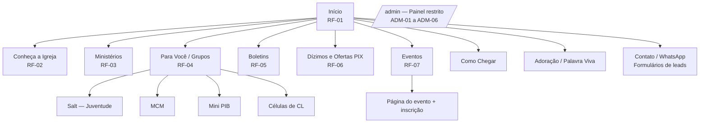
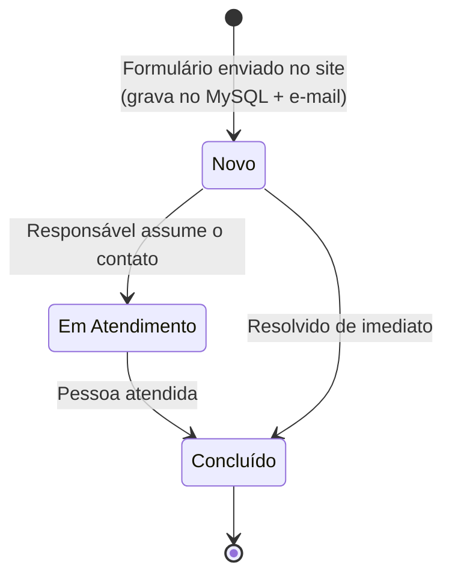

# PRD — Novo Portal PIBLS (pibls.com)

> Substituição do site WordPress da Primeira Igreja Batista em Lagoa Santa por uma aplicação web monolítica (React + Vite + TypeScript / PHP 8 / MySQL) hospedada na conta HostGator já existente, com custo adicional zero.

---

## Informações do Documento

| Campo | Valor |
|---|---|
| **Produto** | Novo Portal PIBLS — portfólio institucional + hub digital de membros e ministérios |
| **Organização** | Primeira Igreja Batista em Lagoa Santa (PIBLS) — Lagoa Santa/MG |
| **Status** | Rascunho para revisão |
| **Versão** | 0.1 |
| **Data** | 2026-10-19 |
| **Documento irmão** | `ARCHITECTURE.md` (a ser produzido a partir da Parte 2 do documento-base) |

### Autores

- 🔵 **Questão em Aberto**: responsável pelo produto (PO/PM) a definir.

### Revisores sugeridos

- 🔶 **Premissa**: Pastor titular (Pr. Joselito F. Sena), Ministério de Comunicação, Secretaria da igreja, Apoio à Tesouraria (dados PIX) e o administrador técnico com acesso ao cPanel. Os papéis foram inferidos dos documentos-fonte; os nomes dos revisores ainda precisam ser confirmados.

### Documentos-fonte

1. **Especificação de Produto e Arquitetura — Novo Portal PIBLS** (PDF, 4 páginas). Parte 1 = base do PRD; Parte 2 = base do ARCHITECTURE.md.
2. **Guia Institucional — PIBLS** (PDF, 3 páginas). Conteúdo oficial: boas-vindas, cultos, PIX, história, pastores, ministérios e grupos.

### Lacunas conhecidas nos documentos-fonte

Os dois PDFs foram gerados com conteúdo que ultrapassa a borda da página. Os trechos abaixo **não existem no arquivo** (estão cortados na origem) e precisam ser recuperados com quem produziu o documento-base:

| Local | O que falta |
|---|---|
| Especificação, pág. 1 | Final do **RF-07** (só aparece "formulários dinâmicos de i…") e possíveis requisitos RF-08+ |
| Especificação, pág. 1→2 | **Seções 3 e 4 da Parte 1** (a numeração salta do item 2 para o item 5) |
| Especificação, pág. 2 | Final da **seção 7** (tipos de formulário — "Inscrições em Eventos: Formulários específicos por…") e possíveis **RNF-04+** |
| Especificação, pág. 3 | Conteúdo da caixa "Isolamento da raiz pública e segurança no Apache (.htaccess)" |
| Especificação, pág. 4 | Passos de deploy **5 em diante** e a seção de **preservação de e-mail** citada no título da página |
| Guia, pág. 3 | Final do texto sobre o Mini PIB (recuperável pelo RF-04: Culto Infantil aos domingos às 19h30) |

Cada lacuna aparece como 🔵 Questão em Aberto na seção correspondente e está consolidada na [Seção 10](#10-questões-em-aberto).

### Convenção de marcação

- 🔶 **Premissa**: inferência plausível, ainda não validada. Toda premissa é um risco até ser confirmada.
- 🔵 **Questão em Aberto**: informação desconhecida que exige decisão, conversa com stakeholders ou levantamento de dados.
- **(fonte)**: item extraído literalmente dos documentos-fonte.

### Histórico de alterações

| Versão | Data | Autor | Descrição |
|---|---|---|---|
| 0.1 | 2026-10-19 | 🔵 A definir | Rascunho inicial a partir dos documentos-fonte |
| 0.2 | AAAA-MM-DD | Revisores | Incorporação de feedback e fechamento das lacunas |
| 1.0 | AAAA-MM-DD | Aprovador | Versão aprovada para desenvolvimento |

---

## Sumário

1. [Resumo Executivo](#1-resumo-executivo)
2. [Declaração do Problema](#2-declaração-do-problema)
3. [Usuários-Alvo e Personas](#3-usuários-alvo-e-personas)
4. [Contexto Estratégico](#4-contexto-estratégico)
5. [Visão Geral da Solução](#5-visão-geral-da-solução)
6. [Métricas de Sucesso](#6-métricas-de-sucesso)
7. [Histórias de Usuário e Requisitos](#7-histórias-de-usuário-e-requisitos)
8. [Fora do Escopo](#8-fora-do-escopo)
9. [Dependências e Riscos](#9-dependências-e-riscos)
10. [Questões em Aberto](#10-questões-em-aberto)
11. [Autoavaliação do PRD](#autoavaliação-do-prd)
12. [Apêndice A — Conteúdo-semente institucional](#apêndice-a--conteúdo-semente-institucional)

---

## 1. Resumo Executivo

Estamos construindo o **novo portal pibls.com**, uma aplicação web monolítica (React + PHP 8 + MySQL) na mesma hospedagem HostGator. Ela atende a três públicos: **visitantes** que querem conhecer a igreja, **membros e os 20 ministérios** que precisam de boletins, eventos, grupos e contribuição via PIX, e a **liderança/secretaria**, que precisa operar o conteúdo e os contatos sem depender de desenvolvedor. O portal substitui o site WordPress atual. A expectativa é que todo visitante interessado vire um **contato registrado e atendido** (fichas de visitante, "Quero ser membro", pedidos de oração), que boletins, eventos, horários e dados PIX sejam publicados pela própria equipe da igreja e que tudo isso aconteça com **custo adicional de infraestrutura zero** e **nenhuma interrupção no e-mail institucional**.

🔶 **Premissa**: o documento-base descreve a solução desejada, mas não registra os problemas concretos do WordPress atual (lentidão, dificuldade de edição, segurança, formulários). A narrativa de problema da Seção 2 foi inferida dos requisitos e precisa ser validada com a Comunicação e a Secretaria.

---

## 2. Declaração do Problema

### Quem tem este problema?

- **Visitantes e pessoas de Lagoa Santa e região** que procuram uma igreja e precisam encontrar horários, localização, informações sobre a igreja e um canal de contato.
- **Membros, congregados e os 20 ministérios** que precisam de um ponto único para boletins, eventos, grupos (Células de CL, Salt, MCM, UMHBB, Mini PIB) e contribuição.
- **Liderança, secretaria e comunicação**, equipe majoritariamente voluntária 🔶, responsável por manter o conteúdo atualizado e responder às pessoas.

### Qual é o problema?

O site atual em WordPress não funciona como hub digital da igreja (inferido dos requisitos da fonte):

1. **Informação institucional dispersa ou desatualizada.** Horários, líderes dos ministérios, Células de CL e dados PIX exigem alteração técnica para serem atualizados. O ADM-06 pede explicitamente que essas mudanças aconteçam "sem precisar alterar código-fonte" (fonte). 🔶
2. **Contatos sem registro nem acompanhamento.** Pedidos de oração, fichas de visitante e "Quero ser membro" não são centralizados nem têm status de atendimento (o ADM-03 propõe estados Novo / Em Atendimento / Concluído). Na prática, a chance de uma pessoa interessada ficar sem resposta é alta. 🔶
3. **Eventos sem ferramenta própria.** Congressos, acampamentos e ações ministeriais não têm inscrição online com controle de vagas e exportação da lista de inscritos (RF-07/ADM-04). 🔶
4. **Contribuição pouco acessível.** A campanha "Estamos Construindo" (reconstrução do templo após o desabamento de 2018) depende de contribuições, e o fluxo PIX não é imediato no celular (falta copiar a chave com um clique e um guia passo a passo; RF-06). 🔶
5. **Restrição financeira.** Qualquer solução precisa caber na hospedagem compartilhada e no e-mail profissional que a igreja já paga, sem orçamento adicional (RNF-01, fonte).

### Por que isso dói?

- **Impacto para as pessoas**: o visitante que não encontra horário, endereço ou um canal de resposta rápida pode desistir de visitar. O membro depende de grupos de WhatsApp e de avisos no púlpito para saber de boletins e eventos 🔶. O líder de ministério organiza inscrições manualmente (papel, planilha, WhatsApp) 🔶.
- **Impacto para a igreja**: a missão declarada é "fazer discípulos: as pessoas, de fato, importam para nós!" (fonte). Um contato perdido é uma pessoa não acolhida. A campanha de construção perde arrecadação potencial se contribuir exigir esforço. E a operação fica concentrada em quem domina o WordPress (dependência de uma pessoa) 🔶.

### Evidências

| Tipo | Situação |
|---|---|
| **Documento-base** | Objetivo executivo, públicos, 7 requisitos funcionais públicos (RF-01 a RF-07), 6 administrativos (ADM-01 a ADM-06), tipos de formulários e 3 RNFs (fonte). |
| **Guia Institucional** | Conteúdo oficial que o portal precisa apresentar (horários, história, ministérios, PIX, grupos) (fonte). |
| **Entrevistas com usuários** | 🔵 **Questão em Aberto**: nenhuma registrada. Recomendado: 3 a 5 conversas curtas (1 visitante recente, 2 membros, 1 líder de ministério, 1 pessoa da secretaria). |
| **Dados de uso do site atual** | 🔵 **Questão em Aberto**: o WordPress tem Google Analytics, Jetpack ou Search Console? Sem baseline, as metas da Seção 6 ficam provisórias. |
| **Volume de contatos atual** | 🔵 **Questão em Aberto**: quantos pedidos de oração, fichas de visitante e contatos chegam hoje por mês, e por qual canal (formulário, WhatsApp, e-mail)? |
| **Citação de usuário** | 🔵 **Questão em Aberto**: coletar ao menos uma citação literal da secretaria ou da comunicação sobre a dificuldade de manter o site atual. |

---

## 3. Usuários-Alvo e Personas

> Os nomes abaixo são **proto-personas fictícias**, construídas a partir dos três públicos descritos no documento-base. Não representam membros reais. 🔶 Validar com Recepção/Acolhimento, Comunicação e Secretaria.

### Persona primária (público externo): Mariana Rocha, visitante

- **Perfil**: 34 anos, mudou-se recentemente para Lagoa Santa com o marido e uma filha de 6 anos. Procura uma igreja batista perto de casa.
- **Contexto**: descobre igrejas pelo Google ("igreja batista lagoa santa") e por links recebidos no WhatsApp. Acessa quase só pelo celular. 🔶
- **Objetivos**: saber o que esperar antes de ir (horários, localização, o que a igreja crê, se há programação para crianças) e fazer um primeiro contato sem constrangimento.
- **Dores**: sites lentos ou desatualizados; horário diferente do real; não saber se alguém vai responder ao formulário.
- **Comportamento atual**: compara 2 ou 3 igrejas pelo site e pelo Instagram, e visita a que passa mais confiança. 🔶

### Persona crítica de operação: Rafael Moura, voluntário da Comunicação e Secretaria

- **Perfil**: 27 anos, voluntário do Ministério de Comunicação. Não é desenvolvedor.
- **Contexto**: publica o boletim semanal, divulga eventos e repassa contatos para a liderança. Tem poucas horas por semana para isso. 🔶
- **Objetivos**: publicar boletins e eventos em minutos; ver todos os contatos recebidos em um só lugar e saber quais já foram atendidos.
- **Dores**: depender de alguém técnico para trocar horários ou o nome de um líder; mensagens espalhadas entre e-mail e WhatsApp.
- **Comportamento atual**: 🔵 **Questão em Aberto**: como o boletim é publicado hoje (PDF no WordPress? só no WhatsApp?) e quanto tempo isso leva.

> **Por que duas personas "principais"?** Mariana é quem o portal precisa conquistar. Rafael é quem mantém o portal vivo. Se o painel for difícil para Rafael, o conteúdo envelhece e o portal falha com Mariana.

### Personas secundárias

| Persona | Papel | Diferença em relação às primárias |
|---|---|---|
| **Célia Fernandes**, membro há 20 anos (61 anos) | Lê boletins, contribui via PIX, participa de uma Célula de CL | Já conhece a igreja; quer **acesso rápido** a boletim, PIX e transmissão no YouTube. Precisa de **fonte legível e alto contraste** 🔶 |
| **Líder de ministério** (ex.: Juventude organizando um acampamento) | Cria eventos e acompanha inscrições | Precisa de **formulário de inscrição sob medida**, controle de vagas e exportação da lista (CSV/PDF) |
| **Marcos Lima**, administrador técnico | Voluntário de TI com acesso ao cPanel | Provisiona usuários e permissões **diretamente no MySQL via phpMyAdmin** (ADM-01). Precisa de um procedimento seguro e documentado |
| **Pastor titular / liderança pastoral** | Recebe "Quero ser membro" e acompanha o acolhimento | Quer visibilidade dos novos interessados e publica mensagens pastorais (Palavra Viva) |

### Jobs-to-be-Done

| Persona | Job funcional | Job emocional | Job social |
|---|---|---|---|
| Mariana (visitante) | Descobrir horários, endereço e programação infantil em menos de 1 minuto pelo celular | Sentir-se bem-vinda e segura antes da primeira visita | Escolher uma igreja que a família toda aprove |
| Rafael (operação) | Publicar o boletim da semana e triar os contatos em menos de 15 minutos 🔶 | Não ter medo de "quebrar o site" | Ser reconhecido como alguém que mantém a igreja bem comunicada |
| Célia (membro) | Ler o boletim e contribuir via PIX sem pedir ajuda | Sentir-se parte da obra de reconstrução do templo | Indicar o site a amigos e parentes |
| Líder de ministério | Abrir inscrições de um evento e exportar a lista sem planilha manual | Confiança de que não haverá inscritos além do limite de vagas | Organizar eventos com aparência profissional |

🔶 **Premissa**: todos os JTBD acima foram inferidos dos documentos. Nenhum foi observado em pesquisa.

---

## 4. Contexto Estratégico

### Objetivos da organização

- **Substituir o WordPress** por uma aplicação "moderna, rápida, dinâmica e profissional" (fonte).
- **Orçamento adicional zero**, mantendo hospedagem compartilhada e e-mail profissional na HostGator (fonte, RNF-01/RNF-02).
- **Dupla função** (fonte): Portfólio Institucional Completo para visitantes e Rede Central de Guias, Eventos e Ferramentas Tecnológicas para membros, congregados e os 20 ministérios.
- **Alinhamento com a missão**: "cumprimos a missão ordenada por Jesus de fazer discípulos" (fonte). O portal é a porta de entrada digital do acolhimento.
- **Apoio à campanha "Estamos Construindo"**: dar visibilidade à reconstrução do templo e facilitar a contribuição via PIX (fonte).

### Alcance potencial

- Lagoa Santa fica na Região Metropolitana de Belo Horizonte e vem crescendo em população, com novos moradores chegando 🔶 (confirmar com dados do IBGE). Esse é exatamente o perfil da persona Mariana.
- TAM/SAM/SOM não se aplica a uma igreja local. A métrica de alcance relevante é o volume de buscas locais e de visitantes do site. 🔵 **Questão em Aberto**: levantar o baseline no Google Search Console antes da migração.

### Cenário de alternativas

| Alternativa usada hoje | Ponto forte | Limitação que o portal resolve |
|---|---|---|
| Grupos de WhatsApp | Alcance imediato entre membros | Não alcança visitantes; o conteúdo se perde no histórico; não tem busca de boletins |
| Canal do YouTube | Transmissão ao vivo e cultos gravados | Não apresenta a igreja, os ministérios nem os grupos; o portal **incorpora** e complementa |
| Instagram/redes sociais 🔶 | Divulgação visual | Não registra contatos com status nem inscrições com controle de vagas |
| Site WordPress atual | Já existe e já é indexado no Google | Manutenção dependente de pessoa técnica e falta de hub funcional 🔶 |
| Formulários e planilhas manuais 🔶 | Gratuitos | Sem controle de vagas e sem integração com o painel |

### Por que agora?

1. **Marco de 40 anos (fundação em 13/01/1985).** O documento-base pede uma "linha do tempo interativa dos 40 anos". Em 2026 a igreja completa 41 anos. 🔶 Recomenda-se calcular a idade dinamicamente a partir da data de fundação, para o texto não ficar desatualizado.
2. **Reconstrução do templo em andamento** desde o desabamento de 2018. A campanha precisa de um canal de contribuição claro e permanente.
3. **Custo zero viável agora.** A hospedagem já paga suporta PHP 8.2–8.5 + MySQL (fonte). 🔵 Confirmar no inventário do cPanel (passo 1 do deploy).
4. 🔶 **Premissa**: o WordPress atual tem dívida de manutenção (plugins, atualizações de segurança). A troca agora reduz superfície de ataque e dependência técnica.

---

## 5. Visão Geral da Solução

### Descrição

O Novo Portal PIBLS é uma **aplicação monolítica modular** hospedada inteiramente na conta HostGator atual. O **portal público** (React + Vite + TypeScript, compilado em arquivos estáticos) apresenta a igreja, a programação, os ministérios, os grupos, os boletins, os eventos e a área de PIX. A **API REST em PHP 8** grava contatos e inscrições no MySQL e dispara notificações pelo e-mail institucional do cPanel.

Um **Painel Administrativo** restrito (`/admin`) permite que liderança, secretaria e comunicação publiquem boletins e mensagens, gerenciem eventos e inscrições, atendam os contatos recebidos e atualizem ministérios, horários e dados PIX **sem alterar código**. Por regra de governança, **nenhum usuário ou permissão é criado por tela**: contas e permissões são provisionadas diretamente no MySQL via cPanel/phpMyAdmin. A aplicação apenas lê esses registros para autenticar e autorizar (fonte).

Detalhes de stack, estrutura de pastas, topologia e deploy ficam no `ARCHITECTURE.md`. Este PRD trata essas decisões como **restrições** (Seção 7).

### Mapa do site (arquitetura de informação)

Baseado no menu do Guia Institucional (fonte) e nos requisitos RF-01 a RF-07:

🔵 **Questão em Aberto**: o menu do Guia cita **Adoração**, **Como Chegar**, **Salt**, **MCM** e **Mini PIB** como seções do site, mas nenhum RF visível os detalha (provavelmente estavam nas seções 3 e 4 cortadas do documento-base). Confirmar se são páginas próprias ou âncoras dentro de RF-01 e RF-04.

### Funcionalidades principais

| # | Funcionalidade | Para quem | Requisito-fonte |
|---|---|---|---|
| F1 | Página inicial com boas-vindas, destaque "Estamos Construindo", aviso da Ceia e quadro de horários | Visitante, membro | RF-01 |
| F2 | História interativa (linha do tempo, ex-pastores, afiliação à CBB, biografia pastoral) | Visitante | RF-02 |
| F3 | Guia dos 20 ministérios com atribuições e líderes atuais | Visitante, membro | RF-03 |
| F4 | Diretório "Para Você" por perfil (Células de CL por bairro, Homens, Mulheres, Salt, Mini PIB) | Visitante, membro | RF-04 |
| F5 | Central de Boletins com busca por data, leitura na tela e download em PDF | Membro | RF-05 |
| F6 | Área PIX com QR Code oficial, "Copiar Chave" em 1 clique e guia passo a passo | Membro, visitante | RF-06 |
| F7 | Motor de páginas de eventos com formulários dinâmicos de inscrição | Membro, líder | RF-07 |
| F8 | Formulários de contato: Ficha de Visitante, "Quero ser membro"/Batismo, Pedido de Oração, contato com ministério | Visitante, membro | Seção 7 da fonte |
| F9 | Login seguro e menu do painel conforme permissões provisionadas no banco | Operação | ADM-01, fluxo de governança |
| F10 | Diretório de usuários (somente leitura) | Admin técnico, liderança | ADM-02 |
| F11 | Caixa de entrada de contatos com status (Novo → Em Atendimento → Concluído) e notificação por e-mail | Operação, liderança | ADM-03 |
| F12 | CRUD de eventos, construtor do formulário de inscrição, lista e exportação (CSV/PDF) de inscritos | Líder de ministério | ADM-04 |
| F13 | Publicador de boletins (com upload de PDF) e de mensagens Palavra Viva | Comunicação, pastor | ADM-05 |
| F14 | Atualização de ministérios, Células de CL, horários e dados PIX/QR Code sem código | Operação | ADM-06 |

### Ciclo de vida de um contato (regra de negócio)

### Fatiamento de entregas proposto

🔶 **Premissa**: proposta de fatiamento para reduzir risco no go-live. O documento-base não define fases.

| Release | Escopo | Racional |
|---|---|---|
| **R1 — Substituição do WordPress (go-live)** | F1–F6, F8–F11, F13, F14 + migração (Épico E8) | Tudo o que o site atual oferece e mais o hub de contatos. Permite desligar o WordPress. |
| **R2 — Eventos e inscrições** | F7, F12 | O construtor de formulários dinâmicos é a peça mais complexa. Isolá-lo evita atrasar o go-live. |

---

## 6. Métricas de Sucesso

### Métrica primária

- **Métrica**: **Contatos de acolhimento atendidos por mês**, ou seja, a quantidade de Fichas de Visitante e de "Quero ser membro" que chegam ao status **Concluído** em até 7 dias após o envio.
- **Por que esta métrica**: mede diretamente o problema central (pessoas interessadas que se perdem) e a missão ("as pessoas importam"). Também depende de o portal ser encontrado (visitante) e de o painel ser usado (operação).
- **Baseline atual**: 🔵 **Questão em Aberto**: desconhecido. Levantar com a secretaria quantos contatos de visitantes chegam hoje por mês e por qual canal.
- **Meta**: 🔶 **Premissa**: definir após 60 dias de medição pós-go-live. Meta provisória: **≥ 90% dos contatos de acolhimento concluídos em até 7 dias**.
- **Prazo de medição**: 30, 60 e 90 dias após o go-live da R1.

### Métricas secundárias

| Métrica | Baseline | Meta | Fonte de dados |
|---|---|---|---|
| **Tempo até a primeira resposta** a um contato (mediana) | 🔵 desconhecido | 🔶 ≤ 48 h | Timestamps de mudança de status em `leads_messages` 🔵 (ver instrumentação) |
| **Pontualidade do boletim**: % de semanas com boletim publicado até domingo às 08h | 🔵 desconhecido | 🔶 ≥ 90% | `bulletins.reference_date` × data de criação |
| **Autonomia editorial**: % de alterações de conteúdo (horários, líderes, PIX, boletins, eventos) feitas pelo painel, sem desenvolvedor | 🔶 ~0% hoje | 100% | Registro de solicitações ao desenvolvedor |
| **Inscrições online**: % das inscrições de eventos feitas pelo portal (R2) | 🔵 desconhecido | 🔶 ≥ 80% | `event_registrations` × contagem total informada pelo líder |
| **Engajamento PIX**: cliques em "Copiar Chave PIX" e visualizações da área PIX por mês | Inexistente | Tendência de alta | Ferramenta de analytics (eventos) |
| **Desempenho**: LCP no celular (p75) | 🔵 medir o WordPress atual | 🔶 ≤ 2,5 s em 4G | PageSpeed Insights / CrUX |

### Métricas de proteção (guardrails)

| Guardrail | Limite |
|---|---|
| **E-mail institucional** | 0 mensagens perdidas e nenhuma alteração em nameservers/MX/SPF/DKIM durante a migração (RNF-02, fonte) |
| **Custo de infraestrutura** | R$ 0/mês adicional (RNF-01, fonte) |
| **Incidentes de segurança ou vazamento de dados pessoais** | 0 |
| **Tráfego orgânico (Google)** | Queda máxima de 20% nos 60 dias pós-migração em relação ao baseline 🔶 (exige o Search Console configurado **antes** da migração) |
| **Integridade dos dados PIX** | 0 alterações da chave PIX sem notificação à Tesouraria/Pastor (ver US-10) |

### Plano de instrumentação

- **Analytics gratuito e compatível com a LGPD**: 🔵 **Questão em Aberto**: escolher entre Google Analytics 4 (exige banner de consentimento) e uma alternativa gratuita sem cookies. A escolha precisa respeitar o RNF-01.
- **Google Search Console**: configurar **antes** do go-live para capturar o baseline de buscas e cliques do WordPress.
- **Histórico de status dos contatos**: o modelo de dados da fonte tem apenas `created_at` em `leads_messages`. 🔵 **Questão em Aberto**: incluir `updated_at` e uma tabela de histórico de status (ou `status_changed_at`) para medir a métrica primária e o tempo de resposta.

---

## 7. Histórias de Usuário e Requisitos

### Hipótese do épico

> **Acreditamos que** um portal monolítico com conteúdo editável pelo painel, contatos centralizados com status de atendimento e uma área PIX simplificada **para** visitantes, membros e a equipe de operação da PIBLS **vai garantir** que pessoas interessadas sejam atendidas (≥ 90% dos contatos de acolhimento concluídos em até 7 dias) e que 100% das atualizações de conteúdo sejam feitas pela própria equipe, **porque** hoje o site depende de alteração técnica e não registra nem acompanha contatos. **Mediremos** pela métrica primária da Seção 6, de 30 a 90 dias após o go-live, sem violar os guardrails de e-mail, custo e segurança.

### Épicos

| Épico | Nome | Requisitos-fonte | Release |
|---|---|---|---|
| E1 | Portal institucional | RF-01, RF-02, RF-03, RF-04 | R1 |
| E2 | Boletins e Palavra Viva | RF-05, ADM-05 | R1 |
| E3 | Contribuição via PIX | RF-06, ADM-06 | R1 |
| E4 | Captação e atendimento de contatos | Seção 7 da fonte, ADM-03 | R1 |
| E5 | Eventos e inscrições | RF-07, ADM-04 | R2 🔶 |
| E6 | Acesso administrativo e governança | ADM-01, ADM-02, fluxo de governança | R1 |
| E7 | Dados institucionais editáveis | ADM-06 | R1 |
| E8 | Migração e go-live | RNF-01, RNF-02, RNF-03, deploy | R1 |

---

### E1 — Portal institucional

**US-01: Ver boas-vindas e programação na página inicial** *(RF-01)*

Como **visitante**, quero ver na página inicial os horários dos cultos e os destaques da igreja, para decidir quando visitar.

- [ ] O quadro de horários exibe: Quinta 20h — Culto de Oração (presencial e online); Domingo 09h — EBD (presencial, classes por faixa); Domingo 10h10 — Culto Matinal (presencial e YouTube); Domingo 19h30 — Culto Noturno (presencial e YouTube); 1ª sexta-feira do mês 19h30 — Culto Salt.
- [ ] Os horários são carregados da API (`GET /api/public/settings` ou `ministries`) e **não** ficam fixos no código; alterações feitas no painel (US-22) aparecem sem novo deploy.
- [ ] A página traz o destaque da campanha "Estamos Construindo", com chamada para a área PIX (US-09).
- [ ] O aviso da Ceia do Senhor informa que ela acontece no 1º domingo do mês. 🔶 Na semana que antecede o 1º domingo, o aviso mostra a data específica ("Próximo domingo, dd/mm: Ceia do Senhor").
- [ ] Botões visíveis para o YouTube (ao vivo e gravados) e o WhatsApp de atendimento (links vindos de `site_settings`).

**US-02: Saber como chegar** *(menu do Guia; RF não visível)*

Como **visitante**, quero ver o endereço e um mapa da igreja, para chegar sem me perder.

- [ ] A página exibe o endereço completo, um mapa incorporado e links "Abrir no Google Maps" e "Abrir no Waze".
- [ ] O endereço é editável pelo painel (`site_settings`).
- [ ] 🔵 **Questão em Aberto**: o endereço da igreja e o local atual dos cultos (durante a reconstrução do templo) **não constam nos documentos-fonte**.

**US-03: Conhecer a história e as crenças da igreja** *(RF-02)*

Como **visitante**, quero conhecer a história e as crenças da PIBLS, para saber se me identifico com a igreja.

- [ ] A linha do tempo interativa mostra os marcos: fundação em 13/01/1985 no bairro Promissão; aquisição do terreno com apoio dos batistas norte-americanos; liderança pastoral atual desde fev/2012; desabamento em 2018 e reconstrução em curso.
- [ ] A idade da igreja ("N anos de fé e serviço") é calculada a partir de 13/01/1985, nunca fixada no texto.
- [ ] A galeria de ex-pastores lista, na ordem do Guia, os 8 pastores anteriores (Sebastião Oliveira de Souza indicado como tendo pastoreado "em duas ocasiões").
- [ ] A página informa a afiliação à Convenção Batista Brasileira (CBB) e dá acesso à Declaração de Fé (link ou PDF). 🔵 Definir se é link externo da CBB ou PDF hospedado.
- [ ] A biografia completa do Pr. Joselito F. Sena inclui família, formação acadêmica e histórico de pastoreio, conforme o Guia.
- [ ] 🔵 **Questão em Aberto**: as fotos dos ex-pastores e da linha do tempo estão disponíveis? Quem as fornece?

**US-04: Conhecer os ministérios** *(RF-03)*

Como **visitante ou membro**, quero ver como cada ministério funciona e quem o lidera, para saber onde servir ou a quem procurar.

- [ ] O catálogo lista os 20 ministérios com nome, atribuições e líderes atuais, carregados de `GET /api/public/ministries`.
- [ ] Cada ministério tem uma ação "Falar com este ministério" que abre o formulário de contato já com o ministério selecionado (US-11/E4).
- [ ] A alteração de um líder no painel (US-22) aparece imediatamente no catálogo.
- [ ] 🔵 **Questão em Aberto**: o RF-03 e o Guia diferem na granularidade (ex.: "Missões" × "Evangelismo e Missões"; "Educação Cristã" e "Programas Especiais" aparecem no Guia, mas não no RF-03). Definir a lista canônica dos 20 itens. Ver o Apêndice A.

**US-05: Encontrar um grupo para mim** *(RF-04)*

Como **visitante ou membro**, quero filtrar grupos pelo meu perfil, para encontrar onde me integrar.

- [ ] Filtros por perfil: Células de CL (lares), Homens, Mulheres, Jovens/Adolescentes (Salt) e Crianças (Mini PIB).
- [ ] Cada grupo mostra dia, horário e bairro: Células de CL às terças ou quartas, 20h; Homens no último sábado do mês, 20h; Mulheres no 3º sábado do mês, 17h30; Mini PIB com EBD Infantil aos domingos às 9h e Culto Infantil aos domingos às 19h30.
- [ ] As Células de CL podem ser filtradas por bairro, em lista ou mapa.
- [ ] O botão "Quero participar" abre a Ficha de Visitante com o grupo ou a célula pré-selecionados.
- [ ] O lema da seção (1ª Pedro 4:10) é exibido.
- [ ] 🔵 **Questão em Aberto (privacidade)**: as Células de CL acontecem em **residências de membros**. Publicar o endereço exato em mapa público expõe essas famílias. Recomendação: mostrar só o **bairro** e liberar o endereço após contato (WhatsApp/ficha). Decisão da liderança.

---

### E2 — Boletins e Palavra Viva

**US-06: Ler e baixar boletins** *(RF-05)*

Como **membro**, quero encontrar o boletim de uma data específica e lê-lo no celular, para me manter atualizado.

- [ ] A lista mostra todos os boletins publicados, do mais recente ao mais antigo, com número da edição, data de referência, título e resumo.
- [ ] Busca e filtro por data (mês/ano).
- [ ] O boletim pode ser lido na tela (resumo em texto + visualização do PDF) e baixado em PDF.
- [ ] A página é responsiva e legível em telas a partir de 360 px.
- [ ] Sem boletins publicados, a página exibe um estado vazio amigável em vez de uma lista em branco.

**US-07: Publicar o boletim da semana** *(ADM-05)*

Como **voluntário da Comunicação**, quero cadastrar o boletim com o PDF em poucos passos, para que os membros o recebam no mesmo dia.

- [ ] O formulário tem os campos número da edição, data de referência, título, resumo em texto e upload do PDF.
- [ ] O upload valida o MIME type **real** (`application/pdf`), respeita um limite de tamanho e renomeia o arquivo com segurança antes de gravá-lo em `uploads/boletins/` (fonte). 🔶 Limite proposto: 10 MB.
- [ ] Só usuários com a permissão `boletins.write` acessam o módulo; a API responde 403 para os demais.
- [ ] Após salvar, o boletim aparece imediatamente na Central de Boletins, e `published_by` registra o autor.
- [ ] Mensagens de erro claras para arquivo inválido ou grande demais.

**US-08: Publicar mensagem Palavra Viva** *(ADM-05)*

Como **pastor ou comunicador**, quero publicar mensagens pastorais no portal, para que membros e visitantes se edifiquem durante a semana.

- [ ] Campos: título, texto da mensagem, data e link opcional do vídeo no YouTube.
- [ ] As mensagens publicadas aparecem na seção Palavra Viva, da mais recente para a mais antiga.
- [ ] A permissão é independente da de boletins. 🔶 Proposta: `mensagens.write`.
- [ ] 🔵 **Questão em Aberto**: o modelo de dados da fonte **não tem tabela** para mensagens/devocionais (só `bulletins`). É preciso definir a tabela (ex.: `devotionals`) no ARCHITECTURE.md.

---

### E3 — Contribuição via PIX

**US-09: Contribuir via PIX pelo celular** *(RF-06)*

Como **membro**, quero copiar a chave PIX com um toque, para contribuir com dízimos, ofertas ou a construção sem digitar o CNPJ.

- [ ] A área PIX exibe o QR Code oficial, o favorecido "Primeira Igreja Batista em Lagoa Santa" e a chave CNPJ 20969119000184.
- [ ] O botão "Copiar Chave PIX" copia a chave em um clique e mostra uma confirmação visual ("Chave copiada!") por alguns segundos.
- [ ] Sem acesso à área de transferência no navegador, a chave fica selecionável e aparece a orientação "toque e segure para copiar".
- [ ] O guia passo a passo tem 3 etapas: abrir o app do banco e o menu Pix; ler o QR Code ou usar "Pix Copia e Cola" com a chave; informar o valor e confirmar.
- [ ] O versículo 2 Coríntios 9:7 é exibido.
- [ ] 🔵 **Questão em Aberto**: dízimo, oferta e construção usam a **mesma chave**? A Tesouraria quer distinguir finalidades (ex.: identificador na descrição do PIX ou QR Codes dinâmicos com payload próprio)?

**US-10: Atualizar dados PIX com segurança** *(ADM-06)*

Como **responsável pela Tesouraria**, quero atualizar a chave e o QR Code PIX pelo painel com rastreabilidade, para que nenhuma alteração indevida desvie contribuições.

- [ ] Só usuários com permissão específica (🔶 proposta: `pix.write`, separada de `settings.write`) editam chave, favorecido e imagem do QR Code.
- [ ] Toda alteração grava quem alterou, quando, o valor anterior e o novo valor.
- [ ] Toda alteração dispara um e-mail automático para o Pastor e a Tesouraria. 🔶
- [ ] A alteração aparece no portal sem novo deploy.

> **Racional de segurança**: a chave PIX é o dado de maior valor financeiro do portal. Uma conta de painel comprometida que troca a chave desvia contribuições em silêncio. Ver Risco R-04.

---

### E4 — Captação e atendimento de contatos

**US-11: Enviar a Ficha de Visitante** *(Seção 7 da fonte)*

Como **visitante**, quero deixar meu contato e dizer se quero receber uma visita ou conhecer uma Célula de CL, para ser acolhido pela igreja.

- [ ] Campos: nome, WhatsApp, bairro, "Deseja receber uma visita?" (sim/não) e "Deseja conhecer uma Célula de CL?" (sim/não).
- [ ] Checkbox **obrigatório** de consentimento para tratamento de dados, com link para a Política de Privacidade (RNF-08).
- [ ] Proteção antispam sem custo (🔶 honeypot + limite de envios por IP) e token CSRF validado (RNF-03).
- [ ] Após o envio, o contato é gravado em `leads_messages` com `form_type = visitante` e status **Novo**, e uma notificação vai para o e-mail institucional.
- [ ] O visitante vê uma confirmação: "Recebemos seu contato! Em breve alguém da nossa equipe vai falar com você."
- [ ] Se o envio de e-mail falhar, o contato **continua gravado** no banco e o visitante recebe a mesma confirmação.

**US-12: Pré-cadastro "Quero ser membro" / Batismo** *(Seção 7 da fonte)*

Como **visitante**, quero manifestar interesse em ser membro ou me batizar, para entrar na classe de novos membros.

- [ ] Campos mínimos: nome, WhatsApp, e-mail (opcional), "membro de outra igreja batista?" (sim/não) e mensagem. 🔶 Campos a confirmar com a secretaria.
- [ ] O contato é gravado com `form_type = membro` e notifica **o pastor e a secretaria** (fonte).
- [ ] Mesmo consentimento, antispam e CSRF da US-11.

**US-13: Enviar pedido de oração** *(Seção 7 da fonte)*

Como **membro ou visitante**, quero enviar um pedido de oração com discrição, para que a equipe de oração interceda por mim.

- [ ] Campos: nome (🔵 opcional ou obrigatório?), contato opcional e texto do pedido.
- [ ] O pedido é gravado com `form_type = oracao` e **encaminhado automaticamente à liderança do Ministério de Oração** (fonte).
- [ ] No painel, pedidos de oração só são visíveis para quem tem permissão específica (🔶 `leads.oracao.read`), não para todo usuário com `leads.read`.
- [ ] 🔵 **Questão em Aberto**: aceitar pedidos anônimos? Qual e-mail recebe os pedidos de oração (cadastro em `site_settings` ou no contato do ministério)?

**US-14: Atender contatos na caixa de entrada** *(ADM-03)*

Como **voluntário da secretaria**, quero ver todos os contatos em um só lugar e marcar o andamento, para que ninguém fique sem resposta.

- [ ] A lista mostra tipo, nome, data, status e telefone, com filtros por tipo e por status.
- [ ] O status muda pelos estados Novo → Em Atendimento → Concluído (`PATCH /api/admin/leads/{id}`), com registro de data/hora e do usuário que alterou. 🔵 Exige ajuste no modelo (ver Seção 6).
- [ ] Um botão "Responder no WhatsApp" abre a conversa com o número do contato.
- [ ] Cada usuário vê apenas os tipos de contato permitidos pela sua permissão.
- [ ] Contatos com status Novo há mais de 3 dias aparecem destacados. 🔶

---

### E5 — Eventos e inscrições *(R2 proposto)*

**US-15: Criar e publicar um evento** *(ADM-04)*

Como **líder de ministério**, quero criar a página de um evento com o formulário de inscrição adequado, para divulgá-lo e receber inscrições sem planilha manual.

- [ ] O CRUD de evento tem os campos título, slug (único, gerado do título e editável), descrição, data, local, banner, número de vagas e publicado/rascunho.
- [ ] O construtor do formulário permite adicionar campos (🔶 tipos: texto curto, texto longo, número, data, seleção única, múltipla escolha e sim/não), marcá-los como obrigatórios e reordená-los. O resultado é salvo em `form_schema_json`.
- [ ] Nome, telefone e e-mail do participante são campos fixos e sempre presentes (`event_registrations`).
- [ ] Eventos em rascunho não aparecem em `GET /api/public/events`.
- [ ] Só usuários com `eventos.write` criam, editam e excluem eventos.
- [ ] 🔵 **Questão em Aberto**: o restante do RF-07 está cortado no documento-base. Confirmar se há requisitos de pagamento, lista de espera, prazo de inscrição ou inscrição de grupos/famílias.

**US-16: Inscrever-se em um evento** *(RF-07)*

Como **membro**, quero me inscrever em um evento pelo celular, para garantir minha vaga.

- [ ] A página pública `/eventos/{slug}` exibe os dados do evento e o formulário dinâmico definido pelo líder.
- [ ] A validação de campos obrigatórios acontece no navegador **e** na API.
- [ ] Ao atingir `max_spots`, a página mostra "Inscrições encerradas — vagas esgotadas" e a API recusa novas inscrições, inclusive em envios simultâneos (sem *overbooking*).
- [ ] Após a inscrição, o participante vê uma confirmação e, se informou e-mail, recebe uma confirmação por e-mail.
- [ ] 🔵 **Questão em Aberto**: impedir inscrição duplicada (mesmo telefone/e-mail no mesmo evento)?

**US-17: Ver e exportar inscritos** *(ADM-04)*

Como **líder de ministério**, quero exportar a lista de inscritos, para organizar transporte, alimentação e materiais.

- [ ] Uma tabela por evento mostra todos os inscritos com os campos fixos e as respostas personalizadas.
- [ ] Exportação em **CSV** (UTF-8 com BOM, abre corretamente no Excel) e em **PDF**.
- [ ] O contador mostra "X de Y vagas preenchidas".
- [ ] Só usuários com permissão de leitura do evento (🔶 `eventos.read`) acessam a lista.

---

### E6 — Acesso administrativo e governança

**US-18: Entrar no painel com segurança** *(fluxo de governança, passo 2)*

Como **usuário do painel**, quero entrar com e-mail e senha, para acessar os módulos sob minha responsabilidade.

- [ ] O login valida a senha com `password_verify` contra `users.password_hash` via PDO (fonte).
- [ ] A sessão usa cookie `HttpOnly`, `Secure` e `SameSite=Strict` (fonte).
- [ ] Usuários com `is_active = 0` não conseguem entrar.
- [ ] Falha de login gera mensagem genérica ("E-mail ou senha inválidos"), sem revelar se o e-mail existe.
- [ ] Após N tentativas falhas, o login daquele e-mail/IP fica bloqueado temporariamente. 🔶 Proposta: 5 tentativas → 15 min.
- [ ] O logout (`POST /api/auth/logout`) invalida a sessão no servidor.

**US-19: Ver só os módulos que posso usar** *(fluxo de governança, passo 3)*

Como **líder ou secretário**, quero que o painel mostre apenas os módulos permitidos ao meu perfil, para não me perder nem acessar o que não devo.

- [ ] Após o login, o frontend consulta `GET /api/auth/me` e monta o menu a partir do array de permissões.
- [ ] **Toda** rota administrativa da API verifica a permissão no servidor e responde 403 sem ela, independentemente do que o frontend exibe.
- [ ] Alterações de permissão feitas no banco passam a valer no próximo login ou na próxima consulta a `/api/auth/me`. 🔶

**US-20: Consultar o diretório de usuários** *(ADM-01, ADM-02)*

Como **liderança ou administrador técnico**, quero ver quem tem acesso ao painel e com quais permissões, para auditar os acessos.

- [ ] A tela lista nome, e-mail, ministério vinculado, status (ativo/inativo) e a matriz de permissões (`GET /api/admin/users`).
- [ ] A tela é **somente leitura**: não existe criação, edição ou exclusão de usuários pela interface (fonte).
- [ ] O acesso exige permissão própria (🔶 `users.read`). Sem ela, a lista de e-mails dos usuários não é exposta a qualquer pessoa logada.

**US-21: Provisionar um usuário pelo cPanel** *(ADM-01, fluxo de governança, passo 1)*

Como **administrador técnico**, quero um procedimento documentado para criar usuários e permissões no MySQL, para dar acesso sem telas públicas e sem erro.

- [ ] Um runbook passo a passo cobre: acessar o cPanel → phpMyAdmin; inserir em `users`; inserir vínculos em `user_permissions` (ex.: `role_code = 'COMUNICACAO'`, permissões `boletins.write`, `eventos.write`, `leads.read`).
- [ ] Um utilitário **somente de linha de comando** (fora do `public_html`, não acessível pela web) gera o hash de senha compatível com `password_verify`. O phpMyAdmin não gera hashes bcrypt/argon nativamente.
- [ ] Um catálogo oficial de `permission_key` e `role_code` existe, para evitar erros de digitação. 🔶
- [ ] O procedimento de desativação (`is_active = 0`) é documentado para quando um líder deixa a função.
- [ ] 🔵 **Questão em Aberto**: como funciona "esqueci minha senha"? Sem tela pública, o reset é feito pelo administrador técnico?

---

### E7 — Dados institucionais editáveis

**US-22: Atualizar ministérios, Células de CL e horários** *(ADM-06)*

Como **voluntário da secretaria**, quero atualizar líderes, células e horários pelo painel, para que o site nunca mostre informação velha.

- [ ] Edição dos 20 ministérios: nome, atribuições, líderes e contato (`PUT /api/admin/ministries/{id}`).
- [ ] Cadastro e edição de Células de CL: bairro, dia, horário, responsável e telefone de contato.
- [ ] Edição dos horários de culto e dos links do YouTube/WhatsApp (`PUT /api/admin/settings`).
- [ ] As alterações aparecem no portal imediatamente, sem deploy.
- [ ] Toda alteração registra autor e data. 🔶

---

### E8 — Migração e go-live

**US-23: Trocar o site sem afetar o e-mail** *(RNF-01, RNF-02)*

Como **liderança**, quero que a troca do WordPress não interrompa o e-mail institucional, para que a comunicação da igreja continue funcionando.

- [ ] Nenhuma alteração em nameservers ou registros MX/SPF/DKIM (fonte). Os registros são capturados antes e conferidos depois do go-live.
- [ ] Backup completo do WordPress (arquivos e banco) baixado e guardado fora da hospedagem antes da substituição.
- [ ] Validação prévia do novo portal em ambiente de homologação gratuito na mesma conta (🔶 subdomínio, ex.: `novo.pibls.com`).
- [ ] Plano de rollback documentado: restaurar o WordPress a partir do backup em menos de 1 h. 🔶
- [ ] Teste de envio e recebimento de e-mail institucional após o go-live.

**US-24: Preservar links antigos** *(guardrail de SEO)*

Como **visitante que chega por um link antigo** (Google, WhatsApp), quero cair na página certa, para não encontrar erro.

- [ ] Inventário das URLs mais acessadas do WordPress (Search Console/sitemap atual).
- [ ] Redirecionamentos 301 no `.htaccess` das URLs antigas relevantes para as novas.
- [ ] Página 404 amigável com links para Início, Horários e Contato.
- [ ] Novo `sitemap.xml` enviado ao Search Console no go-live.

**US-25: Migrar conteúdo legado**

Como **membro**, quero encontrar no novo portal os boletins e as mensagens que já existiam, para não perder o histórico.

- [ ] 🔵 **Questão em Aberto**: definir o escopo da migração (todos os boletins? só os últimos 12 meses? mensagens Palavra Viva?).
- [ ] O conteúdo migrado aparece com datas originais preservadas.

---

### Requisitos não funcionais

| ID | Requisito | Origem |
|---|---|---|
| **RNF-01** | **Custo zero de infraestrutura**: execução 100% compatível com o plano compartilhado atual da HostGator (Apache + PHP 8.2–8.5 + MySQL). | Fonte |
| **RNF-02** | **Preservação de e-mail**: zero alteração de nameservers ou registros MX/SPF/DKIM durante a substituição do WordPress. | Fonte |
| **RNF-03** | **Segurança de dados**: credenciais fora do `public_html`; consultas 100% parametrizadas com PDO (`prepare`); token CSRF em todas as rotas POST/PUT/PATCH/DELETE. | Fonte |
| **RNF-04** | **Upload seguro e bloqueio de listagem**: validação de MIME real, limite de tamanho, renomeação segura; `Options -Indexes` no `.htaccess`. | Fonte (Parte 2, §6) |
| **RNF-05** | **Desempenho**: LCP ≤ 2,5 s (p75, celular 4G); bundle JS inicial enxuto, com carregamento sob demanda do `/admin`. | 🔶 Proposto |
| **RNF-06** | **Mobile-first e responsivo** a partir de 360 px de largura. | 🔶 Proposto (acesso majoritário por celular/WhatsApp) |
| **RNF-07** | **Acessibilidade WCAG 2.1 nível AA**: contraste, fonte redimensionável, navegação por teclado, textos alternativos. Público inclui idosos. | 🔶 Proposto |
| **RNF-08** | **LGPD**: política de privacidade publicada; consentimento explícito nos formulários; tratamento de **dado sensível** (convicção religiosa, LGPD art. 5º, II, e art. 11) com acesso restrito; prazo de retenção definido; canal para o titular solicitar exclusão; consentimento dos responsáveis em inscrições de menores (art. 14). | 🔶 Proposto (ausente na fonte) |
| **RNF-09** | **SEO e compartilhamento**: títulos e meta descriptions por página, tags Open Graph (pré-visualização correta no WhatsApp), `sitemap.xml`, `robots.txt`, e páginas públicas indexáveis apesar de serem SPA (🔶 pré-renderização no build). | 🔶 Proposto |
| **RNF-10** | **Backup**: rotina periódica de backup do banco MySQL e da pasta `uploads/`, com cópia fora da hospedagem. | 🔶 Proposto |
| **RNF-11** | **Auditoria**: log das ações administrativas (quem, quando, o quê), com prioridade para PIX, permissões lidas e status de contatos. | 🔶 Proposto |
| **RNF-12** | **Compatibilidade**: duas últimas versões de Chrome, Safari (iOS), Edge, Firefox e Samsung Internet. | 🔶 Proposto |
| **RNF-13** | **Manutenibilidade por voluntários**: runbooks de deploy, provisionamento de usuários e rollback escritos em linguagem não técnica. | 🔶 Proposto |

🔵 **Questão em Aberto**: a seção 8 do documento-base (RNFs) está cortada após o RNF-03. Podem existir RNFs originais que se sobreponham aos propostos acima.

### Restrições técnicas (decididas na fonte)

- **Stack fixa**: frontend React + Vite + TypeScript; backend PHP 8.2–8.5 (API REST); MySQL via PDO; Apache com `.htaccess` (reescrita da SPA e roteamento da API).
- **Hospedagem compartilhada**: sem runtime Node.js no servidor, sem processos de longa duração. O build é feito **localmente** e só o conteúdo de `dist/` é enviado (nunca `node_modules`).
- **Topologia**: SPA em `public_html/`; API em `public_html/api/`; segredos e núcleo do backend em `/home/USUARIO/private/`, fora da raiz web.
- **Usuários e permissões**: criados **somente** no MySQL via cPanel/phpMyAdmin; a aplicação só lê.
- **E-mail**: envio de notificações pelo SMTP da conta de e-mail do cPanel.
- 🔶 **Premissa**: limites de envio de e-mail por hora no plano compartilhado podem afetar confirmações de inscrição em eventos grandes (ver Risco R-06).

### Casos de borda

| Cenário | Comportamento esperado |
|---|---|
| Duas pessoas se inscrevem na última vaga ao mesmo tempo | Apenas uma inscrição é aceita; a outra recebe "vagas esgotadas" (controle transacional na API) |
| Falha do SMTP ao enviar notificação de contato | O contato fica gravado no banco e visível no painel; a falha vai para o log |
| Upload de arquivo com extensão `.pdf` mas conteúdo não PDF | Rejeitado pela validação de MIME real |
| Sessão expira enquanto o usuário preenche um formulário no painel | Aviso de sessão expirada; 🔶 o conteúdo digitado é preservado localmente até o novo login |
| Usuário desativado (`is_active = 0`) com sessão aberta | A próxima requisição à API responde 401 e o painel volta ao login |
| Evento despublicado com inscrições já feitas | As inscrições continuam acessíveis no painel; a página pública mostra "evento indisponível" |
| Boletim com data futura | 🔵 Publicação agendada ou imediata? Definir |
| Navegador sem suporte à API de área de transferência | Fallback de seleção manual da chave PIX (US-09) |
| Envio repetido do formulário (duplo clique) | Botão desabilitado durante o envio; a API ignora duplicatas idênticas em curto intervalo 🔶 |

### Matriz de rastreabilidade

| Requisito-fonte | Histórias |
|---|---|
| RF-01 | US-01 |
| RF-02 | US-03 |
| RF-03 | US-04 |
| RF-04 | US-05 |
| RF-05 | US-06 |
| RF-06 | US-09 |
| RF-07 | US-15, US-16 |
| ADM-01 | US-20, US-21 |
| ADM-02 | US-20 |
| ADM-03 | US-11, US-12, US-13, US-14 |
| ADM-04 | US-15, US-17 |
| ADM-05 | US-07, US-08 |
| ADM-06 | US-10, US-22 |
| Fluxo de governança | US-18, US-19, US-21 |
| RNF-01 / RNF-02 | US-23 |
| RNF-03 / RNF-04 | US-07, US-11, US-18 |
| Menu do Guia (sem RF visível) | US-02, US-08 |
| Guardrail de SEO | US-24 |

---

## 8. Fora do Escopo

### Não incluído nesta iniciativa

| Item excluído | Racional |
|---|---|
| **Criação e edição de usuários e permissões pela interface** | Decisão de governança da fonte: o provisionamento acontece só no MySQL via cPanel. |
| **Área logada de membros** (perfil, carteirinha, histórico pessoal) | Os membros consomem conteúdo público; o login existe apenas para a operação (fonte). |
| **Sistema de gestão de membros (ChMS)**: cadastro completo de membros, frequência, família, dízimos individuais | Escopo muito maior e com dados sensíveis; não consta na fonte. |
| **Processamento de pagamentos online** (gateway, cartão, boleto, conciliação de PIX) | Custo de gateway viola o RNF-01; o PIX é apenas exibido e copiado. |
| **Hospedagem de vídeo ou streaming próprio** | Transmissões continuam no YouTube; o portal só incorpora ou aponta links. |
| **Aplicativo móvel nativo** | O portal responsivo atende ao celular sem custo de loja ou manutenção. |
| **Automação de WhatsApp** (API WhatsApp Business, chatbots, disparos) | A API oficial é paga. O portal usa apenas links "clique para conversar". |
| **Infraestrutura paga adicional** (VPS, CDN paga, banco gerenciado, serviço de e-mail transacional pago) | Viola o RNF-01. |
| **Alteração de provedor de e-mail ou DNS** | Viola o RNF-02. |
| **Comentários públicos, fórum ou rede social interna** | Exige moderação contínua; não consta na fonte. |
| **Multi-idioma** | Público local de língua portuguesa. |

### Consideração futura

- Lista de espera e inscrição de grupos/famílias em eventos (depende do trecho cortado do RF-07).
- QR Codes PIX dinâmicos por finalidade (dízimo × oferta × construção), conforme decisão da Tesouraria.
- Painel de indicadores no `/admin` (contatos por mês, tempo de resposta, inscrições).
- Termômetro de arrecadação da campanha "Estamos Construindo" (exige que a Tesouraria aceite expor valores).

---

## 9. Dependências e Riscos

### Dependências

| Tipo | Dependência | Responsável sugerido | Quando |
|---|---|---|---|
| **Técnica** | Inventário do cPanel: versão do PHP (8.2–8.5), extensão `pdo_mysql`, espaço em disco, SSL ativo, caminho `/home/USUARIO/`, Composer disponível ou `vendor/` enviado pronto | Administrador técnico | Antes da Sprint 1 |
| **Técnica** | Criação do banco e do usuário MySQL pelo Assistente de Bancos de Dados do cPanel | Administrador técnico | Antes da Sprint 1 |
| **Técnica** | Conta SMTP institucional para notificações | Administrador técnico | Antes do E4 |
| **Acesso** | Credenciais do cPanel, do registrador do domínio (só leitura de DNS) e do WordPress atual (backup e inventário de URLs) | Liderança | Antes da Sprint 1 |
| **Conteúdo** | Endereço e mapa; fotos da linha do tempo e dos ex-pastores; imagem oficial do QR Code PIX; Declaração de Fé (CBB); boletins históricos; textos de atribuição dos 20 ministérios; lista de Células de CL | Comunicação e Secretaria | Antes do E1/E2 |
| **Jurídica** | Política de Privacidade e texto de consentimento (LGPD) | Liderança (com apoio jurídico voluntário 🔶) | Antes do E4 |
| **Documento** | Seções cortadas do documento-base (RF-07 completo, seções 3–4, RNF-04+, `.htaccess`, deploy 5+, preservação de e-mail) | Autor do documento-base | Imediato |
| **Analytics** | Google Search Console verificado no domínio atual, para gerar baseline | Administrador técnico | ≥ 30 dias antes do go-live |

### Riscos e mitigações

| ID | Risco (tipo Cagan) | Probabilidade / Impacto | Mitigação | Gatilho / Responsável |
|---|---|---|---|---|
| **R-01** | **SEO de SPA** (viabilidade): o React renderizado no cliente reduz a indexação, e a igreja perde visitantes vindos do Google | Média / Alto | Pré-renderizar as páginas públicas no build (HTML estático por rota), meta tags e Open Graph por página, `sitemap.xml`, redirecionamentos 301 (US-24) | Queda > 20% no Search Console após o go-live → reavaliar. Dev |
| **R-02** | **Conteúdo desatualizado** (valor): voluntários deixam de alimentar o painel e o site envelhece | Média / Alto | Painel simples (US-07 em < 15 min 🔶), responsável nomeado por módulo, destaque de contatos parados (US-14) | Boletim não publicado por 2 semanas → alerta à liderança. Comunicação |
| **R-03** | **Dependência de uma pessoa no provisionamento** (viabilidade): só um voluntário sabe criar usuários pelo phpMyAdmin | Alta / Médio | Runbook + utilitário de hash por CLI (US-21); pelo menos 2 pessoas treinadas | Antes do go-live. Administrador técnico |
| **R-04** | **Fraude por alteração da chave PIX** (viabilidade/segurança): conta comprometida troca a chave e desvia contribuições | Baixa / Muito alto | Permissão `pix.write` restrita a 1–2 pessoas, log de auditoria, e-mail automático ao Pastor e à Tesouraria a cada alteração (US-10), bloqueio de força bruta no login (US-18) | Qualquer alteração não reconhecida → reverter e trocar senhas. Tesouraria |
| **R-05** | **LGPD e dados sensíveis** (viabilidade/legal): pedidos de oração e fichas revelam convicção religiosa; inscrições de acampamento podem incluir menores | Média / Alto | RNF-08 completo, acesso restrito por tipo de contato (US-13), política de retenção, consentimento dos responsáveis para menores | Antes do E4. Liderança |
| **R-06** | **Limites da hospedagem compartilhada** (viabilidade): limite de e-mails por hora, CPU e memória, ausência de cron confiável ou de SSH | Média / Médio | Inventário prévio (dependência técnica), envio de e-mail sem bloquear a gravação no banco, contato salvo mesmo com falha de e-mail | Erros de envio no log → fila simples em tabela. Dev |
| **R-07** | **Interrupção do e-mail ou do site no go-live** (viabilidade) | Baixa / Muito alto | US-23: homologação em subdomínio, backup completo, conferência de MX/SPF/DKIM antes e depois, plano de rollback | Falha no go-live → rollback em < 1 h. Administrador técnico |
| **R-08** | **Exposição de endereços residenciais das Células de CL** (valor/segurança) | Média / Alto | Mostrar só o bairro; endereço liberado após contato (US-05) | Decisão da liderança antes do E1 |
| **R-09** | **Escopo incompleto por trechos cortados** (viabilidade): requisitos do RF-07, das seções 3–4 e dos RNFs podem mudar a estimativa | Alta / Médio | Recuperar o documento original antes de estimar o E5; revisar este PRD (v0.2) | Imediato. Autor do documento-base |
| **R-10** | **Usabilidade para público idoso** (usabilidade): fonte pequena e contraste baixo afastam membros como a persona Célia | Média / Médio | RNF-07 (WCAG AA) e teste de usabilidade com 2–3 membros acima de 60 anos antes do go-live | Antes do go-live. Comunicação |
| **R-11** | **Spam nos formulários** (usabilidade/operação) enche a caixa de entrada | Alta / Médio | Honeypot, limite de envios por IP, validação no servidor; 🔵 avaliar captcha gratuito | > 20% de contatos falsos/semana → adicionar captcha. Dev |

---

## 10. Questões em Aberto

| # | Questão | Responsável sugerido | Prazo | Status |
|---|---|---|---|---|
| Q-01 | Recuperar os trechos cortados do documento-base (final do RF-07, seções 3 e 4, final da seção 7, RNF-04+, `.htaccess`, deploy 5+, preservação de e-mail) | Autor do documento-base | Antes da estimativa | Aberta |
| Q-02 | Quem é o responsável pelo produto (PO) e quem aprova o PRD? | Pastor titular | Antes da v0.2 | Aberta |
| Q-03 | Endereço da igreja e local atual dos cultos durante a reconstrução | Secretaria | Antes do E1 | Aberta |
| Q-04 | Lista canônica dos 20 ministérios (RF-03 × Guia) | Secretaria + Comunicação | Antes do E1 | Aberta |
| Q-05 | Adoração, Como Chegar, Salt, MCM e Mini PIB são páginas próprias ou seções de RF-01/RF-04? | Comunicação | Antes do E1 | Aberta |
| Q-06 | Endereço das Células de CL: público, só bairro, ou liberado após contato? | Liderança pastoral | Antes do E1 | Aberta |
| Q-07 | Declaração de Fé: link da CBB ou PDF hospedado? | Comunicação | Antes do E1 | Aberta |
| Q-08 | Fotos e material histórico (linha do tempo, ex-pastores) estão disponíveis? | Comunicação | Antes do E1 | Aberta |
| Q-09 | Tabela de dados para mensagens Palavra Viva (ausente no modelo da fonte) | Dev / ARCHITECTURE.md | Antes do E2 | Aberta |
| Q-10 | Escopo da migração de conteúdo legado (boletins, mensagens) | Comunicação | Antes do E8 | Aberta |
| Q-11 | Mesma chave PIX para dízimo, oferta e construção, ou distinção por finalidade? | Tesouraria | Antes do E3 | Aberta |
| Q-12 | Pedidos de oração podem ser anônimos? Qual e-mail recebe cada tipo de contato? | Ministério de Oração + Secretaria | Antes do E4 | Aberta |
| Q-13 | Campos exatos do pré-cadastro "Quero ser membro" / Batismo | Pastor + Secretaria | Antes do E4 | Aberta |
| Q-14 | Política de Privacidade, texto de consentimento e prazo de retenção dos contatos (LGPD) | Liderança | Antes do E4 | Aberta |
| Q-15 | Fluxo de "esqueci minha senha" sem tela pública | Administrador técnico | Antes do E6 | Aberta |
| Q-16 | Catálogo oficial de `role_code` e `permission_key` (incluindo `users.read`, `pix.write`, `leads.oracao.read`) | Administrador técnico + Liderança | Antes do E6 | Aberta |
| Q-17 | Eventos: pagamento, lista de espera, prazo de inscrição, inscrição duplicada, menores de idade? | Líderes de ministério | Antes do E5 | Aberta |
| Q-18 | Ferramenta de analytics gratuita e compatível com a LGPD (GA4 com consentimento × alternativa sem cookies) | Dev + Liderança | Antes do go-live | Aberta |
| Q-19 | Baseline: volume mensal atual de contatos, canais usados e tempo de publicação do boletim | Secretaria + Comunicação | Antes do go-live | Aberta |
| Q-20 | O WordPress atual tem analytics/Search Console? Quais são as URLs mais acessadas? | Administrador técnico | ≥ 30 dias antes do go-live | Aberta |
| Q-21 | O fatiamento R1 (go-live) / R2 (eventos) é aceito pela liderança? | PO + Liderança | Antes da Sprint 1 | Aberta |
| Q-22 | Boletins com data futura: publicação agendada ou imediata? | Comunicação | Antes do E2 | Aberta |

---

## Autoavaliação do PRD

### Seção mais forte

**Seção 7 — Histórias de Usuário e Requisitos.** O documento-base é detalhado nos requisitos funcionais (RF-01 a RF-07, ADM-01 a ADM-06), no modelo de dados, nos endpoints e nas regras de segurança. Isso permitiu escrever critérios de aceite testáveis e rastreáveis até a fonte (matriz de rastreabilidade). O conteúdo institucional do Guia (horários, história, ministérios, PIX) é concreto e oficial.

### Seção mais fraca

**Seção 2 — Declaração do Problema** (e, por consequência, a Seção 6 — Métricas). Os documentos-fonte descrevem **a solução desejada**, não **o problema observado**: não há entrevistas, dados de uso do WordPress, volume de contatos ou citações. O problema foi inferido dos requisitos, e todas as metas são provisórias por falta de baseline.

### Principais premissas a validar

| # | Premissa | Seção | Risco se estiver errada | Validação proposta |
|---|---|---|---|---|
| 1 | Contatos de visitantes se perdem hoje por falta de registro e acompanhamento | 2, 6 | A métrica primária mede algo que não é a dor real; o E4 perde prioridade | Conversa de 20 min com a secretaria e a Recepção: quantos contatos chegam, por onde, e quantos ficam sem resposta |
| 2 | A equipe de Comunicação é voluntária, com pouco tempo, e precisa de autonomia total sem desenvolvedor | 3, 5 | Painel superdimensionado ou subdimensionado para quem vai operá-lo | Observar o voluntário publicando o boletim atual; teste de usabilidade do protótipo do `/admin` |
| 3 | A maioria do público acessa pelo celular e chega pelo Google ou WhatsApp | 3, RNF-05/06/09 | Prioridades erradas de desempenho, SEO e Open Graph | Dados do Search Console / analytics do WordPress (Q-20) |
| 4 | O fatiamento R1 sem eventos é aceitável para a liderança | 5 | Go-live atrasa ou é rejeitado por falta de inscrições online | Validar com a liderança e os líderes de ministério (Q-21), checando o calendário de eventos próximos |
| 5 | A hospedagem compartilhada atual suporta PHP 8.2+, `pdo_mysql`, Composer/`vendor` e o volume de e-mails necessário | 4, 7, 9 | Bloqueio técnico do RNF-01 (custo zero) | Inventário do cPanel (passo 1 do deploy) antes da Sprint 1 |

### Próximo passo recomendado

**Recuperar os trechos cortados do documento-base (Q-01) e, na mesma rodada, fazer uma conversa de 30 minutos com a Secretaria e a Comunicação para levantar o baseline de contatos e a rotina atual do boletim (Q-19).** Sem os trechos cortados, o E5 (Eventos) e a lista de RNFs ficam incompletos. Sem o baseline, a métrica primária não tem meta crível. Feito isso, publicar a v0.2 deste PRD e seguir para o `ARCHITECTURE.md`.

---

## Apêndice A — Conteúdo-semente institucional

> Dados oficiais extraídos do Guia Institucional para popular o banco (`site_settings`, `ministries_groups`) no primeiro deploy. **Não devem ficar fixos no código** (ADM-06).

### Programação regular

| Dia | Atividade | Horário | Modalidade |
|---|---|---|---|
| Quinta-feira | Culto de Oração | 20h00 | Presencial e online |
| Domingo (manhã) | EBD — Escola Bíblica Dominical | 09h00 | Presencial (classes por faixa) |
| Domingo (manhã) | Culto Matinal | 10h10 | Presencial e YouTube |
| Domingo (noite) | Culto Noturno | 19h30 | Presencial e YouTube |
| 1ª sexta-feira do mês | Culto Salt (Juventude) | 19h30 | Presencial |
| 1º domingo do mês | Ceia do Senhor | Nos cultos de domingo | Presencial |

### Grupos "Para Você"

| Grupo | Encontro |
|---|---|
| Células de CL (lares, por bairro) | Terças ou quartas-feiras, 20h |
| Homens (UMHBB) | Último sábado do mês, 20h |
| Mulheres (MCM) | 3º sábado do mês, 17h30 |
| Jovens e Adolescentes (Salt) | Ver programação da Juventude |
| Crianças (Mini PIB) | EBD Infantil aos domingos, 9h; Culto Infantil aos domingos, 19h30 |

### PIX

| Campo | Valor |
|---|---|
| Favorecido | Primeira Igreja Batista em Lagoa Santa |
| Chave (CNPJ) | 20969119000184 |
| Versículo | "Deus ama a quem contribui com alegria." (2 Coríntios 9:7) |

### Ministérios (granularidade a confirmar, Q-04)

Comunicação · Oração · Apoio à Tesouraria · Diáconos · Patrimônio · Recepção/Acolhimento · Juventude · Música · Sonoplastia · Multimídia · Transmissão · Evangelismo e Missões · Cantina · Programas Especiais · Ação Social · Educação Cristã · EBD · Departamento Infantil · MCM · UMHBB · Embaixadores do Rei · Mensageiras do Rei

> O Guia lista 22 frentes nesta granularidade; o RF-03 fala em 20 ministérios. Os nomes dos líderes atuais estão no Guia Institucional (Aba 02) e devem ser carregados pelo painel (US-22), não por este documento.

---

*Fim do PRD — v0.1*
