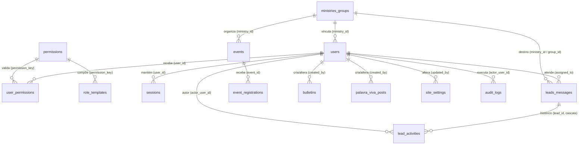
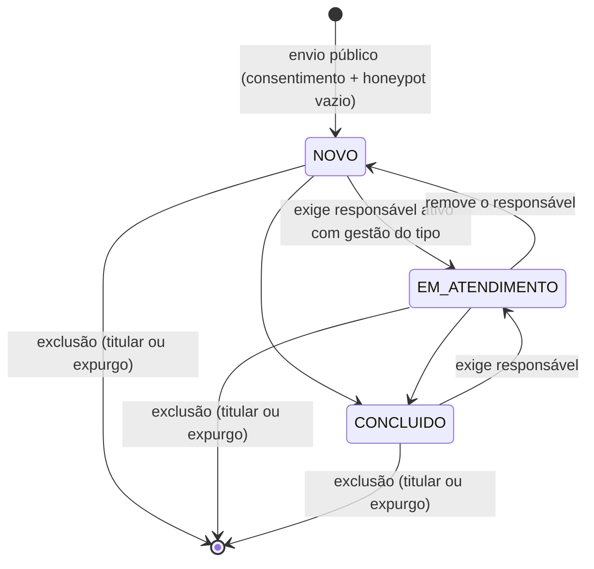
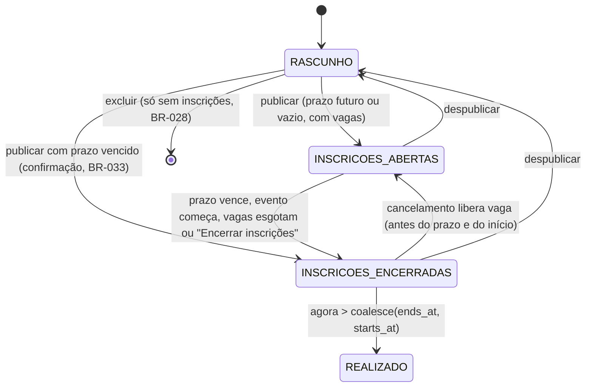

# Data Model: Novo Portal PIBLS

**Fase 1 do `/speckit.plan`** · 2026-10-20

> **Fonte**: `architecture.md` → Domain Model, Business Rules e Database Strategy → Schema Detalhado. Este arquivo organiza o modelo **por entidade da spec**, com as validações (BR-*) e as transições de estado. Em caso de divergência no tipo SQL, no índice ou na constraint, vale o `architecture.md`.

## Convenções

- **Chaves e datas**:
  - PK `id BIGINT UNSIGNED AUTO_INCREMENT`, salvo indicação;
  - datas em `DATETIME` UTC, exibidas em `America/Sao_Paulo`;
  - `created_at`/`updated_at` gerenciados pelo Eloquent.
- **Tipos**:
  - booleanos em `TINYINT(1)`;
  - enums em `VARCHAR`, com `CHECK` nomeado como reforço (o MySQL só aplica a partir do 8.0.16; a garantia principal é a aplicação).
- **Campos cifrados**: 🔒 = cast `encrypted` (ADR-016), tipo `TEXT`, nunca pesquisável.
- **Armazenamento de texto**:
  - telefones em E.164 (`+5531999998888`);
  - e-mails em minúsculas;
  - nomes com `trim` e espaços colapsados.
- **Charset**: `utf8mb4` / `utf8mb4_unicode_ci`, InnoDB, compatível com MySQL 5.7.8+ e 8.0 (ADR-007).

## Mapa entidade (spec) → tabela → módulo

| Entidade da spec | Tabela | Módulo | Exclusão |
|---|---|---|---|
| Usuário do painel | `users` | Access | Nunca (desativação) |
| Papel e Permissão | `permissions`, `role_templates`, `user_permissions` | Access | Só no phpMyAdmin |
| Ministério / Grupo / Célula de CL | `ministries_groups` | Ministries | Definitiva só sem referências |
| Boletim | `bulletins` | Content | Lógica (`deleted_at`) |
| Mensagem Palavra Viva | `palavra_viva_posts` | Content | Lógica (`deleted_at`) |
| Configurações do site e Dados PIX | `site_settings` (uma linha por chave) | Content | — (só atualização) |
| Contato | `leads_messages` | Leads | Definitiva (titular ou expurgo) |
| Registro de atendimento | `lead_activities` | Leads | Em cascata com o contato |
| Evento (R2) | `events` (+ `form_schema` JSON) | Events | Definitiva só sem inscrições |
| Campo personalizado (R2) | Elemento de `events.form_schema` | Events | — |
| Inscrição (R2) | `event_registrations` | Events | Definitiva (cancelamento, titular, expurgo) |
| Notificação | `jobs`, `failed_jobs` (Laravel) | Platform | Após envio; `failed_jobs` em 30 dias |
| Registro de auditoria | `audit_logs` | Platform | Expurgo após 24 meses |
| Consentimento | Colunas `consent_at` + `consent_version` | Leads, Events | Junto com o registro |
| Sessão | `sessions`, `password_reset_tokens` (Laravel) | Access | Expiração |

## Diagrama ER

---

## Access

### `users` — Usuário do painel

| Campo | Tipo | Regras |
|---|---|---|
| `name` | VARCHAR(120) | Obrigatório |
| `email` | VARCHAR(254) | Único (`uq_users_email`); minúsculas; login sem diferenciar maiúsculas (FR-021) |
| `password` | VARCHAR(255) | bcrypt custo 12; política BR-073 (≥ 12 caracteres, ≤ 72 bytes, fora do HIBP) |
| `ministry_id` | FK → `ministries_groups` | Opcional; base das permissões `.own`. Sem ministério, `.own` não concede nada (BR-075) |
| `is_active` | TINYINT(1) | Padrão 1; conferido em toda requisição (BR-074) |
| `password_changed_at`, `last_login_at` | DATETIME | Gravados pela aplicação |

- **Escrita pela aplicação**: só `password`, `password_changed_at` e `last_login_at`. Todo o resto é alterado só pelo phpMyAdmin (FR-029).
- **Eventos**: `PasswordResetRequested` (e-mail com link de 60 min, BR-072); `PasswordChanged` (apaga todas as sessões, enfileira "Sua senha foi alterada", gera auditoria).

### `permissions` · `role_templates` · `user_permissions`

- `permissions.key` (PK, VARCHAR(60)), `description`, `is_own_scope`. As 14 chaves entram por migration:
  - conteúdo: `boletins.write`, `mensagens.write`;
  - eventos: `eventos.write`, `eventos.write.own`, `eventos.inscricoes.read`, `eventos.inscricoes.read.own`;
  - contatos: `leads.read`, `leads.manage`, `leads.oracao.read`, `leads.oracao.manage`;
  - catálogo e configurações: `ministerios.write`, `settings.write`, `pix.write`;
  - usuários: `users.read`.
- `role_templates (role_code, permission_key)`: matriz dos 7 papéis de referência (`COMUNICACAO`, `SECRETARIA`, `TESOURARIA`, `ORACAO`, `PASTORAL`, `LIDER_MINISTERIO`, `ADMIN_TECNICO`), por migration.
- `user_permissions (user_id, role_code, permission_key)`: única; FK para o catálogo; **a aplicação nunca grava** (BR-077, teste de arquitetura).
- **Permissões efetivas** = união das linhas do usuário (aditivas, FR-027).

### `sessions` · `password_reset_tokens`

- **Sessão**: driver `database`, 60 min de inatividade, 12 h absolutas (`login_at` na sessão), id regenerado no login.
- **Revogação**: `DELETE FROM sessions WHERE user_id = ?`.
- **Token de redefinição**: guardado como hash, vale 60 min, uso único, intervalo mínimo de 60 s entre pedidos.

---

## Ministries

### `ministries_groups` — Ministério / Grupo / Célula de CL

| Campo | Tipo | Público? | Regras |
|---|---|:-:|---|
| `category` | VARCHAR(20) | ✓ | `MINISTERIO` · `GRUPO` · `CELULA` |
| `name` | VARCHAR(120) | ✓ | Obrigatório |
| `description` | MEDIUMTEXT | ✓ | `SanitizedHtml`, até 5.000 caracteres |
| `leaders_text` | VARCHAR(500) | ✓ | — |
| `schedule_text` | VARCHAR(120) | ✓ | Obrigatório para `GRUPO` e `CELULA` (BR-049) |
| `neighborhood` | VARCHAR(80) | ✓ | Obrigatório para `CELULA` (BR-049) |
| `private_address` 🔒 | TEXT | **Nunca** | Nunca sai pela API pública nem pelos snapshots (BR-048, teste obrigatório) |
| `contact_phone` | VARCHAR(16) | ✓ | E.164 |
| `contact_email` | VARCHAR(254) | **Não** | Destino das notificações de `MINISTERIO` |
| `display_order` | INT UNSIGNED | — | Padrão 0 |
| `is_active` | TINYINT(1) | — | Inativo some do site e dos formulários (FR-049) |
| `created_by`, `updated_by` | FK → `users` | — | Autoria (FR-050) |

- **Exclusão**: bloqueada se houver referência em `users`, `leads_messages` ou `events` → `409 ITEM_IN_USE` (BR-047). Caminho alternativo: desativar.
- **Efeito**: toda alteração emite `PublicContentChanged` → regenera `data/ministries.json`.

---

## Content

### `bulletins` — Boletim

| Campo | Tipo | Regras |
|---|---|---|
| `edition_number` | INT UNSIGNED | > 0; único entre os não excluídos, por coluna gerada `edition_number_active` (BR-040) |
| `reference_date` | DATE | Obrigatório; ordena a lista pública |
| `title` | VARCHAR(150) | 3 a 150 caracteres |
| `summary_text` | TEXT | Texto puro, até 5.000 |
| `pdf_path`, `pdf_size_bytes` | VARCHAR(255), INT | PDF verdadeiro (MIME real + `%PDF-`), até 10 MB (BR-041); nome aleatório de 32 hex |
| `published_at` | DATETIME | Padrão: agora; futuro = agendado (BR-042) |
| `deleted_at` | DATETIME | Exclusão lógica (ADR-009) |

**Estado derivado**: `AGENDADO` (`published_at > agora`) → `PUBLICADO` (`published_at <= agora` e não excluído) → excluído (`deleted_at`, recuperável só pelo administrador técnico).

### `palavra_viva_posts` — Mensagem Palavra Viva

| Campo | Tipo | Regras |
|---|---|---|
| `title` | VARCHAR(150) | 3 a 150 |
| `slug` | VARCHAR(160) | `^[a-z0-9]+(-[a-z0-9]+)*$`; único entre os não excluídos, por `slug_active` (BR-032) |
| `body` | MEDIUMTEXT | `SanitizedHtml`, até 50.000 caracteres (BR-046 avisa a remoção) |
| `excerpt` | VARCHAR(300) | Gerado do `body`; usado no Open Graph |
| `author_display` | VARCHAR(120) | Opcional |
| `youtube_url`, `youtube_video_id` | VARCHAR | Só hosts do YouTube (BR-044); id extraído |
| `published_at`, `deleted_at` | DATETIME | Igual ao boletim |

### `site_settings` — Configurações do site e Dados PIX

Uma linha por chave (`SettingKey`). Cada chave tem `value` em JSON, validado pelo schema da chave, e `is_public` (lista de permissão, BR-050).

| Chave | Pública | Conteúdo e regras | Permissão |
|---|:-:|---|---|
| `schedule` | ✓ | Até 20 `ScheduleItem` (`day`, `recurrence`, `activity`, `time` HH:MM, `mode`) | `settings.write` |
| `campaign_notice` | ✓ | `{active, title ≤ 80, text ≤ 500}` | `settings.write` |
| `lords_supper_notice` | ✓ | `{active, text ≤ 300}`, **manual**, sem cálculo de data (Clarificação 2) | `settings.write` |
| `address` | ✓ | `PostalAddress` (CEP com 8 dígitos) | `settings.write` |
| `map_links` | ✓ | `{google_maps_url, waze_url, embed_url}` | `settings.write` |
| `whatsapp` | ✓ | `{phone E.164, default_text}` | `settings.write` |
| `youtube_links` | ✓ | `{channel_url, live_url}` | `settings.write` |
| `social_links` | ✓ | `[{network, url}]` | `settings.write` |
| `notification_recipients` | **Não** | `{VISITANTE: [...], MEMBRO, ORACAO, CONTATO, MINISTERIO}`, até 10 e-mails válidos por tipo (BR-051); tipo vazio → aviso BR-011 | `settings.write` |
| `pix` | ✓ | `{pix_key (CNPJ, BR-061), beneficiary_name, qr_image_path (PNG/JPEG ≤ 1 MB, BR-045), copy_paste_code (EMV + CRC16, BR-062)}` | `pix.write` |

**Regras extras do PIX**:

1. `current_password` correta na mesma requisição (BR-060).
2. `PIX_ALERT_RECIPIENTS` precisa estar configurado no `.env` (BR-063).
3. Se as duas condições valem, a alteração é gravada e emite `PixSettingsChanged`, que gera:
   - auditoria com o valor anterior e o novo;
   - o alerta enfileirado.

**Efeito**: toda alteração de chave pública emite `PublicContentChanged` → regenera `data/settings.json`.

---

## Leads

### `leads_messages` — Contato

| Campo | Tipo | Regras |
|---|---|---|
| `type` | VARCHAR(20) | `VISITANTE` · `MEMBRO` · `ORACAO` · `CONTATO` · `MINISTERIO` |
| `status` | VARCHAR(20) | `NOVO` (padrão) · `EM_ATENDIMENTO` · `CONCLUIDO` |
| `name` | VARCHAR(120) | `PersonName` (2 a 120, com letra); opcional só em `ORACAO` |
| `phone` | VARCHAR(16) | `PhoneNumber` (DDD 11–99, 10 ou 11 dígitos) → E.164 |
| `email` | VARCHAR(254) | `EmailAddress` |
| `neighborhood`, `wants_visit`, `wants_cell_group` | — | Obrigatórios em `VISITANTE` |
| `group_id` | FK → `ministries_groups` | Opcional em `VISITANTE`; grupo ou célula ativos (BR-006) |
| `from_other_baptist_church` | TINYINT(1) | Obrigatório em `MEMBRO` |
| `ministry_id` | FK → `ministries_groups` | Obrigatório em `MINISTERIO`; ministério ativo (BR-006) |
| `message` 🔒 | TEXT | `ORACAO` 5–4.000 (obrigatório); `CONTATO`/`MINISTERIO` 5–2.000 (obrigatório); demais até 2.000 |
| `assigned_to` | FK → `users` | Obrigatório em `EM_ATENDIMENTO` (BR-009) |
| `consent_at`, `consent_version` | DATETIME, VARCHAR(20) | `consent = true` (BR-001); versão vigente (BR-082) |
| `status_changed_at` | DATETIME | Base da retenção |

**Campos obrigatórios por tipo** (BR-004, BR-005):

| Tipo | Obrigatórios |
|---|---|
| `VISITANTE` | `name`, `phone`, `neighborhood`, `wants_visit`, `wants_cell_group` |
| `MEMBRO` | `name`, `phone`, `from_other_baptist_church` |
| `ORACAO` | `message` |
| `CONTATO` | `name`, `message`, (`phone` **ou** `email`) |
| `MINISTERIO` | `name`, `ministry_id`, `message`, (`phone` **ou** `email`) |

**Máquina de estados** (BR-008, BR-009):

- **Transição fora da tabela**: `409 INVALID_STATUS_TRANSITION`.
- **Destaques**: "Aguardando atendimento há N dias" quando `status = NOVO` e `created_at` tem mais de 3 dias (BR-010). Responsável inativo aparece com "(inativo)" e pode ser reatribuído (BR-012).
- **Visibilidade**: `ORACAO` só com `leads.oracao.*`. Para os demais usuários, responde 404 (BR-007).
- **Ao criar**: `LeadReceived` → um job por destinatário do tipo, na mesma transação. `MINISTERIO` vai para o `contact_email` do ministério e, sem ele, para a lista do tipo. `ORACAO` vai **sem o texto**.

### `lead_activities` — Registro de atendimento

| Campo | Tipo | Regras |
|---|---|---|
| `lead_id` | FK → `leads_messages` | `ON DELETE CASCADE` |
| `actor_user_id` | FK → `users` | Autor |
| `from_status`, `to_status` | VARCHAR(20) | Preenchidos se houve mudança de status |
| `assigned_to` | BIGINT | Responsável depois da ação |
| `note` 🔒 | TEXT | Até 1.000 caracteres (BR-013) |
| `created_at` | DATETIME | — |

Só inclusão.

---

## Events (R2 — schema criado desde a F0-06)

### `events` — Evento

| Campo | Tipo | Regras |
|---|---|---|
| `title` | VARCHAR(150) | Obrigatório |
| `slug` | VARCHAR(160) | Único (BR-032) |
| `ministry_id` | FK → `ministries_groups` | Ministério ativo; com `.own`, o do usuário (BR-030) |
| `description` | MEDIUMTEXT | `SanitizedHtml`, até 20.000 |
| `excerpt` | VARCHAR(300) | Gerado; Open Graph |
| `starts_at`, `ends_at` | DATETIME | `ends_at >= starts_at` (BR-025) |
| `location` | VARCHAR(200) | Obrigatório |
| `banner_path` | VARCHAR(255) | JPEG/PNG/WebP até 3 MB (BR-045) → WebP de 1600 px e 800 px, sem EXIF |
| `max_spots` | INT UNSIGNED | NULL = ilimitado; nunca abaixo dos inscritos (BR-027) |
| `registration_deadline` | DATETIME | `<= starts_at` (BR-026); "Encerrar inscrições" = agora |
| `has_minors` | TINYINT(1) | Exige responsável legal nas inscrições (BR-023) |
| `is_published` | TINYINT(1) | Padrão 0 (rascunho) |
| `form_schema` | JSON | `FormSchema` (abaixo); `[]` sem campos |

**Estados derivados** (não gravados):

### `FormSchema` / `FormField` (value object em `events.form_schema`)

| Atributo | Regras (BR-031) |
|---|---|
| `key` | `^[a-z][a-z0-9_]{0,39}$`; única no formulário; estável depois de criada |
| `label` | Obrigatório |
| `type` | `TEXT` · `TEXTAREA` · `NUMBER` · `DATE` · `SELECT` · `MULTISELECT` · `BOOLEAN` |
| `required` | Booleano |
| `help_text` | Opcional |
| `min`, `max` | Limites para `NUMBER` e tamanho para texto |
| `options` | `SELECT`/`MULTISELECT`: 2 a 30 opções sem repetição |
| `sensitive` | Booleano opcional, padrão `false`. Marca campo que pede dado de saúde; com algum campo marcado, a inscrição exige `health_consent` (BR-083, ADR-020) |

- **Limite**: até 30 campos.
- **Mudanças com inscrições existentes**: remover um campo ou trocar o `type` exige `confirm_schema_change = true`. Sem a confirmação, a resposta é `409 SCHEMA_CHANGE_NEEDS_CONFIRMATION` (BR-029).

### `event_registrations` — Inscrição

| Campo | Tipo | Regras |
|---|---|---|
| `event_id` | FK → `events` | Evento publicado, antes do início, dentro do prazo e com vaga (BR-020, BR-021) |
| `participant_name` | VARCHAR(120) | `PersonName` |
| `participant_name_normalized` | VARCHAR(120) | Minúsculas, sem acentos, espaços colapsados |
| `phone` | VARCHAR(16) | `PhoneNumber` |
| `email` | VARCHAR(254) | Opcional; se houver, recebe a confirmação |
| `guardian_name`, `guardian_phone`, `guardian_consent_at` | — | Obrigatórios se `has_minors` (BR-023) |
| `answers` 🔒 | TEXT | JSON `[{key, label, type, value}]`, validado contra o `form_schema` vigente (BR-024); guarda o rótulo da época |
| `consent_at`, `consent_version` | — | BR-001, BR-082 |
| `health_consent_at` | DATETIME NULL | Obrigatório (não nulo) quando o `form_schema` tinha campo `sensitive` na inscrição (BR-083); `NULL` nos demais casos |

- **Unicidade**: `uq_event_registrations_person (event_id, phone, participant_name_normalized)` (BR-022).
- **Concorrência**: a transação faz `SELECT … FROM events WHERE id = ? FOR UPDATE`, conta as inscrições, compara com `max_spots` e insere.
- **Cancelamento** pelo painel: exclusão definitiva que libera a vaga (BR-034).

---

## Platform

### `audit_logs` — Registro de auditoria

| Campo | Tipo | Regras |
|---|---|---|
| `occurred_at` | DATETIME(3) | UTC |
| `actor_user_id` | FK → `users` | NULL = sistema ou anônimo |
| `action` | VARCHAR(60) | `AuditAction` (Security → Audit logs) |
| `resource_type`, `resource_id` | VARCHAR | Ex.: `lead` / `120`, `setting` / `pix` |
| `ip_address`, `user_agent`, `correlation_id` | — | `correlation_id` = ULID da requisição |
| `changes` | JSON | `{before, after}` **só com dados não pessoais** |

Só inclusão. Retenção de 24 meses (`pibls:audit:prune`).

### `jobs` · `failed_jobs` — Notificação

- O job é gravado na mesma transação da operação (*outbox*).
- O worker no agendador roda a cada 5 min, com teto de 20 jobs e 240 s.
- São 5 tentativas com *backoff*; esgotadas, o job vai para `failed_jobs`.
- `failed_jobs` é limpo em 30 dias. Mais de 10 falhas definitivas em 1 h disparam o alerta pelo Healthchecks.

### Snapshots públicos (arquivos, não tabelas)

`public_html/data/settings.json`, `ministries.json` e `home.json`. Formato em [contracts/snapshots.md](./contracts/snapshots.md).

---

## Retenção e expurgo (FR-065, Data Privacy Strategy)

| Dado | Prazo padrão (`.env`) | Base de cálculo | Ação |
|---|---|---|---|
| `ORACAO` concluído | 60 dias | `status_changed_at` | Exclusão definitiva |
| `ORACAO` nunca concluído | 90 dias | `created_at` | Exclusão definitiva |
| Demais contatos | 12 meses | `status_changed_at` | Exclusão definitiva (histórico em cascata) |
| Inscrições | 3 meses | `coalesce(ends_at, starts_at)` do evento | Exclusão definitiva |
| `failed_jobs` | 30 dias | `failed_at` | Exclusão |
| `audit_logs` | 24 meses | `occurred_at` | Exclusão (mensal) |

O expurgo diário (04:00) registra em `audit_logs` (`retention.purged`) **só as quantidades**. Prazos aprovados pela liderança em 2026-10-23 (TBD-03).

## Dados obrigatórios (seed de produção por migration idempotente)

1. `permissions`: as 14 chaves.
2. `role_templates`: a matriz dos 7 papéis.
3. `site_settings`: todas as chaves, com os valores iniciais do Guia Institucional (PRD, Apêndice A). O endereço está pendente (TBD-11).
4. `ministries_groups`: ministérios, grupos e Células de CL do Apêndice A, depois da revisão da lista canônica (TBD-11).

A fonte é `backend/database/data/initial_content.php`. **Usuários reais nunca entram por migration.**
